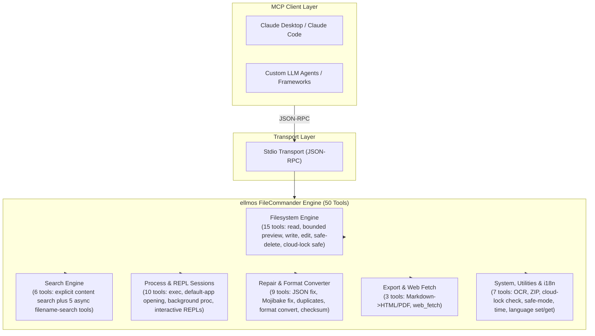
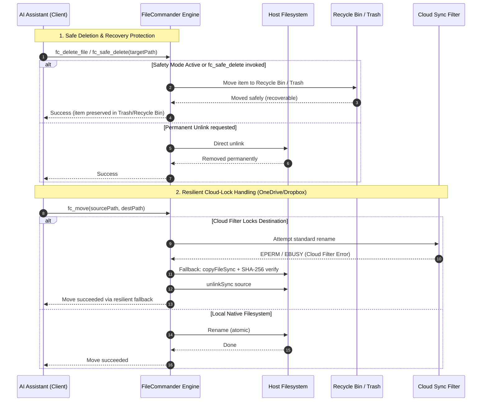

<!-- worldset: {"translated_from_sha256": "b14c4d90b205afeb948351c40f5ee76737faae530da0e8c3cec486fbe24661fa", "translator": "claude-haiku-5-5", "translated_at": "2026-10-25T07:17:11.496324+00:00", "reviewer": "gpt-6-luna/max; Root independent structure and risk samples"} -->
<p align="center">
  
</p>

# ellmos FileCommander MCP Server

[English](README.md) | [Deutsch](README_de.md) | [Español](README_es.md) | [简体中文](README_zh.md) | [日本語](README_ja.md) | [Русский](README_ru.md) | [Français](README_fr.md) | [हिन्दी](README_hi.md) | **العربية** | [বাংলা](README_bn.md) | [Português](README_pt.md)

تسرد قائمة التنقل في ملف README لغات الوثائق المتاحة في هذا المستودع. تدعم رسائل وقت التشغيل في FileCommander اللغات الألمانية (de) والإنجليزية (en) والإسبانية (es) والصينية (zh) واليابانية (ja) والروسية (ru). وتنفصل قائمة وقت التشغيل هذه عن توافر ترجمات ملف README. اضبط `FC_LANGUAGE` قبل بدء الخادم، أو استدعِ `fc_set_language` أثناء جلسة MCP نشطة. استخدم `fc_get_language` لعرض اللغة النشطة ورموز اللغات المدعومة. إذا كان `FC_LANGUAGE` غير مضبوط أو يحتوي على رمز غير مدعوم، فإن وقت التشغيل يعتمد الألمانية (de) افتراضيًا.

*جزء من عائلة [ellmos-ai](https://github.com/ellmos-ai).*

[](https://opensource.org/licenses/MIT)
[](https://github.com/ellmos-ai/ellmos-filecommander-mcp/actions/workflows/tests.yml)
[](https://www.npmjs.com/package/ellmos-filecommander-mcp)
[](https://nodejs.org/)
[](#tools-overview)
[-brightgreen.svg)](#testing)
[](SECURITY.md)
[](SECURITY.md)
[](#why-filecommander)
[](NOTICE)
[](SECURITY.md)
[](THIRD_PARTY_LICENSES.md)
[](THIRD_PARTY_LICENSES.txt)
[](https://github.com/ellmos-ai)
[](https://github.com/open-bricks)
[](llms.txt)
[](llms.txt)
[](llms.txt)

> **التنقل السريع:**
> 1. [نظرة عامة](#sec-01) | 2. [بنية النظام](#sec-02) | 3. [دورة حياة التنفيذ من البداية إلى النهاية](#sec-03) | 4. [القدرات الأساسية وثوابت الأمان](#sec-04) | 5. [الشخصيات المستهدفة وقابلية الاكتشاف](#sec-05) | 6. [التثبيت والمتطلبات الأساسية](#sec-06) | 7. [الإعداد والتكوين للعميل](#sec-07) | 8. [نظرة عامة على الأدوات (50 أداة)](#sec-08) | 9. [المصفوفة المقارنة والبدائل](#sec-09) | 10. [بادئة الأدوات واتفاقية التسمية](#sec-10) | 11. [الحوكمة وثوابت وقت التشغيل](#sec-11) | 12. [بنية الأمان ومخاطر الأدوات](#sec-12) | 13. [الاختبار وبوابات الجودة والتحقق](#sec-13) | 14. [سجل التغييرات والإصدارات](#sec-14) | 15. [قائمة SBOM من المستوى 1 وتراخيص الطرف الثالث](#sec-15) | 16. [التاريخ والتطور](#sec-16) | 17. [منظومة ellmos-ai ومصفوفة الشركاء](#sec-17) | 18. [الإشعار القانوني (§ 521 BGB) وإخلاء المسؤولية](#sec-18)
>
> | مراجع مباشرة: [🛡️ سياسة الأمان](SECURITY.md) • [🤝 المساهمة](CONTRIBUTING.md) • [⚖️ تراخيص الطرف الثالث](THIRD_PARTY_LICENSES.md) • [📄 قائمة SBOM بنص عادي](THIRD_PARTY_LICENSES.txt) • [📜 سجل التسويق](MARKETING-LOG.txt) • [🤖 سياق LLM (llms.txt)](llms.txt) • [📋 الإشعار المعتمد](NOTICE) |

خادم **بروتوكول سياق النموذج (MCP)** شامل يمنح مساعدي الذكاء الاصطناعي وصولاً كاملاً إلى نظام الملفات، والبحث المحدود عن المحتوى عبر ملفات متعددة، وإدارة العمليات، وجلسات الصدفة التفاعلية، وإمكانيات البحث غير المتزامن عن أسماء الملفات.

**50 أداة** في خادم واحد - كل ما يحتاجه وكيل الذكاء الاصطناعي للتفاعل مع النظام المحلي.

**كلمات مفتاحية للاكتشاف:** خادم MCP لنظام الملفات المحلي، وMCP للبحث عن المحتوى عبر ملفات متعددة، وMCP للحذف الآمن، وخادم MCP لسلة المحذوفات، وMCP لإدارة العمليات، وصدفة MCP التفاعلية، والبحث غير المتزامن عن الملفات لوكلاء الذكاء الاصطناعي، وعمليات الملفات الآمنة من قفل السحابة، وMCP للتحويل من Markdown إلى PDF، وخادم MCP للتعرف الضوئي على الحروف، وMCP لأرشيفات ZIP.

**حالة السجلات:** منشور على [npm](https://www.npmjs.com/package/ellmos-filecommander-mcp)، ومفهرس في [jsDelivr](https://www.jsdelivr.com/package/npm/ellmos-filecommander-mcp)، ومرئي على [LobeHub](https://lobehub.com/mcp/ellmos-ai-ellmos-filecommander-mcp)، ومدرج في [Glama](https://glama.ai/mcp/servers/ellmos-ai/ellmos-filecommander-mcp)، ومُعد للسجل الرسمي لـ MCP عبر [`server.json`](server.json). ما تزال بعض الأدلة التابعة لجهات خارجية تعرض بيانات وصفية قديمة تشير إلى 43 أداة، لذا ينبغي أن تبقى بيانات README وnpm المعتمدة هي المرجع حتى يكتمل إعادة الفهرسة لديها.

> [!NOTE]
> **لوكلاء الذكاء الاصطناعي وتكاملات LLM:**
> يوفر FileCommander **50 أداة متخصصة** يمكن الوصول إليها عبر نقل stdio القياسي. تستخدم جميع أسماء الأدوات البادئة `fc_` لمنع تضارب مساحات الأسماء. بالنسبة إلى LLMs، تتوفر نظرات عامة مضغوطة على السياق والمخطط في [`llms.txt`](llms.txt) و[`server.json`](server.json).

---

<a id="sec-01"></a><a id="overview"></a><a id="why-filecommander"></a><a id="ueberblick"></a><a id="überblick"></a>
## نظرة عامة ولماذا FileCommander؟

تقتصر معظم خوادم MCP الخاصة بنظام الملفات على عمليات القراءة والكتابة الأساسية. يتجاوز FileCommander ذلك:

- **الحذف الآمن** - ينقل الملفات إلى سلة المحذوفات (Windows) أو سلة المهملات (macOS/Linux) بدلاً من الحذف النهائي
- **الجلسات التفاعلية** - بدء وتفاعل مع REPLs (Python وNode.js والأوامر الطرفية) عبر بروتوكول MCP
- **البحث غير المتزامن** - البحث في أشجار المجلدات الكبيرة في الخلفية بينما يواصل الذكاء الاصطناعي عمله
- **البحث الصريح في المحتوى** - البحث عن نص حرفي أو تعبير نمطي عبر قائمة محدودة من الملفات دون تكرار أو توسيع للأنماط العامة (glob)
- **إدارة العمليات** - عرض العمليات النظامية وبدءها وإنهاؤها
- **الاستبدال النصي** - تحرير الملفات بمطابقة سلاسل نصية فريدة مع التحقق من السياق
- **تحويل التنسيقات** - التحويل بين JSON وCSV وINI وYAML وTOML وXML وTOON
- **أرشيفات ZIP** - إنشاء أرشيفات ZIP واستخراجها وعرضها
- **مجاميع التحقق للملفات** - تجزئة MD5 وSHA-1 وSHA-256 وSHA-384 وSHA-512 مع المقارنة
- **التعرف الضوئي على الحروف (OCR)** - استخراج النص من الصور (اعتماد اختياري على tesseract.js)
- **وضع الأمان** - تبديل يوجّه جميع عمليات الحذف عبر سلة المحذوفات / سلة المهملات
- **تصدير Markdown** - تحويل Markdown إلى HTML/PDF احترافي مع كتل الشيفرة والجداول والقوائم المتداخلة والاقتباسات
- **آمن مع أقفال السحابة** - استعادة تلقائية بالنسخ ثم الحذف عندما تمنع مرشحات مزامنة السحابة (OneDrive وDropbox وGoogle Drive وiCloud) عمليات إعادة التسمية
- **تشخيص أقفال السحابة** - التحقق مما إذا كان المسار معرضاً لتعارضات مرشحات المزامنة قبل التشغيل
- **متعدد المنصات** - يعمل على Windows وmacOS وLinux مع تحسينات خاصة بكل منصة

---

<a id="sec-02"></a><a id="system-architecture"></a><a id="systemarchitektur"></a>
## بنية النظام

### الطوبولوجيا المعمارية بأربعة مناظير بصيغة ASCII

```text
+--------------------------------------------------------------------------------------------------+
|                            ELLMOS FILECOMMANDER MCP ARCHITECTURAL TOPOLOGY                       |
+--------------------------------------------------------------------------------------------------+
| [VIEW 1: CALLER RUNTIMES & AGENT CLIENTS]                                                        |
|   * Autonomous Agents   : Claude Code, OpenAI Codex, Antigravity / Gemini, Kimi, Cursor          |
|   * Agent Frameworks    : AutoGen, CrewAI, LangChain, LlamaIndex, Custom Python / TS Clients    |
|   * Transport Protocols : Model Context Protocol (MCP stdio), JSON-RPC 2.0 Framing               |
|   * Tool Surface        : 50 Unified Specialized Tools (fc_* namespace collision isolation)       |
|   * Schema Contract     : Stdio transport, dynamic runtime i18n parameter parsing (Zod validated)|
+--------------------------------------------------------------------------------------------------+
|                                                |                                                 |
|                                                v                                                 |
+--------------------------------------------------------------------------------------------------+
| [VIEW 2: FILECOMMANDER MCP CORE ENGINE & DISPATCH ORCHESTRATOR]                                  |
|   * Protocol Dispatch   : ESM stdio router with Zod schema validation & parameter checking      |
|   * Multilingual Core   : 6-language dynamic runtime i18n (de, en, es, zh, ja, ru) engine       |
|   * Safety Interceptor  : Global Safety Mode (fc_set_safe_mode) routing deletes to Recycle Bin   |
|   * Sync Diagnostics    : Reparse point detection & cloud filter diagnostics (fc_check_cloud_lock)|
|   * Process Supervisor  : Bounded child process lifecycle management & interactive REPL session  |
|                           state registry with circular ring buffers                              |
+--------------------------------------------------------------------------------------------------+
|                                                |                                                 |
|                                                v                                                 |
+--------------------------------------------------------------------------------------------------+
| [VIEW 3: FILESYSTEM RUNTIME, FORMAT REPAIR & PROCESS ISOLATION]                                  |
|   * Atomic File Ops     : Read, write, line edit, exact literal string replacement (fc_str_replace)|
|   * Cloud-Lock Fallback : Automatic copyFileSync + SHA-256 verify + unlinkSync on EPERM / EBUSY   |
|   * Bounded Inspection  : Metadata-first preview (fc_preview_file, 1 MiB inline content ceiling)  |
|   * Bounded Content Srch: max 50 explicit files, 10 MB ceiling, token redaction (INV-MASK-06)   |
|   * Self-Healing Repair : Mojibake repair (27+ UTF-8 patterns), JSON syntax fix, file cleanup    |
|   * Lossless Converter  : Declarative transformation across 7 formats (JSON, YAML, TOML, XML...) |
|   * Media & Documents   : Headless Markdown to PDF/HTML, ZIP archive engine, optional OCR (Tess)  |
+--------------------------------------------------------------------------------------------------+
|                                                |                                                 |
|                                                v                                                 |
+--------------------------------------------------------------------------------------------------+
| [VIEW 4: AIR-GAP DEFENSE PERIMETER, RUNASINVOKER & CONTROLLED EGRESS]                            |
|   * Execution Privilege : RunAsInvoker unprivileged user-mode (Zero administrative elevation)    |
|   * Transport Boundary  : 100% Local stdio transport, zero telemetry, zero open listening ports  |
|   * Controlled Egress   : Outbound HTTP(S) strictly gated through caller-invoked fc_web_fetch     |
|   * Network Safety      : SSRF guard blocking private/internal IP ranges (allow_private override) |
|   * Governance & Supply : Level 1 SBOM, 100% permissive runtime (MIT/BSD), 48h Security SLA      |
+--------------------------------------------------------------------------------------------------+
```

### مخطط تدفق المكونات



---

<a id="sec-03"></a><a id="end-to-end-execution-lifecycle"></a><a id="execution-lifecycle"></a><a id="end-to-end-ausfuehrungszyklus"></a>
## دورة حياة التنفيذ من البداية إلى النهاية



---

<a id="sec-04"></a><a id="core-capabilities--safety-invariants"></a><a id="core-capabilities"></a><a id="kernfaehigkeiten--sicherheitsinvarianten"></a><a id="kernfähigkeiten--sicherheitsinvarianten"></a>
## القدرات الأساسية وثوابت الأمان

| القدرة / الثابت | الضمان وتفاصيل التنفيذ | الفائدة الأمنية والتشغيلية |
|------------------------|-----------------------------------|--------------------------------|
| **الإدخال والإخراج القياسي المحلي (stdio) والخروج الصريح للشبكة** | ينفذ نقل MCP عبر الإدخال والإخراج القياسي المحلي، دون أي قياس عن بُعد ودون أي خروج تلقائي إلى الشبكة. `fc_web_fetch` يُجري طلبات HTTP(S) الصادرة فقط عندما يستدعيه عميل بشكل صريح، وتُحظر الأهداف الخاصة افتراضيًا ما لم يُفعَّل `allow_private`. | يجعل حدود الشبكة مرئية للعملاء مع الإبقاء على نقل خادم محلي لا يعتمد على المنافذ. |
| **الحذف الآمن وحماية سلة المهملات** | ينقل `fc_safe_delete` العناصر إلى سلة المحذوفات في Windows / سلة المهملات في macOS / سلة FreeDesktop Trash في Linux. ويوجّه `fc_set_safe_mode` جميع عمليات الحذف بشكل آمن. | يمنع فقدان البيانات غير القابل للاسترداد نتيجة عمليات الحذف العودية أو الجماعية العرضية. |
| **النقل المقاوم لقفل السحابة (`fc_move`)** | اكتشاف تلقائي لمرشحات المزامنة السحابية (OneDrive وDropbox ونقاط إعادة التحليل في iCloud) مع الرجوع السلس إلى آلية النسخ ثم التحقق ثم الحذف. | يُلغي حالات الفشل `EPERM` / `EBUSY` أثناء عمليات الوكلاء الآلية في أدلة المزامنة. |
| **تشخيص قفل السحابة (`fc_check_cloud_lock`)** | تقرير للقراءة فقط يتضمن سياق المسار السحابي الثابت مع وجود الهدف ونوعه؛ ويُذكر صراحةً أن ترطيب Cloud Files ومقابض العمليات لم يُفحصا عند عدم توفرهما. | يتمكن الوكلاء من التمييز بين خطر OneDrive الثابت وقفل إعادة التسمية الفعلي المكتشف. |
| **البحث المحدود في محتوى ملفات متعددة** | يحدد `fc_search_content` المدخلات بدقة (50 ملفًا صريحًا كحد أقصى، و10 ميغابايت لكل ملف، و200 تطابق، و200 ألف حرف) دون تكرار بالنمط العام (glob). | يمنع أخطاء نفاد الذاكرة وتوقف المعالج الكامل أثناء عمليات البحث الكبيرة في المستودعات. |
| **الإخفاء التلقائي للأسرار والرموز** | تُخفي مقتطفات نتائج البحث في المحتوى تلقائيًا مفاتيح واجهات البرمجة الشائعة، ورموز Bearer، وبيانات اعتماد AWS، وترويسات التفويض. | يمنع تلوث سياق نموذج LLM وتسرب بيانات الاعتماد عرضًا في سجل المطالبات. |
| **جلسات REPL التفاعلية وعزل الجلسات** | جلسات تفاعلية ذات حالة (`fc_start_session` و`fc_send_input` و`fc_read_output`) لكل من Python وNode.js وbash وPowerShell مع مخازن مؤقتة محدودة. | يتيح تصحيح الأخطاء عبر REPL في حوارات متعددة الأدوار دون تراكم غير محدود لعمليات الخلفية. |
| **محرك التحويل متعدد الصيغ دون فقدان** | تحويل تصريحي (`fc_convert_format`) عبر 7 صيغ مهيكلة (JSON وYAML وTOML وXML وCSV وINI وTOON). | توحيد نظيف للبيانات عبر ملفات الإعداد المتباينة دون فقدان للبيانات. |
| **محرك إصلاح الترميز والملفات (Mojibake)** | يُصلح `fc_fix_encoding` و`fc_fix_json` و`fc_cleanup_file` ترميز UTF-8 التالف (أكثر من 27 نمطًا)، وأخطاء بنية JSON المشوهة، وعلامات BOM، وبايتات NUL. | خطوط معالجة ذاتية الإصلاح للملفات التالفة المُنشأة عبر أنظمة تشغيل مختلفة. |
| **التنفيذ غير المُصعَّد دون صلاحيات مرتفعة** | مصمم ومُتحقَّق منه للعمل في وضع المستخدم العادي غير المميز. لا يتطلب أبدًا صلاحيات المسؤول أو root. | حد أدنى من سطح الهجوم؛ ويلتزم بمبدأ أقل الامتيازات. |
| **محرك الترجمة الفورية للبيئة التشغيلية بست لغات** | تبديل ديناميكي للغة واستبطان لها (`fc_set_language` و`fc_get_language`) للألمانية (`de`) والإنجليزية (`en`) والإسبانية (`es`) والصينية (`zh`) واليابانية (`ja`) والروسية (`ru`). | تجربة مطور متعددة اللغات أصيلة، وتقارير أخطاء مترجمة محليًا. |
| **مصفوفة متعددة الأنظمة المُتحقَّق منها** | مُختبرة على Windows وUbuntu Linux وmacOS مع Node.js 20 و22 و24، مع 292 تأكيدًا آليًا. | توافق مستمر عبر المنصات وموثوقية. |

---

<a id="sec-05"></a><a id="target-personas--discoverability"></a><a id="target-personas"></a><a id="zielgruppen--auffindbarkeit"></a>
## الشخصيات المستهدفة وسهولة الاكتشاف

صُمّم FileCommander خصيصًا وتم التحقق منه لأربع شخصيات أساسية: المطوّر، والوكيل الذكي، وفريق العمليات.

### [PERSONA-01] وكلاء البرمجة الذكيون المستقلون وأسراب نماذج اللغة الكبيرة
- **الملف التعريفي:** أسراب متعددة الوكلاء وبيئات تشغيل وكيلية مستقلة (Claude Code وAntigravity/Gemini وOpenAI Codex وAutoGen وCrewAI) تنفّذ تحرير الشيفرة التكراري وإعادة هيكلة المشاريع وتدقيق الأدلة.
- **نقاط الألم التشغيلية الرئيسية:** الانتفاخ السريع لنافذة السياق الناجم عن قراءة ملفات بحجم عدة ميغابايت، وتعطّل العمليات غير المعالَج بسبب الملفات المقفلة (`EPERM`/`EBUSY`) في المجلدات المتزامنة مع السحابة، وتلف المستودع الذي لا يمكن استرداده بسبب روتينات التنظيف العرضية لـ `rm -rf`.
- **حل FileCommander:**
  - `fc_preview_file`: فحص يبدأ بالبيانات الوصفية مع سقف صارم للمحتوى المضمّن بحجم 1 MiB يمنع تضخم سياق نموذج اللغة الكبير.
  - `fc_search_content`: بحث محدود متعدد الملفات (بحد أقصى 50 ملفًا، و10 MB لكل ملف، و200 تطابق) مع إخفاء تلقائي للأسرار والرموز المميزة.
  - `fc_safe_delete` و`fc_set_safe_mode`: الحفاظ على الملفات المحذوفة في سلة المحذوفات بنظام التشغيل لعمليات ملفات بلا مخاطر.
  - `fc_move` و`fc_check_cloud_lock`: نسخ تلقائي مع التحقق عبر SHA-256 والرجوع إلى إلغاء الربط عند أقفال الملفات، لمنع فشل الوكيل.

### [PERSONA-02] مهندسو DevOps وسلاسل الأدوات وأتمتة الأجهزة المتعددة
- **الملف التعريفي:** مهندسو أنظمة وأتمتة يبنون أدوات سطر أوامر متعددة المنصات، وخطوط تحقق CI/CD، وسكربتات مزامنة عبر أجهزة متعددة على Windows وLinux وmacOS.
- **نقاط الألم التشغيلية الرئيسية:** دلالات أنظمة تشغيل غير متجانسة (الشرطات المائلة العكسية في Windows مقابل الشرطات المائلة في POSIX، وتلف نهايات الأسطر، وصياغة خاصة بكل صدفة)، وعمليات أبناء ميتة (Zombie)، وقفل الملفات في مساحات العمل المشتركة على OneDrive أو Dropbox.
- **حل FileCommander:**
  - دلالات أداة موحدة عبر Windows وLinux وmacOS.
  - جلسات REPL تفاعلية ذات حالة (`fc_start_session` و`fc_send_input` و`fc_read_output`) مع مخازن دائرية محدودة بحلقات.
  - إعادة تسمية الملفات بالدفعات (`fc_batch_rename`) والبحث في المجلدات في الخلفية (`fc_start_search` و`fc_get_search_results`).
  - إدارة دورة حياة العمليات (`fc_execute_command` و`fc_start_process` و`fc_kill_process`) دون تسرب عمليات.

### [PERSONA-03] مسؤولو SecOps والحوكمة والامتثال
- **الملف التعريفي:** مسؤولو أمن ومدققو امتثال وفرق خصوصية يشرفون على تكاملات أدوات الذكاء الاصطناعي في البيئات المؤسسية والإنتاجية.
- **نقاط الألم التشغيلية الرئيسية:** منارات قياس عن بُعد في الخلفية غير مُفصح عنها، ووصول شبكي غير مُدقَّق من الإضافات المحلية، وتسرب بيانات الاعتماد والرموز المميزة إلى تدريب النماذج أو سجلات الأوامر، وتصعيد امتيازات المستخدم غير المميز.
- **حل FileCommander:**
  - نقل stdio محلي بصفر قياس عن بُعد تمامًا وصفر منافذ استماع شبكية مفتوحة.
  - خروج شبكي صادر صريح مقتصر تمامًا على `fc_web_fetch` الذي يستدعيه المتصل (العناوين الداخلية/الخاصة محظورة افتراضيًا).
  - إخفاء تلقائي للأسرار ورموز Bearer في مقتطفات البحث (`INV-MASK-06`).
  - تنفيذ صارم بمستخدم غير مميز (`INV-PROC-09`) واتفاقية مستوى خدمة ملزمة للاستجابة للثغرات خلال 48 ساعة (`security@open-bricks.org` و`security@ellmos.ai`).

### [PERSONA-04] مهندسو المنصات المؤسسية ومطورو خطوط البيانات
- **الملف التعريفي:** مهندسو حلول ومهندسو بيانات يدمجون الملفات المحلية، ويوحّدون صيغ الإعداد غير المتجانسة، ويتحققون من تجزئات التشفير، ويولّدون التقارير.
- **نقاط الألم التشغيلية الرئيسية:** انتشار خوادم MCP التي تتطلب من 4 إلى 6 خوادم منفصلة أحادية الغرض، وتلف تسلسلات بايتات UTF-8 (Mojibake) عبر الأدوات، وسكربتات تحليل مخصصة.
- **حل FileCommander:**
  - نشر شامل لخادم واحد يضم 50 أداة، يلغي انتشار الخوادم المتعددة وعبء العمليات.
  - تحويل تصريحي بلا فقد عبر 7 صيغ منظمة (`fc_convert_format`: JSON وYAML وTOML وXML وCSV وINI وTOON).
  - محركات إصلاح ملفات مدمجة (`fc_fix_encoding` و`fc_fix_json` و`fc_cleanup_file`) لخطوط أنابيب ذاتية الإصلاح.
  - مجاميع تشفيرية (`fc_checksum`: SHA-256 وSHA-512 وMD5 وSHA-1) وعرض Markdown إلى PDF/HTML (`fc_md_to_pdf` و`fc_md_to_html`).

### استعلامات البحث عالية القصد ومتجهات قابلية الاكتشاف

- **استعلامات البحث الأساسية:** `ellmos-filecommander-mcp` و`FileCommander MCP` و`filesystem MCP server` و`multi-file content search MCP` و`safe delete MCP` و`async file search MCP` و`process management MCP` و`Markdown PDF MCP`.
- **البيانات الوصفية القابلة للقراءة آليًا:** يُحفظ السياق المنظَّم لوكلاء الذكاء الاصطناعي في [`llms.txt`](llms.txt) وَ[`server.json`](server.json) وَ[`glama.json`](glama.json).
- **الامتثال والإسناد:** جرى التحقق منه مقابل [`THIRD_PARTY_LICENSES.md`](THIRD_PARTY_LICENSES.md) وَ[`NOTICE`](NOTICE).

---

<a id="sec-06"></a><a id="installation"></a><a id="installation-prerequisites"></a>
## التثبيت

### المتطلبات الأساسية

- [Node.js](https://nodejs.org/) الإصدار 20 أو أحدث
- npm

### الخيار 1: التثبيت من NPM

```bash
npm install -g ellmos-filecommander-mcp
```

### الخيار 2: التثبيت من المصدر

```bash
git clone https://github.com/ellmos-ai/ellmos-filecommander-mcp.git
cd ellmos-filecommander-mcp
npm ci
npm run build
```

---

<a id="sec-07"></a><a id="configuration"></a><a id="client-setup"></a><a id="konfiguration"></a>
## الإعدادات

### Claude Desktop

أضِف إلى `claude_desktop_config.json`:

**Windows:** `%APPDATA%\Claude\claude_desktop_config.json`
**macOS:** `~/Library/Application Support/Claude/claude_desktop_config.json`

#### إذا تم التثبيت عالميًا عبر NPM:

```json
{
  "mcpServers": {
    "filecommander": {
      "command": "ellmos-filecommander"
    }
  }
}
```

#### إذا تم التثبيت من المصدر:

```json
{
  "mcpServers": {
    "filecommander": {
      "command": "node",
      "args": ["/absolute/path/to/filecommander-mcp/dist/index.js"]
    }
  }
}
```

أعِد تشغيل Claude Desktop بعد الحفظ.

### عملاء MCP الآخرون

يتواصل الخادم عبر **نقل stdio**. وجِّه عميل MCP الخاص بك إلى مدخل `dist/index.js` أو إلى الملف التنفيذي `ellmos-filecommander`.

---

<a id="sec-08"></a><a id="tools-overview"></a><a id="available-tools"></a><a id="tools-uebersicht"></a><a id="tools-übersicht"></a>
## نظرة عامة على الأدوات

### عمليات نظام الملفات (15 أداة)

| الأداة | الوصف |
|------|-------------|
| `fc_read_file` | قراءة محتويات الملف مع حد اختياري للأسطر |
| `fc_preview_file` | فحص نوع MIME والحجم أولًا، ثم طلب محتوى MCP مضمّن ومحدود بشكل صريح |
| `fc_read_multiple_files` | قراءة ما يصل إلى 20 ملفًا في استدعاء واحد |
| `fc_write_file` | الكتابة/الإنشاء/الإلحاق في الملفات |
| `fc_edit_file` | تحرير قائم على الأسطر (استبدال الأسطر وإدراجها وحذفها) |
| `fc_str_replace` | استبدال سلسلة نصية فريدة في ملف مع التحقق من السياق |
| `fc_list_directory` | عرض محتويات الدليل (تكراري، بعمق قابل للتهيئة) |
| `fc_create_directory` | إنشاء الأدلة (بما فيها الأصول الأبوية) |
| `fc_delete_file` | حذف ملف (نهائيًا) |
| `fc_delete_directory` | حذف دليل (مع علم تكراري اختياري) |
| `fc_safe_delete` | النقل إلى سلة المحذوفات / سلة المهملات (قابل للاسترداد!) |
| `fc_move` | نقل الملفات والأدلة أو إعادة تسميتها (آمن مع أقفال السحابة) |
| `fc_copy` | نسخ الملفات والأدلة |
| `fc_file_info` | الحصول على بيانات وصفية مفصلة للملف (الحجم، التواريخ، النوع) |
| `fc_search_files` | البحث المتزامن عن الملفات باستخدام أنماط البدل |

`fc_preview_file` هو البديل عن بُعد/بدون واجهة للملفات المحلية. تُرجع استدعاؤه الافتراضي بيانات وصفية منظَّمة فقط: المسار المحلول، وURI الخاص بـ `file://`، ونوع MIME، وحجم البايتات، ونوع المعاينة، والحد الثابت البالغ 1 MiB، والاستدعاء اللاحق الدقيق. لا يُقرأ المحتوى إلا بعد `include_content=true`. تستخدم الملفات النصية والصور النقطية المؤهلة كتل محتوى MCP القياسية `text`/`image`؛ وتستخدم ملفات PDF `resource` مضمّنًا ومحدودًا. تبقى الملفات التي تتجاوز 1 MiB والأنواع غير المدعومة بيانات وصفية فقط، ولا تُقرأ أو تُرمَّز بـ Base64 أبدًا بواسطة مسار المعاينة.

### البحث في المحتوى (أداة واحدة)

| الأداة | الوصف |
|------|-------------|
| `fc_search_content` | بحث للقراءة فقط بسلسلة حرفية أو تعبير نمطي ضمن قائمة مرتبة وصريحة من الملفات، مع حدود للحالة والسياق والنتائج العامة ولكل ملف |

لا يوسّع `fc_search_content` البدل أبدًا، ولا يجتاز الأدلة، ولا يكتشف الملفات بشكل تكراري. يقبل 50 ملف نصي UTF-8 صريحًا كحد أقصى، ويتخطى الملفات الثنائية والملفات التي تتجاوز 10 MB، ويُرجع JSON حتميًا. تقتصر المطابقات على 200 على المستوى العام و100 لكل ملف، والسياق على 10 أسطر، والمقتطفات على 500 حرف، والمخرجات المتسلسلة على 200,000 حرف. يُبلَّغ عن حالات الفشل المتعلقة بالملفات المفقودة أو الخاصة بالسحابة فقط أو الأذونات أو الترميز أو الملفات الثنائية أو الحجم لكل ملف، بحيث تنتج الملفات القابلة للقراءة نتائج. تُخفى تنسيقات الأسرار الشائعة من المقتطفات.

### البحث غير المتزامن (5 أدوات)

| الأداة | الوصف |
|------|-------------|
| `fc_start_search` | بدء بحث في الخلفية (يُرجع فورًا) |
| `fc_get_search_results` | استرجاع النتائج مع ترقيم الصفحات |
| `fc_stop_search` | إلغاء بحث قيد التشغيل |
| `fc_list_searches` | عرض جميع عمليات البحث النشطة/المكتملة |
| `fc_clear_search` | إزالة عمليات البحث المكتملة من الذاكرة |

### إدارة العمليات (5 أدوات)

| الأداة | الوصف |
|------|-------------|
| `fc_execute_command` | تنفيذ أمر شل (حاجب، مع مهلة زمنية) |
| `fc_start_process` | بدء عملية في الخلفية (غير حاجبة) |
| `fc_open_path` | التحقق من ملف أو دليل محلي موجود وفتحه بالتطبيق الافتراضي لنظام التشغيل |
| `fc_list_processes` | عرض عمليات النظام قيد التشغيل |
| `fc_kill_process` | إنهاء عملية بواسطة PID أو الاسم |

يقبل `fc_open_path` ملفًا أو دليلًا موجودًا فقط، ويرسله إلى مشغّل أصلي ثابت للتطبيق الافتراضي. تُبلغ نتيجته المنظَّمة عن `launcher_accepted=true|false`، وتُبلغ دائمًا عن `user_visible="unknown"`، وتحدد بديلًا قابلًا للقراءة آليًا: `fc_preview_file` مع وسائط بيانات وصفية فقط للملفات، أو `fc_list_directory` للأدلة. لا يدّعي قبول المشغّل أن واجهة رسومية أصبحت مرئية. أما `fc_start_process` فيتيح للمستدعي اختيار ملف تنفيذي ووسائطه. يقبل `fc_execute_command` أمر شل تعسفيًا: يُستخدم شل Node الافتراضي للأوامر العادية (`COMSPEC`/`cmd.exe` على Windows)، بينما يمكن لمسار الأحرف الخاصة في Windows لدى FileCommander أن يوجّه عبر Windows PowerShell.

### الجلسات التفاعلية (5 أدوات)

| الأداة | الوصف |
|------|-------------|
| `fc_start_session` | بدء عملية تفاعلية (Python وNode والصدفة...) |
| `fc_read_output` | قراءة مخرجات الجلسة |
| `fc_send_input` | إرسال مدخلات إلى جلسة قيد التشغيل |
| `fc_list_sessions` | عرض جميع الجلسات |
| `fc_close_session` | إنهاء جلسة |

### صيانة الملفات وإصلاحها (9 أدوات)

| الأداة | الوصف |
|------|-------------|
| `fc_fix_json` | إصلاح JSON التالف (BOM، والفواصل الزائدة، والتعليقات، والاقتباسات المفردة) |
| `fc_validate_json` | التحقق من JSON مع موضع الخطأ وسياقه بالتفصيل |
| `fc_cleanup_file` | إزالة BOM وبايتات NUL والمسافات الزائدة في نهاية الأسطر، وتوحيد نهايات الأسطر |
| `fc_fix_encoding` | إصلاح Mojibake / ترميز UTF-8 المضاعف (أكثر من 27 نمطًا من الأحرف) |
| `fc_folder_diff` | تتبع تغييرات الدليل باستخدام اللقطات (جديد/معدّل/محذوف) |
| `fc_batch_rename` | إعادة تسمية الدفعات المستندة إلى الأنماط (بادئة/لاحقة، واستبدال، واكتشاف تلقائي) |
| `fc_convert_format` | التحويل بين تنسيقات JSON وCSV وINI وYAML وTOML وXML وTOON |
| `fc_detect_duplicates` | البحث عن الملفات المكررة باستخدام تجزئة SHA-256 |
| `fc_checksum` | تجزئة الملفات (MD5 وSHA-1 وSHA-256 وSHA-384 وSHA-512) مع خيار المقارنة |

### الأرشيف (أداة واحدة)

| الأداة | الوصف |
|------|-------------|
| `fc_archive` | إنشاء أرشيفات ZIP واستخراجها وسردها |

### التعرف الضوئي على الحروف (أداة واحدة)

| الأداة | الوصف |
|------|-------------|
| `fc_ocr` | استخراج النص من الصور عبر tesseract.js (تبعية اختيارية) |

### المزامنة السحابية (أداة واحدة)

| الأداة | الوصف |
|------|-------------|
| `fc_check_cloud_lock` | الإبلاغ عن السياق الثابت لمزامنة السحابة وحالة الهدف؛ لا تدّعِ قفلًا نشطًا دون دليل (Windows) |

### النظام (4 أدوات)

| الأداة | الوصف |
|------|-------------|
| `fc_get_time` | الحصول على الوقت الحالي للنظام مع معلومات المنطقة الزمنية |
| `fc_set_safe_mode` | تبديل الوضع الآمن: تمر جميع عمليات الحذف عبر سلة المحذوفات / سلة المهملات |
| `fc_set_language` | تعيين لغة وقت التشغيل (`de`، أو `en`، أو `es`، أو `zh`، أو `ja`، أو `ru`) |
| `fc_get_language` | قراءة لغة وقت التشغيل النشطة وجميع رموز اللغات المدعومة |

### التصدير (أداتان)

| الأداة | الوصف |
|------|-------------|
| `fc_md_to_html` | تحويل Markdown إلى HTML مستقل مع تنسيق CSS (العناوين، وكتل الأكواد، والجداول، والقوائم المتداخلة، والاقتباسات، والصور، ومربعات الاختيار) |
| `fc_md_to_pdf` | تحويل Markdown إلى PDF عبر متصفح بلا واجهة (Edge/Chrome). يتراجع إلى HTML إذا لم يتوفر متصفح |

### الويب (أداة واحدة)

| الأداة | الوصف |
|------|-------------|
| `fc_web_fetch` | جلب صفحة ويب وإرجاع المحتوى حسب `mode`: extract (النص الرئيسي النظيف)، أو raw (جسم HTTP)، أو links، أو forms، أو headers. أداة شبكة للقراءة فقط؛ يحظر حارس SSRF الأهداف الداخلية/الخاصة افتراضيًا. |

**الإجمالي: 50 أداة**

---

<a id="sec-09"></a><a id="comparative-matrix--alternatives"></a><a id="comparative-matrix"></a><a id="comparison-with-alternatives"></a><a id="vergleichsmatrix--alternativen"></a>
## المصفوفة المقارنة والبدائل

يجمع FileCommander بين معالجة نظام الملفات، والبحث المحدود، والتحكم في العمليات، وإصلاح البيانات، وتحويل التنسيقات، وعرض المستندات في واجهة MCP موحدة. فيما يلي مقارنة معمارية بالبدائل القياسية عبر 10 أبعاد تشغيلية رئيسية:

| معيار التشغيل | ellmos FileCommander MCP (50 أداة) | Official Filesystem MCP (`@modelcontextprotocol/server-filesystem`) | Desktop Commander MCP | الصدفة المباشرة للمضيف (`bash` / PowerShell) | النصوص المخصصة وواجهات برمجة السحابة |
|-----------------------|:-----------------------------------:|:------------------------------------------------------------------:|:---------------------:|:---------------------------------------:|:---------------------------:|
| **اتساع الأدوات ونطاقها** `[INV-PROC-09]` | **50 أداة موحدة** عبر 6 مجالات | ~11 أداة أساسية لإدخال الملفات وإخراجها | ~15 أداة (ملفات + عمليات) | أوامر CLI غير مقيدة | نصوص مجزأة مصممة خصيصًا |
| **الحذف الآمن والاستعادة** `[INV-SAFE-02]` | **سلة المحذوفات / المهملات الأصلية لنظام التشغيل** (`fc_safe_delete`، وضع الأمان) | حذف دائم فقط (`unlink`) | حذف دائم فقط | `rm -rf` / `Remove-Item` غير قابل للتراجع | تطبيقات سلة مهملات مخصصة |
| **مرونة القفل السحابي والمزامنة** `[INV-LOCK-03]` | **تراجع تلقائي** (نسخ + التحقق عبر SHA-256 + فك الربط عند EPERM/EBUSY) | يفشل مع الملفات المقفلة ونقاط إعادة التحليل | يفشل مع الملفات المقفلة | يفشل أو يُحجب إلى أجل غير مسمى | تعارض المزامنة / نسخ التعارض |
| **البحث المحدود وتنقيح الأسرار** `[INV-SRCH-05 / INV-MASK-06]` | **بحث محدود** (50 ملفًا كحد أقصى، و10 ميغابايت، وتنقيح تلقائي لرموز واجهات البرمجة) | اجتياز الدليل فقط (بدون تعبير نمطي للمحتوى) | بحث بتعبير نمطي غير محدود | `grep` غير محدود (يسرّب الأسرار في السياق) | تعبير نمطي مخصص بدون تنقيح |
| **البحث الطويل غير المتزامن** `[INV-SRCH-05]` | **عمليات بحث خلفية مقسّمة إلى صفحات بالرموز** (`fc_start_search`) | متزامن فقط (يحجب الوكيل) | متزامن فقط | التحكم في المهام الخلفية (`&`) | حلقات استطلاع / استدعاءات شبكة بطيئة |
| **جلسات REPL التفاعلية والتحكم بالجلسة** `[INV-REPL-08]` | **جلسات REPL مستمرة الحالة** (Node وPython وShell) مع مخازن دائرية | غير مدعوم | جلسات طرفية أساسية | عمليات فرعية خام (خطر العمليات الزومبي) | توصيل IPC معقد |
| **الإصلاح الذاتي وإصلاح البيانات** `[INV-DIAG-04]` | **مدمج**: إصلاح Mojibake (أكثر من 27 نمطًا) وإصلاح JSON | غير مدعوم | غير مدعوم | `iconv` / `sed` يدوي ضمن خط المعالجة | كود مخصص لاستعادة الأخطاء |
| **التحويل متعدد الصيغ** `[INV-PREV-07]` | **تحويل تصريحي** (JSON وYAML وTOML وXML وCSV وINI وTOON) | غير مدعوم | غير مدعوم | يتطلب `jq` / `yq` / `xmlstarlet` خارجية | مكتبات Python من طرف ثالث |
| **أدوات المستندات والأرشيف** `[INV-PREV-07]` | **مدمجة**: دورة حياة ملفات ZIP، والتعرف الضوئي على الحروف (Tesseract)، وتحويل Markdown إلى HTML/PDF | غير مدعوم | ملفات Excel/PDF عبر التطبيق المكتبي | يتطلب `pandoc` و`zip` و`tesseract` | تبعيات أدوات مجزأة |
| **اتفاقيات مستوى الخدمة للحوكمة والأمان** `[INV-LOCAL-01 / INV-SLA-10]` | **stdio محلي**، وصفر قياس عن بُعد، وخروج صريح للشبكة، واتفاقية مستوى خدمة ملزمة خلال 48 ساعة | stdio قياسي، واتفاقية مستوى خدمة مجتمعية | stdio، وقياس/سجلات عن بُعد غير مدققة | رفع صلاحيات غير مقيد ومخاطر حقن النصوص البرمجية | تعرض سحابي لخدمات SaaS مخصصة |

**الفروق الرئيسية:**
- الخادم الوحيد الذي يتيح **الحذف القابل للاسترداد** (سلة المحذوفات / المهملات) و**وضع الأمان** العام
- الخادم الوحيد الذي يتيح **البحث الخلفي غير المتزامن** مع التقسيم إلى صفحات وإدارة الرموز
- الخادم الوحيد الذي يتيح **تنقيح الأسرار ورموز الحامل تلقائيًا** في مقتطفات البحث
- **إصلاح JSON** المدمج، و**إصلاح ترميز Mojibake**، و**كشف النسخ المكررة**
- عمليات ملفات **آمنة مع القفل السحابي** مدمجة، مع تراجع تلقائي عبر النسخ والتحقق والحذف
- حل **الأكثر شمولًا في خادم واحد** (**50 أداة**) يلغي تشتت الخوادم المتعددة

---

<a id="sec-10"></a><a id="tool-prefix"></a><a id="tool-praefix"></a><a id="tool-präfix"></a>
## بادئة الأدوات

تستخدم جميع الأدوات البادئة `fc_` (FileCommander) لتجنب التعارض مع خوادم MCP الأخرى.

---

<a id="sec-11"></a><a id="governance--runtime-invariants"></a><a id="governance-invariants"></a><a id="governance--laufzeit-invarianten"></a>
## invariants الحوكمة والتشغيل

يفرض الخادم 10 invariants تشغيلية صارمة تضمن الأمان والقابلية للتنبؤ وأقل قدر من الصلاحيات:

| معرّف الثابت | الاسم | الضمان وتفاصيل التنفيذ | فائدة السلامة التشغيلية |
|--------------|------|-----------------------|------------------------|
| **INV-LOCAL-01** | **نقل stdio المحلي والخروج الصريح** | نقل stdio محلي، بدون قياس عن بُعد، ولا منافذ استماع مفتوحة. تحدث طلبات HTTP(S) الصادرة فقط عبر استدعاءات صريحة من العميل إلى `fc_web_fetch`. | لا تسرّب شبكي غير مصرّح به في الخلفية؛ عزل يعتمد على المحلية أولاً. |
| **INV-SAFE-02** | **الحذف الآمن وحماية سلة المهملات** | توجّه `fc_safe_delete` والـ `fc_set_safe_mode` العامة عمليات حذف الملفات والمجلدات عبر سلة المحذوفات في Windows / سلة المهملات في macOS/Linux. | يلغي فقدان البيانات العرضي غير القابل للإصلاح الناتج عن إجراءات وكلاء الذكاء الاصطناعي. |
| **INV-LOCK-03** | **النقل المقاوم للقفل السحابي** | ينفّذ `fc_move` تلقائياً النسخ + التحقق عبر SHA-256 + الحل الاحتياطي بإلغاء ربط المصدر عندما تتسبب مرشحات المزامنة (OneDrive وDropbox وiCloud) في حدوث EPERM/EBUSY. | يضمن نجاح عمليات الملفات بموثوقية داخل مساحات العمل المتزامنة سحابياً. |
| **INV-DIAG-04** | **تشخيص القفل السحابي** | يوفّر `fc_check_cloud_lock` فحصاً ثابتاً للمسار للقراءة فقط واكتشافاً لنقاط إعادة التحليل دون تعديل حالة نظام الملفات. | يمكّن الوكلاء من تقييم مخاطر تعارض المزامنة قبل إجراء التعديلات. |
| **INV-SRCH-05** | **البحث المحدود عن المحتوى في ملفات متعددة** | يحدّ `fc_search_content` المدخلات بصرامة (بحد أقصى 50 ملفاً صريحاً، و10 ميغابايت لكل ملف، و200 تطابق، و200 ألف حرف) دون تكرار بالأنماط (glob). | يمنع تعطل الذاكرة نفادها واستهلاك المعالج غير المقيّد. |
| **INV-MASK-06** | **الإخفاء التلقائي للأسرار والرموز** | تكتشف مقتطفات البحث في المحتوى تلقائياً مفاتيح API ورموز Bearer وبيانات اعتماد AWS وترويسات التفويض وتخفيها. | يحمي بيانات الاعتماد من تسرّبها عبر المطالبات وتلوّث السياق. |
| **INV-PREV-07** | **المعاينة المضمّنة المحدودة والفتح الآمن** | تعتمد `fc_preview_file` على البيانات الوصفية أولاً مع سقف صارم للمحتوى المضمّن قدره 1 ميبيبايت؛ ويستدعي `fc_open_path` التطبيق الافتراضي عبر مشغّلات نظام تشغيل آمنة للصدفة. | فحص آمن للملفات البعيدة والمحلية دون تجمّد الواجهة أو تضخّم الحمولة. |
| **INV-REPL-08** | **حلقة REPL التفاعلية وعزل الجلسات** | تستخدم الجلسات التفاعلية ذات الحالة (`fc_start_session` و`fc_send_input` و`fc_read_output`) مخازن حلقية دائرية محدودة. | يمكّن من تصحيح الأخطاء عبر REPL متعدد الأدوار مع منع تراكم العمليات الزومبية. |
| **INV-PROC-09** | **التنفيذ غير المميّز دون رفع الصلاحيات** | يُنفَّذ بالكامل في وضع المستخدم العادي غير المميّز؛ ولا يطلب أبداً صلاحيات المسؤول أو الجذر ولا يتطلبها. | سطح هجوم أدنى؛ وإلتزام صارم بمبدأ أقل الصلاحيات. |
| **INV-SLA-10** | **اتفاقية مستوى الخدمة للاستجابة الأمنية خلال 48 ساعة والفرز خلال 5 أيام** | التزام رسمي بمعالجة الثغرات مع جهات اتصال متعددة القنوات (`security@open-bricks.org`، `security@ellmos.ai`). | استجابة للحوادث ودورة فرز متوقعة وجاهزة للمؤسسات. |

---

<a id="sec-12"></a><a id="security"></a><a id="security-architecture"></a><a id="sicherheit"></a>

## الأمان

**يملك هذا الخادم وصولاً كاملاً إلى نظام الملفات بصلاحيات المستخدم الذي يشغّله.**

راجع [SECURITY.md](SECURITY.md) للحصول على معلومات أمنية مفصّلة وتوصيات.

النقاط الرئيسية:
- يشغّل `fc_execute_command` أوامر صدفة تعسفية
- يستدعي `fc_open_path` التطبيق المرتبط بنظام التشغيل لمسار موجود يحدده المستدعي؛ ويعمل ذلك التطبيق بصلاحيات المستخدم
- يُبلغ `fc_open_path` عن قبول المشغّل بشكل منفصل عن الثابت `user_visible="unknown"`؛ و`fc_preview_file` هو الخيار الاحتياطي البعيد الذي يعتمد على البيانات الوصفية أولاً مع حد صريح للمحتوى المضمّن قدره 1 ميبيبايت
- يبدأ `fc_start_session` أمراً تفاعلياً تعسفياً، ويمكن لاستدعاءات `fc_send_input` اللاحقة تنفيذ إجراءات إضافية
- تُجري أدوات `fc_delete_*` الحذف الدائم افتراضياً (استخدم `fc_safe_delete` أو فعّل **الوضع الآمن** عبر `fc_set_safe_mode` لتوجيه جميع عمليات الحذف إلى سلة المحذوفات / سلة المهملات)
- لا يحمي الوضع الآمن سوى `fc_delete_file` و`fc_delete_directory`؛ ولا يعزل الأوامر أو الجلسات التفاعلية
- نقل الخادم هو stdio محلي ولا يُصدر أي قياس عن بُعد، لكن استدعاء `fc_web_fetch` الصريح يُجري وصولاً صادراً عبر HTTP(S)
- لا يوجد عزل مدمج (sandboxing) - يُفوَّض الأمان إلى طبقة عميل MCP

---

<a id="sec-13"></a><a id="development"></a><a id="testing"></a><a id="testing--verification"></a><a id="entwicklung"></a>

## التطوير

```bash
# Install dependencies
npm ci

# Watch mode (auto-rebuild on changes)
npm run dev

# One-time build
npm run build

# Start the server
npm start

# Run test suite
npm test
```


### الاختبار

يتضمن المشروع **235 اختبار Vitest إضافياً و71 فحص i18n مستقلاً (306 إجمالاً)** تغطي عمليات نظام الملفات، والمعاينة المضمّنة المعتمدة على البيانات الوصفية أولاً، والبحث المحدود عن المحتوى، وتشغيل المعالج الافتراضي الأصلي، وتحويل التنسيقات، وإصلاح الترميز، ومعالجة الأرشيفات، وكشف التكرارات، وحزم اللغات، وتعليقات الأدوات التوضيحية، والسلوك الفعلي لـ stdio، وحدود الأمان.

```bash
npm test              # Run all tests
node test-i18n.mjs    # Run standalone i18n checks
npx vitest run        # Same as above
npx vitest --watch    # Watch mode
```

تُتحقق من الاختبارات على **Windows** و**macOS** و**Linux**.
تُشغَّل عمليات CI عند الدفع (push) وطلبات السحب (pull requests) على Node.js الإصدارات **20** و**22** و**24**، مع `npm ci` وبناء TypeScript وVitest وتجربة جافة لحزمة npm.

راجع [CONTRIBUTING.md](CONTRIBUTING.md) للاطلاع على إرشادات المساهمة.

---

<a id="sec-14"></a><a id="changelog"></a>
## سجل التغييرات

راجع [CHANGELOG.md](CHANGELOG.md) للاطلاع على سجل الإصدارات الكامل.

---

<a id="sec-15"></a><a id="license--legal-attribution"></a><a id="third-party-licenses"></a><a id="drittanbieter-lizenzen"></a>
## الترخيص والإسناد القانوني

[MIT](LICENSE) - Lukas Geiger ([ellmos-ai](https://github.com/ellmos-ai)). راجع [NOTICE](NOTICE) للإسناد الشامل لمنظمة open-bricks، و[THIRD_PARTY_LICENSES.md](THIRD_PARTY_LICENSES.md) للاطلاع على قائمة مكونات البرمجيات (SBOM) من المستوى الأول، و[THIRD_PARTY_LICENSES.txt](THIRD_PARTY_LICENSES.txt) للاطلاع على قائمة SBOM بالنص العادي.

---

<a id="sec-16"></a><a id="history"></a><a id="historie"></a>
## التاريخ

طُوِّر هذا المشروع في الأصل باسم **BACH FileCommander** (`bach-filecommander-mcp`). وقد أُعيدت تسميته إلى **ellmos FileCommander** (`ellmos-filecommander-mcp`) ضمن منظمة [ellmos-ai](https://github.com/ellmos-ai).

اسم الحزمة القديم `bach-filecommander-mcp` مهجور. يرجى استخدام [`ellmos-filecommander-mcp`](https://www.npmjs.com/package/ellmos-filecommander-mcp) بدلاً منه:

```bash
npm uninstall -g bach-filecommander-mcp
npm install -g ellmos-filecommander-mcp
```

---

<a id="sec-17"></a><a id="ellmos-ai-ecosystem"></a><a id="ecosystem"></a><a id="ellmos-ai-oekosystem"></a><a id="ellmos-ai-ökosystem"></a>
## منظومة ellmos-ai

يُعد خادم MCP هذا جزءاً من منظومة **[ellmos-ai](https://github.com/ellmos-ai)** — البنية التحتية للذكاء الاصطناعي وخوادم MCP والأدوات الذكية.

### عائلة خوادم MCP

| الخادم | الأدوات | التركيز | npm |
|--------|---------|---------|-----|
| **[FileCommander](https://github.com/ellmos-ai/ellmos-filecommander-mcp)** | **50** | **نظام الملفات، ومعاينة مضمّنة محدودة، والبحث في المحتوى، وفتح التطبيقات الافتراضية، وإدارة العمليات، والجلسات التفاعلية، وعمليات آمنة مع أقفال السحابة** | **[`ellmos-filecommander-mcp`](https://www.npmjs.com/package/ellmos-filecommander-mcp)** |
| [CodeCommander](https://github.com/ellmos-ai/ellmos-codecommander-mcp) | 22 | تحليل الكود، وإصلاح JSON، والاستيراد، والفروقات، والتعابير النمطية | [`ellmos-codecommander-mcp`](https://www.npmjs.com/package/ellmos-codecommander-mcp) |
| [Clatcher](https://github.com/ellmos-ai/ellmos-clatcher-mcp) | 12 | إصلاح الملفات، وتحويل الصيغ، والعمليات الدفعية | [`ellmos-clatcher-mcp`](https://www.npmjs.com/package/ellmos-clatcher-mcp) |
| [n8n Manager](https://github.com/ellmos-ai/n8n-manager-mcp) | 19 | إدارة سير عمل n8n عبر المساعدين الذكيين | [`n8n-manager-mcp`](https://www.npmjs.com/package/n8n-manager-mcp) |
| [ControlCenter](https://github.com/ellmos-ai/ellmos-controlcenter-mcp) | 31 | اكتشاف مكدس MCP، وإدارة الملفات الشخصية، ومستوى التحكم | [`ellmos-controlcenter-mcp`](https://www.npmjs.com/package/ellmos-controlcenter-mcp) |
| [Homebase](https://github.com/ellmos-ai/ellmos-homebase-mcp) | 45 | ذاكرة LLM المحلية أولاً، والمعرفة، والحالة، والتوجيه، وتنسيق السرب | [`ellmos-homebase-mcp`](https://www.npmjs.com/package/ellmos-homebase-mcp) (ألفا) |
| [ServerCommander](https://github.com/ellmos-ai/ellmos-servercommander-mcp) | 8 | عمليات الخوادم: فحوصات الصحة، وتحليل السجلات، وتجارب النشر الجافة، وتشخيص البريد | [`ellmos-servercommander-mcp`](https://www.npmjs.com/package/ellmos-servercommander-mcp) (ألفا) |
| [Blender Use](https://github.com/ellmos-ai/ellmos-blender-use-mcp) | 5 | ضمان جودة أصول Blender بدون واجهة رسومية والتحقق من إعادة استيراد FBX | [`ellmos-blender-use-mcp`](https://www.npmjs.com/package/ellmos-blender-use-mcp) (ألفا) |
| [Open Compute](https://github.com/ellmos-ai/open-compute-mcp) | 16 | استخدام الحاسوب بشكل مستقل عن النموذج: الالتقاط، والإجراءات المحمية بضوابط السلامة، وUIA في Windows | [`open-compute-mcp`](https://www.npmjs.com/package/open-compute-mcp) (ألفا) |

### البنية التحتية للذكاء الاصطناعي

| المشروع | الوصف |
|---------|-------|
| [BACH](https://github.com/ellmos-ai/bach) | نظام تشغيل نصي محلي أولاً لوكلاء LLM — أكثر من 113 معالجاً، وأكثر من 550 أداة، وذاكرة SQLite |
| [open-compute](https://github.com/ellmos-ai/open-compute) | النواة المستقلة عن النموذج لاستخدام الحاسوب، والمشغّلة لخادم Open Compute MCP |
| [clutch](https://github.com/ellmos-ai/clutch) | تنسيق LLM محايد تجاه المزوّد مع التوجيه التلقائي وتتبع الميزانية |
| [rinnsal](https://github.com/ellmos-ai/rinnsal) | ذاكرة وكلاء خفيفة، وموصّلات، وبنية أتمتة تحتية |
| [ellmos-stack](https://github.com/ellmos-ai/ellmos-stack) | مكدس بحث ذكاء اصطناعي مستضاف ذاتياً (Ollama + n8n + Rinnsal + KnowledgeDigest) |
| [MarbleRun](https://github.com/ellmos-ai/MarbleRun) | إطار عمل لسلاسل وكلاء ذاتية التشغيل لـ Claude Code |
| [gardener](https://github.com/ellmos-ai/gardener) | نموذج أولي لنظام تشغيل LLM بسيط قائم على قاعدة بيانات (4 دوال، جدول واحد) |
| [ellmos-tests](https://github.com/ellmos-ai/ellmos-tests) | إطار اختبار لأنظمة تشغيل LLM (7 أبعاد) |

### تطبيقات سطح المكتب والتطبيقات الشقيقة

تقدّم منظمتنا الشريكة **[open-bricks](https://github.com/open-bricks)** ومنظماتها التابعة تطبيقات سطح مكتب أصلية للذكاء الاصطناعي وأدوات للمطورين:

| التطبيق | الفئة | المنظمة | التركيز |
|-------------|----------|--------------|-------|
| [ProFiler](https://github.com/file-bricks/ProFiler) | إدارة الملفات | file-bricks | مدير ملفات عالي السرعة بلوحتين مع تكامل الذكاء الاصطناعي |
| [ExplorerPro](https://github.com/file-bricks/ExplorerPro) | استكشاف الملفات | file-bricks | مستكشف ملفات ذكي مع مرشحات دلالية ومعاينة |
| [WinStorePackager](https://github.com/file-bricks/WinStorePackager) | التغليف | file-bricks | تغليف MSIX ومتجر Microsoft لتطبيقات سطح مكتب Windows |
| [SoftwareCenter](https://github.com/file-bricks/SoftwareCenter) | متجر التطبيقات | file-bricks | إدارة وتوزيع حزم سطح المكتب المركزية |
| [SQLiteViewer](https://github.com/file-bricks/SQLiteViewer) | أداة قواعد البيانات | file-bricks | استكشاف الاستعلام من SQLite خفيف الوزن |
| [DokuZen](https://github.com/doc-bricks/DokuZen) | مجموعة Markdown | doc-bricks | محرر Markdown وتصدير PDF وتحويل المستندات |
| [MediaBrain](https://github.com/doc-bricks/MediaBrain) | المستندات / الوسائط | doc-bricks | تفريغ الصوت والفيديو واستخراج البيانات الوصفية والفهرسة |
| [UniversalInvoiceMail](https://github.com/doc-bricks/UniversalInvoiceMail) | المستندات / البريد | doc-bricks | تحليل الفواتير تلقائياً واستخراج PDF وتوجيه البريد |
| [DevCenter](https://github.com/dev-bricks/DevCenter) | مجموعة المطورين | dev-bricks | صندوق أدوات مطور متكامل ومحللات الشيفرة ومولدات الكود |
| [CodeBox](https://github.com/dev-bricks/CodeBox) | محرر الشيفرة | dev-bricks | محرر شيفرة متعدد اللغات مع تعزيز بنماذج LLM |
| [safe-start-for-codex](https://github.com/dev-bricks/safe-start-for-codex) | الأمان والتدقيق | dev-bricks | بيئة تشغيل مُحصّنة ومدقق ما قبل التشغيل لـ Codex |
| [automation-master](https://github.com/dev-bricks/automation-master) | أتمتة المهام | dev-bricks | مشغّل جدولة أتمتة خلفية عالي الموثوقية |
| [Zombie Killer Tray](https://github.com/dev-bricks/zombie-killer-tray) | إدارة العمليات | dev-bricks | أداة اختيارية لنظام Windows للتحقق من عمليات MCP اليتيمة. يُعد FileCommander مرشحاً مُهيّأً عند تشغيله عبر نقطة الدخول المدعومة `node_modules/ellmos-filecommander-mcp/dist/index.js`؛ وتظل جميع فحوصات العمليات والتطبيق الإضافية سارية. |

---

<a id="sec-18"></a><a id="liability"></a><a id="statutory-notice--liability"></a><a id="haftung--liability"></a><a id="haftung"></a>

## المسؤولية / Haftung / Liability

هذا المشروع هبة مفتوحة المصدر غير مدفوعة الأجر بموجب القانون الألماني (§§ 516 وما يليها من BGB) (Gefälligkeitsrecht). تقتصر مسؤولية المؤلف والمساهمين وفقاً لـ **§ 521 BGB** على **القصد والإهمال الجسيم**. ويُطبَّق بالإضافة إلى ذلك استثناء المسؤولية الوارد في ترخيص MIT.

الاستخدام على مسؤوليتك الخاصة. لا توجد التزامات صيانة، ولا ضمان للتوفر، ولا ضمان لخلوه من الأخطاء أو ملاءمته لغرض محدد.

تُستقبل الحوادث والثغرات الأمنية ذات الصلة عبر **اتفاقية مستوى الخدمة الملزمة لمدة 48 ساعة** عبر `security@open-bricks.org` و`security@ellmos.ai`، وتُفرز رسمياً خلال 5 أيام عمل.

This project is an unpaid open-source donation under German law (§§ 516 et seq. BGB). Liability is strictly limited to intent and gross negligence (§ 521 German Civil Code). The MIT license disclaimer applies complementarily. Use at your own risk. No warranty, no maintenance guarantee, no fitness-for-purpose assumed.

Security incidents and vulnerabilities are handled under a binding **48-hour response SLA** via `security@open-bricks.org` and `security@ellmos.ai` with formal triage within 5 business days.
