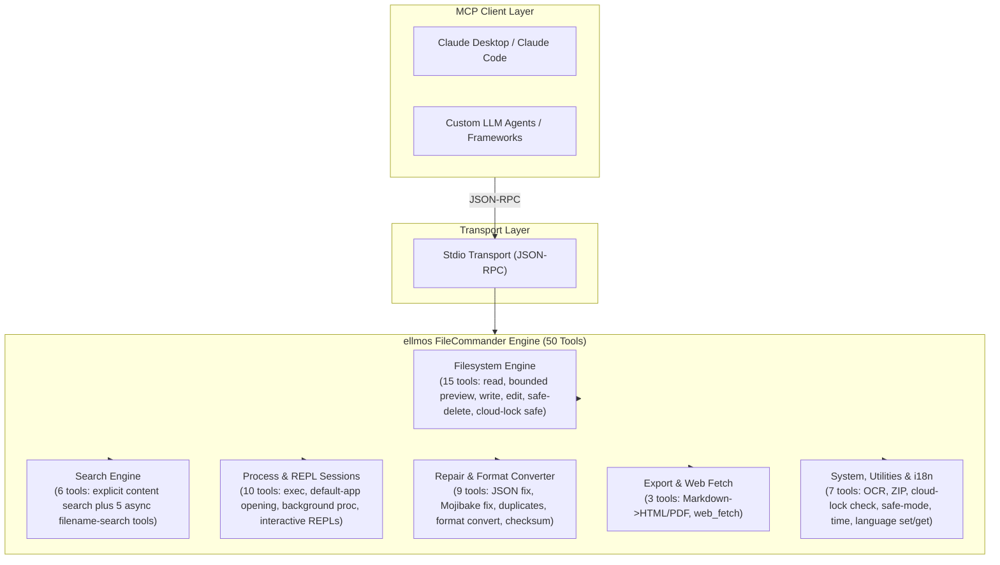
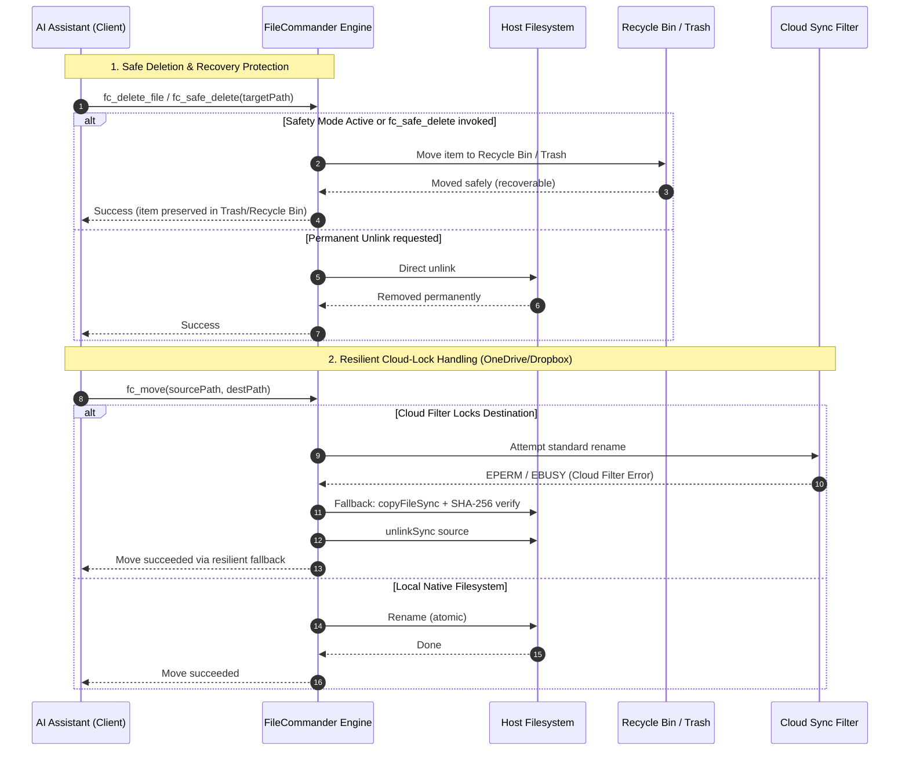

<!-- worldset: {"translated_from_sha256": "310943b7f88d776f409deb86f0a6536cfe6e4f73674f992af028f8173869755c", "translator": "claude-haiku-5-5", "translated_at": "2026-10-25T07:17:11.496324+00:00", "reviewer": "gpt-6-luna/max; Root independent structure and risk samples"} -->
<p align="center">
  
</p>

# ellmos FileCommander MCP Server

[English](README.md) | [Deutsch](README_de.md) | [Español](README_es.md) | [简体中文](README_zh.md) | [日本語](README_ja.md) | [Русский](README_ru.md) | [Français](README_fr.md) | [हिन्दी](README_hi.md) | [العربية](README_ar.md) | **বাংলা** | [Português](README_pt.md)

README নেভিগেশনে এই রিপোজিটরিতে উপলব্ধ ডকুমেন্টেশনের ভাষাগুলো তালিকাভুক্ত রয়েছে। FileCommander-এর রানটাইম বার্তা ও বিন্যাস করা প্রতিক্রিয়া জার্মান (de), ইংরেজি (en), স্প্যানিশ (es), চীনা (zh), জাপানি (ja), রুশ (ru), ফরাসি (fr), হিন্দি (hi), আরবি (ar), বাংলা (bn) এবং পর্তুগিজ (pt) ভাষায় পাওয়া যায়। এই রানটাইম তালিকা README অনুবাদের উপলব্ধতা থেকে আলাদা। এটি রানটাইমে তৈরি বার্তা ও বিন্যাস করা টুল ফলাফলের ক্ষেত্রে প্রযোজ্য; MCP টুলের শিরোনাম, ডিসকভারি বিবরণ এবং স্কিমা বিবরণ স্থিরভাবে ইংরেজিতে থাকে। সার্ভার শুরু করার আগে `FC_LANGUAGE`-এ সমর্থিত একটি কোড সেট করুন, অথবা সক্রিয় MCP সেশনে `fc_set_language` কল করুন। `fc_get_language` সক্রিয় ভাষা ও সমর্থিত এগারোটি কোড জানায়। `FC_LANGUAGE` সেট না থাকলে বা অসমর্থিত কোড থাকলে রানটাইম ডিফল্টভাবে জার্মান (de) ব্যবহার করে। তারিখ ও সময়ের বিন্যাস সক্রিয় ভাষা অনুযায়ী হয়।

*[ellmos-ai](https://github.com/ellmos-ai) পরিবারের অংশ।*

[](https://opensource.org/licenses/MIT)
[](https://github.com/ellmos-ai/ellmos-filecommander-mcp/actions/workflows/tests.yml)
[](https://www.npmjs.com/package/ellmos-filecommander-mcp)
[](https://nodejs.org/)
[](#tools-overview)
[-brightgreen.svg)](#testing)
[](SECURITY.md)
[](SECURITY.md)
[](#why-filecommander)
[](NOTICE)
[](SECURITY.md)
[](THIRD_PARTY_LICENSES.md)
[](THIRD_PARTY_LICENSES.txt)
[](https://github.com/ellmos-ai)
[](https://github.com/open-bricks)
[](llms.txt)
[](llms.txt)
[](llms.txt)

> **দ্রুত নেভিগেশন:**
> 1. [ওভারভিউ](#sec-01) | 2. [সিস্টেম আর্কিটেকচার](#sec-02) | 3. [এন্ড-টু-এন্ড এক্সিকিউশন লাইফসাইকেল](#sec-03) | 4. [কোর ক্ষমতা ও নিরাপত্তা ইনভেরিয়েন্ট](#sec-04) | 5. [লক্ষ্য পার্সোনা ও আবিষ্কারযোগ্যতা](#sec-05) | 6. [ইনস্টলেশন ও পূর্বশর্ত](#sec-06) | 7. [কনফিগারেশন ও ক্লায়েন্ট সেটআপ](#sec-07) | 8. [টুলস ওভারভিউ (50টি টুল)](#sec-08) | 9. [তুলনামূলক ম্যাট্রিক্স ও বিকল্পসমূহ](#sec-09) | 10. [টুল প্রিফিক্স ও নামকরণ নিয়ম](#sec-10) | 11. [শাসন ও রানটাইম ইনভেরিয়েন্ট](#sec-11) | 12. [নিরাপত্তা আর্কিটেকচার ও টুল ঝুঁকি](#sec-12) | 13. [টেস্টিং, কোয়ালিটি গেট ও যাচাইকরণ](#sec-13) | 14. [চেঞ্জলগ ও ভার্সনিং](#sec-14) | 15. [লেভেল ১ SBOM ও তৃতীয় পক্ষের লাইসেন্স](#sec-15) | 16. [ইতিহাস ও বিবর্তন](#sec-16) | 17. [ellmos-ai ইকোসিস্টেম ও পার্টনার ম্যাট্রিক্স](#sec-17) | 18. [বিধিবদ্ধ নোটিশ (§ 521 BGB) ও দায়মুক্তি](#sec-18)
>
> | সরাসরি রেফারেন্স: [🛡️ নিরাপত্তা নীতি](SECURITY.md) • [🤝 অবদান রাখা](CONTRIBUTING.md) • [⚖️ তৃতীয় পক্ষের লাইসেন্স](THIRD_PARTY_LICENSES.md) • [📄 প্লেইন টেক্সট SBOM](THIRD_PARTY_LICENSES.txt) • [📜 মার্কেটিং লগ](MARKETING-LOG.txt) • [🤖 LLM কনটেক্সট (llms.txt)](llms.txt) • [📋 ক্যানোনিকাল নোটিশ](NOTICE) |

একটি ব্যাপক **Model Context Protocol (MCP) সার্ভার** যা AI সহকারীদের সম্পূর্ণ ফাইলসিস্টেম অ্যাক্সেস, সীমাবদ্ধ মাল্টি-ফাইল কনটেন্ট সার্চ, প্রসেস ম্যানেজমেন্ট, ইন্টারেকটিভ শেল সেশন এবং অ্যাসিঙ্ক ফাইলনেম সার্চ ক্ষমতা প্রদান করে।

একটি একক সার্ভারে **50টি টুল** - স্থানীয় সিস্টেমের সাথে ইন্টারঅ্যাক্ট করতে একটি AI এজেন্টের যা যা প্রয়োজন, সবই।

**আবিষ্কারের কীওয়ার্ড:** লোকাল ফাইলসিস্টেম MCP সার্ভার, মাল্টি-ফাইল কনটেন্ট সার্চ MCP, নিরাপদ ডিলিট MCP, Recycle Bin MCP সার্ভার, প্রসেস ম্যানেজমেন্ট MCP, ইন্টারেকটিভ শেল MCP, AI এজেন্টের জন্য অ্যাসিঙ্ক ফাইল সার্চ, ক্লাউড-লক-সেফ ফাইল অপারেশন, Markdown থেকে PDF MCP, OCR MCP সার্ভার, ZIP আর্কাইভ MCP।

**রেজিস্ট্রি স্ট্যাটাস:** [npm](https://www.npmjs.com/package/ellmos-filecommander-mcp)-এ প্রকাশিত, [jsDelivr](https://www.jsdelivr.com/package/npm/ellmos-filecommander-mcp) দ্বারা ইনডেক্সড, [LobeHub](https://lobehub.com/mcp/ellmos-ai-ellmos-filecommander-mcp)-এ দৃশ্যমান, [Glama](https://glama.ai/mcp/servers/ellmos-ai/ellmos-filecommander-mcp)-এ তালিকাভুক্ত, এবং [`server.json`](server.json)-এর মাধ্যমে অফিসিয়াল MCP Registry-এর জন্য প্রস্তুত। কিছু তৃতীয় পক্ষের ডিরেক্টরি এখনও পুরানো ৪৩-টুল মেটাডেটা দেখায়, তাই তাদের রিইন্ডেক্স না হওয়া পর্যন্ত ক্যানোনিকাল README/npm মেটাডেটাই সত্যের উৎস হিসেবে থাকা উচিত।

> [!NOTE]
> **AI এজেন্ট ও LLM ইন্টিগ্রেশনের জন্য:**
> FileCommander স্ট্যান্ডার্ড stdio ট্রান্সপোর্টের মাধ্যমে অ্যাক্সেসযোগ্য **৫০টি বিশেষায়িত টুল** প্রদান করে। নেমস্পেস সংঘর্ষ এড়াতে সব টুলের নাম `fc_` প্রিফিক্স ব্যবহার করে। LLM-দের জন্য সংক্ষিপ্ত কনটেক্সট ও স্কিমা ওভারভিউ [`llms.txt`](llms.txt) ও [`server.json`](server.json)-এ পাওয়া যায়।

---

<a id="sec-01"></a><a id="overview"></a><a id="why-filecommander"></a><a id="ueberblick"></a><a id="überblick"></a>
## ওভারভিউ এবং FileCommander কেন?

বেশিরভাগ ফাইলসিস্টেম MCP সার্ভার কেবল মৌলিক পড়া/লেখার কাজ কভার করে। FileCommander আরও এগিয়ে যায়:

- **নিরাপদ মুছে ফেলা (Safe Delete)** - স্থায়ীভাবে মুছে ফেলার পরিবর্তে ফাইল Recycle Bin (Windows) বা Trash (macOS/Linux)-এ সরিয়ে দেয়
- **ইন্টার্যাকটিভ সেশন (Interactive Sessions)** - MCP প্রোটোকলের মাধ্যমে REPL (Python, Node.js, shells) শুরু ও ইন্টার‌্যাক্ট করুন
- **অ্যাসিঙ্ক সার্চ (Async Search)** - AI কাজ চালিয়ে যাওয়ার সময় বড় ডিরেক্টরি ট্রি ব্যাকগ্রাউন্ডে অনুসন্ধান করুন
- **স্পষ্ট কন্টেন্ট সার্চ (Explicit Content Search)** - recursion বা glob expansion ছাড়া একটি সীমিত ফাইল তালিকায় literal text বা regex অনুসন্ধান করুন
- **প্রসেস ম্যানেজমেন্ট (Process Management)** - সিস্টেম প্রসেস তালিকাভুক্ত, শুরু এবং বন্ধ করুন
- **স্ট্রিং রিপ্লেস (String Replace)** - প্রসঙ্গ যাচাইসহ অনন্য স্ট্রিং মিলিয়ে ফাইল সম্পাদনা করুন
- **ফরম্যাট রূপান্তর (Format Conversion)** - JSON, CSV, INI, YAML, TOML, XML এবং TOON-এর মধ্যে রূপান্তর করুন
- **ZIP আর্কাইভ (ZIP Archives)** - ZIP আর্কাইভ তৈরি, এক্সট্র্যাক্ট এবং তালিকাভুক্ত করুন
- **ফাইল চেকসাম (File Checksums)** - তুলনাসহ MD5, SHA-1, SHA-256, SHA-384 এবং SHA-512 হ্যাশিং
- **OCR** - ছবি থেকে টেক্সট বের করুন (ঐচ্ছিক tesseract.js নির্ভরতা)
- **সেফটি মোড (Safety Mode)** - সব মুছে ফেলার কাজ Recycle Bin / Trash-এর মাধ্যমে পরিচালিত করতে টগল করুন
- **Markdown এক্সপোর্ট (Markdown Export)** - কোড ব্লক, টেবিল, নেস্টেড লিস্ট, ব্লককোট সহ Markdown-কে পেশাদার HTML/PDF-এ রূপান্তর করুন
- **ক্লাউড-লক নিরাপদ (Cloud-Lock Safe)** - ক্লাউড সিঙ্ক ফিল্টার (OneDrive, Dropbox, Google Drive, iCloud) রিনেম অপারেশন ব্লক করলে স্বয়ংক্রিয় copy+delete ফলব্যাক
- **ক্লাউড লক ডায়াগনোসিস (Cloud Lock Diagnosis)** - অপারেট করার আগে কোনো পাথ সিঙ্ক-ফিল্টার সংঘর্ষের ঝুঁকিতে আছে কিনা তা পরীক্ষা করুন
- **ক্রস-প্ল্যাটফর্ম (Cross-platform)** - প্ল্যাটফর্ম-নির্দিষ্ট অপটিমাইজেশনসহ Windows, macOS এবং Linux-এ কাজ করে

---

<a id="sec-02"></a><a id="system-architecture"></a><a id="systemarchitektur"></a>
## সিস্টেম আর্কিটেকচার

### ASCII চার-দৃশ্য আর্কিটেকচারাল টপোলজি

```text
+--------------------------------------------------------------------------------------------------+
|                            ELLMOS FILECOMMANDER MCP ARCHITECTURAL TOPOLOGY                       |
+--------------------------------------------------------------------------------------------------+
| [VIEW 1: CALLER RUNTIMES & AGENT CLIENTS]                                                        |
|   * Autonomous Agents   : Claude Code, OpenAI Codex, Antigravity / Gemini, Kimi, Cursor          |
|   * Agent Frameworks    : AutoGen, CrewAI, LangChain, LlamaIndex, Custom Python / TS Clients    |
|   * Transport Protocols : Model Context Protocol (MCP stdio), JSON-RPC 2.0 Framing               |
|   * Tool Surface        : 50 Unified Specialized Tools (fc_* namespace collision isolation)       |
|   * Schema Contract     : Stdio transport, dynamic runtime i18n parameter parsing (Zod validated)|
+--------------------------------------------------------------------------------------------------+
|                                                |                                                 |
|                                                v                                                 |
+--------------------------------------------------------------------------------------------------+
| [VIEW 2: FILECOMMANDER MCP CORE ENGINE & DISPATCH ORCHESTRATOR]                                  |
|   * Protocol Dispatch   : ESM stdio router with Zod schema validation & parameter checking      |
|   * Multilingual Core   : 11-language dynamic runtime i18n engine       |
|   * Safety Interceptor  : Global Safety Mode (fc_set_safe_mode) routing deletes to Recycle Bin   |
|   * Sync Diagnostics    : Reparse point detection & cloud filter diagnostics (fc_check_cloud_lock)|
|   * Process Supervisor  : Bounded child process lifecycle management & interactive REPL session  |
|                           state registry with circular ring buffers                              |
+--------------------------------------------------------------------------------------------------+
|                                                |                                                 |
|                                                v                                                 |
+--------------------------------------------------------------------------------------------------+
| [VIEW 3: FILESYSTEM RUNTIME, FORMAT REPAIR & PROCESS ISOLATION]                                  |
|   * Atomic File Ops     : Read, write, line edit, exact literal string replacement (fc_str_replace)|
|   * Cloud-Lock Fallback : Automatic copyFileSync + SHA-256 verify + unlinkSync on EPERM / EBUSY   |
|   * Bounded Inspection  : Metadata-first preview (fc_preview_file, 1 MiB inline content ceiling)  |
|   * Bounded Content Srch: max 50 explicit files, 10 MB ceiling, token redaction (INV-MASK-06)   |
|   * Self-Healing Repair : Mojibake repair (27+ UTF-8 patterns), JSON syntax fix, file cleanup    |
|   * Lossless Converter  : Declarative transformation across 7 formats (JSON, YAML, TOML, XML...) |
|   * Media & Documents   : Headless Markdown to PDF/HTML, ZIP archive engine, optional OCR (Tess)  |
+--------------------------------------------------------------------------------------------------+
|                                                |                                                 |
|                                                v                                                 |
+--------------------------------------------------------------------------------------------------+
| [VIEW 4: AIR-GAP DEFENSE PERIMETER, RUNASINVOKER & CONTROLLED EGRESS]                            |
|   * Execution Privilege : RunAsInvoker unprivileged user-mode (Zero administrative elevation)    |
|   * Transport Boundary  : 100% Local stdio transport, zero telemetry, zero open listening ports  |
|   * Controlled Egress   : Outbound HTTP(S) strictly gated through caller-invoked fc_web_fetch     |
|   * Network Safety      : SSRF guard blocking private/internal IP ranges (allow_private override) |
|   * Governance & Supply : Level 1 SBOM, 100% permissive runtime (MIT/BSD), 48h Security SLA      |
+--------------------------------------------------------------------------------------------------+
```

### কম্পোনেন্ট ফ্লো ডায়াগ্রাম



---

<a id="sec-03"></a><a id="end-to-end-execution-lifecycle"></a><a id="execution-lifecycle"></a><a id="end-to-end-ausfuehrungszyklus"></a>
## এন্ড-টু-এন্ড এক্সিকিউশন লাইফসাইকেল



---

<a id="sec-04"></a><a id="core-capabilities--safety-invariants"></a><a id="core-capabilities"></a><a id="kernfaehigkeiten--sicherheitsinvarianten"></a><a id="kernfähigkeiten--sicherheitsinvarianten"></a>
## মূল সক্ষমতা ও নিরাপত্তা অপরিবর্তনীয়সমূহ

| ক্ষমতা / অপরিবর্তনীয় নিয়ম | গ্যারান্টি ও বাস্তবায়নের বিবরণ | নিরাপত্তা ও পরিচালনাগত সুবিধা |
|------------------------|-----------------------------------|--------------------------------|
| **স্থানীয় stdio ও স্পষ্ট বহির্গমন** | MCP পরিবহন হলো স্থানীয় stdio, এতে কোনো টেলিমেট্রি নেই এবং কোনো স্বয়ংক্রিয় নেটওয়ার্ক বহির্গমন নেই। `fc_web_fetch` কেবল তখনই বাহ্যিক HTTP(S) অনুরোধ পাঠায় যখন কোনো ক্লায়েন্ট স্পষ্টভাবে এটি আহ্বান করে; `allow_private` সক্রিয় না থাকলে ব্যক্তিগত লক্ষ্যবস্তু ডিফল্টভাবে ব্লক থাকে। | ক্লায়েন্টের কাছে নেটওয়ার্ক সীমানা দৃশ্যমান রেখে একটি স্থানীয়, পোর্টবিহীন সার্ভার পরিবহন বজায় রাখে। |
| **নিরাপদ মুছে ফেলা ও ট্র্যাশ সুরক্ষা** | `fc_safe_delete` আইটেমগুলিকে Windows Recycle Bin / macOS Trash / Linux FreeDesktop Trash-এ সরিয়ে নেয়। `fc_set_safe_mode` সমস্ত মোছার কাজ নিরাপদে পরিচালনা করে। | দুর্ঘটনাবশত রিকার্সিভ বা বাল্ক মোছা থেকে অপূরণীয় ডেটা ক্ষতি প্রতিরোধ করে। |
| **ক্লাউড-লক সহনশীল স্থানান্তর (`fc_move`)** | OneDrive, Dropbox, iCloud reparse point-এর মতো ক্লাউড সিঙ্ক ফিল্টারের স্বয়ংক্রিয় শনাক্তকরণ, সঙ্গে নির্বিঘ্ন copy+verify+delete ফলব্যাক। | সিঙ্ক ডিরেক্টরিতে স্বয়ংক্রিয় এজেন্ট কার্যক্রমের সময় `EPERM` / `EBUSY` ব্যর্থতা দূর করে। |
| **ক্লাউড-লক নির্ণয় (`fc_check_cloud_lock`)** | স্থির ক্লাউড-পাথ প্রেক্ষাপট এবং লক্ষ্যের অস্তিত্ব/ধরন সংক্রান্ত শুধু-পঠনযোগ্য প্রতিবেদন; Cloud Files হাইড্রেশন ও প্রসেস হ্যান্ডেল উপলব্ধ না থাকলে স্পষ্টভাবে "পরীক্ষা করা হয়নি" হিসেবে প্রতিবেদিত হয়। | এজেন্টগুলি স্থির OneDrive ঝুঁকি এবং প্রকৃতপক্ষে শনাক্ত হওয়া নাম-পরিবর্তন লকের মধ্যে পার্থক্য করতে পারে। |
| **সীমাবদ্ধ বহু-ফাইল বিষয়বস্তু অনুসন্ধান** | `fc_search_content` গ্লোব রিকার্সন ছাড়া ইনপুট কঠোরভাবে সীমিত করে (সর্বোচ্চ 50টি স্পষ্ট ফাইল, প্রতি ফাইলে 10 MB, 200টি মিল, 200k অক্ষর)। | বৃহৎ রিপোজিটরি অনুসন্ধানের সময় আউট-অফ-মেমরি ত্রুটি ও বিপর্যয়কর CPU লক-আপ প্রতিরোধ করে। |
| **স্বয়ংক্রিয় গোপন তথ্য ও টোকেন রিড্যাকশন** | বিষয়বস্তু অনুসন্ধানের উদ্ধৃতাংশে সাধারণ API কী, bearer টোকেন, AWS ক্রেডেনশিয়াল এবং authorization হেডার স্বয়ংক্রিয়ভাবে মাস্ক করা হয়। | LLM প্রেক্ষাপট দূষণ এবং প্রম্পট ইতিহাসে দুর্ঘটনাবশত ক্রেডেনশিয়াল ফাঁস প্রতিরোধ করে। |
| **ইন্টারেক্টিভ REPL ও সেশন বিচ্ছিন্নতা** | Python, Node.js, bash ও PowerShell-এর জন্য সীমাবদ্ধ বাফারসহ স্টেটফুল ইন্টারেক্টিভ সেশন (`fc_start_session`, `fc_send_input`, `fc_read_output`)। | সীমাহীন পটভূমি প্রসেস জমা না করে বহু-পর্যায়ের REPL ডিবাগিংয়ের অনুমতি দেয়। |
| **ক্ষতিহীন বহু-বিন্যাস ইঞ্জিন** | 7টি কাঠামোগত বিন্যাস (JSON, YAML, TOML, XML, CSV, INI, TOON) জুড়ে ঘোষণামূলক রূপান্তর (`fc_convert_format`)। | ডেটা ক্ষতি ছাড়াই বিষমধর্মী কনফিগারেশন বিন্যাসের মধ্যে পরিষ্কার ডেটা স্বাভাবিকীকরণ। |
| **মোজিবেক ও ফাইল মেরামত ইঞ্জিন** | `fc_fix_encoding`, `fc_fix_json` ও `fc_cleanup_file` ভাঙা UTF-8 এনকোডিং (27+ প্যাটার্ন), ত্রুটিপূর্ণ JSON সিনট্যাক্স, BOM এবং NUL বাইট মেরামত করে। | ভিন্ন ভিন্ন OS প্ল্যাটফর্মে তৈরি দূষিত ফাইলের জন্য স্ব-নিরাময়কারী পাইপলাইন। |
| **সুবিধাবিহীন নন-এলিভেশন এক্সিকিউশন** | স্ট্যান্ডার্ড সুবিধাবিহীন ব্যবহারকারী-মোডে চলার জন্য ডিজাইন ও যাচাইকৃত। কখনো প্রশাসনিক বা root সুবিধার প্রয়োজন হয় না। | ন্যূনতম আক্রমণ পৃষ্ঠ; ন্যূনতম সুবিধার নীতি মেনে চলে। |
| **এগারো-ভাষার রানটাইম i18n ইঞ্জিন** | সমর্থিত ১১টি কোডে গতিশীল ভাষা পরিবর্তন ও তথ্য দেখা (`fc_set_language`, `fc_get_language`): `de`, `en`, `es`, `zh`, `ja`, `ru`, `fr`, `hi`, `ar`, `bn` এবং `pt`। | স্থানীয় বহুভাষিক ডেভেলপার অভিজ্ঞতা এবং স্থানীয়কৃত ত্রুটি প্রতিবেদন। |
| **বহু-OS যাচাইকৃত ম্যাট্রিক্স** | Node.js 20, 22 ও 24-এ Windows, Ubuntu Linux ও macOS জুড়ে 292টি স্বয়ংক্রিয় অ্যাসারশন সহ পরীক্ষিত। | ধারাবাহিক ক্রস-প্ল্যাটফর্ম সমতা ও নির্ভরযোগ্যতা। |

---

<a id="sec-05"></a><a id="target-personas--discoverability"></a><a id="target-personas"></a><a id="zielgruppen--auffindbarkeit"></a>
## লক্ষ্য ব্যক্তিত্ব ও আবিষ্কারযোগ্যতা

FileCommander চারটি মূল ডেভেলপার, এজেন্টিক ও অপারেশন ব্যক্তিত্বের জন্য বিশেষভাবে তৈরি ও যাচাইকৃত:

### [PERSONA-01] ‌অটোনমাস AI কোডিং এজেন্ট ও LLM সোয়ার্ম
- **প্রোফাইল:** মাল্টি-এজেন্ট সোয়ার্ম এবং স্ট্যান্ডঅ্যালোন এজেন্টিক রানটাইম (Claude Code, Antigravity/Gemini, OpenAI Codex, AutoGen, CrewAI) যা রিকার্সিভ কোড সম্পাদনা, প্রকল্প রিফ্যাক্টরিং এবং ডিরেক্টরি অডিট চালায়।
- **মূল পরিচালনাগত সমস্যাসমূহ:** মাল্টি-মেগাবাইট ফাইল পড়ার কারণে দ্রুত কনটেক্সট উইন্ডো ফুলে যাওয়া, ক্লাউড-সিঙ্ক্রোনাইজড ফোল্ডারে লক করা ফাইলের (`EPERM`/`EBUSY`) কারণে অনিয়ন্ত্রিত প্রসেস ক্র্যাশ, এবং দুর্ঘটনাবশত `rm -rf` ক্লিনআপ রুটিনের কারণে অপুনরুদ্ধারযোগ্য রিপোজিটরি করাপশন।
- **FileCommander সমাধান:**
  - `fc_preview_file`: কঠোর ১ MiB ইনলাইন কনটেন্ট সীমাসহ মেটাডেটা-প্রথম পরিদর্শন, যা LLM কনটেক্সট ব্লোআউট প্রতিরোধ করে।
  - `fc_search_content`: সীমাবদ্ধ বহু-ফাইল অনুসন্ধান (সর্বোচ্চ ৫০ ফাইল, প্রতি ফাইল ১০ MB, ২০০ ম্যাচ) এবং স্বয়ংক্রিয় সিক্রেট/টোকেন রিডাকশন।
  - `fc_safe_delete` ও `fc_set_safe_mode`: শূন্য-ঝুঁকির ফাইল অপারেশনের জন্য মুছে ফেলা ফাইল OS Recycle Bin / Trash-এ সংরক্ষণ।
  - `fc_move` ও `fc_check_cloud_lock`: ফাইল লকের ক্ষেত্রে স্বয়ংক্রিয় কপি + SHA-256 যাচাই + unlink ফলব্যাক, যা এজেন্ট ব্যর্থতা প্রতিরোধ করে।

### [PERSONA-02] DevOps, টুলচেইন ও মাল্টি-হোস্ট অটোমেশন ইঞ্জিনিয়ার
- **প্রোফাইল:** Windows, Linux ও macOS জুড়ে ক্রস-প্ল্যাটফর্ম CLI টুল, CI/CD যাচাইকরণ পাইপলাইন এবং মাল্টি-মেশিন সিঙ্ক স্ক্রিপ্ট নির্মাণকারী সিস্টেম ও অটোমেশন ইঞ্জিনিয়ার।
- **মূল পরিচালনাগত সমস্যাসমূহ:** ভিন্নধর্মী অপারেটিং সিস্টেম সিম্যান্টিকস (Windows ব্যাকস্ল্যাশ বনাম POSIX স্ল্যাশ, লাইন-এন্ডিং করাপশন, শেল-নির্দিষ্ট সিনট্যাক্স), জম্বি চাইল্ড প্রসেস, এবং শেয়ার্ড OneDrive/Dropbox ওয়ার্কস্পেসে ফাইল লকিং।
- **FileCommander সমাধান:**
  - Windows, Linux ও macOS জুড়ে একীভূত ক্রস-প্ল্যাটফর্ম টুল সিম্যান্টিকস।
  - সীমাবদ্ধ বৃত্তাকার রিং বাফারসহ স্টেটফুল ইন্টারেক্টিভ REPL সেশন (`fc_start_session`, `fc_send_input`, `fc_read_output`)।
  - ব্যাচ ফাইল রিনেমিং (`fc_batch_rename`) এবং ব্যাকগ্রাউন্ড ডিরেক্টরি অনুসন্ধান (`fc_start_search`, `fc_get_search_results`)।
  - প্রসেস লিক ছাড়া প্রসেস লাইফসাইকেল ব্যবস্থাপনা (`fc_execute_command`, `fc_start_process`, `fc_kill_process`)।

### [PERSONA-03] SecOps, গভর্নেন্স ও কমপ্লায়েন্স কর্মকর্তা
- **প্রোফাইল:** এন্টারপ্রাইজ ও প্রোডাকশন পরিবেশে AI টুল ইন্টিগ্রেশন তত্ত্বাবধানকারী নিরাপত্তা কর্মকর্তা, কমপ্লায়েন্স নিরীক্ষক এবং প্রাইভেসি দল।
- **মূল পরিচালনাগত সমস্যাসমূহ:** অঘোষিত ব্যাকগ্রাউন্ড টেলিমেট্রি বীকন, লোকাল প্লাগইন থেকে অযাচাইকৃত নেটওয়ার্ক অ্যাক্সেস, মডেল প্রশিক্ষণ বা প্রম্পট ইতিহাসে ক্রেডেনশিয়াল/টোকেন ফাঁস, এবং অসুবিধাহীন ব্যবহারকারীর সুবিধা বৃদ্ধি।
- **FileCommander সমাধান:**
  - কঠোরভাবে শূন্য টেলিমেট্রি এবং শূন্য উন্মুক্ত নেটওয়ার্ক লিসেনিং পোর্টসহ লোকাল stdio ট্রান্সপোর্ট।
  - কলার-আহ্বানকৃত `fc_web_fetch`-এ স্পষ্টভাবে সীমাবদ্ধ আউটবাউন্ড নেটওয়ার্ক egress (ডিফল্টভাবে internal/private IP ব্লক করা)।
  - অনুসন্ধান এক্সসার্পটে স্বয়ংক্রিয় সিক্রেট ও বিয়ারার টোকেন মাস্কিং (`INV-MASK-06`)।
  - কঠোর অসুবিধাহীন ব্যবহারকারী এক্সিকিউশন (`INV-PROC-09`) এবং বাধ্যতামূলক ৪৮-ঘণ্টার দুর্বলতা প্রতিক্রিয়া SLA (`security@open-bricks.org`, `security@ellmos.ai`)।

### [PERSONA-04] এন্টারপ্রাইজ প্ল্যাটফর্ম আর্কিটেক্ট ও ডেটা পাইপলাইন ডেভেলপার
- **প্রোফাইল:** স্থানীয় ফাইল ইন্টিগ্রেট করা, ভিন্নধর্মী কনফিগারেশন ফরম্যাট নরমালাইজ করা, ক্রিপ্টোগ্রাফিক হ্যাশ যাচাই করা এবং রিপোর্ট তৈরি করা সলিউশন আর্কিটেক্ট ও ডেটা ইঞ্জিনিয়ার।
- **মূল পরিচালনাগত সমস্যাসমূহ:** ৪-৬টি ভিন্ন একক-উদ্দেশ্যের সার্ভার প্রয়োজন হওয়া MCP সার্ভার স্প্রল, টুল জুড়ে দূষিত UTF-8 বাইট সিকোয়েন্স (Mojibake), এবং আনুষ্ঠানিক পার্সিং স্ক্রিপ্ট।
- **FileCommander সমাধান:**
  - বহু-সার্ভার স্প্রল ও প্রসেস ওভারহেড দূর করে ৫০-টুলের সমন্বিত একক-সার্ভার ডেপ্লয়মেন্ট।
  - ৭টি স্ট্রাকচার্ড ফরম্যাট জুড়ে লসলেস ডিক্লারেটিভ রূপান্তর (`fc_convert_format`: JSON, YAML, TOML, XML, CSV, INI, TOON)।
  - সেলফ-হিলিং পাইপলাইনের জন্য অন্তর্নির্মিত ফাইল মেরামত ইঞ্জিন (`fc_fix_encoding`, `fc_fix_json`, `fc_cleanup_file`)।
  - ক্রিপ্টোগ্রাফিক চেকসাম (`fc_checksum`: SHA-256, SHA-512, MD5, SHA-1) এবং Markdown থেকে PDF/HTML রেন্ডারিং (`fc_md_to_pdf`, `fc_md_to_html`)।

### উচ্চ-উদ্দেশ্যমূলক অনুসন্ধান ক্যোয়ারী ও আবিষ্কারযোগ্যতার ভেক্টর

- **প্রাথমিক অনুসন্ধান ক্যোয়ারী:** `ellmos-filecommander-mcp`, `FileCommander MCP`, `filesystem MCP server`, `multi-file content search MCP`, `safe delete MCP`, `async file search MCP`, `process management MCP`, `Markdown PDF MCP`।
- **মেশিন-পঠনযোগ্য মেটাডেটা:** AI এজেন্টদের জন্য স্ট্রাকচার্ড কনটেক্সট [`llms.txt`](llms.txt), [`server.json`](server.json) এবং [`glama.json`](glama.json)-এ রাখা হয়।
- **কমপ্লায়েন্স ও অ্যাট্রিবিউশন:** [`THIRD_PARTY_LICENSES.md`](THIRD_PARTY_LICENSES.md) এবং [`NOTICE`](NOTICE)-এর বিপরীতে যাচাইকৃত।

---

<a id="sec-06"></a><a id="installation"></a><a id="installation-prerequisites"></a>
## ইনস্টলেশন

### পূর্বশর্ত

- [Node.js](https://nodejs.org/) ২০ বা তার বেশি
- npm

### বিকল্প ১: NPM থেকে ইনস্টল

```bash
npm install -g ellmos-filecommander-mcp
```

### বিকল্প ২: সোর্স থেকে ইনস্টল

```bash
git clone https://github.com/ellmos-ai/ellmos-filecommander-mcp.git
cd ellmos-filecommander-mcp
npm ci
npm run build
```

---

<a id="sec-07"></a><a id="configuration"></a><a id="client-setup"></a><a id="konfiguration"></a>
## কনফিগারেশন

### Claude Desktop

আপনার `claude_desktop_config.json`-এ যোগ করুন:

**Windows:** `%APPDATA%\Claude\claude_desktop_config.json`
**macOS:** `~/Library/Application Support/Claude/claude_desktop_config.json`

#### যদি NPM-এর মাধ্যমে গ্লোবালি ইনস্টল করা হয়:

```json
{
  "mcpServers": {
    "filecommander": {
      "command": "ellmos-filecommander"
    }
  }
}
```

#### যদি সোর্স থেকে ইনস্টল করা হয়:

```json
{
  "mcpServers": {
    "filecommander": {
      "command": "node",
      "args": ["/absolute/path/to/filecommander-mcp/dist/index.js"]
    }
  }
}
```

সংরক্ষণ করার পরে Claude Desktop পুনরায় চালু করুন।

### অন্যান্য MCP ক্লায়েন্ট

সার্ভারটি **stdio transport**-এর মাধ্যমে যোগাযোগ করে। আপনার MCP ক্লায়েন্টকে `dist/index.js` এন্ট্রি পয়েন্ট অথবা `ellmos-filecommander` বাইনারির দিকে নির্দেশ করুন।

---

<a id="sec-08"></a><a id="tools-overview"></a><a id="available-tools"></a><a id="tools-uebersicht"></a><a id="tools-übersicht"></a>
## টুলের সারসংক্ষেপ

### ফাইলসিস্টেম অপারেশন (15টি টুল)

| টুল | বিবরণ |
|------|-------------|
| `fc_read_file` | ঐচ্ছিক লাইন সীমাসহ ফাইলের কনটেন্ট পড়ুন |
| `fc_preview_file` | প্রথমে MIME টাইপ ও আকার পরীক্ষা করুন, তারপর স্পষ্টভাবে সীমাবদ্ধ ইনলাইন MCP কনটেন্ট অনুরোধ করুন |
| `fc_read_multiple_files` | একটি কলে সর্বোচ্চ 20টি ফাইল পড়ুন |
| `fc_write_file` | ফাইলে লিখুন/তৈরি করুন/যুক্ত করুন |
| `fc_edit_file` | লাইন-ভিত্তিক সম্পাদনা (লাইন প্রতিস্থাপন, সন্নিবেশ, মুছে ফেলা) |
| `fc_str_replace` | প্রসঙ্গ যাচাইসহ ফাইলের একটি অনন্য স্ট্রিং প্রতিস্থাপন করুন |
| `fc_list_directory` | ডিরেক্টরির কনটেন্ট তালিকাভুক্ত করুন (পুনরাবৃত্ত, কনফিগারযোগ্য গভীরতা) |
| `fc_create_directory` | ডিরেক্টরি তৈরি করুন (প্যারেন্টসহ) |
| `fc_delete_file` | একটি ফাইল মুছুন (স্থায়ীভাবে) |
| `fc_delete_directory` | একটি ডিরেক্টরি মুছুন (ঐচ্ছিক recursive ফ্ল্যাগসহ) |
| `fc_safe_delete` | Recycle Bin / Trash-এ সরান (পুনরুদ্ধারযোগ্য!) |
| `fc_move` | ফাইল ও ডিরেক্টরি সরান বা নতুন নাম দিন (cloud-lock নিরাপদ) |
| `fc_copy` | ফাইল ও ডিরেক্টরি কপি করুন |
| `fc_file_info` | বিস্তারিত ফাইল মেটাডেটা পান (আকার, তারিখ, টাইপ) |
| `fc_search_files` | wildcard প্যাটার্নসহ সিঙ্ক্রোনাস ফাইল অনুসন্ধান |

`fc_preview_file` হলো স্থানীয় ফাইলের জন্য remote/headless fallback। এর ডিফল্ট কল শুধুমাত্র কাঠামোগত মেটাডেটা ফেরত দেয়: resolved path, `file://` URI, MIME টাইপ, byte আকার, preview kind, স্থির 1 MiB সীমা, এবং সঠিক পরবর্তী কল। `include_content=true`-এর পরেই কনটেন্ট পড়া হয়। যোগ্য টেক্সট ও raster ইমেজ স্ট্যান্ডার্ড MCP `text`/`image` কনটেন্ট ব্লক ব্যবহার করে; PDF সীমাবদ্ধ embedded `resource` ব্যবহার করে। 1 MiB-এর বেশি ফাইল এবং অসমর্থিত টাইপ শুধুমাত্র-মেটাডেটা থাকে এবং preview পথ দ্বারা কখনও পড়া বা Base64-এনকোড করা হয় না।

### কনটেন্ট অনুসন্ধান (1টি টুল)

| টুল | বিবরণ |
|------|-------------|
| `fc_search_content` | একটি স্পষ্ট ক্রমযুক্ত ফাইল তালিকার মধ্যে শুধুমাত্র-পঠন literal বা regex অনুসন্ধান, case, context, global ও প্রতি-ফাইল সীমাসহ |

`fc_search_content` কখনও glob সম্প্রসারণ করে না, ডিরেক্টরি অতিক্রম করে না, বা পুনরাবৃত্তভাবে ফাইল আবিষ্কার করে না। এটি সর্বোচ্চ 50টি স্পষ্ট UTF-8 টেক্সট ফাইল গ্রহণ করে, binary ফাইল ও 10 MB-এর বেশি ফাইল বাদ দেয়, এবং নির্ধারিত JSON ফেরত দেয়। ম্যাচ সর্বত্র 200টি ও প্রতি ফাইলে 100টিতে সীমাবদ্ধ, context 10 লাইনে, excerpt 500 অক্ষরে, এবং serialized আউটপুট 200,000 অক্ষরে সীমাবদ্ধ। অনুপস্থিত, cloud-only, permission, encoding, binary ও আকারজনিত ব্যর্থতা প্রতি ফাইলে জানানো হয়, যাতে পাঠযোগ্য ফাইলগুলো এখনও ফলাফল দেয়। সাধারণ secret ফরম্যাট excerpt থেকে redact করা হয়।

### Async অনুসন্ধান (5টি টুল)

| টুল | বিবরণ |
|------|-------------|
| `fc_start_search` | একটি background অনুসন্ধান শুরু করুন (সঙ্গে সঙ্গে ফেরত আসে) |
| `fc_get_search_results` | pagination সহ ফলাফল পুনরুদ্ধার করুন |
| `fc_stop_search` | একটি চলমান অনুসন্ধান বাতিল করুন |
| `fc_list_searches` | সমস্ত সক্রিয়/সম্পন্ন অনুসন্ধান তালিকাভুক্ত করুন |
| `fc_clear_search` | সম্পন্ন অনুসন্ধান মেমোরি থেকে সরান |

### প্রক্রিয়া ব্যবস্থাপনা (5টি টুল)

| টুল | বিবরণ |
|------|-------------|
| `fc_execute_command` | একটি shell কমান্ড চালান (blocking, timeout সহ) |
| `fc_start_process` | একটি background প্রক্রিয়া শুরু করুন (non-blocking) |
| `fc_open_path` | বিদ্যমান একটি স্থানীয় ফাইল বা ডিরেক্টরি যাচাই করে OS ডিফল্ট অ্যাপ্লিকেশনে খুলুন |
| `fc_list_processes` | চলমান সিস্টেম প্রক্রিয়া তালিকাভুক্ত করুন |
| `fc_kill_process` | PID বা নাম দিয়ে একটি প্রক্রিয়া বন্ধ করুন |

`fc_open_path` শুধুমাত্র একটি বিদ্যমান ফাইল বা ডিরেক্টরি গ্রহণ করে এবং এটি একটি স্থির native default-handler launcher-এ পাঠায়। এর কাঠামোগত ফলাফল `launcher_accepted=true|false` জানায়, সর্বদা `user_visible="unknown"` জানায়, এবং একটি machine-readable fallback চিহ্নিত করে: ফাইলের জন্য শুধুমাত্র-মেটাডেটা আর্গুমেন্টসহ `fc_preview_file`, বা ডিরেক্টরির জন্য `fc_list_directory`। Launcher গ্রহণ করা কখনও দাবি করে না যে GUI দৃশ্যমান হয়েছে। `fc_start_process` বরং কলারকে একটি executable ও আর্গুমেন্ট বেছে নিতে দেয়। `fc_execute_command` একটি স্বেচ্ছ shell কমান্ড গ্রহণ করে: সাধারণ কমান্ডের জন্য Node-এর ডিফল্ট shell ব্যবহৃত হয় (Windows-এ `COMSPEC`/`cmd.exe`), যেখানে FileCommander-এর Windows বিশেষ-অক্ষর পথ Windows PowerShell-এর মাধ্যমে রুট হতে পারে।

### ইন্টারঅ্যাক্টিভ সেশন (5টি টুল)

| সরঞ্জাম | বিবরণ |
|------|-------------|
| `fc_start_session` | একটি ইন্টারেক্টিভ প্রক্রিয়া শুরু করুন (Python, Node, shell...) |
| `fc_read_output` | সেশনের আউটপুট পড়ুন |
| `fc_send_input` | একটি চলমান সেশনে ইনপুট পাঠান |
| `fc_list_sessions` | সব সেশনের তালিকা দেখুন |
| `fc_close_session` | একটি সেশন বন্ধ করুন |

### ফাইল রক্ষণাবেক্ষণ ও মেরামত (৯টি সরঞ্জাম)

| সরঞ্জাম | বিবরণ |
|------|-------------|
| `fc_fix_json` | ভাঙা JSON মেরামত করুন (BOM, ট্রেইলিং কমা, মন্তব্য, একক উদ্ধৃতি) |
| `fc_validate_json` | বিস্তারিত ত্রুটির অবস্থান ও প্রসঙ্গসহ JSON যাচাই করুন |
| `fc_cleanup_file` | BOM, NUL বাইট, ট্রেইলিং হোয়াইটস্পেস সরান, লাইন এন্ডিং স্বাভাবিক করুন |
| `fc_fix_encoding` | Mojibake / ডাবল-এনকোডেড UTF-8 ঠিক করুন (২৭+ অক্ষর প্যাটার্ন) |
| `fc_folder_diff` | স্ন্যাপশটের মাধ্যমে ডিরেক্টরির পরিবর্তন ট্র্যাক করুন (নতুন/পরিবর্তিত/মুছে ফেলা) |
| `fc_batch_rename` | প্যাটার্ন-ভিত্তিক ব্যাচ নামকরণ (প্রিফিক্স/সাফিক্স, প্রতিস্থাপন, স্বয়ংক্রিয় শনাক্তকরণ) |
| `fc_convert_format` | JSON, CSV, INI, YAML, TOML, XML এবং TOON ফরম্যাটের মধ্যে রূপান্তর করুন |
| `fc_detect_duplicates` | SHA-256 হ্যাশিং ব্যবহার করে ডুপ্লিকেট ফাইল খুঁজুন |
| `fc_checksum` | ফাইল হ্যাশিং (MD5, SHA-1, SHA-256, SHA-384, SHA-512), ঐচ্ছিক তুলনাসহ |

### আর্কাইভ (১টি সরঞ্জাম)

| সরঞ্জাম | বিবরণ |
|------|-------------|
| `fc_archive` | ZIP আর্কাইভ তৈরি, এক্সট্র্যাক্ট ও তালিকাভুক্ত করুন |

### OCR (১টি সরঞ্জাম)

| সরঞ্জাম | বিবরণ |
|------|-------------|
| `fc_ocr` | tesseract.js এর মাধ্যমে ছবি থেকে লেখা বের করুন (ঐচ্ছিক নির্ভরতা) |

### ক্লাউড সিঙ্ক (১টি সরঞ্জাম)

| সরঞ্জাম | বিবরণ |
|------|-------------|
| `fc_check_cloud_lock` | স্থির ক্লাউড-সিঙ্ক প্রসঙ্গ ও লক্ষ্য অবস্থা প্রতিবেদন করুন; প্রমাণ ছাড়া কখনও সক্রিয় লক দাবি করবেন না (Windows) |

### সিস্টেম (৪টি সরঞ্জাম)

| সরঞ্জাম | বিবরণ |
|------|-------------|
| `fc_get_time` | টাইমজোন তথ্যসহ বর্তমান সিস্টেম সময় পান |
| `fc_set_safe_mode` | নিরাপদ মোড টগল করুন: সব মুছে ফেলা Recycle Bin / Trash-এর মাধ্যমে হবে |
| `fc_set_language` | রানটাইম ভাষা সেট করুন (`de`, `en`, `es`, `zh`, `ja`, `ru`, `fr`, `hi`, `ar`, `bn`, বা `pt`) |
| `fc_get_language` | সক্রিয় রানটাইম ভাষা ও সমর্থিত ১১টি ভাষার কোড পড়ুন |

### এক্সপোর্ট (২টি সরঞ্জাম)

| সরঞ্জাম | বিবরণ |
|------|-------------|
| `fc_md_to_html` | CSS স্টাইলিংসহ Markdown থেকে স্বতন্ত্র HTML (হেডার, কোড ব্লক, টেবিল, নেস্টেড তালিকা, ব্লককোট, ছবি, চেকবক্স) |
| `fc_md_to_pdf` | হেডলেস ব্রাউজারের মাধ্যমে Markdown থেকে PDF (Edge/Chrome)। কোনো ব্রাউজার না থাকলে HTML-এ ফিরে যায় |

### ওয়েব (১টি সরঞ্জাম)

| সরঞ্জাম | বিবরণ |
|------|-------------|
| `fc_web_fetch` | একটি ওয়েব পেজ আনুন এবং `mode` অনুযায়ী কনটেন্ট ফেরত দিন: extract (পরিষ্কার মূল লেখা), raw (HTTP বডি), links, forms, বা headers। শুধু-পঠনযোগ্য নেটওয়ার্ক সরঞ্জাম; SSRF গার্ড ডিফল্টভাবে অভ্যন্তরীণ/ব্যক্তিগত লক্ষ্য ব্লক করে। |

**মোট: ৫০টি সরঞ্জাম**

---

<a id="sec-09"></a><a id="comparative-matrix--alternatives"></a><a id="comparative-matrix"></a><a id="comparison-with-alternatives"></a><a id="vergleichsmatrix--alternativen"></a>
## তুলনামূলক ম্যাট্রিক্স ও বিকল্পসমূহ

FileCommander ফাইলসিস্টেম ব্যবস্থাপনা, সীমাবদ্ধ অনুসন্ধান, প্রক্রিয়া নিয়ন্ত্রণ, ডেটা মেরামত, ফরম্যাট রূপান্তর এবং ডকুমেন্ট রেন্ডারিংকে একটি একীভূত MCP ইন্টারফেসে একত্র করে। নিচে ১০টি মূল পরিচালনাগত মাত্রায় প্রচলিত বিকল্পগুলোর সাথে একটি স্থাপত্যগত তুলনা দেওয়া হলো:

| কার্যপরিচালনার দিক | ellmos FileCommander MCP (৫০টি টুল) | Official Filesystem MCP (`@modelcontextprotocol/server-filesystem`) | Desktop Commander MCP | সরাসরি হোস্ট শেল (`bash` / PowerShell) | এককালীন স্ক্রিপ্ট ও ক্লাউড API |
|-----------------------|:-----------------------------------:|:------------------------------------------------------------------:|:---------------------:|:---------------------------------------:|:---------------------------:|
| **টুলের পরিধি ও বিস্তার** `[INV-PROC-09]` | ৬টি ক্ষেত্রে **৫০টি সমন্বিত টুল** | প্রায় ১১টি মৌলিক file I/O টুল | প্রায় ১৫টি টুল (ফাইল ও প্রক্রিয়া) | সীমাহীন CLI কমান্ড | বিচ্ছিন্ন, নিজস্বভাবে তৈরি স্ক্রিপ্ট |
| **নিরাপদে মুছে ফেলা ও পুনরুদ্ধার** `[INV-SAFE-02]` | **স্থানীয় OS Recycle Bin / Trash** (`fc_safe_delete`, Safety Mode) | শুধু স্থায়ীভাবে মুছে ফেলা (`unlink`) | শুধু স্থায়ীভাবে মুছে ফেলা | অপরিবর্তনীয় `rm -rf` / `Remove-Item` | নিজস্ব Trash ব্যবস্থা |
| **ক্লাউড-লক ও সিঙ্কে স্থিতিশীলতা** `[INV-LOCK-03]` | **স্বয়ংক্রিয় বিকল্প ব্যবস্থা** (কপি + SHA-256 যাচাই + EPERM/EBUSY হলে unlink) | লক করা ফাইল বা reparse point-এ ব্যর্থ হয় | লক করা ফাইলে ব্যর্থ হয় | ব্যর্থ হয় বা অনির্দিষ্টকাল আটকে থাকে | সিঙ্ক সংঘর্ষ / দ্বন্দ্বের কপি |
| **সীমাবদ্ধ অনুসন্ধান ও গোপন তথ্য আড়াল** `[INV-SRCH-05 / INV-MASK-06]` | **সীমাবদ্ধ অনুসন্ধান** (সর্বোচ্চ ৫০টি ফাইল, ১০ MB, API token স্বয়ংক্রিয়ভাবে আড়াল) | শুধু ডিরেক্টরি অনুসন্ধান (কনটেন্ট regex নেই) | সীমাহীন regex অনুসন্ধান | সীমাহীন `grep` (প্রসঙ্গের মধ্যে গোপন তথ্য ফাঁস করে) | আড়াল করার ব্যবস্থা ছাড়া নিজস্ব regex |
| **দীর্ঘস্থায়ী অ্যাসিঙ্ক অনুসন্ধান** `[INV-SRCH-05]` | **Token pagination-সহ পটভূমির স্ক্যান** (`fc_start_search`) | শুধু synchronous (এজেন্টকে আটকে রাখে) | শুধু synchronous | পটভূমির job নিয়ন্ত্রণ (`&`) | polling loop / ধীর নেটওয়ার্ক কল |
| **ইন্টার‌্যাক্টিভ REPL ও সেশন নিয়ন্ত্রণ** `[INV-REPL-08]` | বৃত্তাকার buffer-সহ **অবস্থাসহ REPL** (Node, Python, Shell) | সমর্থিত নয় | মৌলিক terminal session | সরাসরি subprocess (অচল process থেকে যাওয়ার ঝুঁকি) | জটিল IPC পাইপিং |
| **স্বয়ংক্রিয় মেরামত ও ডেটা পুনরুদ্ধার** `[INV-DIAG-04]` | **অন্তর্নির্মিত** Mojibake সংশোধন (২৭টির বেশি pattern) ও JSON মেরামত | সমর্থিত নয় | সমর্থিত নয় | হাতে চালাতে হয় `iconv` / `sed` pipeline | নিজস্ব ত্রুটি-সংশোধন কোড |
| **একাধিক ফরম্যাটে রূপান্তর** `[INV-PREV-07]` | **নির্দেশনাভিত্তিক রূপান্তর** (JSON, YAML, TOML, XML, CSV, INI, TOON) | সমর্থিত নয় | সমর্থিত নয় | বাইরের `jq` / `yq` / `xmlstarlet` লাগে | তৃতীয় পক্ষের Python library |
| **নথি ও আর্কাইভের উপকরণ** `[INV-PREV-07]` | **অন্তর্নির্মিত** ZIP জীবনচক্র, OCR (Tesseract), Markdown থেকে HTML/PDF | সমর্থিত নয় | desktop app-এর মাধ্যমে Excel/PDF | `pandoc`, `zip`, `tesseract` লাগে | বিচ্ছিন্ন utility dependency |
| **শাসন ও নিরাপত্তা SLA** `[INV-LOCAL-01 / INV-SLA-10]` | **স্থানীয় stdio**, কোনো telemetry নয়, স্পষ্টভাবে অনুমোদিত outbound সংযোগ, বাধ্যতামূলক ৪৮ ঘণ্টার SLA | সাধারণ stdio, কমিউনিটি SLA | stdio, যাচাই না-করা telemetry/log | সীমাহীন privilege বৃদ্ধি ও script injection-এর ঝুঁকি | অনিয়ন্ত্রিত SaaS cloud exposure |

**মূল বৈশিষ্ট্য:**
- পুনরুদ্ধারযোগ্যভাবে মুছে ফেলা (Recycle Bin / Trash) এবং সার্বিক **Safety Mode** থাকা একমাত্র MCP সার্ভার
- pagination ও token ব্যবস্থাপনাসহ **অ্যাসিঙ্ক পটভূমির অনুসন্ধান** থাকা একমাত্র MCP সার্ভার
- অনুসন্ধানের snippet-এ **গোপন তথ্য ও bearer token স্বয়ংক্রিয়ভাবে আড়াল** করা একমাত্র MCP সার্ভার
- অন্তর্নির্মিত **JSON মেরামত**, **Mojibake encoding সংশোধন** এবং **ডুপ্লিকেট শনাক্তকরণ**
- কপি, যাচাই ও মুছে ফেলার স্বয়ংক্রিয় বিকল্প ব্যবস্থাসহ অন্তর্নির্মিত **cloud-lock-safe file operation**
- সবচেয়ে পূর্ণাঙ্গ একক-সার্ভার সমাধান (**৫০টি টুল**), যা একাধিক সার্ভারের জটিলতা কমায়

---

<a id="sec-10"></a><a id="tool-prefix"></a><a id="tool-praefix"></a><a id="tool-präfix"></a>
## টুল প্রিফিক্স

অন্য MCP সার্ভারের সঙ্গে সংঘাত এড়াতে সব টুলে FileCommander-এর `fc_` প্রিফিক্স ব্যবহার করা হয়।

---

<a id="sec-11"></a><a id="governance--runtime-invariants"></a><a id="governance-invariants"></a><a id="governance--laufzeit-invarianten"></a>
## শাসন ও রানটাইমের অপরিবর্তনীয় নিয়ম

নিরাপত্তা, পূর্বানুমেয়তা এবং ন্যূনতম অনুমতি নিশ্চিত করতে সার্ভারটি ১০টি কঠোর রানটাইম নিয়ম প্রয়োগ করে:

| নিয়মের ID | নাম | নিশ্চয়তা ও বাস্তবায়নের বিবরণ | কার্যপরিচালনার নিরাপত্তা-সুবিধা |
|--------------|------|-----------------------------------|----------------------------|
| **INV-LOCAL-01** | **স্থানীয় stdio ও স্পষ্ট বহির্গমন** | স্থানীয় stdio পরিবহন, কোনো telemetry নেই, এবং বাইরে থেকে সংযোগ নেওয়ার listening port খোলা নেই। বহির্গামী HTTP(S) অনুরোধ কেবল `fc_web_fetch`-এ স্পষ্ট client call-এর মাধ্যমে হয়। | অনুমতিহীন পটভূমির নেটওয়ার্ক যোগাযোগ রোধ করে; স্থানীয়-প্রথম বিচ্ছিন্নতা বজায় রাখে। |
| **INV-SAFE-02** | **নিরাপদে মুছে ফেলা ও Trash সুরক্ষা** | `fc_safe_delete` এবং সার্বিক `fc_set_safe_mode` ফাইল ও ডিরেক্টরি মুছে ফেলার কাজ Windows-এর OS Recycle Bin অথবা macOS/Linux-এর Trash-এ পাঠায়। | AI এজেন্টের কাজের কারণে দুর্ঘটনাজনিত, অপরিবর্তনীয় ডেটা হারানো ঠেকায়। |
| **INV-LOCK-03** | **ক্লাউড-লকে বাধা-সহনশীল স্থানান্তর** | OneDrive, Dropbox বা iCloud-এর sync filter EPERM/EBUSY ঘটালে `fc_move` স্বয়ংক্রিয়ভাবে কপি, SHA-256 যাচাই এবং উৎস unlink করার বিকল্প ধাপ চালায়। | ক্লাউড-সিঙ্ক করা কর্মপরিসরে ফাইলের কাজ নির্ভরযোগ্যভাবে সম্পন্ন করতে সহায়তা করে। |
| **INV-DIAG-04** | **ক্লাউড-লক নির্ণয়** | `fc_check_cloud_lock` ফাইল-সিস্টেমের অবস্থা না বদলে path-এর read-only স্থির পরিদর্শন এবং reparse point শনাক্তকরণ করে। | পরিবর্তনের আগে এজেন্টকে সিঙ্ক-সংঘাতের ঝুঁকি যাচাই করতে দেয়। |
| **INV-SRCH-05** | **একাধিক ফাইলে সীমাবদ্ধ কনটেন্ট অনুসন্ধান** | `fc_search_content` ইনপুট কঠোরভাবে সীমিত রাখে: সর্বোচ্চ ৫০টি নির্দিষ্ট ফাইল, প্রতি ফাইলে ১০ MB, ২০০টি মিল এবং ২০০,০০০ অক্ষর; glob recursion ব্যবহার করে না। | মেমরি শেষ হয়ে যাওয়া এবং সীমাহীন CPU ব্যবহার ঠেকায়। |
| **INV-MASK-06** | **গোপন তথ্য ও token স্বয়ংক্রিয়ভাবে আড়াল** | কনটেন্ট অনুসন্ধানের উদ্ধৃতাংশে API key, bearer token, AWS credential এবং authorization header স্বয়ংক্রিয়ভাবে শনাক্ত করে আড়াল করা হয়। | prompt-এ credential ফাঁস এবং প্রসঙ্গ দূষিত হওয়া থেকে সুরক্ষা দেয়। |
| **INV-PREV-07** | **সীমাবদ্ধ inline preview ও নিরাপদে খোলা** | `fc_preview_file` প্রথমে metadata দেখায় এবং inline কনটেন্ট ১ MiB-তে সীমাবদ্ধ রাখে; `fc_open_path` shell-safe OS launcher দিয়ে ডিফল্ট অ্যাপ চালায়। | UI আটকে যাওয়া বা অতিরিক্ত payload ছাড়াই দূরবর্তী ও স্থানীয় ফাইল নিরাপদে পরীক্ষা করতে দেয়। |
| **INV-REPL-08** | **ইন্টার‌্যাক্টিভ REPL ও সেশন বিচ্ছিন্নতা** | অবস্থাসহ ইন্টার‌্যাক্টিভ সেশন (`fc_start_session`, `fc_send_input`, `fc_read_output`) সীমাবদ্ধ বৃত্তাকার ring buffer ব্যবহার করে। | zombie process জমতে না দিয়ে বহু-ধাপের REPL debugging সম্ভব করে। |
| **INV-PROC-09** | **সাধারণ ব্যবহারকারী হিসেবে, privilege বৃদ্ধি ছাড়া চালানো** | কাজ সম্পূর্ণ সাধারণ অনধিকারপ্রাপ্ত user mode-এ হয়; প্রশাসনিক elevation বা root অনুমতি কখনো চাওয়া বা প্রয়োজন হয় না। | আক্রমণের ক্ষেত্র কমায় এবং ন্যূনতম অনুমতির নীতি কঠোরভাবে মেনে চলে। |
| **INV-SLA-10** | **৪৮ ঘণ্টায় নিরাপত্তা-প্রতিক্রিয়া ও ৫ দিনে triage SLA** | একাধিক যোগাযোগপথসহ আনুষ্ঠানিক দুর্বলতা-সংক্রান্ত অঙ্গীকার (`security@open-bricks.org`, `security@ellmos.ai`)। | পূর্বানুমেয়, প্রতিষ্ঠানের উপযোগী incident response ও triage প্রক্রিয়া দেয়। |

---

<a id="sec-12"></a><a id="security"></a><a id="security-architecture"></a><a id="sicherheit"></a>
## নিরাপত্তা

**এই সার্ভারের চলমান ব্যবহারকারীর অনুমতি অনুযায়ী ফাইল-সিস্টেমে পূর্ণ প্রবেশাধিকার আছে।**

বিস্তারিত নিরাপত্তা-তথ্য ও সুপারিশের জন্য [SECURITY.md](SECURITY.md) দেখুন।

মূল বিষয়গুলো:
- `fc_execute_command` দিয়ে যেকোনো shell command চালানো যায়
- `fc_open_path` আহ্বানকারী-নির্বাচিত বিদ্যমান path-এর জন্য অপারেটিং সিস্টেমের সংশ্লিষ্ট অ্যাপ চালায়; সেই অ্যাপ ব্যবহারকারীর অনুমতিতেই চলে
- `fc_open_path` launcher-এর গ্রহণযোগ্যতা `user_visible="unknown"`-এর অপরিবর্তনীয় নিয়ম থেকে আলাদাভাবে জানায়; দূরবর্তী কনটেন্টের fallback `fc_preview_file`-এ metadata-কে অগ্রাধিকার দেয় এবং inline কনটেন্ট ১ MiB-তে সীমিত রাখে
- `fc_start_session` যেকোনো ইন্টার‌্যাক্টিভ command শুরু করে, এবং পরবর্তী `fc_send_input` call অতিরিক্ত কাজ চালাতে পারে
- `fc_delete_*`-এর টুলগুলো ডিফল্টভাবে স্থায়ীভাবে মুছে ফেলে (`fc_safe_delete` ব্যবহার করুন অথবা `fc_set_safe_mode` দিয়ে **safe mode** চালু করুন, যাতে সব মুছে ফেলার কাজ Recycle Bin / Trash-এ যায়)
- safe mode শুধু `fc_delete_file` এবং `fc_delete_directory`-কে সুরক্ষা দেয়; এটি command বা ইন্টার‌্যাক্টিভ session-কে sandbox করে না
- সার্ভারের পরিবহন স্থানীয় stdio এবং telemetry পাঠায় না, কিন্তু স্পষ্ট `fc_web_fetch` call বহির্গামী HTTP(S) সংযোগ করে
- অন্তর্নির্মিত sandboxing নেই — নিরাপত্তার দায় MCP client স্তরে থাকে

---

<a id="sec-13"></a><a id="development"></a><a id="testing"></a><a id="testing--verification"></a><a id="entwicklung"></a>
## উন্নয়ন

```bash
# Install dependencies
npm ci

# Watch mode (auto-rebuild on changes)
npm run dev

# One-time build
npm run build

# Start the server
npm start

# Run test suite
npm test
```

### পরীক্ষা

প্রকল্পটিতে **২৪৯টি Vitest পরীক্ষা এবং আলাদা ৭১টি i18n যাচাই (মোট ৩২০টি)** রয়েছে। এগুলো ফাইল-সিস্টেমের কাজ, metadata-প্রথম inline preview, সীমাবদ্ধ content অনুসন্ধান, native default-handler চালু করা, format conversion, encoding মেরামত, archive handling, duplicate শনাক্তকরণ, language pack, tool annotation, বাস্তব stdio আচরণ এবং নিরাপত্তার সীমানা পরীক্ষা করে।

```bash
npm test              # Run all tests
node test-i18n.mjs    # Run standalone i18n checks
npx vitest run        # Same as above
npx vitest --watch    # Watch mode
```

Tests are verified on **Windows**, **macOS**, and **Linux**.
Pushes and pull requests run CI on Node.js **20**, **22**, and **24** with `npm ci`, TypeScript build, Vitest, and an npm package dry-run.

See [CONTRIBUTING.md](CONTRIBUTING.md) for contribution guidelines.

---

<a id="sec-14"></a><a id="changelog"></a>
## Changelog

See [CHANGELOG.md](CHANGELOG.md) for the full version history.

---

<a id="sec-15"></a><a id="license--legal-attribution"></a><a id="third-party-licenses"></a><a id="drittanbieter-lizenzen"></a>
## লাইসেন্স ও আইনি অ্যাট্রিবিউশন

[MIT](LICENSE) - Lukas Geiger ([ellmos-ai](https://github.com/ellmos-ai))। open-bricks ছাতা অ্যাট্রিবিউশনের জন্য [NOTICE](NOTICE) দেখুন, Level 1 SBOM-এর জন্য [THIRD_PARTY_LICENSES.md](THIRD_PARTY_LICENSES.md) দেখুন, এবং সাধারণ পাঠ্য SBOM-এর জন্য [THIRD_PARTY_LICENSES.txt](THIRD_PARTY_LICENSES.txt) দেখুন।

---

<a id="sec-16"></a><a id="history"></a><a id="historie"></a>
## ইতিহাস

এই প্রকল্পটি মূলত **BACH FileCommander** (`bach-filecommander-mcp`) হিসেবে বিকশিত হয়েছিল। এটির নাম **ellmos FileCommander** (`ellmos-filecommander-mcp`) করা হয়েছে, এবং এটি [ellmos-ai](https://github.com/ellmos-ai) সংস্থার অংশ।

পুরনো প্যাকেজের নাম `bach-filecommander-mcp` অবচয়িত (deprecated)। অনুগ্রহ করে এর পরিবর্তে [`ellmos-filecommander-mcp`](https://www.npmjs.com/package/ellmos-filecommander-mcp) ব্যবহার করুন:

```bash
npm uninstall -g bach-filecommander-mcp
npm install -g ellmos-filecommander-mcp
```

---

<a id="sec-17"></a><a id="ellmos-ai-ecosystem"></a><a id="ecosystem"></a><a id="ellmos-ai-oekosystem"></a><a id="ellmos-ai-ökosystem"></a>
## ellmos-ai ইকোসিস্টেম

এই MCP সার্ভারটি **[ellmos-ai](https://github.com/ellmos-ai)** ইকোসিস্টেমের অংশ — AI অবকাঠামো, MCP সার্ভার এবং বুদ্ধিমান টুল।

### MCP সার্ভার পরিবার

| সার্ভার | টুল | মনোযোগ | npm |
|--------|-------|-------|-----|
| **[FileCommander](https://github.com/ellmos-ai/ellmos-filecommander-mcp)** | **50** | **ফাইলসিস্টেম, সীমিত ইনলাইন প্রিভিউ, কন্টেন্ট সার্চ, ডিফল্ট-অ্যাপ খোলা, প্রসেস ম্যানেজমেন্ট, ইন্টারেক্টিভ সেশন, ক্লাউড-লক-নিরাপদ অপারেশন** | **[`ellmos-filecommander-mcp`](https://www.npmjs.com/package/ellmos-filecommander-mcp)** |
| [CodeCommander](https://github.com/ellmos-ai/ellmos-codecommander-mcp) | 22 | কোড বিশ্লেষণ, JSON মেরামত, ইম্পোর্ট, ডিফ, রেজেক্স | [`ellmos-codecommander-mcp`](https://www.npmjs.com/package/ellmos-codecommander-mcp) |
| [Clatcher](https://github.com/ellmos-ai/ellmos-clatcher-mcp) | 12 | ফাইল মেরামত, ফরম্যাট রূপান্তর, ব্যাচ অপারেশন | [`ellmos-clatcher-mcp`](https://www.npmjs.com/package/ellmos-clatcher-mcp) |
| [n8n Manager](https://github.com/ellmos-ai/n8n-manager-mcp) | 19 | AI সহকারীর মাধ্যমে n8n ওয়ার্কফ্লো ম্যানেজমেন্ট | [`n8n-manager-mcp`](https://www.npmjs.com/package/n8n-manager-mcp) |
| [ControlCenter](https://github.com/ellmos-ai/ellmos-controlcenter-mcp) | 31 | MCP স্ট্যাক ডিসকভারি, প্রোফাইল ম্যানেজমেন্ট, কন্ট্রোল প্লেন | [`ellmos-controlcenter-mcp`](https://www.npmjs.com/package/ellmos-controlcenter-mcp) |
| [Homebase](https://github.com/ellmos-ai/ellmos-homebase-mcp) | 45 | লোকাল-ফার্স্ট LLM মেমরি, জ্ঞান, স্টেট, রাউটিং, সোয়ার্ম অর্কেস্ট্রেশন | [`ellmos-homebase-mcp`](https://www.npmjs.com/package/ellmos-homebase-mcp) (alpha) |
| [ServerCommander](https://github.com/ellmos-ai/ellmos-servercommander-mcp) | 8 | সার্ভার অপারেশন: হেলথ চেক, লগ বিশ্লেষণ, ডিপ্লয় ড্রাই-রান, মেইল ডায়াগনস্টিক | [`ellmos-servercommander-mcp`](https://www.npmjs.com/package/ellmos-servercommander-mcp) (alpha) |
| [Blender Use](https://github.com/ellmos-ai/ellmos-blender-use-mcp) | 5 | হেডলেস Blender অ্যাসেট QA এবং FBX রিইমপোর্ট যাচাইকরণ | [`ellmos-blender-use-mcp`](https://www.npmjs.com/package/ellmos-blender-use-mcp) (alpha) |
| [Open Compute](https://github.com/ellmos-ai/open-compute-mcp) | 16 | মডেল-অজ্ঞেয় কম্পিউটার ব্যবহার: ক্যাপচার, নিরাপত্তা-গেটেড অ্যাকশন, Windows UIA | [`open-compute-mcp`](https://www.npmjs.com/package/open-compute-mcp) (alpha) |

### AI অবকাঠামো

| প্রকল্প | বিবরণ |
|---------|-------|
| [BACH](https://github.com/ellmos-ai/bach) | LLM এজেন্টের জন্য লোকাল-ফার্স্ট টেক্সট-ভিত্তিক OS — 113+ হ্যান্ডলার, 550+ টুল, SQLite মেমরি |
| [open-compute](https://github.com/ellmos-ai/open-compute) | Open Compute MCP-কে শক্তি জোগানো মডেল-অজ্ঞেয় কম্পিউটার-ব্যবহার কোর |
| [clutch](https://github.com/ellmos-ai/clutch) | অটো-রাউটিং ও বাজেট ট্র্যাকিং সহ প্রোভাইডার-নিরপেক্ষ LLM অর্কেস্ট্রেশন |
| [rinnsal](https://github.com/ellmos-ai/rinnsal) | হালকা এজেন্ট মেমরি, কানেক্টর ও অটোমেশন অবকাঠামো |
| [ellmos-stack](https://github.com/ellmos-ai/ellmos-stack) | সেলফ-হোস্টেড AI গবেষণা স্ট্যাক (Ollama + n8n + Rinnsal + KnowledgeDigest) |
| [MarbleRun](https://github.com/ellmos-ai/MarbleRun) | Claude Code-এর জন্য স্বায়ত্তশাসিত এজেন্ট চেইন ফ্রেমওয়ার্ক |
| [gardener](https://github.com/ellmos-ai/gardener) | ন্যূনতম ডেটাবেস-ভিত্তিক LLM OS প্রোটোটাইপ (4টি ফাংশন, 1টি টেবিল) |
| [ellmos-tests](https://github.com/ellmos-ai/ellmos-tests) | LLM অপারেটিং সিস্টেমের জন্য টেস্টিং ফ্রেমওয়ার্ক (7টি মাত্রা) |

### ডেস্কটপ সফটওয়্যার ও সহোদর অ্যাপ্লিকেশন

আমাদের অংশীদার সংস্থা **[open-bricks](https://github.com/open-bricks)** এবং এর লাইন সংস্থাগুলো AI-নেটিভ ডেস্কটপ অ্যাপ্লিকেশন ও ডেভেলপার ইউটিলিটি সরবরাহ করে:

| অ্যাপ্লিকেশন | বিভাগ | সংস্থা | মূল কাজ |
|-------------|----------|--------------|-------|
| [ProFiler](https://github.com/file-bricks/ProFiler) | ফাইল ব্যবস্থাপনা | file-bricks | AI একীভূতকরণসহ উচ্চ-গতির দুই-প্যানেলের ফাইল ম্যানেজার |
| [ExplorerPro](https://github.com/file-bricks/ExplorerPro) | ফাইল অনুসন্ধান | file-bricks | অর্থভিত্তিক filter ও preview-সহ স্মার্ট ফাইল এক্সপ্লোরার |
| [WinStorePackager](https://github.com/file-bricks/WinStorePackager) | প্যাকেজ তৈরি | file-bricks | Windows desktop application-এর MSIX ও Store packaging |
| [SoftwareCenter](https://github.com/file-bricks/SoftwareCenter) | অ্যাপ স্টোর | file-bricks | desktop package-এর কেন্দ্রীয় ব্যবস্থাপনা ও বিতরণ |
| [SQLiteViewer](https://github.com/file-bricks/SQLiteViewer) | ডেটাবেস সরঞ্জাম | file-bricks | SQLite অনুসন্ধান ও query করার হালকা সরঞ্জাম |
| [DokuZen](https://github.com/doc-bricks/DokuZen) | Markdown suite | doc-bricks | Markdown editor, PDF export এবং নথি রূপান্তর |
| [MediaBrain](https://github.com/doc-bricks/MediaBrain) | নথি / মিডিয়া | doc-bricks | অডিও/ভিডিও transcription, metadata extraction ও cataloging |
| [UniversalInvoiceMail](https://github.com/doc-bricks/UniversalInvoiceMail) | নথি / মেইল | doc-bricks | স্বয়ংক্রিয় invoice parsing, PDF extraction এবং mail routing |
| [DevCenter](https://github.com/dev-bricks/DevCenter) | ডেভেলপার suite | dev-bricks | সমন্বিত developer toolbox, code analyzer ও generator |
| [CodeBox](https://github.com/dev-bricks/CodeBox) | code editor | dev-bricks | LLM সহায়তাসহ বহু-ভাষার code editor |
| [safe-start-for-codex](https://github.com/dev-bricks/safe-start-for-codex) | নিরাপত্তা ও audit | dev-bricks | Codex-এর জন্য সুরক্ষিত runtime পরিবেশ ও প্রাথমিক যাচাইকারী |
| [automation-master](https://github.com/dev-bricks/automation-master) | কাজ স্বয়ংক্রিয়করণ | dev-bricks | উচ্চ-নির্ভরযোগ্যতার background automation runner ও scheduler |
| [Zombie Killer Tray](https://github.com/dev-bricks/zombie-killer-tray) | process ব্যবস্থাপনা | dev-bricks | অনাথ MCP process পরীক্ষা করার ঐচ্ছিক Windows সরঞ্জাম। সমর্থিত `node_modules/ellmos-filecommander-mcp/dist/index.js` entrypoint দিয়ে চালালে FileCommander একটি কনফিগার করা candidate; এরপরও process ও apply-সংক্রান্ত সব অতিরিক্ত যাচাই প্রযোজ্য। |

---

<a id="sec-18"></a><a id="liability"></a><a id="statutory-notice--liability"></a><a id="haftung--liability"></a><a id="haftung"></a>
## দায়বদ্ধতা / Haftung / Liability

এই প্রকল্পটি জার্মান আইনের অধীনে বিনা পারিশ্রমিকের ওপেন-সোর্স উপহার (BGB-এর §§ 516 এবং পরবর্তী ধারাসমূহ; সৌজন্যভিত্তিক সহায়তার বিধান)। স্রষ্টা ও অবদানকারীদের দায় জার্মান দেওয়ানি বিধির § 521 অনুযায়ী কেবল ইচ্ছাকৃত কাজ ও গুরুতর অবহেলার ক্ষেত্রে সীমাবদ্ধ। এর পাশাপাশি MIT লাইসেন্সের দায়-অস্বীকার প্রযোজ্য।

নিজ দায়িত্বে ব্যবহার করুন। রক্ষণাবেক্ষণের কোনো প্রতিশ্রুতি নেই, প্রাপ্যতার নিশ্চয়তা নেই, এবং ত্রুটিমুক্ততা বা নির্দিষ্ট কোনো উদ্দেশ্যে উপযোগিতার নিশ্চয়তা নেই।

নিরাপত্তা-সংক্রান্ত ঘটনা ও দুর্বলতা `security@open-bricks.org` এবং `security@ellmos.ai`-এর মাধ্যমে বাধ্যতামূলক **৪৮-ঘণ্টার SLA**-এর অধীনে গ্রহণ করা হয় এবং ৫ কর্মদিবসের মধ্যে আনুষ্ঠানিকভাবে triage করা হয়।

এই প্রকল্পটি জার্মান আইনের অধীনে বিনা পারিশ্রমিকের ওপেন-সোর্স দান (§§ 516 এবং পরবর্তী ধারা, BGB)। দায় কেবল ইচ্ছাকৃত কাজ ও গুরুতর অবহেলার ক্ষেত্রে সীমাবদ্ধ (§ 521, জার্মান দেওয়ানি বিধি)। MIT লাইসেন্সের দায়-অস্বীকার অতিরিক্তভাবে প্রযোজ্য। নিজ দায়িত্বে ব্যবহার করুন। কোনো ওয়ারেন্টি নেই, রক্ষণাবেক্ষণের নিশ্চয়তা নেই এবং কোনো বিশেষ উদ্দেশ্যে উপযোগিতার নিশ্চয়তা দেওয়া হয় না।

নিরাপত্তা-ঘটনা ও দুর্বলতা `security@open-bricks.org` এবং `security@ellmos.ai`-এর মাধ্যমে বাধ্যতামূলক **৪৮-ঘণ্টার প্রতিক্রিয়া SLA** অনুযায়ী পরিচালিত হয়; ৫ কর্মদিবসের মধ্যে আনুষ্ঠানিক triage হয়।
