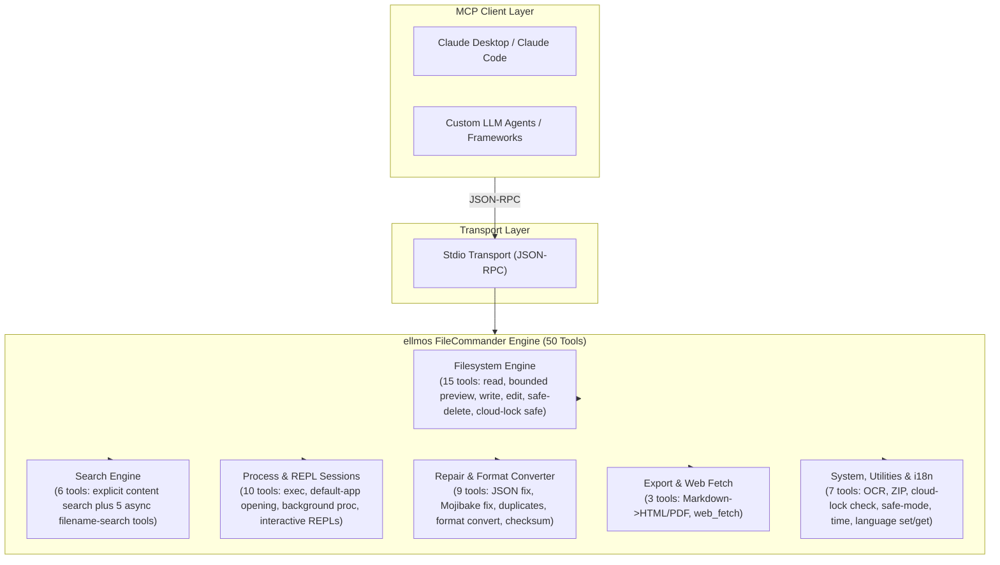
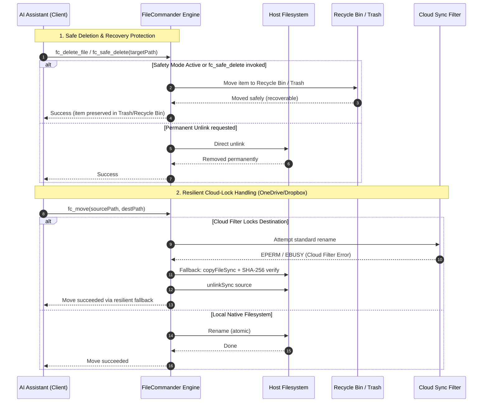

<!-- worldset: {"translated_from_sha256": "310943b7f88d776f409deb86f0a6536cfe6e4f73674f992af028f8173869755c", "translator": "claude-haiku-5-5", "translated_at": "2026-10-25T05:43:05.467386+00:00", "reviewer": "gpt-6-luna/max; Root independent structure and risk samples"} -->
<p align="center">
  
</p>

# Servidor MCP ellmos FileCommander

[English](README.md) | [Deutsch](README_de.md) | **Español** | [简体中文](README_zh.md) | [日本語](README_ja.md) | [Русский](README_ru.md) | [Français](README_fr.md) | [हिन्दी](README_hi.md) | [العربية](README_ar.md) | [বাংলা](README_bn.md) | [Português](README_pt.md)

La navegación del README enumera los idiomas de documentación disponibles en este repositorio. Los mensajes de ejecución y las respuestas formateadas de FileCommander están disponibles en alemán (de), inglés (en), español (es), chino (zh), japonés (ja), ruso (ru), francés (fr), hindi (hi), árabe (ar), bengalí (bn) y portugués (pt). Esta lista de idiomas de ejecución es independiente de los idiomas de traducción del README. Se aplica a los mensajes generados durante la ejecución y a las respuestas de herramientas con formato; los títulos de herramientas MCP y las descripciones de descubrimiento y de esquemas permanecen estáticos en inglés. Define `FC_LANGUAGE` con uno de los códigos admitidos antes de iniciar el servidor, o llama a `fc_set_language` durante una sesión MCP activa. `fc_get_language` informa del idioma activo y de los once códigos admitidos. Si `FC_LANGUAGE` no está definido o contiene un código no admitido, se usa alemán (de). Los formatos de fecha y hora siguen la configuración regional activa.

*Parte de la familia [ellmos-ai](https://github.com/ellmos-ai).*

[](https://opensource.org/licenses/MIT)
[](https://github.com/ellmos-ai/ellmos-filecommander-mcp/actions/workflows/tests.yml)
[](https://www.npmjs.com/package/ellmos-filecommander-mcp)
[](https://nodejs.org/)
[](#tools-overview)
[-brightgreen.svg)](#testing)
[](SECURITY.md)
[](SECURITY.md)
[](#why-filecommander)
[](NOTICE)
[](SECURITY.md)
[](THIRD_PARTY_LICENSES.md)
[](THIRD_PARTY_LICENSES.txt)
[](https://github.com/ellmos-ai)
[](https://github.com/open-bricks)
[](llms.txt)
[](llms.txt)
[](llms.txt)

> **Navegación rápida:**
> 1. [Descripción general](#sec-01) | 2. [Arquitectura del sistema](#sec-02) | 3. [Ciclo de vida de ejecución de extremo a extremo](#sec-03) | 4. [Capacidades principales e invariantes de seguridad](#sec-04) | 5. [Perfiles objetivo y detectabilidad](#sec-05) | 6. [Instalación y requisitos previos](#sec-06) | 7. [Configuración y configuración del cliente](#sec-07) | 8. [Resumen de herramientas (50 herramientas)](#sec-08) | 9. [Matriz comparativa y alternativas](#sec-09) | 10. [Prefijo de herramientas y convención de nombres](#sec-10) | 11. [Gobernanza e invariantes de ejecución](#sec-11) | 12. [Arquitectura de seguridad y riesgos de las herramientas](#sec-12) | 13. [Pruebas, puertas de calidad y verificación](#sec-13) | 14. [Registro de cambios y versionado](#sec-14) | 15. [SBOM de nivel 1 y licencias de terceros](#sec-15) | 16. [Historia y evolución](#sec-16) | 17. [Ecosistema ellmos-ai y matriz de socios](#sec-17) | 18. [Aviso legal (§ 521 BGB) y descargo de responsabilidad](#sec-18)
>
> | Referencias directas: [🛡️ Política de seguridad](SECURITY.md) • [🤝 Contribuir](CONTRIBUTING.md) • [⚖️ Licencias de terceros](THIRD_PARTY_LICENSES.md) • [📄 SBOM en texto plano](THIRD_PARTY_LICENSES.txt) • [📜 Registro de marketing](MARKETING-LOG.txt) • [🤖 Contexto para LLM (llms.txt)](llms.txt) • [📋 Aviso canónico](NOTICE) |

Un **servidor completo de Model Context Protocol (MCP)** que proporciona a los asistentes de IA acceso completo al sistema de archivos, búsqueda de contenido acotada en múltiples archivos, gestión de procesos, sesiones de shell interactivas y capacidades asíncronas de búsqueda de nombres de archivo.

**50 herramientas** en un único servidor: todo lo que un agente de IA necesita para interactuar con el sistema local.

**Palabras clave de descubrimiento:** servidor MCP de sistema de archivos local, búsqueda de contenido en múltiples archivos MCP, eliminación segura MCP, servidor MCP de la Papelera de reciclaje, gestión de procesos MCP, shell interactiva MCP, búsqueda asíncrona de archivos para agentes de IA, operaciones de archivos seguras frente a bloqueos de la nube, Markdown a PDF MCP, servidor OCR MCP, archivos ZIP MCP.

**Estado en registros:** publicado en [npm](https://www.npmjs.com/package/ellmos-filecommander-mcp), indexado por [jsDelivr](https://www.jsdelivr.com/package/npm/ellmos-filecommander-mcp), visible en [LobeHub](https://lobehub.com/mcp/ellmos-ai-ellmos-filecommander-mcp), listado en [Glama](https://glama.ai/mcp/servers/ellmos-ai/ellmos-filecommander-mcp) y preparado para el Registro oficial de MCP mediante [`server.json`](server.json). Algunos directorios de terceros todavía muestran metadatos antiguos de 43 herramientas, por lo que los metadatos canónicos del README y de npm deben seguir siendo la fuente de referencia hasta que se complete su reindexación.

> [!NOTE]
> **Para agentes de IA e integraciones de LLM:**
> FileCommander ofrece **50 herramientas especializadas** accesibles mediante transporte stdio estándar. Todos los nombres de herramientas usan el prefijo `fc_` para evitar colisiones de espacios de nombres. Para los LLM, hay resúmenes compactos de contexto y de esquemas disponibles en [`llms.txt`](llms.txt) y [`server.json`](server.json).

---

<a id="sec-01"></a><a id="overview"></a><a id="why-filecommander"></a><a id="ueberblick"></a><a id="überblick"></a>
## Descripción general y ¿por qué FileCommander?

La mayoría de los servidores MCP de sistema de archivos solo cubren operaciones básicas de lectura y escritura. FileCommander va más allá:

- **Eliminación segura**: mueve los archivos a la Papelera de reciclaje (Windows) o a la Papelera (macOS/Linux) en lugar de eliminarlos de forma permanente
- **Sesiones interactivas**: inicia e interactúa con REPL (Python, Node.js, shells) a través del protocolo MCP
- **Búsqueda asíncrona**: busca en árboles de directorios grandes en segundo plano mientras la IA sigue trabajando
- **Búsqueda explícita de contenido**: busca texto literal o expresiones regulares en una lista acotada de archivos, sin recursión ni expansión de globs
- **Gestión de procesos**: lista, inicia y termina procesos del sistema
- **Reemplazo de cadenas**: edita archivos buscando cadenas únicas con validación de contexto
- **Conversión de formatos**: convierte entre JSON, CSV, INI, YAML, TOML, XML y TOON
- **Archivos ZIP**: crea, extrae y lista archivos ZIP
- **Sumas de verificación**: hash MD5, SHA-1, SHA-256, SHA-384 y SHA-512 con comparación
- **OCR**: extrae texto de imágenes (dependencia opcional tesseract.js)
- **Modo seguro**: alterna para dirigir todas las eliminaciones a la Papelera de reciclaje / Papelera
- **Exportación a Markdown**: convierte Markdown a HTML/PDF profesional con bloques de código, tablas, listas anidadas y citas en bloque
- **Seguro frente a bloqueos de la nube**: copia y eliminación automática como alternativa cuando los filtros de sincronización en la nube (OneDrive, Dropbox, Google Drive, iCloud) bloquean las operaciones de renombrado
- **Diagnóstico de bloqueos en la nube**: comprueba si una ruta corre riesgo de conflictos con los filtros de sincronización antes de operar
- **Multiplataforma**: funciona en Windows, macOS y Linux con optimizaciones específicas de cada plataforma

---

<a id="sec-02"></a><a id="system-architecture"></a><a id="systemarchitektur"></a>
## Arquitectura del sistema

### Topología arquitectónica ASCII en cuatro vistas

```text
+--------------------------------------------------------------------------------------------------+
|                            ELLMOS FILECOMMANDER MCP ARCHITECTURAL TOPOLOGY                       |
+--------------------------------------------------------------------------------------------------+
| [VIEW 1: CALLER RUNTIMES & AGENT CLIENTS]                                                        |
|   * Autonomous Agents   : Claude Code, OpenAI Codex, Antigravity / Gemini, Kimi, Cursor          |
|   * Agent Frameworks    : AutoGen, CrewAI, LangChain, LlamaIndex, Custom Python / TS Clients    |
|   * Transport Protocols : Model Context Protocol (MCP stdio), JSON-RPC 2.0 Framing               |
|   * Tool Surface        : 50 Unified Specialized Tools (fc_* namespace collision isolation)       |
|   * Schema Contract     : Stdio transport, dynamic runtime i18n parameter parsing (Zod validated)|
+--------------------------------------------------------------------------------------------------+
|                                                |                                                 |
|                                                v                                                 |
+--------------------------------------------------------------------------------------------------+
| [VIEW 2: FILECOMMANDER MCP CORE ENGINE & DISPATCH ORCHESTRATOR]                                  |
|   * Protocol Dispatch   : ESM stdio router with Zod schema validation & parameter checking      |
|   * Multilingual Core   : 11-language dynamic runtime i18n engine       |
|   * Safety Interceptor  : Global Safety Mode (fc_set_safe_mode) routing deletes to Recycle Bin   |
|   * Sync Diagnostics    : Reparse point detection & cloud filter diagnostics (fc_check_cloud_lock)|
|   * Process Supervisor  : Bounded child process lifecycle management & interactive REPL session  |
|                           state registry with circular ring buffers                              |
+--------------------------------------------------------------------------------------------------+
|                                                |                                                 |
|                                                v                                                 |
+--------------------------------------------------------------------------------------------------+
| [VIEW 3: FILESYSTEM RUNTIME, FORMAT REPAIR & PROCESS ISOLATION]                                  |
|   * Atomic File Ops     : Read, write, line edit, exact literal string replacement (fc_str_replace)|
|   * Cloud-Lock Fallback : Automatic copyFileSync + SHA-256 verify + unlinkSync on EPERM / EBUSY   |
|   * Bounded Inspection  : Metadata-first preview (fc_preview_file, 1 MiB inline content ceiling)  |
|   * Bounded Content Srch: max 50 explicit files, 10 MB ceiling, token redaction (INV-MASK-06)   |
|   * Self-Healing Repair : Mojibake repair (27+ UTF-8 patterns), JSON syntax fix, file cleanup    |
|   * Lossless Converter  : Declarative transformation across 7 formats (JSON, YAML, TOML, XML...) |
|   * Media & Documents   : Headless Markdown to PDF/HTML, ZIP archive engine, optional OCR (Tess)  |
+--------------------------------------------------------------------------------------------------+
|                                                |                                                 |
|                                                v                                                 |
+--------------------------------------------------------------------------------------------------+
| [VIEW 4: AIR-GAP DEFENSE PERIMETER, RUNASINVOKER & CONTROLLED EGRESS]                            |
|   * Execution Privilege : RunAsInvoker unprivileged user-mode (Zero administrative elevation)    |
|   * Transport Boundary  : 100% Local stdio transport, zero telemetry, zero open listening ports  |
|   * Controlled Egress   : Outbound HTTP(S) strictly gated through caller-invoked fc_web_fetch     |
|   * Network Safety      : SSRF guard blocking private/internal IP ranges (allow_private override) |
|   * Governance & Supply : Level 1 SBOM, 100% permissive runtime (MIT/BSD), 48h Security SLA      |
+--------------------------------------------------------------------------------------------------+
```

### Diagrama de flujo de componentes



---

<a id="sec-03"></a><a id="end-to-end-execution-lifecycle"></a><a id="execution-lifecycle"></a><a id="end-to-end-ausfuehrungszyklus"></a>
## Ciclo de vida de ejecución de extremo a extremo



---

<a id="sec-04"></a><a id="core-capabilities--safety-invariants"></a><a id="core-capabilities"></a><a id="kernfaehigkeiten--sicherheitsinvarianten"></a><a id="kernfähigkeiten--sicherheitsinvarianten"></a>
## Capacidades principales e invariantes de seguridad

| Capacidad / Invariante | Garantía y detalles de implementación | Beneficio de seguridad y operativo |
|------------------------|---------------------------------------|------------------------------------|
| **stdio local y salida explícita** | El transporte MCP es stdio local, sin telemetría y sin salida automática a la red. `fc_web_fetch` realiza solicitudes HTTP(S) salientes solo cuando un cliente lo invoca explícitamente; los destinos privados se bloquean por defecto salvo que `allow_private` esté habilitado. | Hace visible para los clientes el límite de red, manteniendo un transporte de servidor local y sin puertos. |
| **Eliminación segura y protección de la papelera** | `fc_safe_delete` mueve los elementos a la Papelera de reciclaje de Windows / Papelera de macOS / Papelera FreeDesktop de Linux. `fc_set_safe_mode` enruta todas las eliminaciones de forma segura. | Evita la pérdida irreversible de datos por eliminaciones recursivas o masivas accidentales. |
| **Movimiento resistente a bloqueos de la nube (`fc_move`)** | Detección automática de filtros de sincronización en la nube (puntos de reanálisis de OneDrive, Dropbox, iCloud) con alternativa fluida de copia, verificación y eliminación. | Elimina los fallos `EPERM` / `EBUSY` durante las operaciones automatizadas de agentes en directorios sincronizados. |
| **Diagnóstico de bloqueos en la nube (`fc_check_cloud_lock`)** | Informe de solo lectura del contexto estático de rutas en la nube más la existencia y el tipo del destino; la hidratación de Cloud Files y los manejadores de procesos se indican explícitamente como no comprobados cuando no están disponibles. | Los agentes pueden distinguir el riesgo estático de OneDrive de un bloqueo de renombrado realmente detectado. |
| **Búsqueda de contenido acotada en múltiples archivos** | `fc_search_content` limita estrictamente las entradas (máximo 50 archivos explícitos, 10 MB por archivo, 200 coincidencias, 200 000 caracteres) sin recursión por globs. | Previene errores de memoria insuficiente y bloqueos catastróficos de CPU durante búsquedas en repositorios grandes. |
| **Redacción automática de secretos y tokens** | Los fragmentos de búsqueda de contenido enmascaran automáticamente claves de API comunes, tokens de portador, credenciales de AWS y cabeceras de autorización. | Evita la contaminación del contexto del LLM y la filtración accidental de credenciales en el historial de prompts. |
| **REPL interactivos y aislamiento de sesiones** | Sesiones interactivas con estado (`fc_start_session`, `fc_send_input`, `fc_read_output`) para Python, Node.js, bash y PowerShell con búferes acotados. | Permite depurar REPL en múltiples turnos sin una acumulación descontrolada de procesos en segundo plano. |
| **Motor multiformato sin pérdidas** | Conversión declarativa (`fc_convert_format`) entre 7 formatos estructurados (JSON, YAML, TOML, XML, CSV, INI, TOON). | Normalización limpia de datos entre formatos de configuración heterogéneos sin pérdida de información. |
| **Motor de reparación de mojibake y archivos** | `fc_fix_encoding`, `fc_fix_json` y `fc_cleanup_file` reparan codificaciones UTF-8 rotas (más de 27 patrones), sintaxis JSON malformada, BOM y bytes NUL. | Canalizaciones autorreparables para archivos corruptos generados en distintas plataformas. |
| **Ejecución sin privilegios ni elevación** | Diseñado y verificado para ejecutarse en modo usuario estándar sin privilegios. Nunca requiere privilegios de administrador ni de root. | Superficie de ataque mínima; cumple el principio de mínimo privilegio. |
| **Motor de i18n en tiempo de ejecución con once idiomas** | Cambio dinámico y consulta del idioma (`fc_set_language`, `fc_get_language`) para los 11 códigos admitidos: `de`, `en`, `es`, `zh`, `ja`, `ru`, `fr`, `hi`, `ar`, `bn` y `pt`. | Experiencia multilingüe nativa para desarrolladores e informes de errores localizados. |
| **Matriz verificada en múltiples sistemas operativos** | Probado en Windows, Ubuntu Linux y macOS con Node.js 20, 22 y 24 con 292 aserciones automatizadas. | Paridad y fiabilidad multiplataforma continuas. |

---

<a id="sec-05"></a><a id="target-personas--discoverability"></a><a id="target-personas"></a><a id="zielgruppen--auffindbarkeit"></a>
## Perfiles objetivo y detectabilidad

FileCommander está diseñado y validado específicamente para cuatro perfiles principales de desarrolladores, agentes y operaciones:

### [PERSONA-01] Agentes autónomos de programación con IA y enjambres de LLM
- **Perfil:** enjambres multiagente y entornos agénticos independientes (Claude Code, Antigravity/Gemini, OpenAI Codex, AutoGen, CrewAI) que ejecutan edición recursiva de código, refactorización de proyectos y auditorías de directorios.
- **Principales problemas operativos:** crecimiento rápido de la ventana de contexto por la lectura de archivos de varios megabytes, caídas de procesos no gestionadas por archivos bloqueados (`EPERM`/`EBUSY`) en carpetas sincronizadas en la nube, y corrupción irrecuperable de repositorios por rutinas accidentales de limpieza (`rm -rf`).
- **Solución de FileCommander:**
  - `fc_preview_file`: inspección basada primero en metadatos, con un límite estricto de 1 MiB de contenido en línea que evita la saturación del contexto del LLM.
  - `fc_search_content`: búsqueda acotada en múltiples archivos (máximo 50 archivos, 10 MB por archivo, 200 coincidencias) con redacción automática de secretos y tokens.
  - `fc_safe_delete` y `fc_set_safe_mode`: conserva los archivos eliminados en la Papelera de reciclaje / Papelera del sistema para operaciones de archivos sin riesgo.
  - `fc_move` y `fc_check_cloud_lock`: copia automática + verificación SHA-256 + alternativa de desvinculación ante bloqueos de archivos, evitando fallos del agente.

### [PERSONA-02] Ingenieros de DevOps, cadenas de herramientas y automatización multi-host
- **Perfil:** ingenieros de sistemas y automatización que construyen herramientas CLI multiplataforma, canalizaciones de validación CI/CD y scripts de sincronización entre múltiples máquinas en Windows, Linux y macOS.
- **Principales problemas operativos:** semántica heterogénea de sistemas operativos (barras invertidas de Windows frente a barras de POSIX, corrupción de finales de línea, sintaxis específica de cada shell), procesos hijos zombis y bloqueos de archivos en espacios de trabajo compartidos de OneDrive/Dropbox.
- **Solución de FileCommander:**
  - Semántica unificada de herramientas multiplataforma en Windows, Linux y macOS.
  - Sesiones REPL interactivas con estado (`fc_start_session`, `fc_send_input`, `fc_read_output`) con búferes circulares acotados.
  - Renombrado por lotes de archivos (`fc_batch_rename`) y búsqueda de directorios en segundo plano (`fc_start_search`, `fc_get_search_results`).
  - Gestión del ciclo de vida de procesos (`fc_execute_command`, `fc_start_process`, `fc_kill_process`) sin fugas de procesos.

### [PERSONA-03] Responsables de SecOps, gobernanza y cumplimiento
- **Perfil:** responsables de seguridad, auditores de cumplimiento y equipos de privacidad que supervisan las integraciones de herramientas de IA en entornos empresariales y de producción.
- **Principales problemas operativos:** balizas de telemetría en segundo plano no divulgadas, acceso a la red no revisado desde plugins locales, filtración de credenciales o tokens en datos de entrenamiento o historiales de prompts, y escalada de privilegios de usuarios sin privilegios.
- **Solución de FileCommander:**
  - Transporte stdio local con telemetría estrictamente nula y sin puertos de escucha de red abiertos.
  - Salida de red explícita restringida estrictamente a `fc_web_fetch` invocado por el cliente (IP internas o privadas bloqueadas por defecto).
  - Enmascaramiento automático de secretos y tokens de portador en los fragmentos de búsqueda (`INV-MASK-06`).
  - Ejecución estricta sin privilegios de usuario (`INV-PROC-09`) y un SLA vinculante de respuesta a vulnerabilidades de 48 horas (`security@open-bricks.org`, `security@ellmos.ai`).

### [PERSONA-04] Arquitectos de plataformas empresariales y desarrolladores de canalizaciones de datos
- **Perfil:** arquitectos de soluciones e ingenieros de datos que integran archivos locales, normalizan formatos de configuración heterogéneos, validan hashes criptográficos y generan informes.
- **Principales problemas operativos:** proliferación de servidores MCP que obliga a usar entre 4 y 6 servidores dispares de propósito único, secuencias de bytes UTF-8 corruptas (mojibake) entre herramientas, y scripts de análisis a medida.
- **Solución de FileCommander:**
  - Despliegue completo de 50 herramientas en un único servidor, eliminando la proliferación de servidores y la sobrecarga de procesos.
  - Conversión declarativa sin pérdidas entre 7 formatos estructurados (`fc_convert_format`: JSON, YAML, TOML, XML, CSV, INI, TOON).
  - Motores integrados de reparación de archivos (`fc_fix_encoding`, `fc_fix_json`, `fc_cleanup_file`) para canalizaciones autorreparables.
  - Sumas de verificación criptográficas (`fc_checksum`: SHA-256, SHA-512, MD5, SHA-1) y renderizado de Markdown a PDF/HTML (`fc_md_to_pdf`, `fc_md_to_html`).

### Consultas de búsqueda de alta intención y vectores de detectabilidad

- **Consultas de búsqueda principales:** `ellmos-filecommander-mcp`, `FileCommander MCP`, `filesystem MCP server`, `multi-file content search MCP`, `safe delete MCP`, `async file search MCP`, `process management MCP`, `Markdown PDF MCP`.
- **Metadatos legibles por máquina:** el contexto estructurado para agentes de IA se mantiene en [`llms.txt`](llms.txt), [`server.json`](server.json) y [`glama.json`](glama.json).
- **Cumplimiento y atribución:** validado frente a [`THIRD_PARTY_LICENSES.md`](THIRD_PARTY_LICENSES.md) y [`NOTICE`](NOTICE).

---

<a id="sec-06"></a><a id="installation"></a><a id="installation-prerequisites"></a>
## Instalación

### Requisitos previos

- [Node.js](https://nodejs.org/) 20 o superior
- npm

### Opción 1: instalar desde NPM

```bash
npm install -g ellmos-filecommander-mcp
```

### Opción 2: instalar desde el código fuente

```bash
git clone https://github.com/ellmos-ai/ellmos-filecommander-mcp.git
cd ellmos-filecommander-mcp
npm ci
npm run build
```

---

<a id="sec-07"></a><a id="configuration"></a><a id="client-setup"></a><a id="konfiguration"></a>
## Configuración

### Claude Desktop

Añade lo siguiente a tu `claude_desktop_config.json`:

**Windows:** `%APPDATA%\Claude\claude_desktop_config.json`
**macOS:** `~/Library/Application Support/Claude/claude_desktop_config.json`

#### Si está instalado globalmente mediante NPM:

```json
{
  "mcpServers": {
    "filecommander": {
      "command": "ellmos-filecommander"
    }
  }
}
```

#### Si está instalado desde el código fuente:

```json
{
  "mcpServers": {
    "filecommander": {
      "command": "node",
      "args": ["/absolute/path/to/filecommander-mcp/dist/index.js"]
    }
  }
}
```

Reinicia Claude Desktop después de guardar.

### Otros clientes MCP

El servidor se comunica mediante **transporte stdio**. Apunta tu cliente MCP a la entrada `dist/index.js` o al binario `ellmos-filecommander`.

---

<a id="sec-08"></a><a id="tools-overview"></a><a id="available-tools"></a><a id="tools-uebersicht"></a><a id="tools-übersicht"></a>
## Resumen de herramientas

### Operaciones de sistema de archivos (15 herramientas)

| Herramienta | Descripción |
|-------------|-------------|
| `fc_read_file` | Lee el contenido de un archivo con límite de líneas opcional |
| `fc_preview_file` | Inspecciona primero el tipo MIME y el tamaño, y luego solicita explícitamente contenido MCP en línea acotado |
| `fc_read_multiple_files` | Lee hasta 20 archivos en una sola llamada |
| `fc_write_file` | Escribe, crea o añade contenido a archivos |
| `fc_edit_file` | Edición basada en líneas (reemplazar, insertar, eliminar líneas) |
| `fc_str_replace` | Reemplaza una cadena única en un archivo con validación de contexto |
| `fc_list_directory` | Lista el contenido de directorios (recursivo, profundidad configurable) |
| `fc_create_directory` | Crea directorios (incluidos los padres) |
| `fc_delete_file` | Elimina un archivo (permanente) |
| `fc_delete_directory` | Elimina un directorio (con indicador recursivo opcional) |
| `fc_safe_delete` | Mueve a la Papelera de reciclaje / Papelera (¡recuperable!) |
| `fc_move` | Mueve o renombra archivos y directorios (seguro frente a la nube) |
| `fc_copy` | Copia archivos y directorios |
| `fc_file_info` | Obtiene metadatos detallados de un archivo (tamaño, fechas, tipo) |
| `fc_search_files` | Búsqueda síncrona de archivos con patrones comodín |

`fc_preview_file` es la alternativa remota/sin interfaz para archivos locales. Su llamada predeterminada devuelve solo metadatos estructurados: ruta resuelta, URI `file://`, tipo MIME, tamaño en bytes, tipo de vista previa, límite fijo de 1 MiB y la llamada exacta de seguimiento. El contenido solo se lee después de `include_content=true`. Los textos y las imágenes raster elegibles usan bloques de contenido MCP estándar `text`/`image`; los PDF usan un `resource` incrustado acotado. Los archivos de más de 1 MiB y los tipos no compatibles siguen siendo solo metadatos y nunca se leen ni se codifican en Base64 mediante la vista previa.

### Búsqueda de contenido (1 herramienta)

| Herramienta | Descripción |
|-------------|-------------|
| `fc_search_content` | Búsqueda de solo lectura, literal o por expresión regular, dentro de una lista explícita y ordenada de archivos, con límites de mayúsculas, contexto, globales y por archivo |

`fc_search_content` nunca expande globs, no recorre directorios ni descubre archivos de forma recursiva. Acepta como máximo 50 archivos de texto UTF-8 explícitos, omite los binarios y los archivos de más de 10 MB, y devuelve JSON determinista. Las coincidencias se limitan a 200 globalmente y 100 por archivo, el contexto a 10 líneas, los fragmentos a 500 caracteres y la salida serializada a 200 000 caracteres. Los fallos por ausencia, solo-nube, permisos, codificación, binarios y tamaño se informan por archivo, de modo que los archivos legibles siguen produciendo resultados. Los formatos comunes de secretos se redactan en los fragmentos.

### Búsqueda asíncrona (5 herramientas)

| Herramienta | Descripción |
|-------------|-------------|
| `fc_start_search` | Inicia una búsqueda en segundo plano (devuelve el control de inmediato) |
| `fc_get_search_results` | Recupera resultados con paginación |
| `fc_stop_search` | Cancela una búsqueda en curso |
| `fc_list_searches` | Lista todas las búsquedas activas o completadas |
| `fc_clear_search` | Elimina de la memoria las búsquedas completadas |

### Gestión de procesos (5 herramientas)

| Herramienta | Descripción |
|-------------|-------------|
| `fc_execute_command` | Ejecuta un comando de shell (bloqueante, con tiempo límite) |
| `fc_start_process` | Inicia un proceso en segundo plano (no bloqueante) |
| `fc_open_path` | Valida y abre un archivo o directorio local existente con la aplicación predeterminada del sistema operativo |
| `fc_list_processes` | Lista los procesos del sistema en ejecución |
| `fc_kill_process` | Termina un proceso por PID o nombre |

`fc_open_path` acepta solo un archivo o directorio existente y lo envía a un lanzador nativo fijo del controlador predeterminado. Su resultado estructurado informa de `launcher_accepted=true|false`, indica siempre `user_visible="unknown"` e identifica una alternativa legible por máquina: `fc_preview_file` con argumentos solo de metadatos para archivos, o `fc_list_directory` para directorios. La aceptación del lanzador nunca afirma que una GUI se haya hecho visible. `fc_start_process` permite en cambio al llamador elegir un ejecutable y sus argumentos. `fc_execute_command` acepta un comando de shell arbitrario: para comandos ordinarios se usa el shell predeterminado de Node (`COMSPEC`/`cmd.exe` en Windows), mientras que la ruta de caracteres especiales de FileCommander en Windows puede enrutarse a través de Windows PowerShell.

### Sesiones interactivas (5 herramientas)

| Herramienta | Descripción |
|-------------|-------------|
| `fc_start_session` | Inicia un proceso interactivo (Python, Node, shell...) |
| `fc_read_output` | Lee la salida de una sesión |
| `fc_send_input` | Envía entrada a una sesión en ejecución |
| `fc_list_sessions` | Lista todas las sesiones |
| `fc_close_session` | Termina una sesión |

### Mantenimiento y reparación de archivos (9 herramientas)

| Herramienta | Descripción |
|-------------|-------------|
| `fc_fix_json` | Repara JSON dañado (BOM, comas finales, comentarios, comillas simples) |
| `fc_validate_json` | Valida JSON con posición detallada del error y contexto |
| `fc_cleanup_file` | Elimina BOM, bytes NUL, espacios finales y normaliza los finales de línea |
| `fc_fix_encoding` | Corrige mojibake / UTF-8 con doble codificación (más de 27 patrones de caracteres) |
| `fc_folder_diff` | Registra cambios en directorios mediante instantáneas (nuevos/modificados/eliminados) |
| `fc_batch_rename` | Renombrado por lotes basado en patrones (prefijo/sufijo, reemplazo, detección automática) |
| `fc_convert_format` | Convierte entre los formatos JSON, CSV, INI, YAML, TOML, XML y TOON |
| `fc_detect_duplicates` | Encuentra archivos duplicados mediante hash SHA-256 |
| `fc_checksum` | Hash de archivos (MD5, SHA-1, SHA-256, SHA-384, SHA-512) con comparación opcional |

### Archivo (1 herramienta)

| Herramienta | Descripción |
|-------------|-------------|
| `fc_archive` | Crea, extrae y lista archivos ZIP |

### OCR (1 herramienta)

| Herramienta | Descripción |
|-------------|-------------|
| `fc_ocr` | Extrae texto de imágenes mediante tesseract.js (dependencia opcional) |

### Sincronización en la nube (1 herramienta)

| Herramienta | Descripción |
|-------------|-------------|
| `fc_check_cloud_lock` | Informa del contexto estático de sincronización en la nube y del estado del destino; nunca afirma un bloqueo activo sin evidencia (Windows) |

### Sistema (4 herramientas)

| Herramienta | Descripción |
|-------------|-------------|
| `fc_get_time` | Obtiene la hora actual del sistema con información de zona horaria |
| `fc_set_safe_mode` | Alterna el modo seguro: todas las eliminaciones pasan por la Papelera de reciclaje / Papelera |
| `fc_set_language` | Establece el idioma de ejecución (`de`, `en`, `es`, `zh`, `ja`, `ru`, `fr`, `hi`, `ar`, `bn` o `pt`) |
| `fc_get_language` | Lee el idioma de ejecución activo y los 11 códigos de idioma admitidos |

### Exportación (2 herramientas)

| Herramienta | Descripción |
|-------------|-------------|
| `fc_md_to_html` | Markdown a HTML independiente con estilos CSS (encabezados, bloques de código, tablas, listas anidadas, citas en bloque, imágenes, casillas de verificación) |
| `fc_md_to_pdf` | Markdown a PDF mediante navegador sin interfaz (Edge/Chrome). Recurre a HTML si no hay ningún navegador disponible |

### Web (1 herramienta)

| Herramienta | Descripción |
|-------------|-------------|
| `fc_web_fetch` | Obtiene una página web y devuelve contenido según `mode`: extract (texto principal limpio), raw (cuerpo HTTP), links, forms o headers. Herramienta de red de solo lectura; el filtro SSRF bloquea por defecto los destinos internos o privados. |

**Total: 50 herramientas**

---

<a id="sec-09"></a><a id="comparative-matrix--alternatives"></a><a id="comparative-matrix"></a><a id="comparison-with-alternatives"></a><a id="vergleichsmatrix--alternativen"></a>
## Matriz comparativa y alternativas

FileCommander combina manipulación del sistema de archivos, búsqueda acotada, control de procesos, reparación de datos, conversión de formatos y renderizado de documentos en una única interfaz MCP unificada. A continuación se muestra una comparación arquitectónica frente a alternativas habituales en 10 dimensiones operativas clave:

| Dimensión operativa | ellmos FileCommander MCP (50 herramientas) | MCP oficial de sistema de archivos (`@modelcontextprotocol/server-filesystem`) | Desktop Commander MCP | Shell directa del host (`bash` / PowerShell) | Scripts ad hoc y APIs en la nube |
|---------------------|:------------------------------------------:|:----------------------------------------------------------:|:---------------------:|:---------------------------------------------------------:|:--------------------------------:|
| **Amplitud y alcance de herramientas** `[INV-PROC-09]` | **50 herramientas unificadas** en 6 dominios | ~11 herramientas básicas de E/S de archivos | ~15 herramientas (archivos + procesos) | Comandos CLI sin restricciones | Scripts a medida fragmentados |
| **Eliminación segura y recuperación** `[INV-SAFE-02]` | **Papelera de reciclaje / Papelera nativa del SO** (`fc_safe_delete`, modo seguro) | Solo eliminación permanente (`unlink`) | Solo eliminación permanente | `rm -rf` / `Remove-Item` irreversible | Implementaciones de papelera personalizadas |
| **Resiliencia frente a bloqueos y sincronización en la nube** `[INV-LOCK-03]` | **Alternativa automática** (copia + verificación SHA-256 + desvinculación ante EPERM/EBUSY) | Falla con archivos bloqueados / puntos de reanálisis | Falla con archivos bloqueados | Falla o se bloquea indefinidamente | Colisiones de sincronización / copias en conflicto |
| **Búsqueda acotada y redacción de secretos** `[INV-SRCH-05 / INV-MASK-06]` | **Búsqueda acotada** (máximo 50 archivos, 10 MB, redacción automática de tokens de API) | Solo recorrido de directorios (sin expresiones regulares de contenido) | Búsqueda por expresiones regulares sin límites | `grep` sin límites (filtra secretos en el contexto) | Expresiones regulares personalizadas sin redacción |
| **Búsqueda asíncrona de larga duración** `[INV-SRCH-05]` | **Análisis en segundo plano con paginación por token** (`fc_start_search`) | Solo síncrona (bloquea al agente) | Solo síncrona | Control de trabajos en segundo plano (`&`) | Bucles de sondeo / llamadas de red lentas |
| **REPL interactivos y control de sesiones** `[INV-REPL-08]` | **REPL con estado** (Node, Python, Shell) con búferes circulares | No compatible | Sesiones de terminal básicas | Subprocesos sin procesar (riesgo de procesos zombis) | Canalizaciones IPC complejas |
| **Autorreparación y reparación de datos** `[INV-DIAG-04]` | **Integrado**: corrección de mojibake (más de 27 patrones) y reparación de JSON | No compatible | No compatible | Canalización manual `iconv` / `sed` | Código personalizado de recuperación de errores |
| **Transformación entre formatos** `[INV-PREV-07]` | **Conversión declarativa** (JSON, YAML, TOML, XML, CSV, INI, TOON) | No compatible | No compatible | Requiere `jq` / `yq` / `xmlstarlet` externos | Bibliotecas Python de terceros |
| **Utilidades de documentos y archivos** `[INV-PREV-07]` | **Integrado**: ciclo de vida de ZIP, OCR (Tesseract), Markdown a HTML/PDF | No compatible | Excel/PDF mediante aplicación de escritorio | Requiere `pandoc`, `zip`, `tesseract` | Dependencias de utilidades fragmentadas |
| **Gobernanza y SLA de seguridad** `[INV-LOCAL-01 / INV-SLA-10]` | **stdio local**, telemetría nula, salida explícita, SLA vinculante de 48 h | stdio estándar, SLA comunitario | stdio, telemetría/registros no revisados | Elevación sin restricciones y riesgo de inyección de scripts | Exposición ad hoc a la nube SaaS |

**Diferenciadores clave:**
- El único servidor MCP con **eliminación recuperable** (Papelera de reciclaje / Papelera) y **modo seguro** global
- El único servidor MCP con **búsqueda asíncrona en segundo plano** con paginación y gestión de tokens
- El único servidor MCP con **redacción automática de secretos y tokens de portador** en los fragmentos de búsqueda
- **Reparación de JSON**, **corrección de codificación mojibake** y **detección de duplicados** integradas
- **Operaciones de archivos seguras frente a bloqueos en la nube** integradas, con alternativa automática de copia, verificación y eliminación
- Solución de servidor único más completa (**50 herramientas**), que evita la proliferación de múltiples servidores

---

<a id="sec-10"></a><a id="tool-prefix"></a><a id="tool-praefix"></a><a id="tool-präfix"></a>
## Prefijo de herramientas

Todas las herramientas usan el prefijo `fc_` (FileCommander) para evitar conflictos con otros servidores MCP.

---

<a id="sec-11"></a><a id="governance--runtime-invariants"></a><a id="governance-invariants"></a><a id="governance--laufzeit-invarianten"></a>
## Gobernanza e invariantes de ejecución

El servidor aplica 10 invariantes estrictos de ejecución que garantizan seguridad, previsibilidad y mínimo privilegio:

| ID del invariante | Nombre | Garantía y detalles de implementación | Beneficio operativo de seguridad |
|-------------------|--------|---------------------------------------|----------------------------------|
| **INV-LOCAL-01** | **stdio local y salida explícita** | Transporte stdio local, telemetría nula, sin puertos de escucha abiertos. Las solicitudes HTTP(S) salientes ocurren estrictamente mediante llamadas explícitas del cliente a `fc_web_fetch`. | Cero fugas de red en segundo plano no autorizadas; aislamiento local primero. |
| **INV-SAFE-02** | **Eliminación segura y protección de la papelera** | `fc_safe_delete` y el `fc_set_safe_mode` global dirigen las eliminaciones de archivos y directorios a la Papelera de reciclaje (Windows) / Papelera (macOS/Linux). | Elimina la pérdida accidental e irreversible de datos por acciones de agentes de IA. |
| **INV-LOCK-03** | **Movimiento resistente a bloqueos de la nube** | `fc_move` utiliza automáticamente como alternativa la copia, la verificación SHA-256 y la eliminación del archivo de origen cuando los filtros de sincronización (OneDrive, Dropbox, iCloud) provocan EPERM/EBUSY. | Garantiza que las operaciones con archivos se completen de forma fiable dentro de espacios de trabajo sincronizados en la nube. |
| **INV-DIAG-04** | **Diagnóstico de bloqueos en la nube** | `fc_check_cloud_lock` proporciona inspección estática de rutas de solo lectura y detección de puntos de reanálisis sin modificar el estado del sistema de archivos. | Permite a los agentes evaluar los riesgos de conflicto de sincronización antes de realizar modificaciones. |
| **INV-SRCH-05** | **Búsqueda de contenido acotada en múltiples archivos** | `fc_search_content` limita estrictamente las entradas (máximo 50 archivos explícitos, 10 MB por archivo, 200 coincidencias, 200 000 caracteres) sin recursión por globs. | Previene fallos por falta de memoria y consumo de CPU sin restricciones. |
| **INV-MASK-06** | **Redacción automática de secretos y tokens** | Los fragmentos de búsqueda de contenido detectan y enmascaran automáticamente claves de API, tokens de portador, credenciales de AWS y cabeceras de autorización. | Protege las credenciales frente a la filtración en prompts y la contaminación del contexto. |
| **INV-PREV-07** | **Vista previa en línea acotada y apertura segura** | `fc_preview_file` se basa primero en metadatos, con un límite estricto de 1 MiB de contenido en línea; `fc_open_path` invoca la aplicación predeterminada mediante lanzadores del SO seguros frente a shell. | Inspección segura de archivos remotos y locales sin bloqueos de la interfaz ni cargas útiles excesivas. |
| **INV-REPL-08** | **REPL interactivos y aislamiento de sesiones** | Las sesiones interactivas con estado (`fc_start_session`, `fc_send_input`, `fc_read_output`) emplean búferes circulares acotados. | Permite depurar REPL en múltiples turnos evitando la acumulación de procesos zombis. |
| **INV-PROC-09** | **Ejecución sin privilegios ni elevación** | Se ejecuta íntegramente en modo usuario estándar sin privilegios; nunca solicita ni requiere elevación administrativa ni derechos de root. | Superficie de ataque mínima; cumple estrictamente el principio de mínimo privilegio. |
| **INV-SLA-10** | **Respuesta de seguridad en 48 h y SLA de triaje en 5 días** | Compromiso formal de gestión de vulnerabilidades con contactos multicanal (`security@open-bricks.org`, `security@ellmos.ai`). | Ciclo de respuesta ante incidentes y de triaje predecible y apto para empresas. |

---

<a id="sec-12"></a><a id="security"></a><a id="security-architecture"></a><a id="sicherheit"></a>
## Seguridad

**Este servidor tiene acceso completo al sistema de archivos con los permisos del usuario que lo ejecuta.**

Consulta [SECURITY.md](SECURITY.md) para obtener información de seguridad detallada y recomendaciones.

Puntos clave:
- `fc_execute_command` ejecuta comandos de shell arbitrarios
- `fc_open_path` invoca la aplicación asociada del sistema operativo para una ruta existente elegida por el llamador; esa aplicación se ejecuta con los permisos del usuario
- `fc_open_path` informa de la aceptación del lanzador por separado del invariante `user_visible="unknown"`; `fc_preview_file` es la alternativa remota basada primero en metadatos, con un límite explícito de 1 MiB de contenido en línea
- `fc_start_session` inicia un comando interactivo arbitrario, y las llamadas posteriores de `fc_send_input` pueden ejecutar acciones adicionales
- Las herramientas `fc_delete_*` realizan eliminación permanente por defecto (usa `fc_safe_delete` o activa el **modo seguro** mediante `fc_set_safe_mode` para dirigir todas las eliminaciones a la Papelera de reciclaje / Papelera)
- El modo seguro protege únicamente `fc_delete_file` y `fc_delete_directory`; no aísla los comandos ni las sesiones interactivas
- El transporte del servidor es stdio local y no emite telemetría, pero una llamada explícita a `fc_web_fetch` realiza acceso HTTP(S) saliente
- No hay aislamiento (sandboxing) integrado: la seguridad se delega en la capa del cliente MCP

---

<a id="sec-13"></a><a id="development"></a><a id="testing"></a><a id="testing--verification"></a><a id="entwicklung"></a>
## Desarrollo

```bash
# Install dependencies
npm ci

# Watch mode (auto-rebuild on changes)
npm run dev

# One-time build
npm run build

# Start the server
npm start

# Run test suite
npm test
```

### Pruebas

El proyecto incluye **250 pruebas de Vitest más 71 comprobaciones de i18n independientes (321 en total)** que cubren operaciones de sistema de archivos, vista previa en línea basada primero en metadatos, búsqueda de contenido acotada, lanzamiento nativo con el controlador predeterminado, conversión de formatos, reparación de codificación, gestión de archivos comprimidos, detección de duplicados, paquetes de idioma, anotaciones de herramientas, comportamiento real de stdio y límites de seguridad.

```bash
npm test              # Run all tests
node test-i18n.mjs    # Run standalone i18n checks
npx vitest run        # Same as above
npx vitest --watch    # Watch mode
```

Las pruebas se verifican en **Windows**, **macOS** y **Linux**.
Los envíos y las solicitudes de extracción ejecutan CI en Node.js **20**, **22** y **24** con `npm ci`, compilación de TypeScript, Vitest y una simulación de empaquetado npm (dry-run).

Consulta [CONTRIBUTING.md](CONTRIBUTING.md) para las pautas de contribución.

---

<a id="sec-14"></a><a id="changelog"></a>
## Registro de cambios

Consulta [CHANGELOG.md](CHANGELOG.md) para el historial completo de versiones.

---

<a id="sec-15"></a><a id="license--legal-attribution"></a><a id="third-party-licenses"></a><a id="drittanbieter-lizenzen"></a>
## Licencia y atribución legal

[MIT](LICENSE): Lukas Geiger ([ellmos-ai](https://github.com/ellmos-ai)). Consulta [NOTICE](NOTICE) para la atribución del paraguas open-bricks, [THIRD_PARTY_LICENSES.md](THIRD_PARTY_LICENSES.md) para el SBOM de nivel 1 y [THIRD_PARTY_LICENSES.txt](THIRD_PARTY_LICENSES.txt) para el SBOM en texto plano.

---

<a id="sec-16"></a><a id="history"></a><a id="historie"></a>
## Historia

Este proyecto se desarrolló originalmente como **BACH FileCommander** (`bach-filecommander-mcp`). Se ha renombrado a **ellmos FileCommander** (`ellmos-filecommander-mcp`) como parte de la organización [ellmos-ai](https://github.com/ellmos-ai).

El nombre de paquete heredado `bach-filecommander-mcp` está obsoleto. Usa en su lugar [`ellmos-filecommander-mcp`](https://www.npmjs.com/package/ellmos-filecommander-mcp):

```bash
npm uninstall -g bach-filecommander-mcp
npm install -g ellmos-filecommander-mcp
```

---

<a id="sec-17"></a><a id="ellmos-ai-ecosystem"></a><a id="ecosystem"></a><a id="ellmos-ai-oekosystem"></a><a id="ellmos-ai-ökosystem"></a>
## Ecosistema ellmos-ai

Este servidor MCP forma parte del ecosistema **[ellmos-ai](https://github.com/ellmos-ai)**: infraestructura de IA, servidores MCP y herramientas inteligentes.

### Familia de servidores MCP

| Servidor | Herramientas | Enfoque | npm |
|----------|--------------|---------|-----|
| **[FileCommander](https://github.com/ellmos-ai/ellmos-filecommander-mcp)** | **50** | **Sistema de archivos, vista previa en línea acotada, búsqueda de contenido, apertura con aplicación predeterminada, gestión de procesos, sesiones interactivas, operaciones seguras frente a bloqueos de la nube** | **[`ellmos-filecommander-mcp`](https://www.npmjs.com/package/ellmos-filecommander-mcp)** |
| [CodeCommander](https://github.com/ellmos-ai/ellmos-codecommander-mcp) | 22 | Análisis de código, reparación de JSON, importaciones, diffs, expresiones regulares | [`ellmos-codecommander-mcp`](https://www.npmjs.com/package/ellmos-codecommander-mcp) |
| [Clatcher](https://github.com/ellmos-ai/ellmos-clatcher-mcp) | 12 | Reparación de archivos, conversión de formatos, operaciones por lotes | [`ellmos-clatcher-mcp`](https://www.npmjs.com/package/ellmos-clatcher-mcp) |
| [n8n Manager](https://github.com/ellmos-ai/n8n-manager-mcp) | 19 | Gestión de flujos de trabajo de n8n mediante asistentes de IA | [`n8n-manager-mcp`](https://www.npmjs.com/package/n8n-manager-mcp) |
| [ControlCenter](https://github.com/ellmos-ai/ellmos-controlcenter-mcp) | 31 | Descubrimiento de la pila MCP, gestión de perfiles, plano de control | [`ellmos-controlcenter-mcp`](https://www.npmjs.com/package/ellmos-controlcenter-mcp) |
| [Homebase](https://github.com/ellmos-ai/ellmos-homebase-mcp) | 45 | Memoria, conocimiento, estado y enrutamiento de LLM local-first, orquestación de enjambres | [`ellmos-homebase-mcp`](https://www.npmjs.com/package/ellmos-homebase-mcp) (alfa) |
| [ServerCommander](https://github.com/ellmos-ai/ellmos-servercommander-mcp) | 8 | Operaciones de servidor: comprobaciones de estado, análisis de registros, simulaciones de despliegue, diagnóstico de correo | [`ellmos-servercommander-mcp`](https://www.npmjs.com/package/ellmos-servercommander-mcp) (alfa) |
| [Blender Use](https://github.com/ellmos-ai/ellmos-blender-use-mcp) | 5 | Control de calidad de activos de Blender sin interfaz y verificación de reimportación FBX | [`ellmos-blender-use-mcp`](https://www.npmjs.com/package/ellmos-blender-use-mcp) (alfa) |
| [Open Compute](https://github.com/ellmos-ai/open-compute-mcp) | 16 | Uso del ordenador independiente del modelo: captura, acciones con control de seguridad, Windows UIA | [`open-compute-mcp`](https://www.npmjs.com/package/open-compute-mcp) (alfa) |

### Infraestructura de IA

| Proyecto | Descripción |
|----------|-------------|
| [BACH](https://github.com/ellmos-ai/bach) | Sistema operativo local-first basado en texto para agentes LLM: más de 113 manejadores, más de 550 herramientas, memoria SQLite |
| [open-compute](https://github.com/ellmos-ai/open-compute) | Núcleo de uso del ordenador independiente del modelo que impulsa Open Compute MCP |
| [clutch](https://github.com/ellmos-ai/clutch) | Orquestación de LLM neutral respecto al proveedor, con enrutamiento automático y seguimiento de presupuesto |
| [rinnsal](https://github.com/ellmos-ai/rinnsal) | Memoria ligera de agentes, conectores e infraestructura de automatización |
| [ellmos-stack](https://github.com/ellmos-ai/ellmos-stack) | Pila de investigación de IA autoalojada (Ollama + n8n + Rinnsal + KnowledgeDigest) |
| [MarbleRun](https://github.com/ellmos-ai/MarbleRun) | Framework de cadenas de agentes autónomos para Claude Code |
| [gardener](https://github.com/ellmos-ai/gardener) | Prototipo minimalista de sistema operativo LLM basado en base de datos (4 funciones, 1 tabla) |
| [ellmos-tests](https://github.com/ellmos-ai/ellmos-tests) | Framework de pruebas para sistemas operativos LLM (7 dimensiones) |

### Software de escritorio y aplicaciones hermanas

Nuestra organización socia **[open-bricks](https://github.com/open-bricks)** y sus organizaciones afines ofrecen aplicaciones de escritorio nativas de IA y utilidades para desarrolladores:

| Aplicación | Categoría | Organización | Enfoque |
|------------|-----------|--------------|---------|
| [ProFiler](https://github.com/file-bricks/ProFiler) | Gestión de archivos | file-bricks | Gestor de archivos de doble panel de alta velocidad con integración de IA |
| [ExplorerPro](https://github.com/file-bricks/ExplorerPro) | Exploración de archivos | file-bricks | Explorador de archivos inteligente con filtros semánticos y vista previa |
| [WinStorePackager](https://github.com/file-bricks/WinStorePackager) | Empaquetado | file-bricks | Empaquetado MSIX y para la Tienda de aplicaciones de escritorio de Windows |
| [SoftwareCenter](https://github.com/file-bricks/SoftwareCenter) | Tienda de aplicaciones | file-bricks | Gestión y distribución centralizada de paquetes de escritorio |
| [SQLiteViewer](https://github.com/file-bricks/SQLiteViewer) | Herramienta de base de datos | file-bricks | Exploración y consulta ligeras de SQLite |
| [DokuZen](https://github.com/doc-bricks/DokuZen) | Suite de Markdown | doc-bricks | Editor de Markdown, exportación a PDF y conversión de documentos |
| [MediaBrain](https://github.com/doc-bricks/MediaBrain) | Documento / multimedia | doc-bricks | Transcripción de audio y vídeo, extracción de metadatos y catalogación |
| [UniversalInvoiceMail](https://github.com/doc-bricks/UniversalInvoiceMail) | Documento / correo | doc-bricks | Análisis automatizado de facturas, extracción de PDF y enrutamiento de correo |
| [DevCenter](https://github.com/dev-bricks/DevCenter) | Suite para desarrolladores | dev-bricks | Caja de herramientas integrada para desarrolladores, analizadores y generadores de código |
| [CodeBox](https://github.com/dev-bricks/CodeBox) | Editor de código | dev-bricks | Editor de código multilenguaje con aumento mediante LLM |
| [safe-start-for-codex](https://github.com/dev-bricks/safe-start-for-codex) | Seguridad y auditoría | dev-bricks | Entorno de ejecución reforzado y verificador previo para Codex |
| [automation-master](https://github.com/dev-bricks/automation-master) | Automatización de tareas | dev-bricks | Ejecutor y planificador de automatización en segundo plano de alta fiabilidad |
| [Zombie Killer Tray](https://github.com/dev-bricks/zombie-killer-tray) | Gestión de procesos | dev-bricks | Herramienta opcional de Windows para comprobar procesos MCP huérfanos. FileCommander es un candidato configurado cuando se lanza mediante el punto de entrada compatible `node_modules/ellmos-filecommander-mcp/dist/index.js`; todas las comprobaciones adicionales de procesos y aplicación siguen vigentes. |

---

<a id="sec-18"></a><a id="liability"></a><a id="statutory-notice--liability"></a><a id="haftung--liability"></a><a id="haftung"></a>
## Haftung / Responsabilidad

Dieses Projekt ist eine **unentgeltliche Open-Source-Schenkung** im Sinne der §§ 516 ff. BGB (Gefälligkeitsrecht). Die Haftung des Urhebers und der Mitwirkenden ist gemäß **§ 521 BGB** auf **Vorsatz und grobe Fahrlässigkeit** beschränkt. Ergänzend gilt der Haftungsausschluss der MIT-Lizenz.

Nutzung auf eigenes Risiko. Keine Wartungszusage, keine Verfügbarkeitsgarantie, keine Gewähr für Fehlerfreiheit oder Eignung für einen bestimmten Zweck.

Sicherheitsrelevante Vorfälle und Schwachstellen werden über das verbindliche **48-Stunden-SLA** unter `security@open-bricks.org` und `security@ellmos.ai` entgegengenommen und innerhalb von 5 Werktagen triagiert.

Este proyecto es una donación de código abierto no remunerada conforme al Derecho alemán (§§ 516 y siguientes del BGB). La responsabilidad se limita estrictamente a la intención y la negligencia grave (§ 521 del Código Civil alemán). El descargo de responsabilidad de la licencia MIT se aplica de forma complementaria. Úsalo bajo tu propio riesgo. Sin garantía, sin compromiso de mantenimiento y sin asunción de idoneidad para un fin determinado.

Los incidentes y vulnerabilidades de seguridad se gestionan mediante un **SLA vinculante de respuesta en 48 horas** a través de `security@open-bricks.org` y `security@ellmos.ai`, con triaje formal en un plazo de 5 días hábiles.