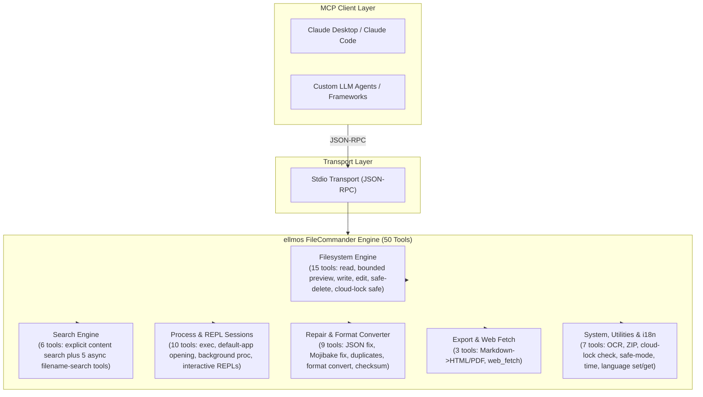
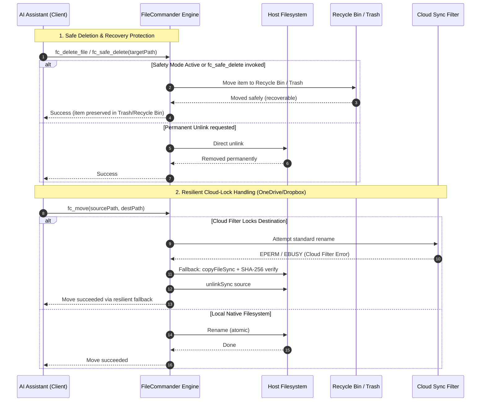

<!-- worldset: {"translated_from_sha256": "b14c4d90b205afeb948351c40f5ee76737faae530da0e8c3cec486fbe24661fa", "translator": "claude-haiku-5-5", "translated_at": "2026-10-25T07:17:11.496324+00:00", "reviewer": "gpt-6-luna/max; Root independent structure and risk samples"} -->
<p align="center">
  
</p>

# Serveur MCP ellmos FileCommander

[English](README.md) | [Deutsch](README_de.md) | [Español](README_es.md) | [简体中文](README_zh.md) | [日本語](README_ja.md) | [Русский](README_ru.md) | **Français** | [हिन्दी](README_hi.md) | [العربية](README_ar.md) | [বাংলা](README_bn.md) | [Português](README_pt.md)

La navigation du README répertorie les langues de documentation disponibles dans ce dépôt. Les messages d'exécution de FileCommander prennent en charge l'allemand (de), l'anglais (en), l'espagnol (es), le chinois (zh), le japonais (ja) et le russe (ru). Cette liste d'exécution est distincte de la disponibilité des traductions du README. Définissez `FC_LANGUAGE` avant de démarrer le serveur, ou appelez `fc_set_language` pendant une session MCP active. Utilisez `fc_get_language` pour afficher la langue active et les codes pris en charge. Si `FC_LANGUAGE` n'est pas défini ou contient un code non pris en charge, l'exécution utilise l'allemand (de) par défaut.

*Fait partie de la famille [ellmos-ai](https://github.com/ellmos-ai).*

[](https://opensource.org/licenses/MIT)
[](https://github.com/ellmos-ai/ellmos-filecommander-mcp/actions/workflows/tests.yml)
[](https://www.npmjs.com/package/ellmos-filecommander-mcp)
[](https://nodejs.org/)
[](#tools-overview)
[-brightgreen.svg)](#testing)
[](SECURITY.md)
[](SECURITY.md)
[](#why-filecommander)
[](NOTICE)
[](SECURITY.md)
[](THIRD_PARTY_LICENSES.md)
[](THIRD_PARTY_LICENSES.txt)
[](https://github.com/ellmos-ai)
[](https://github.com/open-bricks)
[](llms.txt)
[](llms.txt)
[](llms.txt)

> **Navigation rapide :**
> 1. [Vue d'ensemble](#sec-01) | 2. [Architecture du système](#sec-02) | 3. [Cycle de vie d'exécution de bout en bout](#sec-03) | 4. [Capacités principales et invariants de sécurité](#sec-04) | 5. [Profils cibles et découvrabilité](#sec-05) | 6. [Installation et prérequis](#sec-06) | 7. [Configuration et intégration client](#sec-07) | 8. [Aperçu des outils (50 outils)](#sec-08) | 9. [Matrice comparative et alternatives](#sec-09) | 10. [Préfixe des outils et convention de nommage](#sec-10) | 11. [Gouvernance et invariants d'exécution](#sec-11) | 12. [Architecture de sécurité et risques des outils](#sec-12) | 13. [Tests, portes de qualité et vérification](#sec-13) | 14. [Journal des modifications et versionnage](#sec-14) | 15. [SBOM de niveau 1 et licences tierces](#sec-15) | 16. [Historique et évolution](#sec-16) | 17. [Écosystème ellmos-ai et matrice des partenaires](#sec-17) | 18. [Mention légale (§ 521 BGB) et clause de non-responsabilité](#sec-18)
>
> | Références directes : [🛡️ Politique de sécurité](SECURITY.md) • [🤝 Contribuer](CONTRIBUTING.md) • [⚖️ Licences tierces](THIRD_PARTY_LICENSES.md) • [📄 SBOM en texte brut](THIRD_PARTY_LICENSES.txt) • [📜 Journal marketing](MARKETING-LOG.txt) • [🤖 Contexte LLM (llms.txt)](llms.txt) • [📋 Mention canonique](NOTICE) |

Un **serveur Model Context Protocol (MCP)** complet qui donne aux assistants IA un accès complet au système de fichiers, une recherche de contenu bornée sur plusieurs fichiers, la gestion des processus, des sessions shell interactives et des capacités de recherche asynchrone de noms de fichiers.

**50 outils** dans un seul serveur - tout ce dont un agent IA a besoin pour interagir avec le système local.

**Mots-clés de découvrabilité :** serveur MCP de système de fichiers local, MCP de recherche de contenu multi-fichiers, MCP de suppression sécurisée, serveur MCP de la Corbeille, MCP de gestion de processus, MCP de shell interactif, recherche de fichiers asynchrone pour agents IA, opérations sur fichiers sûres face aux verrous cloud, MCP de conversion Markdown vers PDF, serveur MCP OCR, MCP d'archives ZIP.

**État des registres :** publié sur [npm](https://www.npmjs.com/package/ellmos-filecommander-mcp), indexé par [jsDelivr](https://www.jsdelivr.com/package/npm/ellmos-filecommander-mcp), visible sur [LobeHub](https://lobehub.com/mcp/ellmos-ai-ellmos-filecommander-mcp), référencé sur [Glama](https://glama.ai/mcp/servers/ellmos-ai/ellmos-filecommander-mcp) et préparé pour le registre officiel MCP via [`server.json`](server.json). Certains répertoires tiers affichent encore les anciennes métadonnées à 43 outils ; le README canonique et les métadonnées npm doivent donc rester la référence jusqu'à leur prochaine réindexation.

> [!NOTE]
> **Pour les agents IA et les intégrations LLM :**
> FileCommander fournit **50 outils spécialisés** accessibles via le transport stdio standard. Tous les noms d'outils utilisent le préfixe `fc_` afin d'éviter les collisions d'espaces de noms. Pour les LLM, des aperçus compacts du contexte et des schémas sont disponibles dans [`llms.txt`](llms.txt) et [`server.json`](server.json).

---

<a id="sec-01"></a><a id="overview"></a><a id="why-filecommander"></a><a id="ueberblick"></a><a id="überblick"></a>
## Vue d'ensemble et raison d'être de FileCommander

La plupart des serveurs MCP de système de fichiers ne couvrent que les opérations de lecture et d'écriture de base. FileCommander va plus loin :

- **Suppression sécurisée** - Déplace les fichiers vers la Corbeille (Windows) ou la Corbeille (macOS/Linux) au lieu de les supprimer définitivement
- **Sessions interactives** - Démarre et interagit avec des REPL (Python, Node.js, shells) via le protocole MCP
- **Recherche asynchrone** - Recherche dans de grandes arborescences de répertoires en arrière-plan pendant que l'IA continue son travail
- **Recherche explicite de contenu** - Recherche un texte littéral ou une expression régulière dans une liste bornée de fichiers, sans récursion ni expansion de motifs glob
- **Gestion des processus** - Liste, démarre et termine les processus système
- **Remplacement de chaîne** - Modifie des fichiers en faisant correspondre des chaînes uniques avec validation du contexte
- **Conversion de formats** - Convertit entre JSON, CSV, INI, YAML, TOML, XML et TOON
- **Archives ZIP** - Crée, extrait et liste des archives ZIP
- **Sommes de contrôle de fichiers** - Hachage MD5, SHA-1, SHA-256, SHA-384 et SHA-512 avec comparaison
- **OCR** - Extrait le texte d'images (dépendance optionnelle tesseract.js)
- **Mode sécurisé** - Bascule permettant de router toutes les suppressions vers la Corbeille / Corbeille
- **Export Markdown** - Convertit le Markdown en HTML/PDF professionnel avec blocs de code, tableaux, listes imbriquées, citations
- **Sécurité face au verrouillage cloud** - Repli automatique copie+suppression lorsque les filtres de synchronisation cloud (OneDrive, Dropbox, Google Drive, iCloud) bloquent les opérations de renommage
- **Diagnostic de verrouillage cloud** - Vérifie si un chemin risque des conflits de filtre de synchronisation avant toute opération
- **Multiplateforme** - Fonctionne sous Windows, macOS et Linux avec des optimisations propres à chaque plateforme

---

<a id="sec-02"></a><a id="system-architecture"></a><a id="systemarchitektur"></a>
## Architecture du système

### Topologie architecturale ASCII à quatre vues

```text
+--------------------------------------------------------------------------------------------------+
|                            ELLMOS FILECOMMANDER MCP ARCHITECTURAL TOPOLOGY                       |
+--------------------------------------------------------------------------------------------------+
| [VIEW 1: CALLER RUNTIMES & AGENT CLIENTS]                                                        |
|   * Autonomous Agents   : Claude Code, OpenAI Codex, Antigravity / Gemini, Kimi, Cursor          |
|   * Agent Frameworks    : AutoGen, CrewAI, LangChain, LlamaIndex, Custom Python / TS Clients    |
|   * Transport Protocols : Model Context Protocol (MCP stdio), JSON-RPC 2.0 Framing               |
|   * Tool Surface        : 50 Unified Specialized Tools (fc_* namespace collision isolation)       |
|   * Schema Contract     : Stdio transport, dynamic runtime i18n parameter parsing (Zod validated)|
+--------------------------------------------------------------------------------------------------+
|                                                |                                                 |
|                                                v                                                 |
+--------------------------------------------------------------------------------------------------+
| [VIEW 2: FILECOMMANDER MCP CORE ENGINE & DISPATCH ORCHESTRATOR]                                  |
|   * Protocol Dispatch   : ESM stdio router with Zod schema validation & parameter checking      |
|   * Multilingual Core   : 6-language dynamic runtime i18n (de, en, es, zh, ja, ru) engine       |
|   * Safety Interceptor  : Global Safety Mode (fc_set_safe_mode) routing deletes to Recycle Bin   |
|   * Sync Diagnostics    : Reparse point detection & cloud filter diagnostics (fc_check_cloud_lock)|
|   * Process Supervisor  : Bounded child process lifecycle management & interactive REPL session  |
|                           state registry with circular ring buffers                              |
+--------------------------------------------------------------------------------------------------+
|                                                |                                                 |
|                                                v                                                 |
+--------------------------------------------------------------------------------------------------+
| [VIEW 3: FILESYSTEM RUNTIME, FORMAT REPAIR & PROCESS ISOLATION]                                  |
|   * Atomic File Ops     : Read, write, line edit, exact literal string replacement (fc_str_replace)|
|   * Cloud-Lock Fallback : Automatic copyFileSync + SHA-256 verify + unlinkSync on EPERM / EBUSY   |
|   * Bounded Inspection  : Metadata-first preview (fc_preview_file, 1 MiB inline content ceiling)  |
|   * Bounded Content Srch: max 50 explicit files, 10 MB ceiling, token redaction (INV-MASK-06)   |
|   * Self-Healing Repair : Mojibake repair (27+ UTF-8 patterns), JSON syntax fix, file cleanup    |
|   * Lossless Converter  : Declarative transformation across 7 formats (JSON, YAML, TOML, XML...) |
|   * Media & Documents   : Headless Markdown to PDF/HTML, ZIP archive engine, optional OCR (Tess)  |
+--------------------------------------------------------------------------------------------------+
|                                                |                                                 |
|                                                v                                                 |
+--------------------------------------------------------------------------------------------------+
| [VIEW 4: AIR-GAP DEFENSE PERIMETER, RUNASINVOKER & CONTROLLED EGRESS]                            |
|   * Execution Privilege : RunAsInvoker unprivileged user-mode (Zero administrative elevation)    |
|   * Transport Boundary  : 100% Local stdio transport, zero telemetry, zero open listening ports  |
|   * Controlled Egress   : Outbound HTTP(S) strictly gated through caller-invoked fc_web_fetch     |
|   * Network Safety      : SSRF guard blocking private/internal IP ranges (allow_private override) |
|   * Governance & Supply : Level 1 SBOM, 100% permissive runtime (MIT/BSD), 48h Security SLA      |
+--------------------------------------------------------------------------------------------------+
```

### Diagramme de flux des composants



---

<a id="sec-03"></a><a id="end-to-end-execution-lifecycle"></a><a id="execution-lifecycle"></a><a id="end-to-end-ausfuehrungszyklus"></a>
## Cycle d'exécution de bout en bout



---

<a id="sec-04"></a><a id="core-capabilities--safety-invariants"></a><a id="core-capabilities"></a><a id="kernfaehigkeiten--sicherheitsinvarianten"></a><a id="kernfähigkeiten--sicherheitsinvarianten"></a>
## Capacités principales et invariants de sécurité

| Capacité / Invariant | Garantie et détails d'implémentation | Avantage en matière de sécurité et d'exploitation |
|------------------------|-----------------------------------|--------------------------------|
| **Stdio local et sortie explicite** | Le transport MCP est stdio local, sans télémétrie et sans sortie réseau automatique. `fc_web_fetch` n'effectue des requêtes HTTP(S) sortantes que lorsqu'un client l'invoque explicitement ; les cibles privées sont bloquées par défaut, sauf si `allow_private` est activé. | Rend la frontière réseau visible pour les clients tout en conservant un transport serveur local et sans port. |
| **Suppression sécurisée et protection de la corbeille** | `fc_safe_delete` déplace les éléments vers la Corbeille Windows / la Corbeille macOS / la Corbeille FreeDesktop Linux. `fc_set_safe_mode` achemine toutes les suppressions de manière sécurisée. | Empêche la perte de données irréversible causée par des suppressions récursives ou en masse accidentelles. |
| **Déplacement résilient au verrouillage cloud (`fc_move`)** | Détection automatique des filtres de synchronisation cloud (points de réanalyse OneDrive, Dropbox, iCloud) avec un mécanisme de repli copie+vérification+suppression transparent. | Élimine les échecs `EPERM` / `EBUSY` lors des opérations automatisées d'agents dans des répertoires synchronisés. |
| **Diagnostic de verrouillage cloud (`fc_check_cloud_lock`)** | Rapport en lecture seule du contexte statique des chemins cloud ainsi que de l'existence et du type de la cible ; l'hydratation des fichiers Cloud et les handles de processus sont explicitement signalés comme non vérifiés lorsqu'ils sont indisponibles. | Permet aux agents de distinguer le risque statique OneDrive d'un verrouillage de renommage réellement détecté. |
| **Recherche de contenu multi-fichiers bornée** | `fc_search_content` limite strictement les entrées (au maximum 50 fichiers explicites, 10 Mo par fichier, 200 correspondances, 200 000 caractères) sans récursion par motifs glob. | Prévient les erreurs de mémoire insuffisante et les blocages catastrophiques du CPU lors de recherches dans de grands dépôts. |
| **Masquage automatique des secrets et jetons** | Les extraits de recherche de contenu masquent automatiquement les clés API courantes, les jetons Bearer, les identifiants AWS et les en-têtes d'autorisation. | Empêche la contamination du contexte LLM et la fuite accidentelle d'identifiants dans l'historique des prompts. |
| **REPL interactif et isolation des sessions** | Sessions interactives avec état (`fc_start_session`, `fc_send_input`, `fc_read_output`) pour Python, Node.js, bash et PowerShell, avec tampons bornés. | Permet le débogage REPL multi-tours sans accumulation de processus d'arrière-plan non contrôlée. |
| **Moteur de conversion multi-format sans perte** | Conversion déclarative (`fc_convert_format`) entre 7 formats structurés (JSON, YAML, TOML, XML, CSV, INI, TOON). | Normalisation propre des données entre des formats de configuration hétérogènes, sans perte de données. |
| **Moteur de réparation Mojibake et de fichiers** | `fc_fix_encoding`, `fc_fix_json` et `fc_cleanup_file` réparent les encodages UTF-8 cassés (plus de 27 motifs), la syntaxe JSON malformée, les BOM et les octets NUL. | Pipelines auto-réparateurs pour les fichiers corrompus générés sur des plateformes d'exploitation divergentes. |
| **Exécution sans privilèges et sans élévation** | Conçu et vérifié pour fonctionner en mode utilisateur standard non privilégié. Ne nécessite jamais de privilèges administrateur ou root. | Surface d'attaque minimale ; respecte le principe du moindre privilège. |
| **Moteur i18n d'exécution à six langues** | Changement dynamique de langue et introspection (`fc_set_language`, `fc_get_language`) pour l'allemand (`de`), l'anglais (`en`), l'espagnol (`es`), le chinois (`zh`), le japonais (`ja`) et le russe (`ru`). | Expérience multilingue native pour les développeurs et signalement d'erreurs localisé. |
| **Matrice multi-OS vérifiée** | Testé sous Windows, Ubuntu Linux et macOS avec Node.js 20, 22 et 24, avec 292 assertions automatisées. | Parité et fiabilité multiplateformes continues. |

---

<a id="sec-05"></a><a id="target-personas--discoverability"></a><a id="target-personas"></a><a id="zielgruppen--auffindbarkeit"></a>
## Personas cibles et découvrabilité

FileCommander est spécialement conçu et validé pour quatre personas principaux : développeurs, agents et équipes d'exploitation :

### [PERSONA-01] Agents de codage IA autonomes et essaims LLM
- **Profil :** Essaims multi-agents et environnements d'exécution agentiques autonomes (Claude Code, Antigravity/Gemini, OpenAI Codex, AutoGen, CrewAI) exécutant la modification récursive de code, la refactorisation de projets et l'audit de répertoires.
- **Principaux points de douleur opérationnels :** Gonflement rapide de la fenêtre de contexte causé par la lecture de fichiers de plusieurs mégaoctets, plantages de processus non gérés dus à des fichiers verrouillés (`EPERM`/`EBUSY`) dans des dossiers synchronisés avec le cloud, et corruption irrécupérable de dépôts à cause de routines de nettoyage accidentelles `rm -rf`.
- **Solution FileCommander :**
  - `fc_preview_file` : Inspection axée sur les métadonnées avec un plafond strict de 1 MiB pour le contenu en ligne, empêchant le débordement du contexte LLM.
  - `fc_search_content` : Recherche multi-fichiers bornée (50 fichiers max, 10 Mo par fichier, 200 correspondances) avec masquage automatique des secrets et jetons.
  - `fc_safe_delete` & `fc_set_safe_mode` : Conserve les fichiers supprimés dans la Corbeille du système d'exploitation pour des opérations sur fichiers sans risque.
  - `fc_move` & `fc_check_cloud_lock` : Copie automatique + vérification SHA-256 + solution de repli par suppression du lien en cas de verrouillage de fichier, évitant l'échec de l'agent.

### [PERSONA-02] Ingénieurs DevOps, chaîne d'outils et automatisation multi-hôtes
- **Profil :** Ingénieurs systèmes et d'automatisation qui conçoivent des outils CLI multiplateformes, des pipelines de validation CI/CD et des scripts de synchronisation multi-machines sous Windows, Linux et macOS.
- **Principaux points de douleur opérationnels :** Sémantique hétérogène des systèmes d'exploitation (barres obliques inverses Windows contre barres obliques POSIX, corruption des fins de ligne, syntaxe propre au shell), processus enfants zombies et verrouillage de fichiers dans les espaces de travail partagés OneDrive/Dropbox.
- **Solution FileCommander :**
  - Sémantique d'outils unifiée et multiplateforme sous Windows, Linux et macOS.
  - Sessions REPL interactives avec état (`fc_start_session`, `fc_send_input`, `fc_read_output`) avec des tampons circulaires bornés.
  - Renommage de fichiers par lots (`fc_batch_rename`) et recherche de répertoires en arrière-plan (`fc_start_search`, `fc_get_search_results`).
  - Gestion du cycle de vie des processus (`fc_execute_command`, `fc_start_process`, `fc_kill_process`) sans fuite de processus.

### [PERSONA-03] Responsables SecOps, gouvernance et conformité
- **Profil :** Responsables de la sécurité, auditeurs de conformité et équipes de confidentialité supervisant l'intégration d'outils d'IA dans des environnements d'entreprise et de production.
- **Principaux points de douleur opérationnels :** Balises de télémétrie en arrière-plan non divulguées, accès réseau non vérifié depuis des plugins locaux, fuite d'identifiants et de jetons dans l'entraînement des modèles ou l'historique des invites, et élévation de privilèges par des utilisateurs non privilégiés.
- **Solution FileCommander :**
  - Transport stdio local avec une télémétrie strictement nulle et aucun port d'écoute réseau ouvert.
  - Sortie réseau sortante explicite strictement limitée à `fc_web_fetch` invoqué par l'appelant (adresses IP internes/privées bloquées par défaut).
  - Masquage automatique des secrets et des jetons porteurs dans les extraits de recherche (`INV-MASK-06`).
  - Exécution stricte par un utilisateur non privilégié (`INV-PROC-09`) et engagement contraignant de réponse aux vulnérabilités sous 48 heures (`security@open-bricks.org`, `security@ellmos.ai`).

### [PERSONA-04] Architectes de plateformes d'entreprise et développeurs de pipelines de données
- **Profil :** Architectes de solutions et ingénieurs de données qui intègrent des fichiers locaux, normalisent des formats de configuration hétérogènes, valident des empreintes cryptographiques et génèrent des rapports.
- **Principaux points de douleur opérationnels :** Prolifération de serveurs MCP nécessitant 4 à 6 serveurs disparates à usage unique, séquences d'octets UTF-8 corrompues (mojibake) à travers les outils, et scripts d'analyse sur mesure.
- **Solution FileCommander :**
  - Déploiement sur serveur unique de 50 outils, éliminant la prolifération de serveurs multiples et la surcharge de processus.
  - Conversion déclarative sans perte entre 7 formats structurés (`fc_convert_format` : JSON, YAML, TOML, XML, CSV, INI, TOON).
  - Moteurs intégrés de réparation de fichiers (`fc_fix_encoding`, `fc_fix_json`, `fc_cleanup_file`) pour des pipelines auto-réparateurs.
  - Sommes de contrôle cryptographiques (`fc_checksum` : SHA-256, SHA-512, MD5, SHA-1) et rendu Markdown vers PDF/HTML (`fc_md_to_pdf`, `fc_md_to_html`).

### Requêtes de recherche à forte intention et vecteurs de découvrabilité

- **Requêtes de recherche principales :** `ellmos-filecommander-mcp`, `FileCommander MCP`, `filesystem MCP server`, `multi-file content search MCP`, `safe delete MCP`, `async file search MCP`, `process management MCP`, `Markdown PDF MCP`.
- **Métadonnées lisibles par machine :** Le contexte structuré destiné aux agents IA est maintenu dans [`llms.txt`](llms.txt), [`server.json`](server.json) et [`glama.json`](glama.json).
- **Conformité et attribution :** Validé par rapport à [`THIRD_PARTY_LICENSES.md`](THIRD_PARTY_LICENSES.md) et [`NOTICE`](NOTICE).

---

<a id="sec-06"></a><a id="installation"></a><a id="installation-prerequisites"></a>
## Installation

### Prérequis

- [Node.js](https://nodejs.org/) 20 ou version ultérieure
- npm

### Option 1 : Installation depuis NPM

```bash
npm install -g ellmos-filecommander-mcp
```

### Option 2 : Installation depuis les sources

```bash
git clone https://github.com/ellmos-ai/ellmos-filecommander-mcp.git
cd ellmos-filecommander-mcp
npm ci
npm run build
```

---

<a id="sec-07"></a><a id="configuration"></a><a id="client-setup"></a><a id="konfiguration"></a>
## Configuration

### Claude Desktop

Ajoutez à votre `claude_desktop_config.json` :

**Windows :** `%APPDATA%\Claude\claude_desktop_config.json`
**macOS :** `~/Library/Application Support/Claude/claude_desktop_config.json`

#### Si installé globalement via NPM :

```json
{
  "mcpServers": {
    "filecommander": {
      "command": "ellmos-filecommander"
    }
  }
}
```

#### Si installé à partir des sources :

```json
{
  "mcpServers": {
    "filecommander": {
      "command": "node",
      "args": ["/absolute/path/to/filecommander-mcp/dist/index.js"]
    }
  }
}
```

Redémarrez Claude Desktop après avoir enregistré.

### Autres clients MCP

Le serveur communique via le **transport stdio**. Pointez votre client MCP vers l'entrée `dist/index.js` ou vers le binaire `ellmos-filecommander`.

---

<a id="sec-08"></a><a id="tools-overview"></a><a id="available-tools"></a><a id="tools-uebersicht"></a><a id="tools-übersicht"></a>
## Vue d'ensemble des outils

### Opérations sur le système de fichiers (15 outils)

| Outil | Description |
|------|-------------|
| `fc_read_file` | Lit le contenu d'un fichier avec une limite de lignes facultative |
| `fc_preview_file` | Inspecte d'abord le type MIME et la taille, puis demande explicitement un contenu MCP inline borné |
| `fc_read_multiple_files` | Lit jusqu'à 20 fichiers en un seul appel |
| `fc_write_file` | Écrit, crée ou ajoute du contenu à des fichiers |
| `fc_edit_file` | Édition par lignes (remplacer, insérer, supprimer des lignes) |
| `fc_str_replace` | Remplace une chaîne unique dans un fichier avec validation du contexte |
| `fc_list_directory` | Liste le contenu d'un répertoire (récursif, profondeur configurable) |
| `fc_create_directory` | Crée des répertoires (y compris les parents) |
| `fc_delete_file` | Supprime un fichier (définitivement) |
| `fc_delete_directory` | Supprime un répertoire (avec indicateur récursif facultatif) |
| `fc_safe_delete` | Déplace vers la Corbeille (récupérable !) |
| `fc_move` | Déplace ou renomme des fichiers et répertoires (sûr pour les verrous cloud) |
| `fc_copy` | Copie des fichiers et répertoires |
| `fc_file_info` | Obtient les métadonnées détaillées d'un fichier (taille, dates, type) |
| `fc_search_files` | Recherche synchrone de fichiers avec motifs génériques |

`fc_preview_file` est la solution de repli distante/sans interface pour les fichiers locaux. Son appel par défaut ne renvoie que des métadonnées structurées : chemin résolu, URI `file://`, type MIME, taille en octets, type d'aperçu, limite fixe de 1 MiB et l'appel de suivi exact. Le contenu n'est lu qu'après `include_content=true`. Les fichiers texte et images raster éligibles utilisent les blocs de contenu MCP standard `text`/`image` ; les PDF utilisent un `resource` intégré et borné. Les fichiers de plus de 1 MiB et les types non pris en charge restent limités aux métadonnées et ne sont jamais lus ni encodés en Base64 par la fonction d'aperçu.

### Recherche dans le contenu (1 outil)

| Outil | Description |
|------|-------------|
| `fc_search_content` | Recherche en lecture seule, littérale ou par expression régulière, dans une liste explicite et ordonnée de fichiers, avec limites de casse, de contexte, globales et par fichier |

`fc_search_content` n'étend jamais les globs, ne parcourt jamais les répertoires et ne découvre jamais récursivement les fichiers. Il accepte au maximum 50 fichiers texte UTF-8 explicites, ignore les fichiers binaires et ceux de plus de 10 Mo, et renvoie un JSON déterministe. Les correspondances sont limitées à 200 au total et à 100 par fichier, le contexte à 10 lignes, les extraits à 500 caractères et la sortie sérialisée à 200 000 caractères. Les erreurs d'absence de fichier, de fichier cloud uniquement, de permission, d'encodage, de fichier binaire et de taille sont signalées par fichier, afin que les fichiers lisibles produisent tout de même des résultats. Les formats courants de secrets sont masqués dans les extraits.

### Recherche asynchrone (5 outils)

| Outil | Description |
|------|-------------|
| `fc_start_search` | Démarre une recherche en arrière-plan (retour immédiat) |
| `fc_get_search_results` | Récupère les résultats avec pagination |
| `fc_stop_search` | Annule une recherche en cours |
| `fc_list_searches` | Liste toutes les recherches actives ou terminées |
| `fc_clear_search` | Supprime de la mémoire les recherches terminées |

### Gestion des processus (5 outils)

| Outil | Description |
|------|-------------|
| `fc_execute_command` | Exécute une commande shell (bloquante, avec délai d'expiration) |
| `fc_start_process` | Démarre un processus en arrière-plan (non bloquant) |
| `fc_open_path` | Valide et ouvre un fichier ou répertoire local existant avec l'application par défaut du système d'exploitation |
| `fc_list_processes` | Liste les processus système en cours d'exécution |
| `fc_kill_process` | Termine un processus par PID ou par nom |

`fc_open_path` n'accepte qu'un fichier ou un répertoire existant et l'envoie à un lanceur natif fixe de l'application par défaut. Son résultat structuré indique `launcher_accepted=true|false`, signale toujours `user_visible="unknown"` et identifie une solution de repli lisible par machine : `fc_preview_file` avec des arguments limités aux métadonnées pour les fichiers, ou `fc_list_directory` pour les répertoires. L'acceptation par le lanceur ne prétend jamais qu'une interface graphique est devenue visible. `fc_start_process` permet plutôt à l'appelant de choisir un exécutable et ses arguments. `fc_execute_command` accepte une commande shell arbitraire : le shell par défaut de Node est utilisé pour les commandes ordinaires (`COMSPEC`/`cmd.exe` sous Windows), tandis que le chemin des caractères spéciaux Windows de FileCommander peut passer par Windows PowerShell.

### Sessions interactives (5 outils)

| Outil | Description |
|------|-------------|
| `fc_start_session` | Démarrer un processus interactif (Python, Node, shell...) |
| `fc_read_output` | Lire la sortie d'une session |
| `fc_send_input` | Envoyer une entrée à une session en cours |
| `fc_list_sessions` | Lister toutes les sessions |
| `fc_close_session` | Terminer une session |

### Maintenance et réparation de fichiers (9 outils)

| Outil | Description |
|------|-------------|
| `fc_fix_json` | Réparer un JSON cassé (BOM, virgules finales, commentaires, guillemets simples) |
| `fc_validate_json` | Valider un JSON avec position et contexte détaillés de l'erreur |
| `fc_cleanup_file` | Supprimer le BOM, les octets NUL, les espaces de fin de ligne et normaliser les fins de ligne |
| `fc_fix_encoding` | Corriger le Mojibake / l'UTF-8 à double encodage (plus de 27 motifs de caractères) |
| `fc_folder_diff` | Suivre les modifications d'un répertoire à l'aide d'instantanés (nouveaux/modifiés/supprimés) |
| `fc_batch_rename` | Renommage par lots basé sur des motifs (préfixe/suffixe, remplacement, détection automatique) |
| `fc_convert_format` | Convertir entre les formats JSON, CSV, INI, YAML, TOML, XML et TOON |
| `fc_detect_duplicates` | Rechercher les fichiers en double à l'aide du hachage SHA-256 |
| `fc_checksum` | Hachage de fichiers (MD5, SHA-1, SHA-256, SHA-384, SHA-512) avec comparaison facultative |

### Archive (1 outil)

| Outil | Description |
|------|-------------|
| `fc_archive` | Créer, extraire et lister des archives ZIP |

### OCR (1 outil)

| Outil | Description |
|------|-------------|
| `fc_ocr` | Extraire le texte d'images via tesseract.js (dépendance facultative) |

### Synchronisation cloud (1 outil)

| Outil | Description |
|------|-------------|
| `fc_check_cloud_lock` | Signaler le contexte statique de synchronisation cloud et l'état cible ; ne jamais affirmer un verrou actif sans preuve (Windows) |

### Système (4 outils)

| Outil | Description |
|------|-------------|
| `fc_get_time` | Obtenir l'heure système actuelle avec les informations de fuseau horaire |
| `fc_set_safe_mode` | Activer ou désactiver le mode sécurisé : toutes les suppressions passent par la Corbeille |
| `fc_set_language` | Définir la langue d'exécution (`de`, `en`, `es`, `zh`, `ja` ou `ru`) |
| `fc_get_language` | Lire la langue d'exécution active et tous les codes de langue pris en charge |

### Export (2 outils)

| Outil | Description |
|------|-------------|
| `fc_md_to_html` | Markdown vers HTML autonome avec style CSS (en-têtes, blocs de code, tableaux, listes imbriquées, citations, images, cases à cocher) |
| `fc_md_to_pdf` | Markdown vers PDF via navigateur sans interface (Edge/Chrome). Repli sur HTML si aucun navigateur n'est disponible |

### Web (1 outil)

| Outil | Description |
|------|-------------|
| `fc_web_fetch` | Récupérer une page web et renvoyer le contenu selon `mode` : extract (texte principal nettoyé), raw (corps HTTP), links, forms ou headers. Outil réseau en lecture seule ; le garde SSRF bloque les cibles internes/privées par défaut. |

**Total : 50 outils**

---

<a id="sec-09"></a><a id="comparative-matrix--alternatives"></a><a id="comparative-matrix"></a><a id="comparison-with-alternatives"></a><a id="vergleichsmatrix--alternativen"></a>
## Matrice comparative et alternatives

FileCommander combine la manipulation du système de fichiers, la recherche bornée, le contrôle de processus, la réparation de données, la conversion de formats et le rendu de documents dans une interface MCP unifiée unique. Ci-dessous, une comparaison architecturale avec les alternatives standard selon 10 dimensions opérationnelles clés :

| Dimension opérationnelle | ellmos FileCommander MCP (50 outils) | MCP Filesystem officiel (`@modelcontextprotocol/server-filesystem`) | Desktop Commander MCP | Shell hôte direct (`bash` / PowerShell) | Scripts ad hoc et API cloud |
|-----------------------|:-----------------------------------:|:------------------------------------------------------------------:|:---------------------:|:---------------------------------------:|:---------------------------:|
| **Étendue et portée des outils** `[INV-PROC-09]` | **50 outils unifiés** répartis sur 6 domaines | ~11 outils d'E/S de fichiers de base | ~15 outils (fichiers + processus) | Commandes CLI sans contrainte | Scripts sur mesure fragmentés |
| **Suppression sûre et récupération** `[INV-SAFE-02]` | **Corbeille native du système d'exploitation** (`fc_safe_delete`, mode sécurisé) | Suppression définitive uniquement (`unlink`) | Suppression définitive uniquement | `rm -rf` / `Remove-Item` irréversible | Implémentations de corbeille personnalisées |
| **Résilience face au verrouillage et à la synchronisation cloud** `[INV-LOCK-03]` | **Repli automatique** (copie + vérification SHA-256 + suppression du lien sur EPERM/EBUSY) | Échoue sur les fichiers verrouillés / points de réanalyse | Échoue sur les fichiers verrouillés | Échoue ou bloque indéfiniment | Conflits de synchronisation / copies en conflit |
| **Recherche bornée et masquage des secrets** `[INV-SRCH-05 / INV-MASK-06]` | **Recherche bornée** (50 fichiers max, 10 Mo, masquage automatique des jetons d'API) | Parcours de répertoire uniquement (pas de regex sur le contenu) | Recherche regex non bornée | `grep` non borné (fuite de secrets dans le contexte) | Regex personnalisée sans masquage |
| **Recherche asynchrone de longue durée** `[INV-SRCH-05]` | **Analyses en arrière-plan paginées par jetons** (`fc_start_search`) | Synchrone uniquement (bloque l'agent) | Synchrone uniquement | Contrôle des tâches en arrière-plan (`&`) | Boucles d'interrogation / appels réseau lents |
| **REPL interactifs et contrôle de session** `[INV-REPL-08]` | **REPL avec état** (Node, Python, Shell) avec tampons circulaires | Non pris en charge | Sessions de terminal de base | Sous-processus bruts (risque de processus zombies) | IPC par tubes complexes |
| **Auto-réparation et réparation des données** `[INV-DIAG-04]` | **Intégrée** : correction du mojibake (plus de 27 motifs) et réparation JSON | Non pris en charge | Non pris en charge | Pipeline manuel `iconv` / `sed` | Code de récupération d'erreurs personnalisé |
| **Transformation multi-format** `[INV-PREV-07]` | **Conversion déclarative** (JSON, YAML, TOML, XML, CSV, INI, TOON) | Non pris en charge | Non pris en charge | Nécessite `jq` / `yq` / `xmlstarlet` externes | Bibliothèques Python tierces |
| **Utilitaires de documents et d'archives** `[INV-PREV-07]` | **Intégrés** : cycle de vie ZIP, OCR (Tesseract), Markdown vers HTML/PDF | Non pris en charge | Excel/PDF via l'application de bureau | Nécessite `pandoc`, `zip`, `tesseract` | Dépendances utilitaires fragmentées |
| **Gouvernance et SLA de sécurité** `[INV-LOCAL-01 / INV-SLA-10]` | **stdio local**, zéro télémétrie, sortie réseau explicite, SLA contraignant de 48 h | stdio standard, SLA communautaire | stdio, télémétrie et journaux non vérifiés | Élévation sans restriction et risque d'injection de scripts | Exposition à un cloud SaaS ad hoc |

**Principaux différenciateurs :**
- Seul serveur MCP avec **suppression récupérable** (Corbeille) et **mode sécurisé** global
- Seul serveur MCP avec **recherche asynchrone en arrière-plan** avec pagination et gestion des jetons
- Seul serveur MCP avec **masquage automatisé des secrets et des jetons porteurs** dans les extraits de recherche
- **Réparation JSON**, **correction d'encodage mojibake** et **détection des doublons** intégrées
- Opérations sur fichiers **sûres face au verrouillage cloud** intégrées, avec repli automatique copie + vérification + suppression
- Solution monoserveur la plus complète (**50 outils**), évitant la prolifération de serveurs multiples

---

<a id="sec-10"></a><a id="tool-prefix"></a><a id="tool-praefix"></a><a id="tool-präfix"></a>
## Préfixe des outils

Tous les outils utilisent le préfixe `fc_` (FileCommander) afin d'éviter les conflits avec d'autres serveurs MCP.

---

<a id="sec-11"></a><a id="governance--runtime-invariants"></a><a id="governance-invariants"></a><a id="governance--laufzeit-invarianten"></a>
## Invariants de gouvernance et d'exécution

Le serveur applique 10 invariants stricts d'exécution garantissant la sécurité, la prévisibilité et le moindre privilège :

| Identifiant de l'invariant | Nom | Garantie et détails de mise en œuvre | Bénéfice pour la sécurité opérationnelle |
|--------------|------|-----------------------------------|----------------------------|
| **INV-LOCAL-01** | **Stdio local et sortie explicite** | Transport stdio local, zéro télémétrie, aucun port d'écoute ouvert. Les requêtes HTTP(S) sortantes ne surviennent que via des appels explicites du client vers `fc_web_fetch`. | Aucune fuite réseau non autorisée en arrière-plan ; isolation locale d'abord. |
| **INV-SAFE-02** | **Suppression sécurisée et protection de la corbeille** | `fc_safe_delete` et `fc_set_safe_mode` global acheminent les suppressions de fichiers et de répertoires vers la Corbeille du système d'exploitation (Windows) / la Corbeille (macOS/Linux). | Élimine les pertes de données accidentelles et irréversibles causées par les actions d'agents IA. |
| **INV-LOCK-03** | **Déplacement résilient aux verrous cloud** | `fc_move` exécute automatiquement une copie, une vérification SHA-256, puis une suppression de la source en repli lorsque les filtres de synchronisation (OneDrive, Dropbox, iCloud) provoquent des erreurs EPERM/EBUSY. | Garantit la réussite fiable des opérations sur les fichiers dans les espaces de travail synchronisés avec le cloud. |
| **INV-DIAG-04** | **Diagnostic des verrous cloud** | `fc_check_cloud_lock` fournit une inspection statique et en lecture seule des chemins ainsi que la détection des points de reparse, sans modifier l'état du système de fichiers. | Permet aux agents d'évaluer les risques de conflit de synchronisation avant d'effectuer des modifications. |
| **INV-SRCH-05** | **Recherche de contenu bornée sur plusieurs fichiers** | `fc_search_content` plafonne strictement les entrées (maximum 50 fichiers explicites, 10 Mo par fichier, 200 correspondances, 200 000 caractères) sans récursion par glob. | Empêche les plantages par manque de mémoire et la consommation de CPU non contrôlée. |
| **INV-MASK-06** | **Expurgation automatique des secrets et jetons** | Les extraits de recherche de contenu détectent et masquent automatiquement les clés d'API, les jetons Bearer, les identifiants AWS et les en-têtes d'autorisation. | Protège les identifiants contre les fuites dans les invites et la contamination du contexte. |
| **INV-PREV-07** | **Aperçu intégré borné et ouverture sécurisée** | `fc_preview_file` privilégie les métadonnées avec un plafond strict de contenu intégré de 1 MiB ; `fc_open_path` invoque l'application par défaut via des lanceurs du système d'exploitation sûrs vis-à-vis du shell. | Inspection sûre des fichiers distants et locaux sans blocage de l'interface ni gonflement de la charge utile. |
| **INV-REPL-08** | **REPL interactif et isolation de session** | Les sessions interactives avec état (`fc_start_session`, `fc_send_input`, `fc_read_output`) utilisent des tampons circulaires bornés. | Permet le débogage REPL multi-tours tout en empêchant l'accumulation de processus zombies. |
| **INV-PROC-09** | **Exécution non privilégiée sans élévation** | S'exécute entièrement en mode utilisateur standard non privilégié ; ne demande ni ne requiert jamais de droits d'administrateur ou de root. | Surface d'attaque minimale ; respecte strictement le principe du moindre privilège. |
| **INV-SLA-10** | **Réponse de sécurité sous 48 h et SLA de tri sous 5 jours** | Engagement formel de traitement des vulnérabilités avec des contacts multicanaux (`security@open-bricks.org`, `security@ellmos.ai`). | Cycle de réponse aux incidents et de tri prévisible et adapté aux entreprises. |

---

<a id="sec-12"></a><a id="security"></a><a id="security-architecture"></a><a id="sicherheit"></a>
## Sécurité

**Ce serveur dispose d'un accès complet au système de fichiers avec les autorisations de l'utilisateur en cours d'exécution.**

Consultez [SECURITY.md](SECURITY.md) pour des informations détaillées sur la sécurité et des recommandations.

Points clés :
- `fc_execute_command` exécute des commandes shell arbitraires
- `fc_open_path` invoque l'application associée au système d'exploitation pour un chemin existant choisi par l'appelant ; cette application s'exécute avec les autorisations de l'utilisateur
- `fc_open_path` signale l'acceptation du lanceur séparément de l'invariant `user_visible="unknown"` ; `fc_preview_file` est le repli distant privilégiant les métadonnées, avec une limite explicite de contenu intégré de 1 MiB
- `fc_start_session` démarre une commande interactive arbitraire, et les appels ultérieurs de `fc_send_input` peuvent exécuter des actions supplémentaires
- Les outils `fc_delete_*` effectuent une suppression définitive par défaut (utilisez `fc_safe_delete` ou activez le **mode sans échec** via `fc_set_safe_mode` pour acheminer toutes les suppressions vers la Corbeille)
- Le mode sans échec ne protège que `fc_delete_file` et `fc_delete_directory` ; il n'isole pas les commandes ni les sessions interactives dans un bac à sable
- Le transport du serveur est le stdio local et n'émet aucune télémétrie, mais un appel explicite de `fc_web_fetch` effectue un accès HTTP(S) sortant
- Aucune isolation intégrée (sandbox) : la sécurité est déléguée à la couche client MCP

---

<a id="sec-13"></a><a id="development"></a><a id="testing"></a><a id="testing--verification"></a><a id="entwicklung"></a>
## Développement

```bash
# Install dependencies
npm ci

# Watch mode (auto-rebuild on changes)
npm run dev

# One-time build
npm run build

# Start the server
npm start

# Run test suite
npm test
```

### Tests

Le projet comprend **235 tests Vitest et 71 vérifications i18n autonomes (306 au total)** couvrant les opérations sur le système de fichiers, l'aperçu intégré privilégiant les métadonnées, la recherche de contenu bornée, le lancement natif via l'application par défaut, la conversion de format, la réparation d'encodage, la gestion des archives, la détection des doublons, les packs de langues, les annotations d'outils, le comportement réel du stdio et les limites de sécurité.

```bash
npm test              # Run all tests
node test-i18n.mjs    # Run standalone i18n checks
npx vitest run        # Same as above
npx vitest --watch    # Watch mode
```

Les tests sont vérifiés sur **Windows**, **macOS** et **Linux**.
Les pushes et les pull requests exécutent la CI sur Node.js **20**, **22** et **24** avec `npm ci`, la compilation TypeScript, Vitest et un test à blanc du package npm.

Consultez [CONTRIBUTING.md](CONTRIBUTING.md) pour les directives de contribution.

---

<a id="sec-14"></a><a id="changelog"></a>
## Journal des modifications

Consultez [CHANGELOG.md](CHANGELOG.md) pour l'historique complet des versions.

---

<a id="sec-15"></a><a id="license--legal-attribution"></a><a id="third-party-licenses"></a><a id="drittanbieter-lizenzen"></a>
## Licence et mentions légales

[MIT](LICENSE) - Lukas Geiger ([ellmos-ai](https://github.com/ellmos-ai)). Consultez [NOTICE](NOTICE) pour l'attribution de l'organisation parapluie open-bricks, [THIRD_PARTY_LICENSES.md](THIRD_PARTY_LICENSES.md) pour le SBOM de niveau 1, et [THIRD_PARTY_LICENSES.txt](THIRD_PARTY_LICENSES.txt) pour le SBOM en texte brut.

---

<a id="sec-16"></a><a id="history"></a><a id="historie"></a>
## Historique

Ce projet a d'abord été développé sous le nom **BACH FileCommander** (`bach-filecommander-mcp`). Il a été renommé **ellmos FileCommander** (`ellmos-filecommander-mcp`) dans le cadre de l'organisation [ellmos-ai](https://github.com/ellmos-ai).

Le nom de package historique `bach-filecommander-mcp` est obsolète. Veuillez utiliser [`ellmos-filecommander-mcp`](https://www.npmjs.com/package/ellmos-filecommander-mcp) à la place :

```bash
npm uninstall -g bach-filecommander-mcp
npm install -g ellmos-filecommander-mcp
```

---

<a id="sec-17"></a><a id="ellmos-ai-ecosystem"></a><a id="ecosystem"></a><a id="ellmos-ai-oekosystem"></a><a id="ellmos-ai-ökosystem"></a>
## Écosystème ellmos-ai

Ce serveur MCP fait partie de l'écosystème **[ellmos-ai](https://github.com/ellmos-ai)** — infrastructure d'IA, serveurs MCP et outils intelligents.

### Famille de serveurs MCP

| Serveur | Outils | Domaine | npm |
|--------|-------|-----|-----|
| **[FileCommander](https://github.com/ellmos-ai/ellmos-filecommander-mcp)** | **50** | **Système de fichiers, aperçu intégré borné, recherche de contenu, ouverture avec l'application par défaut, gestion des processus, sessions interactives, opérations sûres vis-à-vis des verrouillages cloud** | **[`ellmos-filecommander-mcp`](https://www.npmjs.com/package/ellmos-filecommander-mcp)** |
| [CodeCommander](https://github.com/ellmos-ai/ellmos-codecommander-mcp) | 22 | Analyse de code, réparation JSON, imports, diffs, regex | [`ellmos-codecommander-mcp`](https://www.npmjs.com/package/ellmos-codecommander-mcp) |
| [Clatcher](https://github.com/ellmos-ai/ellmos-clatcher-mcp) | 12 | Réparation de fichiers, conversion de formats, opérations par lots | [`ellmos-clatcher-mcp`](https://www.npmjs.com/package/ellmos-clatcher-mcp) |
| [n8n Manager](https://github.com/ellmos-ai/n8n-manager-mcp) | 19 | Gestion de workflows n8n via des assistants IA | [`n8n-manager-mcp`](https://www.npmjs.com/package/n8n-manager-mcp) |
| [ControlCenter](https://github.com/ellmos-ai/ellmos-controlcenter-mcp) | 31 | Découverte de la pile MCP, gestion de profils, plan de contrôle | [`ellmos-controlcenter-mcp`](https://www.npmjs.com/package/ellmos-controlcenter-mcp) |
| [Homebase](https://github.com/ellmos-ai/ellmos-homebase-mcp) | 45 | Mémoire, connaissances, état, routage et orchestration de swarm LLM en local d'abord | [`ellmos-homebase-mcp`](https://www.npmjs.com/package/ellmos-homebase-mcp) (alpha) |
| [ServerCommander](https://github.com/ellmos-ai/ellmos-servercommander-mcp) | 8 | Opérations serveur : contrôles de santé, analyse de journaux, simulations de déploiement, diagnostics de messagerie | [`ellmos-servercommander-mcp`](https://www.npmjs.com/package/ellmos-servercommander-mcp) (alpha) |
| [Blender Use](https://github.com/ellmos-ai/ellmos-blender-use-mcp) | 5 | Contrôle qualité d'assets Blender en mode headless et vérification de réimportation FBX | [`ellmos-blender-use-mcp`](https://www.npmjs.com/package/ellmos-blender-use-mcp) (alpha) |
| [Open Compute](https://github.com/ellmos-ai/open-compute-mcp) | 16 | Utilisation d'ordinateur indépendante du modèle : capture, actions soumises à des contrôles de sécurité, Windows UIA | [`open-compute-mcp`](https://www.npmjs.com/package/open-compute-mcp) (alpha) |

### Infrastructure d'IA

| Projet | Description |
|---------|-------------|
| [BACH](https://github.com/ellmos-ai/bach) | OS textuel local d'abord pour agents LLM — plus de 113 gestionnaires, plus de 550 outils, mémoire SQLite |
| [open-compute](https://github.com/ellmos-ai/open-compute) | Cœur d'utilisation d'ordinateur indépendant du modèle alimentant Open Compute MCP |
| [clutch](https://github.com/ellmos-ai/clutch) | Orchestration LLM neutre vis-à-vis des fournisseurs, avec routage automatique et suivi du budget |
| [rinnsal](https://github.com/ellmos-ai/rinnsal) | Mémoire d'agent légère, connecteurs et infrastructure d'automatisation |
| [ellmos-stack](https://github.com/ellmos-ai/ellmos-stack) | Pile de recherche en IA auto-hébergée (Ollama + n8n + Rinnsal + KnowledgeDigest) |
| [MarbleRun](https://github.com/ellmos-ai/MarbleRun) | Framework de chaînes d'agents autonomes pour Claude Code |
| [gardener](https://github.com/ellmos-ai/gardener) | Prototype d'OS LLM minimaliste piloté par base de données (4 fonctions, 1 table) |
| [ellmos-tests](https://github.com/ellmos-ai/ellmos-tests) | Framework de tests pour systèmes d'exploitation LLM (7 dimensions) |

### Applications de bureau et applications sœurs

Notre organisation partenaire **[open-bricks](https://github.com/open-bricks)** et ses organisations associées proposent des applications de bureau natives IA et des utilitaires pour développeurs :

| Application | Catégorie | Organisation | Axe principal |
|-------------|-----------|--------------|---------------|
| [ProFiler](https://github.com/file-bricks/ProFiler) | Gestion de fichiers | file-bricks | Gestionnaire de fichiers à double volet haute vitesse avec intégration IA |
| [ExplorerPro](https://github.com/file-bricks/ExplorerPro) | Exploration de fichiers | file-bricks | Explorateur de fichiers intelligent avec filtres sémantiques et aperçu |
| [WinStorePackager](https://github.com/file-bricks/WinStorePackager) | Empaquetage | file-bricks | Empaquetage MSIX et Store pour les applications de bureau Windows |
| [SoftwareCenter](https://github.com/file-bricks/SoftwareCenter) | Magasin d'applications | file-bricks | Gestion centralisée et distribution des paquets logiciels de bureau |
| [SQLiteViewer](https://github.com/file-bricks/SQLiteViewer) | Outil de base de données | file-bricks | Exploration et interrogation SQLite légères |
| [DokuZen](https://github.com/doc-bricks/DokuZen) | Suite Markdown | doc-bricks | Éditeur Markdown, export PDF et conversion de documents |
| [MediaBrain](https://github.com/doc-bricks/MediaBrain) | Document / Média | doc-bricks | Transcription audio/vidéo, extraction de métadonnées et catalogage |
| [UniversalInvoiceMail](https://github.com/doc-bricks/UniversalInvoiceMail) | Document / Courriel | doc-bricks | Analyse automatisée des factures, extraction PDF et acheminement des courriels |
| [DevCenter](https://github.com/dev-bricks/DevCenter) | Suite pour développeurs | dev-bricks | Boîte à outils intégrée pour développeurs, analyseurs de code et générateurs |
| [CodeBox](https://github.com/dev-bricks/CodeBox) | Éditeur de code | dev-bricks | Éditeur de code multilingue enrichi par LLM |
| [safe-start-for-codex](https://github.com/dev-bricks/safe-start-for-codex) | Sécurité et audit | dev-bricks | Environnement d'exécution renforcé et vérificateur préalable pour Codex |
| [automation-master](https://github.com/dev-bricks/automation-master) | Automatisation des tâches | dev-bricks | Exécuteur et planificateur d'automatisation en arrière-plan à haute fiabilité |
| [Zombie Killer Tray](https://github.com/dev-bricks/zombie-killer-tray) | Gestion des processus | dev-bricks | Outil Windows facultatif permettant de vérifier les processus MCP orphelins. FileCommander est un candidat configuré lorsqu'il est lancé via le point d'entrée pris en charge `node_modules/ellmos-filecommander-mcp/dist/index.js` ; toutes les autres vérifications de processus et d'application s'appliquent toujours. |

---

<a id="sec-18"></a><a id="liability"></a><a id="statutory-notice--liability"></a><a id="haftung--liability"></a><a id="haftung"></a>
## Haftung / Responsabilité

Ce projet est une **donation open source non rémunérée** au sens des §§ 516 et suivants du BGB (droit allemand des libéralités de complaisance). La responsabilité de l'auteur et des contributeurs est, conformément au **§ 521 BGB**, limitée à l'**intention et à la faute lourde**. La clause d'exclusion de responsabilité de la licence MIT s'applique en complément.

Utilisation à vos propres risques. Aucun engagement de maintenance, aucune garantie de disponibilité, aucune garantie d'absence d'erreurs ni d'aptitude à un usage particulier.

Les incidents et vulnérabilités liés à la sécurité sont pris en charge dans le cadre d'un **SLA contraignant de 48 heures** via `security@open-bricks.org` et `security@ellmos.ai`, avec un tri formel dans un délai de 5 jours ouvrés.

This project is an unpaid open-source donation under German law (§§ 516 et seq. BGB). Liability is strictly limited to intent and gross negligence (§ 521 German Civil Code). The MIT license disclaimer applies complementarily. Use at your own risk. No warranty, no maintenance guarantee, no fitness-for-purpose assumed.

Security incidents and vulnerabilities are handled under a binding **48-hour response SLA** via `security@open-bricks.org` and `security@ellmos.ai` with formal triage within 5 business days.
