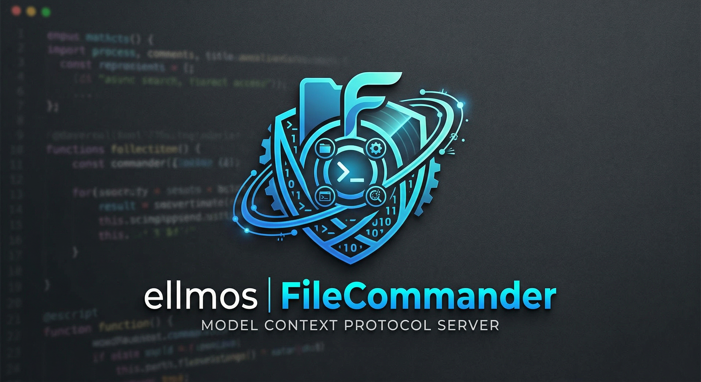
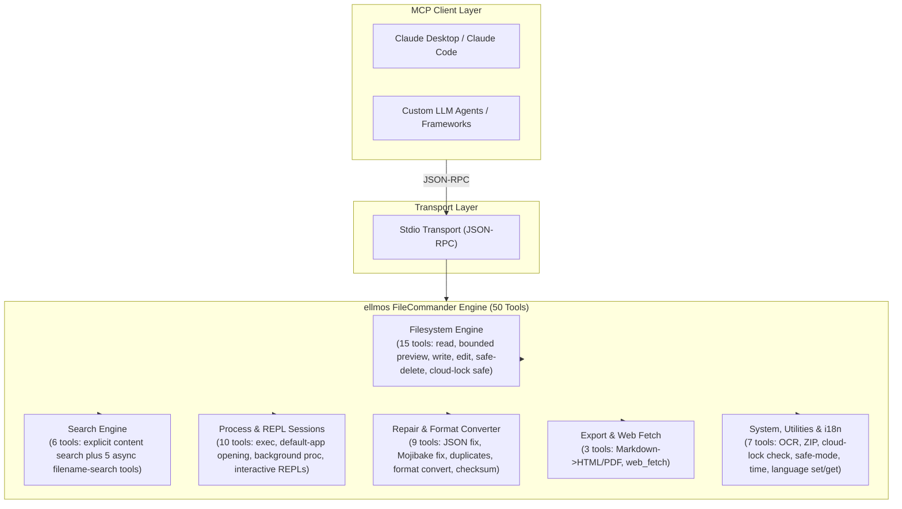
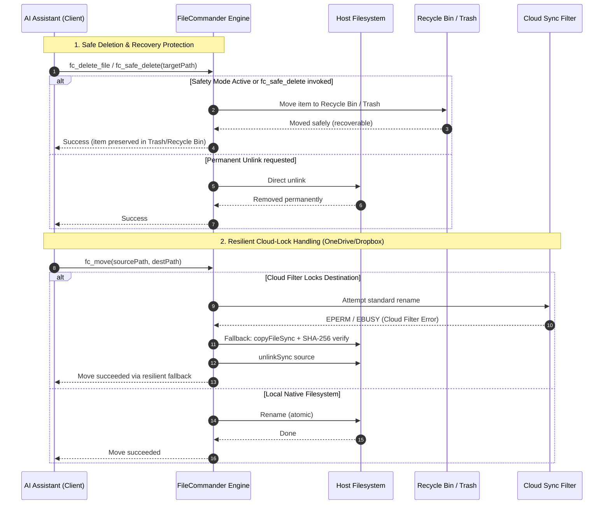

<!-- worldset: {"translated_from_sha256": "310943b7f88d776f409deb86f0a6536cfe6e4f73674f992af028f8173869755c", "translator": "claude-haiku-5-5", "translated_at": "2026-10-25T07:17:11.496324+00:00", "reviewer": "gpt-6-luna/max; Root independent structure and risk samples"} -->
<p align="center">
  
</p>

# ellmos FileCommander MCP Server

[English](README.md) | [Deutsch](README_de.md) | [Español](README_es.md) | [简体中文](README_zh.md) | [日本語](README_ja.md) | [Русский](README_ru.md) | [Français](README_fr.md) | **हिन्दी** | [العربية](README_ar.md) | [বাংলা](README_bn.md) | [Português](README_pt.md)

README नेविगेशन इस रिपॉज़िटरी में उपलब्ध दस्तावेज़ीकरण भाषाओं की सूची देता है। FileCommander के रनटाइम संदेश और स्वरूपित प्रतिक्रियाएँ जर्मन (de), अंग्रेज़ी (en), स्पेनिश (es), चीनी (zh), जापानी (ja), रूसी (ru), फ़्रेंच (fr), हिंदी (hi), अरबी (ar), बंगाली (bn) और पुर्तगाली (pt) में उपलब्ध हैं। यह रनटाइम सूची README अनुवाद की उपलब्धता से अलग है। यह रनटाइम में बनाए गए संदेशों और स्वरूपित टूल परिणामों पर लागू होती है; MCP टूल शीर्षक, डिस्कवरी विवरण और स्कीमा विवरण स्थिर रूप से अंग्रेज़ी में रहते हैं। सर्वर शुरू करने से पहले `FC_LANGUAGE` को किसी समर्थित कोड पर सेट करें, या सक्रिय MCP सत्र के दौरान `fc_set_language` कॉल करें। `fc_get_language` सक्रिय भाषा और सभी ग्यारह समर्थित कोड बताता है। `FC_LANGUAGE` सेट न होने या असमर्थित कोड होने पर जर्मन (de) का उपयोग होता है। तारीख और समय के प्रारूप सक्रिय भाषा के अनुसार होते हैं।

*[ellmos-ai](https://github.com/ellmos-ai) परिवार का हिस्सा।*

[](https://opensource.org/licenses/MIT)
[](https://github.com/ellmos-ai/ellmos-filecommander-mcp/actions/workflows/tests.yml)
[](https://www.npmjs.com/package/ellmos-filecommander-mcp)
[](https://nodejs.org/)
[](#tools-overview)
[-brightgreen.svg)](#testing)
[](SECURITY.md)
[](SECURITY.md)
[](#why-filecommander)
[](NOTICE)
[](SECURITY.md)
[](THIRD_PARTY_LICENSES.md)
[](THIRD_PARTY_LICENSES.txt)
[](https://github.com/ellmos-ai)
[](https://github.com/open-bricks)
[](llms.txt)
[](llms.txt)
[](llms.txt)

> **त्वरित नेविगेशन:**
> 1. [अवलोकन](#sec-01) | 2. [सिस्टम आर्किटेक्चर](#sec-02) | 3. [एंड-टू-एंड निष्पादन जीवनचक्र](#sec-03) | 4. [मुख्य क्षमताएँ और सुरक्षा अपरिवर्तनीय](#sec-04) | 5. [लक्षित व्यक्तित्व और खोजने योग्यता](#sec-05) | 6. [इंस्टॉलेशन और पूर्वापेक्षाएँ](#sec-06) | 7. [कॉन्फ़िगरेशन और क्लाइंट सेटअप](#sec-07) | 8. [टूल्स अवलोकन (50 टूल्स)](#sec-08) | 9. [तुलनात्मक मैट्रिक्स और विकल्प](#sec-09) | 10. [टूल प्रीफ़िक्स और नामकरण परंपरा](#sec-10) | 11. [गवर्नेंस और रनटाइम अपरिवर्तनीय](#sec-11) | 12. [सुरक्षा आर्किटेक्चर और टूल जोखिम](#sec-12) | 13. [परीक्षण, गुणवत्ता गेट और सत्यापन](#sec-13) | 14. [चेंजलॉग और संस्करण](#sec-14) | 15. [लेवल 1 SBOM और थर्ड-पार्टी लाइसेंस](#sec-15) | 16. [इतिहास और विकास](#sec-16) | 17. [ellmos-ai इकोसिस्टम और पार्टनर मैट्रिक्स](#sec-17) | 18. [वैधानिक सूचना (§ 521 BGB) और दायित्व अस्वीकरण](#sec-18)
>
> | प्रत्यक्ष संदर्भ: [🛡️ सुरक्षा नीति](SECURITY.md) • [🤝 योगदान](CONTRIBUTING.md) • [⚖️ थर्ड-पार्टी लाइसेंस](THIRD_PARTY_LICENSES.md) • [📄 सादा पाठ SBOM](THIRD_PARTY_LICENSES.txt) • [📜 मार्केटिंग लॉग](MARKETING-LOG.txt) • [🤖 LLM संदर्भ (llms.txt)](llms.txt) • [📋 प्रामाणिक सूचना](NOTICE) |

एक व्यापक **Model Context Protocol (MCP) सर्वर** जो AI सहायकों को पूर्ण फ़ाइलसिस्टम एक्सेस, सीमित बहु-फ़ाइल सामग्री खोज, प्रोसेस प्रबंधन, इंटरैक्टिव शेल सत्र और एसिंक्रोनस फ़ाइलनाम खोज क्षमताएँ प्रदान करता है।

**एक ही सर्वर में 50 टूल्स** - वह सब कुछ जिसकी एक AI एजेंट को स्थानीय सिस्टम के साथ इंटरैक्ट करने के लिए आवश्यकता है।

**खोज कीवर्ड:** local filesystem MCP server, multi-file content search MCP, safe delete MCP, Recycle Bin MCP server, process management MCP, interactive shell MCP, async file search for AI agents, cloud-lock-safe file operations, Markdown to PDF MCP, OCR MCP server, ZIP archive MCP.

**रजिस्ट्री स्थिति:** [npm](https://www.npmjs.com/package/ellmos-filecommander-mcp) पर प्रकाशित, [jsDelivr](https://www.jsdelivr.com/package/npm/ellmos-filecommander-mcp) द्वारा अनुक्रमित, [LobeHub](https://lobehub.com/mcp/ellmos-ai-ellmos-filecommander-mcp) पर दिखाई देता है, [Glama](https://glama.ai/mcp/servers/ellmos-ai/ellmos-filecommander-mcp) पर सूचीबद्ध, और [`server.json`](server.json) के माध्यम से आधिकारिक MCP Registry के लिए तैयार। कुछ तृतीय-पक्ष डायरेक्टरियाँ अभी भी पुराना 43-टूल मेटाडेटा दिखाती हैं, इसलिए उनके पुनः-अनुक्रमण तक canonical README/npm मेटाडेटा ही सत्य का स्रोत बना रहना चाहिए।

> [!NOTE]
> **AI एजेंट और LLM एकीकरण के लिए:**
> FileCommander मानक stdio ट्रांसपोर्ट के माध्यम से पहुँचे जाने योग्य **50 विशेष टूल्स** प्रदान करता है। नेमस्पेस टकराव से बचने के लिए सभी टूल नामों में `fc_` प्रीफ़िक्स है। LLM के लिए, संक्षिप्त संदर्भ और स्कीमा अवलोकन [`llms.txt`](llms.txt) और [`server.json`](server.json) में उपलब्ध हैं।

---

<a id="sec-01"></a><a id="overview"></a><a id="why-filecommander"></a><a id="ueberblick"></a><a id="überblick"></a>
## अवलोकन और FileCommander क्यों?

अधिकांश फ़ाइलसिस्टम MCP सर्वर केवल बुनियादी read/write संचालन को कवर करते हैं। FileCommander इससे आगे जाता है:

- **सुरक्षित डिलीट** - फ़ाइलों को स्थायी रूप से हटाने के बजाय Recycle Bin (Windows) या Trash (macOS/Linux) में ले जाता है
- **इंटरैक्टिव सेशन** - MCP प्रोटोकॉल के माध्यम से REPL (Python, Node.js, shells) शुरू करें और उनके साथ इंटरैक्ट करें
- **Async Search** - AI के काम करते रहने के दौरान बैकग्राउंड में बड़े डायरेक्टरी ट्री खोजें
- **स्पष्ट सामग्री खोज** - बिना recursion या glob expansion के, फ़ाइलों की सीमित सूची में शाब्दिक टेक्स्ट या regex खोजें
- **प्रोसेस प्रबंधन** - सिस्टम प्रोसेस की सूची देखें, शुरू करें और समाप्त करें
- **String Replace** - संदर्भ सत्यापन के साथ अद्वितीय स्ट्रिंग से मिलाकर फ़ाइलें संपादित करें
- **प्रारूप रूपांतरण** - JSON, CSV, INI, YAML, TOML, XML और TOON के बीच रूपांतरित करें
- **ZIP Archives** - ZIP archives बनाएँ, निकालें और सूचीबद्ध करें
- **फ़ाइल Checksums** - तुलना के साथ MD5, SHA-1, SHA-256, SHA-384 और SHA-512 हैशिंग
- **OCR** - छवियों से टेक्स्ट निकालें (वैकल्पिक tesseract.js dependency)
- **Safety Mode** - सभी डिलीट को Recycle Bin / Trash के माध्यम से भेजने के लिए toggle
- **Markdown Export** - code blocks, tables, nested lists, blockquotes के साथ Markdown को पेशेवर HTML/PDF में बदलें
- **Cloud-Lock Safe** - जब cloud sync filters (OneDrive, Dropbox, Google Drive, iCloud) rename संचालन को रोकते हैं, तो स्वचालित copy+delete fallback
- **Cloud Lock Diagnosis** - संचालन से पहले जाँचें कि कोई path sync-filter conflicts के जोखिम में है या नहीं
- **Cross-platform** - platform-specific optimizations के साथ Windows, macOS और Linux पर काम करता है

---

<a id="sec-02"></a><a id="system-architecture"></a><a id="systemarchitektur"></a>
## सिस्टम आर्किटेक्चर

### ASCII चार-दृश्य वास्तुकला टोपोलॉजी

```text
+--------------------------------------------------------------------------------------------------+
|                            ELLMOS FILECOMMANDER MCP ARCHITECTURAL TOPOLOGY                       |
+--------------------------------------------------------------------------------------------------+
| [VIEW 1: CALLER RUNTIMES & AGENT CLIENTS]                                                        |
|   * Autonomous Agents   : Claude Code, OpenAI Codex, Antigravity / Gemini, Kimi, Cursor          |
|   * Agent Frameworks    : AutoGen, CrewAI, LangChain, LlamaIndex, Custom Python / TS Clients    |
|   * Transport Protocols : Model Context Protocol (MCP stdio), JSON-RPC 2.0 Framing               |
|   * Tool Surface        : 50 Unified Specialized Tools (fc_* namespace collision isolation)       |
|   * Schema Contract     : Stdio transport, dynamic runtime i18n parameter parsing (Zod validated)|
+--------------------------------------------------------------------------------------------------+
|                                                |                                                 |
|                                                v                                                 |
+--------------------------------------------------------------------------------------------------+
| [VIEW 2: FILECOMMANDER MCP CORE ENGINE & DISPATCH ORCHESTRATOR]                                  |
|   * Protocol Dispatch   : ESM stdio router with Zod schema validation & parameter checking      |
|   * Multilingual Core   : 11-language dynamic runtime i18n engine       |
|   * Safety Interceptor  : Global Safety Mode (fc_set_safe_mode) routing deletes to Recycle Bin   |
|   * Sync Diagnostics    : Reparse point detection & cloud filter diagnostics (fc_check_cloud_lock)|
|   * Process Supervisor  : Bounded child process lifecycle management & interactive REPL session  |
|                           state registry with circular ring buffers                              |
+--------------------------------------------------------------------------------------------------+
|                                                |                                                 |
|                                                v                                                 |
+--------------------------------------------------------------------------------------------------+
| [VIEW 3: FILESYSTEM RUNTIME, FORMAT REPAIR & PROCESS ISOLATION]                                  |
|   * Atomic File Ops     : Read, write, line edit, exact literal string replacement (fc_str_replace)|
|   * Cloud-Lock Fallback : Automatic copyFileSync + SHA-256 verify + unlinkSync on EPERM / EBUSY   |
|   * Bounded Inspection  : Metadata-first preview (fc_preview_file, 1 MiB inline content ceiling)  |
|   * Bounded Content Srch: max 50 explicit files, 10 MB ceiling, token redaction (INV-MASK-06)   |
|   * Self-Healing Repair : Mojibake repair (27+ UTF-8 patterns), JSON syntax fix, file cleanup    |
|   * Lossless Converter  : Declarative transformation across 7 formats (JSON, YAML, TOML, XML...) |
|   * Media & Documents   : Headless Markdown to PDF/HTML, ZIP archive engine, optional OCR (Tess)  |
+--------------------------------------------------------------------------------------------------+
|                                                |                                                 |
|                                                v                                                 |
+--------------------------------------------------------------------------------------------------+
| [VIEW 4: AIR-GAP DEFENSE PERIMETER, RUNASINVOKER & CONTROLLED EGRESS]                            |
|   * Execution Privilege : RunAsInvoker unprivileged user-mode (Zero administrative elevation)    |
|   * Transport Boundary  : 100% Local stdio transport, zero telemetry, zero open listening ports  |
|   * Controlled Egress   : Outbound HTTP(S) strictly gated through caller-invoked fc_web_fetch     |
|   * Network Safety      : SSRF guard blocking private/internal IP ranges (allow_private override) |
|   * Governance & Supply : Level 1 SBOM, 100% permissive runtime (MIT/BSD), 48h Security SLA      |
+--------------------------------------------------------------------------------------------------+
```

### घटक प्रवाह आरेख



---

<a id="sec-03"></a><a id="end-to-end-execution-lifecycle"></a><a id="execution-lifecycle"></a><a id="end-to-end-ausfuehrungszyklus"></a>
## अंत-से-अंत निष्पादन जीवनचक्र



---

<a id="sec-04"></a><a id="core-capabilities--safety-invariants"></a><a id="core-capabilities"></a><a id="kernfaehigkeiten--sicherheitsinvarianten"></a><a id="kernfähigkeiten--sicherheitsinvarianten"></a>
## मुख्य क्षमताएँ और सुरक्षा अपरिवर्तनीय नियम

| क्षमता / अपरिवर्तनीय नियम | गारंटी और कार्यान्वयन विवरण | सुरक्षा और परिचालन लाभ |
|------------------------|-----------------------------------|--------------------------------|
| **स्थानीय stdio और स्पष्ट बाहरी संचार** | MCP परिवहन स्थानीय stdio है, जिसमें कोई टेलीमेट्री नहीं और कोई स्वचालित नेटवर्क बाहरी संचार नहीं है। `fc_web_fetch` बाहरी HTTP(S) अनुरोध तभी करता है जब कोई क्लाइंट उसे स्पष्ट रूप से आमंत्रित करता है; `allow_private` सक्षम न होने पर निजी लक्ष्य डिफ़ॉल्ट रूप से अवरुद्ध रहते हैं। | पोर्ट-रहित सर्वर परिवहन को बनाए रखते हुए क्लाइंट्स के लिए नेटवर्क सीमा को दृश्यमान बनाता है। |
| **सुरक्षित हटाना और ट्रैश संरक्षण** | `fc_safe_delete` आइटम्स को Windows Recycle Bin / macOS Trash / Linux FreeDesktop Trash में ले जाता है। `fc_set_safe_mode` सभी हटाने के कार्यों को सुरक्षित रूप से रूट करता है। | आकस्मिक पुनरावर्ती या बड़े पैमाने पर हटाने से होने वाली अपरिवर्तनीय डेटा हानि को रोकता है। |
| **क्लाउड-लॉक प्रतिरोधी स्थानांतरण (`fc_move`)** | क्लाउड सिंक फ़िल्टर (OneDrive, Dropbox, iCloud reparse points) का स्वचालित पता लगाना, सहज copy+verify+delete फ़ॉलबैक के साथ। | सिंक निर्देशिकाओं में स्वचालित एजेंट संचालन के दौरान `EPERM` / `EBUSY` विफलताओं को समाप्त करता है। |
| **क्लाउड-लॉक निदान (`fc_check_cloud_lock`)** | लक्ष्य के अस्तित्व/प्रकार के साथ स्थैतिक क्लाउड-पथ संदर्भ की केवल-पढ़ने योग्य रिपोर्ट; उपलब्ध न होने पर Cloud Files hydration और process handles को स्पष्ट रूप से "जाँचे नहीं गए" के रूप में रिपोर्ट किया जाता है। | एजेंट स्थैतिक OneDrive जोखिम और वास्तविक रूप से पता चले rename lock के बीच अंतर कर सकते हैं। |
| **सीमित बहु-फ़ाइल सामग्री खोज** | `fc_search_content` इनपुट को कड़ाई से सीमित करता है (अधिकतम 50 स्पष्ट फ़ाइलें, प्रति फ़ाइल 10 MB, 200 मिलान, 200k अक्षर), glob पुनरावृत्ति के बिना। | बड़े रिपॉज़िटरी खोजों के दौरान out-of-memory त्रुटियों और भयंकर CPU lockups को रोकता है। |
| **स्वचालित रहस्य और टोकन रिडेक्शन** | सामग्री खोज अंश स्वचालित रूप से सामान्य API keys, bearer tokens, AWS credentials और authorization headers को मास्क करते हैं। | LLM संदर्भ प्रदूषण और prompt इतिहास में आकस्मिक credential लीक को रोकता है। |
| **इंटरैक्टिव REPL और सत्र पृथक्करण** | Python, Node.js, bash और PowerShell के लिए सीमित buffers वाले stateful इंटरैक्टिव सत्र (`fc_start_session`, `fc_send_input`, `fc_read_output`)। | अनियंत्रित background process संचय के बिना बहु-चरणीय REPL डिबगिंग की अनुमति देता है। |
| **लॉसलेस बहु-प्रारूप इंजन** | 7 संरचित प्रारूपों (JSON, YAML, TOML, XML, CSV, INI, TOON) में घोषणात्मक रूपांतरण (`fc_convert_format`)। | डेटा हानि के बिना विषम कॉन्फ़िगरेशन प्रारूपों में स्वच्छ डेटा सामान्यीकरण। |
| **Mojibake और फ़ाइल मरम्मत इंजन** | `fc_fix_encoding`, `fc_fix_json` और `fc_cleanup_file` टूटे UTF-8 एन्कोडिंग (27+ पैटर्न), विकृत JSON सिंटैक्स, BOMs और NUL bytes की मरम्मत करते हैं। | विभिन्न OS प्लेटफ़ॉर्म पर उत्पन्न भ्रष्ट फ़ाइलों के लिए स्व-उपचारी पाइपलाइन। |
| **अविशेषाधिकृत, गैर-उन्नयन निष्पादन** | सामान्य अविशेषाधिकृत user-mode में चलने के लिए डिज़ाइन और सत्यापित। कभी भी प्रशासनिक या root विशेषाधिकारों की आवश्यकता नहीं होती। | न्यूनतम attack surface; न्यूनतम विशेषाधिकार के सिद्धांत का पालन। |
| **ग्यारह-भाषा रनटाइम i18n इंजन** | सभी 11 समर्थित कोड के लिए गतिशील भाषा स्विचिंग और जानकारी (`fc_set_language`, `fc_get_language`): `de`, `en`, `es`, `zh`, `ja`, `ru`, `fr`, `hi`, `ar`, `bn`, और `pt`। | मूल बहुभाषी डेवलपर अनुभव और स्थानीयकृत त्रुटि रिपोर्टिंग। |
| **बहु-OS सत्यापित मैट्रिक्स** | Node.js 20, 22 और 24 पर Windows, Ubuntu Linux और macOS में परीक्षित, 292 स्वचालित assertions के साथ। | निरंतर क्रॉस-प्लेटफ़ॉर्म समानता और विश्वसनीयता। |

---

<a id="sec-05"></a><a id="target-personas--discoverability"></a><a id="target-personas"></a><a id="zielgruppen--auffindbarkeit"></a>
## लक्षित व्यक्तित्व और खोजने की क्षमता

FileCommander को चार मुख्य डेवलपर, एजेंटिक और ऑपरेशंस व्यक्तित्वों के लिए विशेष रूप से बनाया और सत्यापित किया गया है:

### [PERSONA-01] ऑटोनॉमस AI कोडिंग एजेंट्स और LLM स्वार्म्स
- **प्रोफ़ाइल:** मल्टी-एजेंट स्वार्म्स और स्टैंडअलोन एजेंटिक रनटाइम्स जो रिकर्सिव कोड एडिटिंग, प्रोजेक्ट रिफैक्टरिंग और डायरेक्टरी ऑडिट चलाते हैं।
- **मुख्य परिचालन समस्याएँ:** कई-मेगाबाइट फ़ाइलें पढ़ने से तेज़ी से बढ़ता कॉन्टेक्स्ट विंडो बोझ, क्लाउड-सिंक्ड फ़ोल्डरों में लॉक्ड फ़ाइलों (`EPERM`/`EBUSY`) के कारण अनहैंडल्ड प्रोसेस क्रैश, और `rm -rf` क्लीनअप रूटीन के गलती से चलने से अपरिवर्तनीय रिपॉज़िटरी भ्रष्टाचार।
- **FileCommander समाधान:**
  - `fc_preview_file`: मेटाडेटा-पहले निरीक्षण, सख्त 1 MiB इनलाइन कंटेंट सीमा जो LLM कॉन्टेक्स्ट विस्फोट को रोकती है।
  - `fc_search_content`: सीमित मल्टी-फ़ाइल खोज (अधिकतम 50 फ़ाइलें, प्रति फ़ाइल 10 MB, 200 मिलान) स्वचालित सीक्रेट/टोकन रिडैक्शन के साथ।
  - `fc_safe_delete` & `fc_set_safe_mode`: शून्य-जोखिम फ़ाइल ऑपरेशन के लिए हटाई गई फ़ाइलों को OS रीसायकल बिन / ट्रैश में सुरक्षित रखता है।
  - `fc_move` & `fc_check_cloud_lock`: फ़ाइल लॉक पर स्वचालित कॉपी + SHA-256 सत्यापन + अनलिंक फ़ॉलबैक, जिससे एजेंट विफलता रुकती है।

### [PERSONA-02] DevOps, टूलचेन और मल्टी-होस्ट ऑटोमेशन इंजीनियर
- **प्रोफ़ाइल:** सिस्टम और ऑटोमेशन इंजीनियर जो Windows, Linux और macOS पर क्रॉस-प्लेटफ़ॉर्म CLI टूल्स, CI/CD वैलिडेशन पिपलाइन और मल्टी-मशीन सिंक स्क्रिप्ट बनाते हैं।
- **मुख्य परिचालन समस्याएँ:** विषम ऑपरेटिंग सिस्टम सिमेंटिक्स (Windows बैकस्लैश बनाम POSIX स्लैश), लाइन-एंडिंग भ्रष्टाचार, शेल-विशिष्ट सिंटैक्स, ज़ोंबी चाइल्ड प्रोसेस, और साझा OneDrive/Dropbox वर्कस्पेस में फ़ाइल लॉकिंग।
- **FileCommander समाधान:**
  - Windows, Linux और macOS में एकीकृत क्रॉस-प्लेटफ़ॉर्म टूल सिमेंटिक्स।
  - सीमित सर्कुलर रिंग बफ़र्स के साथ स्टेटफ़ुल इंटरैक्टिव REPL सेशन (`fc_start_session`, `fc_send_input`, `fc_read_output`)।
  - बैच फ़ाइल रीनेमिंग (`fc_batch_rename`) और बैकग्राउंड डायरेक्टरी खोज (`fc_start_search`, `fc_get_search_results`)।
  - बिना प्रोसेस लीक के प्रोसेस लाइफ़साइकल प्रबंधन (`fc_execute_command`, `fc_start_process`, `fc_kill_process`)।

### [PERSONA-03] SecOps, गवर्नेंस और कम्प्लायंस अधिकारी
- **प्रोफ़ाइल:** उद्यम और प्रोडक्शन वातावरण में AI टूल इंटीग्रेशन की निगरानी करने वाले सुरक्षा अधिकारी, कम्प्लायंस ऑडिटर और प्राइवेसी टीमें।
- **मुख्य परिचालन समस्याएँ:** अघोषित बैकग्राउंड टेलीमेट्री बीकन, स्थानीय प्लगइन से अप्रमाणित नेटवर्क एक्सेस, मॉडल ट्रेनिंग या प्रॉम्प्ट इतिहास में क्रेडेंशियल/टोकन लीक, और अप्रिविलेज्ड उपयोगकर्ता द्वारा प्रिविलेज एस्केलेशन।
- **FileCommander समाधान:**
  - सख्ती से शून्य टेलीमेट्री और शून्य खुले नेटवर्क लिसनिंग पोर्ट्स के साथ स्थानीय stdio ट्रांसपोर्ट।
  - स्पष्ट आउटबाउंड नेटवर्क एग्रेस, जो केवल कॉलर द्वारा शुरू किए गए `fc_web_fetch` तक सीमित है (डिफ़ॉल्ट रूप से इंटरनल/प्राइवेट IP ब्लॉक)।
  - खोज अंशों में स्वचालित सीक्रेट और बियरर टोकन मास्किंग (`INV-MASK-06`)।
  - सख्त अप्रिविलेज्ड उपयोगकर्ता निष्पादन (`INV-PROC-09`) और बाध्यकारी 48-घंटे की भेद्यता प्रतिक्रिया SLA (`security@open-bricks.org`, `security@ellmos.ai`)।

### [PERSONA-04] एंटरप्राइज़ प्लेटफ़ॉर्म आर्किटेक्ट्स और डेटा पाइपलाइन डेवलपर्स
- **प्रोफ़ाइल:** सॉल्यूशन आर्किटेक्ट और डेटा इंजीनियर जो स्थानीय फ़ाइलों को इंटीग्रेट करते हैं, विषम कॉन्फ़िगरेशन फ़ॉर्मेट को नॉर्मलाइज़ करते हैं, क्रिप्टोग्राफ़िक हैश सत्यापित करते हैं और रिपोर्ट तैयार करते हैं।
- **मुख्य परिचालन समस्याएँ:** 4-6 अलग-अलग एकल-उद्देश्य सर्वरों की आवश्यकता वाला MCP सर्वर फैलाव, टूल्स में भ्रष्ट UTF-8 बाइट अनुक्रम (Mojibake), और कस्टम पार्सिंग स्क्रिप्ट।
- **FileCommander समाधान:**
  - व्यापक 50-टूल सिंगल-सर्वर डिप्लॉयमेंट, जो मल्टी-सर्वर फैलाव और प्रोसेस ओवरहेड को समाप्त करता है।
  - 7 संरचित फ़ॉर्मेट (`fc_convert_format`: JSON, YAML, TOML, XML, CSV, INI, TOON) में लॉसलेस डिक्लेरेटिव कन्वर्ज़न।
  - सेल्फ-हीलिंग पिपलाइन के लिए बिल्ट-इन फ़ाइल रिपेयर इंजन (`fc_fix_encoding`, `fc_fix_json`, `fc_cleanup_file`)।
  - क्रिप्टोग्राफ़िक चेकसम (`fc_checksum`: SHA-256, SHA-512, MD5, SHA-1) और Markdown से PDF/HTML रेंडरिंग (`fc_md_to_pdf`, `fc_md_to_html`)।

### उच्च-इरादा खोज क्वेरी और खोजने योग्यता वेक्टर

- **प्राथमिक खोज क्वेरी:** `ellmos-filecommander-mcp`, `FileCommander MCP`, `filesystem MCP server`, `multi-file content search MCP`, `safe delete MCP`, `async file search MCP`, `process management MCP`, `Markdown PDF MCP`।
- **मशीन-पठनीय मेटाडेटा:** AI एजेंटों के लिए संरचित संदर्भ [`llms.txt`](llms.txt), [`server.json`](server.json), और [`glama.json`](glama.json) में रखा जाता है।
- **कम्प्लायंस और एट्रिब्यूशन:** [`THIRD_PARTY_LICENSES.md`](THIRD_PARTY_LICENSES.md) और [`NOTICE`](NOTICE) के विरुद्ध मान्य।

---

<a id="sec-06"></a><a id="installation"></a><a id="installation-prerequisites"></a>
## इंस्टॉलेशन

### पूर्वापेक्षाएँ

- [Node.js](https://nodejs.org/) 20 या उससे ऊपर
- npm

### विकल्प 1: NPM से इंस्टॉल करें

```bash
npm install -g ellmos-filecommander-mcp
```

### विकल्प 2: सोर्स से इंस्टॉल करें

```bash
git clone https://github.com/ellmos-ai/ellmos-filecommander-mcp.git
cd ellmos-filecommander-mcp
npm ci
npm run build
```

---

<a id="sec-07"></a><a id="configuration"></a><a id="client-setup"></a><a id="konfiguration"></a>
## कॉन्फ़िगरेशन

### Claude Desktop

अपनी `claude_desktop_config.json` में जोड़ें:

**Windows:** `%APPDATA%\Claude\claude_desktop_config.json`
**macOS:** `~/Library/Application Support/Claude/claude_desktop_config.json`

#### यदि NPM के माध्यम से वैश्विक रूप से इंस्टॉल किया गया है:

```json
{
  "mcpServers": {
    "filecommander": {
      "command": "ellmos-filecommander"
    }
  }
}
```

#### यदि स्रोत से इंस्टॉल किया गया है:

```json
{
  "mcpServers": {
    "filecommander": {
      "command": "node",
      "args": ["/absolute/path/to/filecommander-mcp/dist/index.js"]
    }
  }
}
```

सहेजने के बाद Claude Desktop को पुनः आरंभ करें।

### अन्य MCP क्लाइंट

सर्वर **stdio transport** के माध्यम से संचार करता है। अपने MCP क्लाइंट को `dist/index.js` एंट्री पॉइंट या `ellmos-filecommander` बाइनरी की ओर इंगित करें।

---

<a id="sec-08"></a><a id="tools-overview"></a><a id="available-tools"></a><a id="tools-uebersicht"></a><a id="tools-übersicht"></a>
## टूल्स का अवलोकन

### फ़ाइल सिस्टम संचालन (15 टूल)

| टूल | विवरण |
|------|-------------|
| `fc_read_file` | वैकल्पिक लाइन सीमा के साथ फ़ाइल सामग्री पढ़ें |
| `fc_preview_file` | पहले MIME प्रकार और आकार जाँचें, फिर स्पष्ट रूप से सीमित इनलाइन MCP सामग्री का अनुरोध करें |
| `fc_read_multiple_files` | एक ही कॉल में अधिकतम 20 फ़ाइलें पढ़ें |
| `fc_write_file` | फ़ाइलों में लिखें/बनाएँ/जोड़ें |
| `fc_edit_file` | लाइन-आधारित संपादन (लाइनें बदलें, डालें, हटाएँ) |
| `fc_str_replace` | संदर्भ सत्यापन के साथ फ़ाइल में एक अद्वितीय स्ट्रिंग बदलें |
| `fc_list_directory` | डायरेक्टरी सामग्री सूचीबद्ध करें (पुनरावर्ती, कॉन्फ़िगर करने योग्य गहराई) |
| `fc_create_directory` | डायरेक्टरी बनाएँ (मूल डायरेक्टरी सहित) |
| `fc_delete_file` | एक फ़ाइल हटाएँ (स्थायी) |
| `fc_delete_directory` | एक डायरेक्टरी हटाएँ (वैकल्पिक पुनरावर्ती फ़्लैग के साथ) |
| `fc_safe_delete` | Recycle Bin / Trash में ले जाएँ (पुनर्प्राप्ति योग्य!) |
| `fc_move` | फ़ाइलें और डायरेक्टरी ले जाएँ या नाम बदलें (cloud-lock सुरक्षित) |
| `fc_copy` | फ़ाइलें और डायरेक्टरी कॉपी करें |
| `fc_file_info` | विस्तृत फ़ाइल मेटाडेटा प्राप्त करें (आकार, तिथियाँ, प्रकार) |
| `fc_search_files` | वाइल्डकार्ड पैटर्न के साथ सिंक्रोनस फ़ाइल खोज |

`fc_preview_file` स्थानीय फ़ाइलों के लिए remote/headless फ़ॉलबैक है। इसकी डिफ़ॉल्ट कॉल केवल संरचित मेटाडेटा लौटाती है: resolved path, `file://` URI, MIME प्रकार, बाइट आकार, preview kind, निश्चित 1 MiB सीमा, और सटीक अगली कॉल। सामग्री केवल `include_content=true` के बाद पढ़ी जाती है। योग्य टेक्स्ट और raster images मानक MCP `text`/`image` content blocks का उपयोग करते हैं; PDFs एक सीमित embedded `resource` का उपयोग करते हैं। 1 MiB से बड़ी फ़ाइलें और असमर्थित प्रकार केवल-मेटाडेटा बने रहते हैं और preview पथ द्वारा कभी न पढ़े जाते हैं और न Base64-encoded किए जाते हैं।

### सामग्री खोज (1 टूल)

| टूल | विवरण |
|------|-------------|
| `fc_search_content` | केस, संदर्भ, global, और प्रति-फ़ाइल सीमाओं के साथ एक स्पष्ट क्रमबद्ध फ़ाइल सूची के भीतर केवल-पढ़ने वाली literal या regex खोज |

`fc_search_content` globs का विस्तार नहीं करता, डायरेक्टरी में नहीं घूमता, और फ़ाइलें पुनरावर्ती रूप से नहीं खोजता। यह अधिकतम 50 स्पष्ट UTF-8 टेक्स्ट फ़ाइलें स्वीकार करता है, binary और 10 MB से बड़ी फ़ाइलें छोड़ता है, और निर्धारक JSON लौटाता है। मिलान वैश्विक रूप से 200 और प्रति फ़ाइल 100 तक सीमित हैं, संदर्भ 10 पंक्तियों तक, excerpts 500 अक्षरों तक, और serialized आउटपुट 200,000 अक्षरों तक। Missing, cloud-only, permission, encoding, binary, और size विफलताएँ प्रति फ़ाइल रिपोर्ट की जाती हैं ताकि पठनीय फ़ाइलें फिर भी परिणाम दें। सामान्य secret formats excerpts से redact किए जाते हैं।

### Async Search (5 टूल)

| टूल | विवरण |
|------|-------------|
| `fc_start_search` | पृष्ठभूमि खोज शुरू करें (तुरंत लौटता है) |
| `fc_get_search_results` | पेजिनेशन के साथ परिणाम प्राप्त करें |
| `fc_stop_search` | चल रही खोज रद्द करें |
| `fc_list_searches` | सभी सक्रिय/पूर्ण खोजें सूचीबद्ध करें |
| `fc_clear_search` | पूर्ण खोजें मेमोरी से हटाएँ |

### प्रक्रिया प्रबंधन (5 टूल)

| टूल | विवरण |
|------|-------------|
| `fc_execute_command` | एक shell command निष्पादित करें (ब्लॉकिंग, timeout के साथ) |
| `fc_start_process` | पृष्ठभूमि प्रक्रिया शुरू करें (non-blocking) |
| `fc_open_path` | मौजूदा स्थानीय फ़ाइल या डायरेक्टरी को validate करें और OS डिफ़ॉल्ट एप्लिकेशन से खोलें |
| `fc_list_processes` | चल रही सिस्टम प्रक्रियाएँ सूचीबद्ध करें |
| `fc_kill_process` | PID या नाम से प्रक्रिया समाप्त करें |

`fc_open_path` केवल मौजूदा फ़ाइल या डायरेक्टरी स्वीकार करता है और उसे एक निश्चित native default-handler launcher को भेजता है। इसका संरचित परिणाम `launcher_accepted=true|false` रिपोर्ट करता है, हमेशा `user_visible="unknown"` रिपोर्ट करता है, और एक machine-readable fallback पहचानता है: फ़ाइलों के लिए केवल-मेटाडेटा arguments के साथ `fc_preview_file`, या डायरेक्टरी के लिए `fc_list_directory`। Launcher की स्वीकृति कभी यह दावा नहीं करती कि GUI दिखाई दिया। `fc_start_process` इसके बजाय कॉलर को executable और arguments चुनने देता है। `fc_execute_command` एक मनमाना shell command स्वीकार करता है: सामान्य commands के लिए Node का डिफ़ॉल्ट shell उपयोग होता है (Windows पर `COMSPEC`/`cmd.exe`), जबकि FileCommander का Windows special-character पथ Windows PowerShell के माध्यम से जा सकता है।

### Interactive Sessions (5 टूल)

| उपकरण | विवरण |
|------|-------------|
| `fc_start_session` | एक इंटरैक्टिव प्रक्रिया शुरू करें (Python, Node, shell...) |
| `fc_read_output` | सत्र आउटपुट पढ़ें |
| `fc_send_input` | चल रहे सत्र को इनपुट भेजें |
| `fc_list_sessions` | सभी सत्रों की सूची बनाएँ |
| `fc_close_session` | एक सत्र समाप्त करें |

### फ़ाइल रखरखाव और मरम्मत (9 उपकरण)

| उपकरण | विवरण |
|------|-------------|
| `fc_fix_json` | टूटे JSON की मरम्मत करें (BOM, ट्रेलिंग कॉमा, टिप्पणियाँ, एकल उद्धरण) |
| `fc_validate_json` | विस्तृत त्रुटि स्थिति और संदर्भ के साथ JSON का सत्यापन करें |
| `fc_cleanup_file` | BOM, NUL बाइट्स, ट्रेलिंग व्हाइटस्पेस हटाएँ, लाइन एंडिंग को सामान्य करें |
| `fc_fix_encoding` | Mojibake / दोहरी-एन्कोडेड UTF-8 ठीक करें (27+ वर्ण पैटर्न) |
| `fc_folder_diff` | स्नैपशॉट के साथ डायरेक्टरी परिवर्तनों को ट्रैक करें (नई/संशोधित/हटाई गई) |
| `fc_batch_rename` | पैटर्न-आधारित बैच नाम परिवर्तन (प्रीफ़िक्स/सफ़िक्स, replace, auto-detect) |
| `fc_convert_format` | JSON, CSV, INI, YAML, TOML, XML और TOON प्रारूपों के बीच रूपांतरण करें |
| `fc_detect_duplicates` | SHA-256 हैशिंग का उपयोग करके डुप्लिकेट फ़ाइलें खोजें |
| `fc_checksum` | फ़ाइल हैशिंग (MD5, SHA-1, SHA-256, SHA-384, SHA-512), वैकल्पिक तुलना के साथ |

### आर्काइव (1 उपकरण)

| उपकरण | विवरण |
|------|-------------|
| `fc_archive` | ZIP आर्काइव बनाएँ, निकालें और सूचीबद्ध करें |

### OCR (1 उपकरण)

| उपकरण | विवरण |
|------|-------------|
| `fc_ocr` | tesseract.js के माध्यम से छवियों से टेक्स्ट निकालें (वैकल्पिक निर्भरता) |

### क्लाउड सिंक (1 उपकरण)

| उपकरण | विवरण |
|------|-------------|
| `fc_check_cloud_lock` | स्थिर क्लाउड-सिंक संदर्भ और लक्ष्य स्थिति की रिपोर्ट करें; प्रमाण के बिना कभी सक्रिय लॉक का दावा न करें (Windows) |

### सिस्टम (4 उपकरण)

| उपकरण | विवरण |
|------|-------------|
| `fc_get_time` | टाइमज़ोन जानकारी के साथ वर्तमान सिस्टम समय प्राप्त करें |
| `fc_set_safe_mode` | सेफ़ मोड टॉगल करें: सभी डिलीट Recycle Bin / Trash के माध्यम से जाएँगे |
| `fc_set_language` | रनटाइम भाषा सेट करें (`de`, `en`, `es`, `zh`, `ja`, `ru`, `fr`, `hi`, `ar`, `bn`, या `pt`) |
| `fc_get_language` | सक्रिय रनटाइम भाषा और सभी 11 समर्थित भाषा कोड पढ़ें |

### निर्यात (2 उपकरण)

| उपकरण | विवरण |
|------|-------------|
| `fc_md_to_html` | Markdown से CSS स्टाइलिंग वाला स्टैंडअलोन HTML (हेडर, कोड ब्लॉक, तालिकाएँ, नेस्टेड सूचियाँ, ब्लॉककोट, छवियाँ, चेकबॉक्स) |
| `fc_md_to_pdf` | हेडलेस ब्राउज़र (Edge/Chrome) के माध्यम से Markdown से PDF। कोई ब्राउज़र उपलब्ध न होने पर HTML पर वापस जाता है |

### वेब (1 उपकरण)

| उपकरण | विवरण |
|------|-------------|
| `fc_web_fetch` | एक वेब पेज लाएँ और `mode` द्वारा सामग्री लौटाएँ: extract (साफ़ मुख्य टेक्स्ट), raw (HTTP बॉडी), links, forms, या headers। केवल-पठन नेटवर्क उपकरण; SSRF गार्ड डिफ़ॉल्ट रूप से आंतरिक/निजी लक्ष्यों को ब्लॉक करता है। |

**कुल: 50 उपकरण**

---

<a id="sec-09"></a><a id="comparative-matrix--alternatives"></a><a id="comparative-matrix"></a><a id="comparison-with-alternatives"></a><a id="vergleichsmatrix--alternativen"></a>
## तुलनात्मक मैट्रिक्स और विकल्प

FileCommander फ़ाइल सिस्टम में हेरफेर, सीमित खोज, प्रक्रिया नियंत्रण, डेटा मरम्मत, प्रारूप रूपांतरण और दस्तावेज़ रेंडरिंग को एक एकीकृत MCP इंटरफ़ेस में जोड़ता है। नीचे 10 प्रमुख परिचालन आयामों में मानक विकल्पों के विरुद्ध एक वास्तुशिल्पीय तुलना दी गई है:

| परिचालन आयाम | ellmos FileCommander MCP (50 टूल) | आधिकारिक Filesystem MCP (`@modelcontextprotocol/server-filesystem`) | Desktop Commander MCP | प्रत्यक्ष होस्ट शेल (`bash` / PowerShell) | Ad-Hoc स्क्रिप्ट्स और Cloud APIs |
|-----------------------|:-----------------------------------:|:------------------------------------------------------------------:|:---------------------:|:---------------------------------------:|:---------------------------:|
| **टूल की व्यापकता और दायरा** `[INV-PROC-09]` | **6 डोमेन में 50 एकीकृत टूल** | लगभग 11 बुनियादी फ़ाइल I/O टूल | लगभग 15 टूल (फ़ाइल + प्रक्रिया) | प्रतिबंधरहित CLI कमांड | बिखरी हुई कस्टम स्क्रिप्ट्स |
| **सुरक्षित हटाना और पुनर्प्राप्ति** `[INV-SAFE-02]` | **मूल OS Recycle Bin / Trash** (`fc_safe_delete`, Safety Mode) | केवल स्थायी हटाना (`unlink`) | केवल स्थायी हटाना | अपरिवर्तनीय `rm -rf` / `Remove-Item` | कस्टम ट्रैश कार्यान्वयन |
| **Cloud-Lock और Sync की मज़बूती** `[INV-LOCK-03]` | **स्वचालित फ़ॉलबैक** (copy + SHA-256 verify + EPERM/EBUSY पर unlink) | लॉक्ड फ़ाइलों और reparse points पर विफल | लॉक्ड फ़ाइलों पर विफल | विफल या अनिश्चित काल तक अवरुद्ध | Sync टकराव / conflict copies |
| **सीमित खोज और गोपनीय डेटा रिडैक्शन** `[INV-SRCH-05 / INV-MASK-06]` | **सीमित खोज** (अधिकतम 50 फ़ाइलें, 10 MB, स्वचालित API token रिडैक्शन) | केवल डायरेक्टरी वॉक (कंटेंट regex नहीं) | असीमित regex खोज | असीमित `grep` (संदर्भ में गोपनीय डेटा लीक करता है) | बिना रिडैक्शन के कस्टम regex |
| **असिंक्रोनस दीर्घकालिक खोज** `[INV-SRCH-05]` | **Token-paginated पृष्ठभूमि स्कैन** (`fc_start_search`) | केवल सिंक्रोनस (एजेंट को अवरुद्ध करता है) | केवल सिंक्रोनस | पृष्ठभूमि जॉब नियंत्रण (`&`) | Polling loops / धीमी नेटवर्क कॉल |
| **इंटरैक्टिव REPL और सत्र नियंत्रण** `[INV-REPL-08]` | **Circular buffers के साथ स्टेटफ़ुल REPLs** (Node, Python, Shell) | समर्थित नहीं | बुनियादी terminal sessions | कच्चे subprocesses (zombie process जोखिम) | जटिल IPC पाइपिंग |
| **स्व-उपचार और डेटा मरम्मत** `[INV-DIAG-04]` | **अंतर्निर्मित** Mojibake सुधार (27+ पैटर्न) और JSON मरम्मत | समर्थित नहीं | समर्थित नहीं | मैनुअल `iconv` / `sed` पाइपलाइन | कस्टम त्रुटि-पुनर्प्राप्ति कोड |
| **बहु-प्रारूप रूपांतरण** `[INV-PREV-07]` | **घोषणात्मक रूपांतरण** (JSON, YAML, TOML, XML, CSV, INI, TOON) | समर्थित नहीं | समर्थित नहीं | बाहरी `jq` / `yq` / `xmlstarlet` आवश्यक | तृतीय-पक्ष Python लाइब्रेरी |
| **दस्तावेज़ और आर्काइव उपयोगिताएँ** `[INV-PREV-07]` | **अंतर्निर्मित** ZIP lifecycle, OCR (Tesseract), Markdown से HTML/PDF | समर्थित नहीं | desktop ऐप के माध्यम से Excel/PDF | `pandoc`, `zip`, `tesseract` आवश्यक | बिखरी हुई उपयोगिता निर्भरताएँ |
| **शासन और सुरक्षा SLAs** `[INV-LOCAL-01 / INV-SLA-10]` | **स्थानीय stdio, शून्य telemetry, स्पष्ट egress, बाध्यकारी 48 घंटे SLA** | मानक stdio, सामुदायिक SLA | Stdio, अप्रमाणित telemetry/logs | अप्रतिबंधित elevation और script injection जोखिम | Ad-hoc SaaS cloud एक्सपोज़र |

**मुख्य विशेषताएँ:**
- एकमात्र MCP सर्वर जिसमें **पुनर्प्राप्ति योग्य हटाना** (Recycle Bin / Trash) और वैश्विक **Safety Mode** है
- एकमात्र MCP सर्वर जिसमें pagination और token प्रबंधन के साथ **असिंक्रोनस पृष्ठभूमि खोज** है
- एकमात्र MCP सर्वर जिसमें खोज snippets में **स्वचालित गोपनीय डेटा और bearer token रिडैक्शन** है
- अंतर्निर्मित **JSON मरम्मत**, **Mojibake एन्कोडिंग सुधार**, और **डुप्लिकेट पहचान**
- स्वचालित copy+verify+delete फ़ॉलबैक के साथ अंतर्निर्मित **cloud-lock-सुरक्षित फ़ाइल संचालन**
- सर्वोत्तम एकल-सर्वर समाधान (**50 टूल**) जो multi-server प्रसार को समाप्त करता है

---

<a id="sec-10"></a><a id="tool-prefix"></a><a id="tool-praefix"></a><a id="tool-präfix"></a>
## टूल प्रीफ़िक्स

सभी टूल `fc_` प्रीफ़िक्स (FileCommander) का उपयोग करते हैं ताकि अन्य MCP सर्वरों के साथ टकराव से बचा जा सके।

---

<a id="sec-11"></a><a id="governance--runtime-invariants"></a><a id="governance-invariants"></a><a id="governance--laufzeit-invarianten"></a>
## शासन और रनटाइम अपरिवर्तनीय नियम

सर्वर सुरक्षा, पूर्वानुमेयता और न्यूनतम विशेषाधिकार की गारंटी देने वाले 10 सख़्त रनटाइम अपरिवर्तनीय नियम लागू करता है:

| Invariant ID | Name | Guarantee & Implementation Details | Operational Safety Benefit |
|--------------|------|-----------------------------------|----------------------------|
| **INV-LOCAL-01** | **स्थानीय stdio और स्पष्ट बहिर्गमन** | स्थानीय stdio ट्रांसपोर्ट, शून्य टेलीमेट्री, कोई खुला लिसनिंग पोर्ट नहीं। आउटबाउंड HTTP(S) अनुरोध केवल `fc_web_fetch` को किए गए स्पष्ट क्लाइंट कॉल के माध्यम से ही होते हैं। | अनधिकृत पृष्ठभूमि नेटवर्क रिसाव शून्य; स्थानीय-प्रथम अलगाव। |
| **INV-SAFE-02** | **सुरक्षित हटाना और ट्रैश संरक्षण** | `fc_safe_delete` और वैश्विक `fc_set_safe_mode` फ़ाइल और निर्देशिका हटाने को OS रीसायकल बिन (Windows) / ट्रैश (macOS/Linux) के माध्यम से भेजते हैं। | AI एजेंट क्रियाओं से होने वाली अपरिवर्तनीय आकस्मिक डेटा हानि समाप्त होती है। |
| **INV-LOCK-03** | **क्लाउड-लॉक लचीला स्थानांतरण** | `fc_move` स्वचालित रूप से कॉपी + SHA-256 सत्यापन + स्रोत अनलिंक फ़ॉलबैक निष्पादित करता है जब सिंक फ़िल्टर (OneDrive, Dropbox, iCloud) EPERM/EBUSY का कारण बनते हैं। | क्लाउड-सिंक्रोनाइज़्ड वर्कस्पेस के भीतर फ़ाइल संचालन विश्वसनीय रूप से सफल होने की गारंटी। |
| **INV-DIAG-04** | **क्लाउड-लॉक निदान** | `fc_check_cloud_lock` केवल-पठन स्थैतिक पथ निरीक्षण और रीपार्स पॉइंट पहचान प्रदान करता है, बिना फ़ाइल सिस्टम स्थिति को बदले। | संशोधन से पहले एजेंटों को सिंक टकराव जोखिमों का आकलन करने में सक्षम बनाता है। |
| **INV-SRCH-05** | **सीमित बहु-फ़ाइल सामग्री खोज** | `fc_search_content` इनपुट को सख्ती से सीमित करता है (अधिकतम 50 स्पष्ट फ़ाइलें, प्रति फ़ाइल 10 MB, 200 मिलान, 200k अक्षर) बिना glob पुनरावृत्ति के। | आउट-ऑफ़-मेमोरी क्रैश और अनियंत्रित CPU उपभोग को रोकता है। |
| **INV-MASK-06** | **स्वचालित गोपनीय और टोकन रीडैक्शन** | सामग्री खोज अंश स्वचालित रूप से API कुंजियों, बेयरर टोकन, AWS क्रेडेंशियल और प्राधिकरण हेडर का पता लगाते हैं और उन्हें मास्क करते हैं। | प्रॉम्प्ट रिसाव और संदर्भ संदूषण से क्रेडेंशियल की रक्षा करता है। |
| **INV-PREV-07** | **सीमित इनलाइन पूर्वावलोकन और सुरक्षित खोलना** | `fc_preview_file` मेटाडेटा-प्रथम है जिसकी सख्त 1 MiB इनलाइन सामग्री सीमा है; `fc_open_path` शेल-सुरक्षित OS लॉन्चर के माध्यम से डिफ़ॉल्ट एप्लिकेशन लागू करता है। | UI फ़्रीज़ या पेलोड फुलाव के बिना दूरस्थ और स्थानीय फ़ाइलों का सुरक्षित निरीक्षण। |
| **INV-REPL-08** | **इंटरैक्टिव REPL और सत्र अलगाव** | स्टेटफ़ुल इंटरैक्टिव सत्र (`fc_start_session`, `fc_send_input`, `fc_read_output`) सीमित वृत्ताकार रिंग बफ़र का उपयोग करते हैं। | ज़ॉम्बी प्रोसेस जमाव को रोकते हुए बहु-चरण REPL डीबगिंग सक्षम बनाता है। |
| **INV-PROC-09** | **अविशेषाधिकार रहित गैर-उन्नयन निष्पादन** | पूरी तरह से मानक अविशेषाधिकार रहित उपयोगकर्ता-मोड में निष्पादित होता है; कभी प्रशासनिक उन्नयन या root अधिकार नहीं माँगता या आवश्यक नहीं करता। | न्यूनतम हमला सतह; न्यूनतम विशेषाधिकार के सिद्धांत का सख्ती से पालन। |
| **INV-SLA-10** | **48 घंटे सुरक्षा प्रतिक्रिया और 5-दिवसीय ट्रायज SLA** | बहु-चैनल संपर्कों (`security@open-bricks.org`, `security@ellmos.ai`) के साथ औपचारिक भेद्यता प्रतिबद्धता। | अनुमानित, उद्यम-तैयार घटना प्रतिक्रिया और ट्रायज जीवनचक्र। |

---

<a id="sec-12"></a><a id="security"></a><a id="security-architecture"></a><a id="sicherheit"></a>
## सुरक्षा

**यह सर्वर चलने वाले उपयोगकर्ता की अनुमतियों के साथ पूर्ण फ़ाइल सिस्टम पहुँच रखता है।**

विस्तृत सुरक्षा जानकारी और सिफ़ारिशों के लिए [SECURITY.md](SECURITY.md) देखें।

मुख्य बिंदु:
- `fc_execute_command` मनमाने शेल कमांड चलाता है
- `fc_open_path` कॉलर-चयनित मौजूदा पथ के लिए ऑपरेटिंग सिस्टम से संबद्ध एप्लिकेशन लागू करता है; वह एप्लिकेशन उपयोगकर्ता की अनुमतियों के साथ चलता है
- `fc_open_path` लॉन्चर स्वीकृति को अपरिवर्तनीय `user_visible="unknown"` से अलग रिपोर्ट करता है; `fc_preview_file` एक स्पष्ट 1 MiB इनलाइन-सामग्री सीमा वाला मेटाडेटा-प्रथम दूरस्थ फ़ॉलबैक है
- `fc_start_session` एक मनमाना इंटरैक्टिव कमांड शुरू करता है, और बाद की `fc_send_input` कॉल अतिरिक्त क्रियाएँ निष्पादित कर सकती हैं
- `fc_delete_*` टूल डिफ़ॉल्ट रूप से स्थायी हटाना करते हैं (`fc_safe_delete` का उपयोग करें या `fc_set_safe_mode` के माध्यम से **सेफ़ मोड** सक्षम करें ताकि सभी हटाने रीसायकल बिन / ट्रैश के माध्यम से भेजे जाएँ)
- सेफ़ मोड केवल `fc_delete_file` और `fc_delete_directory` की रक्षा करता है; यह कमांड या इंटरैक्टिव सत्रों को सैंडबॉक्स नहीं करता
- सर्वर ट्रांसपोर्ट स्थानीय stdio है और कोई टेलीमेट्री उत्सर्जित नहीं करता, परंतु एक स्पष्ट `fc_web_fetch` कॉल आउटबाउंड HTTP(S) पहुँच करती है
- कोई अंतर्निहित सैंडबॉक्सिंग नहीं है - सुरक्षा MCP क्लाइंट परत को सौंपी गई है

---

<a id="sec-13"></a><a id="development"></a><a id="testing"></a><a id="testing--verification"></a><a id="entwicklung"></a>
## विकास

```bash
# Install dependencies
npm ci

# Watch mode (auto-rebuild on changes)
npm run dev

# One-time build
npm run build

# Start the server
npm start

# Run test suite
npm test
```

### परीक्षण

इस परियोजना में **250 Vitest परीक्षण और 71 स्वतंत्र i18n जाँच (कुल 321)** शामिल हैं, जो फ़ाइल सिस्टम संचालन, मेटाडेटा-प्रथम इनलाइन पूर्वावलोकन, सीमित सामग्री खोज, मूल डिफ़ॉल्ट-हैंडलर लॉन्चिंग, प्रारूप रूपांतरण, एन्कोडिंग मरम्मत, आर्काइव हैंडलिंग, डुप्लीकेट पहचान, भाषा पैक, टूल एनोटेशन, वास्तविक stdio व्यवहार और सुरक्षा सीमाओं को कवर करते हैं।

```bash
npm test              # Run all tests
node test-i18n.mjs    # Run standalone i18n checks
npx vitest run        # Same as above
npx vitest --watch    # Watch mode
```

इन परीक्षणों की पुष्टि **Windows**, **macOS** और **Linux** पर की गई है।
हर push और pull request पर Node.js **20**, **22** और **24** के साथ `npm ci`, TypeScript build, Vitest और npm package dry-run चलाकर CI किया जाता है।

योगदान के निर्देशों के लिए [CONTRIBUTING.md](CONTRIBUTING.md) देखें।

---

<a id="sec-14"></a><a id="changelog"></a>
## बदलाव-सूची

सभी संस्करणों का इतिहास देखने के लिए [CHANGELOG.md](CHANGELOG.md) देखें।

---

<a id="sec-15"></a><a id="license--legal-attribution"></a><a id="third-party-licenses"></a><a id="drittanbieter-lizenzen"></a>
## लाइसेंस और कानूनी श्रेय

[MIT](LICENSE) - Lukas Geiger ([ellmos-ai](https://github.com/ellmos-ai))। open-bricks समूह के व्यापक श्रेय के लिए [NOTICE](NOTICE) देखें, Level 1 SBOM के लिए [THIRD_PARTY_LICENSES.md](THIRD_PARTY_LICENSES.md) और सादे-पाठ SBOM के लिए [THIRD_PARTY_LICENSES.txt](THIRD_PARTY_LICENSES.txt) देखें।

---

<a id="sec-16"></a><a id="history"></a><a id="historie"></a>
## इतिहास

यह परियोजना मूल रूप से **BACH FileCommander** (`bach-filecommander-mcp`) के रूप में विकसित हुई थी। बाद में इसका नाम **ellmos FileCommander** (`ellmos-filecommander-mcp`) रखा गया; यह [ellmos-ai](https://github.com/ellmos-ai) संगठन के अंतर्गत है।

पुराना पैकेज नाम `bach-filecommander-mcp` अब अप्रचलित है। कृपया इसके स्थान पर [`ellmos-filecommander-mcp`](https://www.npmjs.com/package/ellmos-filecommander-mcp) का उपयोग करें:

```bash
npm uninstall -g bach-filecommander-mcp
npm install -g ellmos-filecommander-mcp
```

---

<a id="sec-17"></a><a id="ellmos-ai-ecosystem"></a><a id="ecosystem"></a><a id="ellmos-ai-oekosystem"></a><a id="ellmos-ai-ökosystem"></a>
## ellmos-ai पारिस्थितिकी तंत्र

यह MCP सर्वर **[ellmos-ai](https://github.com/ellmos-ai)** पारिस्थितिकी तंत्र का हिस्सा है — AI अवसंरचना, MCP सर्वर और बुद्धिमान उपकरण।

### MCP सर्वर परिवार

| सर्वर | टूल | मुख्य कार्य | npm |
|--------|-------|-------|-----|
| **[FileCommander](https://github.com/ellmos-ai/ellmos-filecommander-mcp)** | **50** | **फ़ाइल प्रणाली, सीमित inline preview, सामग्री खोज, डिफ़ॉल्ट ऐप में खोलना, प्रक्रिया प्रबंधन, इंटरैक्टिव सत्र और cloud-lock-safe संचालन** | **[`ellmos-filecommander-mcp`](https://www.npmjs.com/package/ellmos-filecommander-mcp)** |
| [CodeCommander](https://github.com/ellmos-ai/ellmos-codecommander-mcp) | 22 | कोड विश्लेषण, JSON मरम्मत, imports, अंतर और regex | [`ellmos-codecommander-mcp`](https://www.npmjs.com/package/ellmos-codecommander-mcp) |
| [Clatcher](https://github.com/ellmos-ai/ellmos-clatcher-mcp) | 12 | फ़ाइल मरम्मत, प्रारूप रूपांतरण और समूह में काम | [`ellmos-clatcher-mcp`](https://www.npmjs.com/package/ellmos-clatcher-mcp) |
| [n8n Manager](https://github.com/ellmos-ai/n8n-manager-mcp) | 19 | AI सहायकों के ज़रिये n8n workflow प्रबंधन | [`n8n-manager-mcp`](https://www.npmjs.com/package/n8n-manager-mcp) |
| [ControlCenter](https://github.com/ellmos-ai/ellmos-controlcenter-mcp) | 31 | MCP stack की खोज, profile प्रबंधन और नियंत्रण-स्तर | [`ellmos-controlcenter-mcp`](https://www.npmjs.com/package/ellmos-controlcenter-mcp) |
| [Homebase](https://github.com/ellmos-ai/ellmos-homebase-mcp) | 45 | स्थानीय-प्रथम LLM स्मृति, ज्ञान, स्थिति, routing और swarm orchestration | [`ellmos-homebase-mcp`](https://www.npmjs.com/package/ellmos-homebase-mcp) (alpha) |
| [ServerCommander](https://github.com/ellmos-ai/ellmos-servercommander-mcp) | 8 | सर्वर संचालन: स्वास्थ्य-जाँच, log विश्लेषण, deploy dry-run और mail diagnostics | [`ellmos-servercommander-mcp`](https://www.npmjs.com/package/ellmos-servercommander-mcp) (alpha) |
| [Blender Use](https://github.com/ellmos-ai/ellmos-blender-use-mcp) | 5 | बिना GUI Blender asset QA और FBX दोबारा आयात की जाँच | [`ellmos-blender-use-mcp`](https://www.npmjs.com/package/ellmos-blender-use-mcp) (alpha) |
| [Open Compute](https://github.com/ellmos-ai/open-compute-mcp) | 16 | मॉडल-निरपेक्ष कंप्यूटर उपयोग: capture, सुरक्षा-जाँच वाले actions और Windows UIA | [`open-compute-mcp`](https://www.npmjs.com/package/open-compute-mcp) (alpha) |

### AI अवसंरचना

| परियोजना | विवरण |
|---------|-------------|
| [BACH](https://github.com/ellmos-ai/bach) | LLM एजेंटों के लिए स्थानीय-प्रथम पाठ-आधारित OS — 113+ handler, 550+ tool और SQLite स्मृति |
| [open-compute](https://github.com/ellmos-ai/open-compute) | मॉडल-निरपेक्ष computer-use core, जो Open Compute MCP को शक्ति देता है |
| [clutch](https://github.com/ellmos-ai/clutch) | स्वचालित routing और बजट निगरानी वाला provider-neutral LLM orchestration |
| [rinnsal](https://github.com/ellmos-ai/rinnsal) | हल्की agent memory, connectors और automation infrastructure |
| [ellmos-stack](https://github.com/ellmos-ai/ellmos-stack) | self-hosted AI शोध stack (Ollama + n8n + Rinnsal + KnowledgeDigest) |
| [MarbleRun](https://github.com/ellmos-ai/MarbleRun) | Claude Code के लिए स्वायत्त agent-chain framework |
| [gardener](https://github.com/ellmos-ai/gardener) | न्यूनतम database-आधारित LLM OS prototype (4 functions, 1 table) |
| [ellmos-tests](https://github.com/ellmos-ai/ellmos-tests) | LLM operating systems के लिए परीक्षण ढाँचा (7 आयाम) |

### डेस्कटॉप सॉफ़्टवेयर और सहयोगी अनुप्रयोग

हमारा सहयोगी संगठन **[open-bricks](https://github.com/open-bricks)** और उसकी संबद्ध इकाइयाँ AI-आधारित desktop अनुप्रयोग तथा developer utilities उपलब्ध कराती हैं:

| अनुप्रयोग | श्रेणी | संगठन | मुख्य कार्यक्षेत्र |
|-------------|----------|--------------|-------|
| [ProFiler](https://github.com/file-bricks/ProFiler) | फ़ाइल प्रबंधन | file-bricks | AI एकीकरण वाला उच्च गति का दो-पैनल फ़ाइल प्रबंधक |
| [ExplorerPro](https://github.com/file-bricks/ExplorerPro) | फ़ाइल अन्वेषण | file-bricks | अर्थ-आधारित फ़िल्टर और पूर्वावलोकन वाला स्मार्ट फ़ाइल एक्सप्लोरर |
| [WinStorePackager](https://github.com/file-bricks/WinStorePackager) | पैकेजिंग | file-bricks | Windows डेस्कटॉप अनुप्रयोगों के लिए MSIX और Store पैकेजिंग |
| [SoftwareCenter](https://github.com/file-bricks/SoftwareCenter) | ऐप स्टोर | file-bricks | डेस्कटॉप पैकेजों का केंद्रीकृत प्रबंधन और वितरण |
| [SQLiteViewer](https://github.com/file-bricks/SQLiteViewer) | डेटाबेस उपकरण | file-bricks | SQLite डेटाबेस की हल्की पड़ताल और क्वेरी |
| [DokuZen](https://github.com/doc-bricks/DokuZen) | Markdown सुइट | doc-bricks | Markdown संपादक, PDF निर्यात और दस्तावेज़ रूपांतरण |
| [MediaBrain](https://github.com/doc-bricks/MediaBrain) | दस्तावेज़ / मीडिया | doc-bricks | ऑडियो/वीडियो ट्रांसक्रिप्शन, मेटाडेटा निष्कर्षण और सूचीकरण |
| [UniversalInvoiceMail](https://github.com/doc-bricks/UniversalInvoiceMail) | दस्तावेज़ / ईमेल | doc-bricks | स्वचालित इनवॉइस पार्सिंग, PDF निष्कर्षण और ईमेल रूटिंग |
| [DevCenter](https://github.com/dev-bricks/DevCenter) | डेवलपर सुइट | dev-bricks | एकीकृत डेवलपर टूलबॉक्स, कोड विश्लेषक और जनरेटर |
| [CodeBox](https://github.com/dev-bricks/CodeBox) | कोड संपादक | dev-bricks | LLM संवर्धन वाला बहुभाषी कोड संपादक |
| [safe-start-for-codex](https://github.com/dev-bricks/safe-start-for-codex) | सुरक्षा और ऑडिट | dev-bricks | Codex के लिए सुदृढ़ रनटाइम परिवेश और पूर्व-जाँच उपकरण |
| [automation-master](https://github.com/dev-bricks/automation-master) | कार्य स्वचालन | dev-bricks | उच्च-विश्वसनीयता वाला पृष्ठभूमि स्वचालन रनर और शेड्यूलर |
| [Zombie Killer Tray](https://github.com/dev-bricks/zombie-killer-tray) | प्रक्रिया प्रबंधन | dev-bricks | अनाथ MCP प्रक्रियाओं की जाँच के लिए वैकल्पिक Windows उपकरण। समर्थित `node_modules/ellmos-filecommander-mcp/dist/index.js` प्रवेश-बिंदु से शुरू किए जाने पर FileCommander एक कॉन्फ़िगर किया हुआ उम्मीदवार है; प्रक्रिया और लागू करने संबंधी सभी अतिरिक्त जाँचें फिर भी लागू होती हैं। |

---

<a id="sec-18"></a><a id="liability"></a><a id="statutory-notice--liability"></a><a id="haftung--liability"></a><a id="haftung"></a>
## दायित्व / Haftung / Liability

यह परियोजना जर्मन कानून (BGB की §§ 516 और उसके बाद की धाराओं) के तहत बिना शुल्क दिया गया ओपन-सोर्स उपहार है। रचयिता और योगदानकर्ताओं का दायित्व जर्मन नागरिक संहिता के § 521 के अनुसार केवल जानबूझकर किए गए कृत्य और घोर लापरवाही तक सीमित है। इसके अतिरिक्त MIT लाइसेंस का दायित्व-अस्वीकरण लागू होता है।

उपयोग अपने जोखिम पर करें। रखरखाव का कोई वादा नहीं है, उपलब्धता की कोई गारंटी नहीं है, और त्रुटिरहित होने या किसी विशेष उद्देश्य के लिए उपयुक्त होने की कोई वारंटी नहीं है।

सुरक्षा-संबंधी घटनाएँ और कमजोरियाँ `security@open-bricks.org` और `security@ellmos.ai` के माध्यम से बाध्यकारी **48-घंटे SLA** के तहत स्वीकार की जाती हैं और 5 कार्य-दिवसों के भीतर औपचारिक रूप से ट्रायेज की जाती हैं।

यह परियोजना जर्मन कानून (BGB की §§ 516 और उसके बाद की धाराओं) के तहत बिना भुगतान का ओपन-सोर्स दान है। दायित्व केवल आशय और घोर लापरवाही तक सीमित है (जर्मन नागरिक संहिता का § 521)। MIT लाइसेंस का दायित्व-अस्वीकरण पूरक रूप से लागू होता है। उपयोग अपने जोखिम पर करें। कोई वारंटी नहीं, रखरखाव की कोई गारंटी नहीं, और किसी विशेष उद्देश्य के लिए उपयुक्तता का कोई आश्वासन नहीं है।

सुरक्षा घटनाओं और कमजोरियों को `security@open-bricks.org` और `security@ellmos.ai` के माध्यम से बाध्यकारी **48-घंटे प्रतिक्रिया SLA** के तहत संभाला जाता है; 5 कार्य-दिवसों के भीतर औपचारिक ट्रायेज होता है।