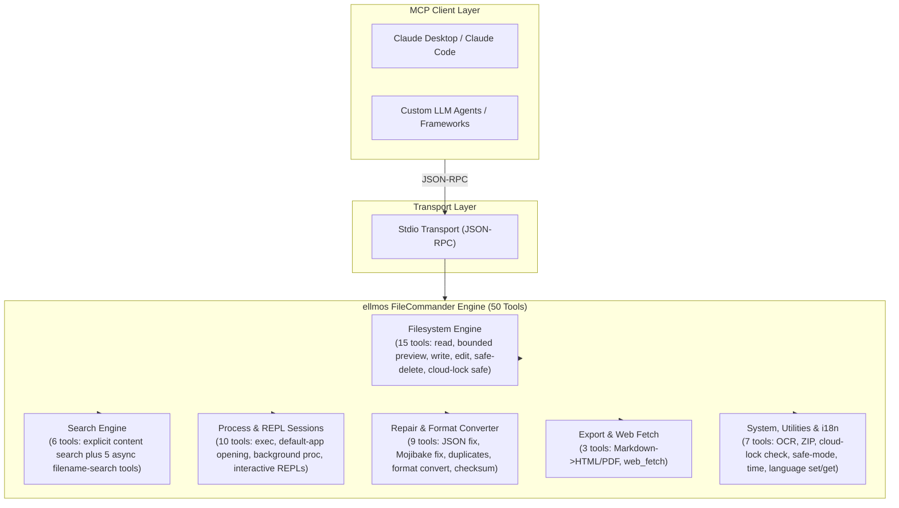
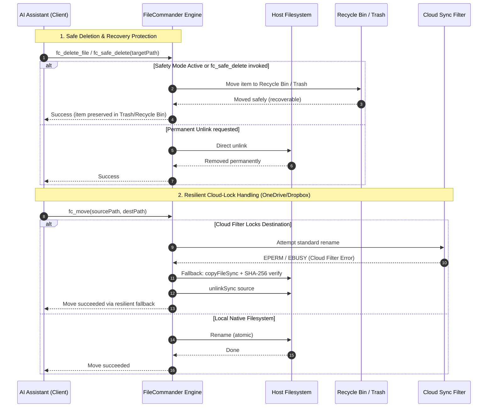

<!-- worldset: {"translated_from_sha256": "310943b7f88d776f409deb86f0a6536cfe6e4f73674f992af028f8173869755c", "translator": "claude-haiku-5-5", "translated_at": "2026-10-25T05:56:51.271355+00:00", "reviewed_by": "gpt-6-luna", "review_manifest_sha256": "8f8d60530b2c2262d1f65f226d7c19b614f154bf7bf509af34edb77abc564dff", "operator_assembled_at": "2026-10-25T06:40:21.351455+00:00", "reviewer": "gpt-6-luna/max; Root independent structure and risk samples"} -->
<p align="center">
  
</p>

# ellmos FileCommander MCP サーバー

[English](README.md) | [Deutsch](README_de.md) | [Español](README_es.md) | [简体中文](README_zh.md) | **日本語** | [Русский](README_ru.md) | [Français](README_fr.md) | [हिन्दी](README_hi.md) | [العربية](README_ar.md) | [বাংলা](README_bn.md) | [Português](README_pt.md)

README のナビゲーションには、このリポジトリで利用できるドキュメント言語が一覧表示されます。FileCommander のランタイムメッセージと書式化された応答は、ドイツ語 (de)、英語 (en)、スペイン語 (es)、中国語 (zh)、日本語 (ja)、ロシア語 (ru)、フランス語 (fr)、ヒンディー語 (hi)、アラビア語 (ar)、ベンガル語 (bn)、ポルトガル語 (pt) に対応します。このランタイム言語一覧は README の翻訳言語とは別です。対象はランタイムで生成されるメッセージと書式化されたツール結果です。MCP ツールのタイトル、ディスカバリー説明、スキーマ説明は英語のままです。サーバー起動前に `FC_LANGUAGE` に対応コードを設定するか、実行中の MCP セッションで `fc_set_language` を呼び出します。`fc_get_language` は有効な言語と 11 個すべての対応コードを返します。`FC_LANGUAGE` が未設定または未対応のコードの場合、ランタイムはドイツ語 (de) を既定値として使用します。日付と時刻の書式は選択中の言語に従います。

*[ellmos-ai](https://github.com/ellmos-ai) ファミリーの一員です。*

[](https://opensource.org/licenses/MIT)
[](https://github.com/ellmos-ai/ellmos-filecommander-mcp/actions/workflows/tests.yml)
[](https://www.npmjs.com/package/ellmos-filecommander-mcp)
[](https://nodejs.org/)
[](#tools-overview)
[-brightgreen.svg)](#testing)
[](SECURITY.md)
[](SECURITY.md)
[](#why-filecommander)
[](NOTICE)
[](SECURITY.md)
[](THIRD_PARTY_LICENSES.md)
[](THIRD_PARTY_LICENSES.txt)
[](https://github.com/ellmos-ai)
[](https://github.com/open-bricks)
[](llms.txt)
[](llms.txt)
[](llms.txt)

> **クイックナビゲーション:**
> 1. [概要](#sec-01) | 2. [システムアーキテクチャ](#sec-02) | 3. [エンドツーエンド実行ライフサイクル](#sec-03) | 4. [主要機能と安全性の不変条件](#sec-04) | 5. [想定ペルソナと検索性](#sec-05) | 6. [インストールと前提条件](#sec-06) | 7. [設定とクライアントセットアップ](#sec-07) | 8. [ツール概要（50 ツール）](#sec-08) | 9. [比較マトリクスと代替案](#sec-09) | 10. [ツールプレフィックスと命名規則](#sec-10) | 11. [ガバナンスと実行時の不変条件](#sec-11) | 12. [セキュリティアーキテクチャとツールのリスク](#sec-12) | 13. [テスト、品質ゲート、検証](#sec-13) | 14. [変更履歴とバージョニング](#sec-14) | 15. [Level 1 SBOM とサードパーティライセンス](#sec-15) | 16. [履歴と進化](#sec-16) | 17. [ellmos-ai エコシステムとパートナーマトリクス](#sec-17) | 18. [法定表示（ドイツ民法 § 521）と責任の免責](#sec-18)
>
> | 直接参照: [🛡️ セキュリティポリシー](SECURITY.md) • [🤝 コントリビューション](CONTRIBUTING.md) • [⚖️ サードパーティライセンス](THIRD_PARTY_LICENSES.md) • [📄 プレーンテキスト SBOM](THIRD_PARTY_LICENSES.txt) • [📜 マーケティングログ](MARKETING-LOG.txt) • [🤖 LLM コンテキスト（llms.txt）](llms.txt) • [📋 正式な表示](NOTICE) |

AI アシスタントに完全なファイルシステムアクセスを提供し、上限付きの複数ファイルコンテンツ検索、プロセス管理、対話型シェルセッション、非同期のファイル名検索機能を備えた、包括的な **Model Context Protocol (MCP) サーバー**です。

単一のサーバーに **50 のツール** を備え、AI エージェントがローカルシステムを操作するために必要なものを網羅しています。

**検索キーワード:** local filesystem MCP server, multi-file content search MCP, safe delete MCP, Recycle Bin MCP server, process management MCP, interactive shell MCP, async file search for AI agents, cloud-lock-safe file operations, Markdown to PDF MCP, OCR MCP server, ZIP archive MCP.

**レジストリの状況:** [npm](https://www.npmjs.com/package/ellmos-filecommander-mcp) に公開され、[jsDelivr](https://www.jsdelivr.com/package/npm/ellmos-filecommander-mcp) にインデックスされ、[LobeHub](https://lobehub.com/mcp/ellmos-ai-ellmos-filecommander-mcp) に掲載され、[Glama](https://glama.ai/mcp/servers/ellmos-ai/ellmos-filecommander-mcp) にリストされており、[`server.json`](server.json) を通じて公式 MCP Registry への登録が準備されています。一部のサードパーティディレクトリにはなお旧バージョンの 43 ツールのメタデータが表示されるため、再インデックスが完了するまでは、正規の README と npm のメタデータを正とみなしてください。

> [!NOTE]
> **AI エージェントおよび LLM 統合向け:**
> FileCommander は標準の stdio トランスポート経由でアクセス可能な **50 の専用ツール** を提供します。すべてのツール名は名前空間の衝突を防ぐために `fc_` プレフィックスを使用します。LLM 向けには、コンパクトなコンテキストとスキーマの概要が [`llms.txt`](llms.txt) と [`server.json`](server.json) で利用できます。

---

<a id="sec-01"></a><a id="overview"></a><a id="why-filecommander"></a><a id="ueberblick"></a><a id="überblick"></a>
## 概要と FileCommander を選ぶ理由

ほとんどのファイルシステム MCP サーバーは、基本的な読み取り／書き込み操作にのみ対応しています。FileCommander はそれ以上の機能を提供します:

- **安全な削除** - 完全削除ではなく、ファイルをごみ箱（Windows）またはゴミ箱（macOS/Linux）へ移動します
- **対話型セッション** - MCP プロトコル経由で REPL（Python、Node.js、シェル）を起動し、操作します
- **非同期検索** - AI が作業を続けている間に、大規模なディレクトリツリーをバックグラウンドで検索します
- **明示的なコンテンツ検索** - 再帰もグロブ展開も行わず、上限付きのファイルリストに対してリテラルテキストまたは正規表現で検索します
- **プロセス管理** - システムプロセスの一覧表示、起動、終了を行います
- **文字列置換** - 一意に一致する文字列とコンテキストの検証によってファイルを編集します
- **形式変換** - JSON、CSV、INI、YAML、TOML、XML、TOON の間で変換します
- **ZIP アーカイブ** - ZIP アーカイブの作成、展開、一覧表示を行います
- **ファイルチェックサム** - MD5、SHA-1、SHA-256、SHA-384、SHA-512 によるハッシュ計算と比較を行います
- **OCR** - 画像からテキストを抽出します（オプションの tesseract.js 依存関係）
- **安全モード** - すべての削除をごみ箱／ゴミ箱経由に切り替えるトグルです
- **Markdown エクスポート** - Markdown をコードブロック、表、入れ子リスト、引用付きの高品質な HTML/PDF に変換します
- **クラウドロック対応の安全性** - クラウド同期フィルター（OneDrive、Dropbox、Google Drive、iCloud）が名前変更操作をブロックした場合、自動的にコピーと削除によるフォールバックを行います
- **クラウドロック診断** - 操作の前に、パスが同期フィルターの競合リスクにさらされているかを確認します
- **クロスプラットフォーム** - プラットフォーム固有の最適化を行いながら、Windows、macOS、Linux で動作します

---

<a id="sec-02"></a><a id="system-architecture"></a><a id="systemarchitektur"></a>
## システムアーキテクチャ

### 4つのビューで示すASCIIアーキテクチャトポロジー

```text
+--------------------------------------------------------------------------------------------------+
|                            ELLMOS FILECOMMANDER MCP ARCHITECTURAL TOPOLOGY                       |
+--------------------------------------------------------------------------------------------------+
| [VIEW 1: CALLER RUNTIMES & AGENT CLIENTS]                                                        |
|   * Autonomous Agents   : Claude Code, OpenAI Codex, Antigravity / Gemini, Kimi, Cursor          |
|   * Agent Frameworks    : AutoGen, CrewAI, LangChain, LlamaIndex, Custom Python / TS Clients    |
|   * Transport Protocols : Model Context Protocol (MCP stdio), JSON-RPC 2.0 Framing               |
|   * Tool Surface        : 50 Unified Specialized Tools (fc_* namespace collision isolation)       |
|   * Schema Contract     : Stdio transport, dynamic runtime i18n parameter parsing (Zod validated)|
+--------------------------------------------------------------------------------------------------+
|                                                |                                                 |
|                                                v                                                 |
+--------------------------------------------------------------------------------------------------+
| [VIEW 2: FILECOMMANDER MCP CORE ENGINE & DISPATCH ORCHESTRATOR]                                  |
|   * Protocol Dispatch   : ESM stdio router with Zod schema validation & parameter checking      |
|   * Multilingual Core   : 11-language dynamic runtime i18n engine       |
|   * Safety Interceptor  : Global Safety Mode (fc_set_safe_mode) routing deletes to Recycle Bin   |
|   * Sync Diagnostics    : Reparse point detection & cloud filter diagnostics (fc_check_cloud_lock)|
|   * Process Supervisor  : Bounded child process lifecycle management & interactive REPL session  |
|                           state registry with circular ring buffers                              |
+--------------------------------------------------------------------------------------------------+
|                                                |                                                 |
|                                                v                                                 |
+--------------------------------------------------------------------------------------------------+
| [VIEW 3: FILESYSTEM RUNTIME, FORMAT REPAIR & PROCESS ISOLATION]                                  |
|   * Atomic File Ops     : Read, write, line edit, exact literal string replacement (fc_str_replace)|
|   * Cloud-Lock Fallback : Automatic copyFileSync + SHA-256 verify + unlinkSync on EPERM / EBUSY   |
|   * Bounded Inspection  : Metadata-first preview (fc_preview_file, 1 MiB inline content ceiling)  |
|   * Bounded Content Srch: max 50 explicit files, 10 MB ceiling, token redaction (INV-MASK-06)   |
|   * Self-Healing Repair : Mojibake repair (27+ UTF-8 patterns), JSON syntax fix, file cleanup    |
|   * Lossless Converter  : Declarative transformation across 7 formats (JSON, YAML, TOML, XML...) |
|   * Media & Documents   : Headless Markdown to PDF/HTML, ZIP archive engine, optional OCR (Tess)  |
+--------------------------------------------------------------------------------------------------+
|                                                |                                                 |
|                                                v                                                 |
+--------------------------------------------------------------------------------------------------+
| [VIEW 4: AIR-GAP DEFENSE PERIMETER, RUNASINVOKER & CONTROLLED EGRESS]                            |
|   * Execution Privilege : RunAsInvoker unprivileged user-mode (Zero administrative elevation)    |
|   * Transport Boundary  : 100% Local stdio transport, zero telemetry, zero open listening ports  |
|   * Controlled Egress   : Outbound HTTP(S) strictly gated through caller-invoked fc_web_fetch     |
|   * Network Safety      : SSRF guard blocking private/internal IP ranges (allow_private override) |
|   * Governance & Supply : Level 1 SBOM, 100% permissive runtime (MIT/BSD), 48h Security SLA      |
+--------------------------------------------------------------------------------------------------+
```

### コンポーネントフロー図



---

<a id="sec-03"></a><a id="end-to-end-execution-lifecycle"></a><a id="execution-lifecycle"></a><a id="end-to-end-ausfuehrungszyklus"></a>
## エンドツーエンドの実行ライフサイクル



---

<a id="sec-04"></a><a id="core-capabilities--safety-invariants"></a><a id="core-capabilities"></a><a id="kernfaehigkeiten--sicherheitsinvarianten"></a><a id="kernfähigkeiten--sicherheitsinvarianten"></a>
## 中核機能と安全性の不変条件

| 機能 / 不変条件 | 保証と実装の詳細 | セキュリティと運用上の利点 |
|------------------------|-----------------------------------|--------------------------------|
| **ローカル stdio と明示的な外向き通信** | MCP トランスポートはローカルの stdio であり、テレメトリも自動的なネットワーク送信もありません。`fc_web_fetch` は、クライアントが明示的に呼び出した場合にのみ外向きの HTTP(S) リクエストを送信します。プライベートなターゲットは、`allow_private` が有効化されていない限り、デフォルトでブロックされます。 | ポートを使用しないサーバートランスポートを維持しつつ、ネットワーク境界をクライアントから見える状態にします。 |
| **安全な削除とゴミ箱保護** | `fc_safe_delete` は、項目を Windows のごみ箱 / macOS のゴミ箱 / Linux の FreeDesktop ゴミ箱へ移動します。`fc_set_safe_mode` は、すべての削除を安全に振り分けます。 | 誤った再帰的削除や一括削除による、取り返しのつかないデータ損失を防止します。 |
| **クラウドロック耐性のある移動 (`fc_move`)** | クラウド同期フィルター(OneDrive、Dropbox、iCloud の再解析ポイント)を自動検出し、コピー、検証、削除のフォールバックをシームレスに実行します。 | 同期ディレクトリでの自動化されたエージェント操作中に発生する `EPERM` / `EBUSY` の失敗を解消します。 |
| **クラウドロック診断 (`fc_check_cloud_lock`)** | 静的なクラウドパスの文脈とターゲットの存在/種類を読み取り専用でレポートします。Cloud Files のハイドレーションとプロセスハンドルは、利用できない場合に未確認として明示的に報告されます。 | エージェントは、静的な OneDrive のリスクと、実際に検出された名前変更ロックを区別できます。 |
| **上限付きの複数ファイル内容検索** | `fc_search_content` は、glob の再帰を使わずに入力を厳格に制限します(明示的なファイルは最大 50 件、ファイルごとに 10 MB、最大 200 件の一致、20 万文字)。 | 大規模なリポジトリ検索時のメモリ不足エラーや、CPU の深刻なフリーズを防止します。 |
| **自動化された秘密情報とトークンの墨消し** | 内容検索の抜粋では、一般的な API キー、Bearer トークン、AWS 認証情報、認可ヘッダーが自動的にマスクされます。 | LLM のコンテキストの汚染や、プロンプト履歴への認証情報の意図しない漏えいを防止します。 |
| **対話型 REPL とセッション分離** | Python、Node.js、bash、PowerShell 向けに、上限付きバッファーを持つステートフルな対話セッション(`fc_start_session`、`fc_send_input`、`fc_read_output`)を提供します。 | 無制限なバックグラウンドプロセスの蓄積なしに、複数ターンにわたる REPL でのデバッグを可能にします。 |
| **無損失の多形式エンジン** | 7 種類の構造化形式(JSON、YAML、TOML、XML、CSV、INI、TOON)にわたる宣言的な変換(`fc_convert_format`)。 | 異種の設定形式間で、データを失うことなく明確なデータ正規化を行います。 |
| **文字化けとファイルの修復エンジン** | `fc_fix_encoding`、`fc_fix_json`、`fc_cleanup_file` が、壊れた UTF-8 エンコーディング(27 種以上のパターン)、不正な JSON 構文、BOM、NUL バイトを修復します。 | 異なる OS プラットフォームで生成された破損ファイルに対する自己修復型のパイプラインを提供します。 |
| **非特権・非昇格での実行** | 標準の非特権ユーザーモードで実行できるように設計・検証されています。管理者権限またはルート権限を必要とすることはありません。 | 攻撃対象領域を最小化し、最小権限の原則に従います。 |
| **11 言語のランタイム i18n エンジン** | `fc_set_language` と `fc_get_language` による動的な言語切り替えと照会に対応します。対応コードは次の 11 個です：`de`、`en`、`es`、`zh`、`ja`、`ru`、`fr`、`hi`、`ar`、`bn`、`pt`。 | ネイティブな多言語の開発者体験と、ローカライズされたエラー報告を提供します。 |
| **マルチ OS 検証マトリックス** | Node.js 20、22、24 上で、Windows、Ubuntu Linux、macOS にわたってテストされ、292 件の自動アサーションを実施しています。 | 継続的なクロスプラットフォームの同等性と信頼性を提供します。 |

---

<a id="sec-05"></a><a id="target-personas--discoverability"></a><a id="target-personas"></a><a id="zielgruppen--auffindbarkeit"></a>
## 対象ペルソナと発見性

FileCommander は、4 つの中核的な開発者、エージェント、運用のペルソナ向けに設計され、検証されています:

### [PERSONA-01] 自律型AIコーディングエージェントとLLMスウォーム
- **プロファイル:** マルチエージェントのスウォームおよびスタンドアロンのエージェント型ランタイム(Claude Code、Antigravity/Gemini、OpenAI Codex、AutoGen、CrewAI)による、再帰的なコード編集、プロジェクトのリファクタリング、ディレクトリ監査。
- **主な運用上の課題:** 数メガバイトのファイルを読み込むことによる急速なコンテキストウィンドウの肥大化、クラウド同期フォルダ内のロックされたファイル(`EPERM`/`EBUSY`)に起因する未処理のプロセスクラッシュ、そして偶発的な`rm -rf`のクリーンアップ処理による回復不能なリポジトリ破損。
- **FileCommanderのソリューション:**
  - `fc_preview_file`: LLMのコンテキスト爆発を防ぐ、厳格な1 MiBのインラインコンテンツ上限を備えた、メタデータ優先の検査。
  - `fc_search_content`: 自動的なシークレット/トークンのマスキングを伴う、上限付きの複数ファイル検索(最大50ファイル、ファイルあたり10 MB、200件の一致)。
  - `fc_safe_delete` & `fc_set_safe_mode`: リスクゼロのファイル操作のため、削除されたファイルをOSのごみ箱/ゴミ箱に保持。
  - `fc_move` & `fc_check_cloud_lock`: ファイルロック時の自動コピー + SHA-256検証 + unlinkフォールバックにより、エージェントの失敗を防止。

### [PERSONA-02] DevOps、ツールチェーン、マルチホスト自動化エンジニア
- **プロファイル:** Windows、Linux、macOSにまたがるクロスプラットフォームのCLIツール、CI/CD検証パイプライン、マルチマシン同期スクリプトを構築するシステムおよび自動化エンジニア。
- **主な運用上の課題:** 異種OSの仕様の違い(WindowsのバックスラッシュとPOSIXのスラッシュ、改行コードの破損、シェル固有の構文)、ゾンビ子プロセス、共有のOneDrive/Dropboxワークスペースでのファイルロック。
- **FileCommanderのソリューション:**
  - Windows、Linux、macOSにまたがる統一されたクロスプラットフォームのツールの仕様。
  - 上限付きの循環リングバッファを備えた、ステートフルな対話型REPLセッション(`fc_start_session`、`fc_send_input`、`fc_read_output`)。
  - 一括ファイル名変更(`fc_batch_rename`)およびバックグラウンドのディレクトリ検索(`fc_start_search`、`fc_get_search_results`)。
  - プロセスリークなしのプロセスライフサイクル管理(`fc_execute_command`、`fc_start_process`、`fc_kill_process`)。

### [PERSONA-03] SecOps、ガバナンス、コンプライアンス担当者
- **プロファイル:** 企業および本番環境においてAIツールの統合を監督するセキュリティ担当者、コンプライアンス監査人、プライバシーチーム。
- **主な運用上の課題:** 開示されていないバックグラウンドのテレメトリビーコン、ローカルプラグインからの未審査のネットワークアクセス、モデルの学習やプロンプト履歴への認証情報/トークンの漏洩、そして非特権ユーザーによる権限昇格。
- **FileCommanderのソリューション:**
  - テレメトリがまったくなく、ネットワーク待ち受けポートを一切開かない、ローカルのstdioトランスポート。
  - 呼び出し元が明示的に起動した`fc_web_fetch`に厳密に限定された、明示的な外向きネットワーク通信(内部/プライベートIPはデフォルトでブロック)。
  - 検索の抜粋における自動的なシークレットおよびベアラートークンのマスキング(`INV-MASK-06`)。
  - 厳格な非特権ユーザーでの実行(`INV-PROC-09`)と、拘束力のある48時間の脆弱性対応SLA(`security@open-bricks.org`、`security@ellmos.ai`)。

### [PERSONA-04] エンタープライズ・プラットフォーム・アーキテクトおよびデータパイプライン開発者
- **プロファイル:** ローカルファイルを統合し、異種の設定形式を正規化し、暗号学的ハッシュを検証し、レポートを生成するソリューションアーキテクトおよびデータエンジニア。
- **主な運用上の課題:** 4〜6台の別々の単一目的のMCPサーバーが必要になるMCPサーバーの乱立、ツールをまたいだ破損したUTF-8バイト列(文字化け)、そして個別に作り込まれたパース用スクリプト。
- **FileCommanderのソリューション:**
  - サーバーの乱立とプロセスのオーバーヘッドを排除する、包括的な50ツールの単一サーバー展開。
  - 7つの構造化形式(`fc_convert_format`: JSON、YAML、TOML、XML、CSV、INI、TOON)間での可逆的な宣言的変換。
  - 自己修復型パイプラインのための組み込みのファイル修復エンジン(`fc_fix_encoding`、`fc_fix_json`、`fc_cleanup_file`)。
  - 暗号学的チェックサム(`fc_checksum`: SHA-256、SHA-512、MD5、SHA-1)およびMarkdownからPDF/HTMLへのレンダリング(`fc_md_to_pdf`、`fc_md_to_html`)。

### 高意図の検索クエリと発見可能性のベクトル

- **主要な検索クエリ:** `ellmos-filecommander-mcp`、`FileCommander MCP`、`filesystem MCP server`、`multi-file content search MCP`、`safe delete MCP`、`async file search MCP`、`process management MCP`、`Markdown PDF MCP`。
- **機械可読メタデータ:** AIエージェント向けの構造化コンテキストは、[`llms.txt`](llms.txt)、[`server.json`](server.json)、および[`glama.json`](glama.json)で管理されています。
- **コンプライアンスと帰属表示:** [`THIRD_PARTY_LICENSES.md`](THIRD_PARTY_LICENSES.md)および[`NOTICE`](NOTICE)に対して検証済み。

---

<a id="sec-06"></a><a id="installation"></a><a id="installation-prerequisites"></a>
## インストール

### 前提条件

- [Node.js](https://nodejs.org/) 20以上
- npm

### オプション1: NPMからインストール

```bash
npm install -g ellmos-filecommander-mcp
```

### オプション2: ソースからインストール

```bash
git clone https://github.com/ellmos-ai/ellmos-filecommander-mcp.git
cd ellmos-filecommander-mcp
npm ci
npm run build
```

---

<a id="sec-07"></a><a id="configuration"></a><a id="client-setup"></a><a id="konfiguration"></a>
## 設定

### Claude Desktop

次のファイルに追加します: `claude_desktop_config.json`:

**Windows:** `%APPDATA%\Claude\claude_desktop_config.json`
**macOS:** `~/Library/Application Support/Claude/claude_desktop_config.json`

#### NPM でグローバルにインストールした場合:

```json
{
  "mcpServers": {
    "filecommander": {
      "command": "ellmos-filecommander"
    }
  }
}
```

#### ソースからインストールした場合:

```json
{
  "mcpServers": {
    "filecommander": {
      "command": "node",
      "args": ["/absolute/path/to/filecommander-mcp/dist/index.js"]
    }
  }
}
```

保存後、Claude Desktop を再起動してください。

### その他の MCP クライアント

サーバーは **stdio トランスポート**で通信します。MCP クライアントを `dist/index.js` のエントリポイント、または `ellmos-filecommander` バイナリに向けてください。

---

<a id="sec-08"></a><a id="tools-overview"></a><a id="available-tools"></a><a id="tools-uebersicht"></a><a id="tools-übersicht"></a>
## ツール概要

### ファイルシステム操作（15 ツール）

| ツール | 説明 |
|------|-------------|
| `fc_read_file` | 行数上限を任意で指定してファイルの内容を読み取る |
| `fc_preview_file` | 先に MIME タイプとサイズを確認し、そのうえで明示的に上限付きのインライン MCP コンテンツを要求する |
| `fc_read_multiple_files` | 1 回の呼び出しで最大 20 個のファイルを読み取る |
| `fc_write_file` | ファイルへの書き込み・作成・追記を行う |
| `fc_edit_file` | 行単位の編集（行の置換・挿入・削除） |
| `fc_str_replace` | コンテキストを検証したうえで、ファイル内の一意な文字列を置換する |
| `fc_list_directory` | ディレクトリの内容を一覧表示する（再帰的、深さは設定可能） |
| `fc_create_directory` | ディレクトリを作成する（親ディレクトリを含む） |
| `fc_delete_file` | ファイルを削除する（完全削除） |
| `fc_delete_directory` | ディレクトリを削除する（再帰フラグは任意） |
| `fc_safe_delete` | ごみ箱／ゴミ箱に移動する（復元可能！） |
| `fc_move` | ファイルおよびディレクトリを移動または名前変更する（クラウドロックに安全） |
| `fc_copy` | ファイルおよびディレクトリをコピーする |
| `fc_file_info` | ファイルの詳細メタデータ（サイズ、日付、種類）を取得する |
| `fc_search_files` | ワイルドカードパターンによる同期ファイル検索 |

`fc_preview_file` は、ローカルファイル向けのリモート／ヘッドレス用の代替手段です。既定の呼び出しでは構造化されたメタデータのみを返します。解決済みパス、`file://` URI、MIME タイプ、バイトサイズ、プレビューの種類、固定の 1 MiB 上限、および正確な後続呼び出しが含まれます。内容は `include_content=true` の後にのみ読み取られます。対象となるテキストおよびラスター画像には、標準の MCP `text`／`image` コンテンツブロックを使用します。PDF には上限付きの埋め込み `resource` を使用します。1 MiB を超えるファイルおよび未対応の種類は、メタデータのみのままとなり、プレビュー処理では決して読み取られず、Base64 エンコードもされません。

### コンテンツ検索（1 ツール）

| ツール | 説明 |
|------|-------------|
| `fc_search_content` | 明示的に順序付けされたファイル一覧の中で、読み取り専用のリテラルまたは正規表現検索を行う（大文字小文字、コンテキスト、グローバルおよびファイルごとの上限を指定可能） |

`fc_search_content` は、グロブの展開、ディレクトリの走査、ファイルの再帰的な探索を一切行いません。明示的な UTF-8 テキストファイルを最大 50 個まで受け付け、バイナリファイルおよび 10 MB を超えるファイルはスキップし、決定的な JSON を返します。一致件数は全体で 200 件、ファイルごとに 100 件までに制限され、コンテキストは 10 行まで、抜粋は 500 文字まで、シリアライズされた出力は 200,000 文字までです。見つからないファイル、クラウドのみのファイル、権限、エンコーディング、バイナリ、サイズに関する失敗はファイルごとに報告されるため、読み取り可能なファイルは結果を返し続けます。一般的なシークレット形式は抜粋からマスクされます。

### 非同期検索（5 ツール）

| ツール | 説明 |
|------|-------------|
| `fc_start_search` | バックグラウンド検索を開始する（即座に返る） |
| `fc_get_search_results` | ページネーションを使用して結果を取得する |
| `fc_stop_search` | 実行中の検索をキャンセルする |
| `fc_list_searches` | アクティブ／完了済みのすべての検索を一覧表示する |
| `fc_clear_search` | 完了済みの検索をメモリから削除する |

### プロセス管理（5 ツール）

| ツール | 説明 |
|------|-------------|
| `fc_execute_command` | シェルコマンドを実行する（ブロッキング、タイムアウト付き） |
| `fc_start_process` | バックグラウンドプロセスを開始する（非ブロッキング） |
| `fc_open_path` | 既存のローカルファイルまたはディレクトリを検証し、OS の既定のアプリケーションで開く |
| `fc_list_processes` | 実行中のシステムプロセスを一覧表示する |
| `fc_kill_process` | PID または名前でプロセスを終了する |

`fc_open_path` は既存のファイルまたはディレクトリのみを受け付け、固定のネイティブ既定ハンドラー起動機能に渡します。その構造化された結果は `launcher_accepted=true|false` を報告し、常に `user_visible="unknown"` を報告し、機械可読な代替手段を示します。ファイルの場合は引数としてメタデータのみを指定する `fc_preview_file`、ディレクトリの場合は `fc_list_directory` です。起動機能が受け付けたことは、GUI が表示されたことを意味するものではありません。`fc_start_process` は、呼び出し元が実行ファイルと引数を選択できるようにします。`fc_execute_command` は任意のシェルコマンドを受け付けます。通常のコマンドには Node の既定のシェルが使用されます（Windows では `COMSPEC`／`cmd.exe`）。一方、FileCommander の Windows 特殊文字の経路では Windows PowerShell を経由することがあります。

### 対話型セッション（5 ツール）

| ツール | 説明 |
|------|-------------|
| `fc_start_session` | 対話型プロセスを開始する(Python、Node、シェルなど) |
| `fc_read_output` | セッションの出力を読み取る |
| `fc_send_input` | 実行中のセッションに入力を送信する |
| `fc_list_sessions` | すべてのセッションを一覧表示する |
| `fc_close_session` | セッションを終了する |

### ファイルのメンテナンスと修復(9ツール)

| ツール | 説明 |
|------|-------------|
| `fc_fix_json` | 壊れたJSONを修復する(BOM、末尾のカンマ、コメント、シングルクォートを処理) |
| `fc_validate_json` | JSONを検証し、詳細なエラー位置とコンテキストを表示する |
| `fc_cleanup_file` | BOM、NULバイト、末尾の空白を削除し、改行コードを正規化する |
| `fc_fix_encoding` | Mojibake / 二重エンコードされたUTF-8を修正する(27以上の文字パターン) |
| `fc_folder_diff` | スナップショットでディレクトリの変更を追跡する(新規/変更/削除) |
| `fc_batch_rename` | パターンベースの一括名前変更(接頭辞/接尾辞、置換、自動検出) |
| `fc_convert_format` | JSON、CSV、INI、YAML、TOML、XML、TOON形式間で変換する |
| `fc_detect_duplicates` | SHA-256ハッシュを使用して重複ファイルを検索する |
| `fc_checksum` | ファイルのハッシュ計算(MD5、SHA-1、SHA-256、SHA-384、SHA-512)、オプションで比較 |

### アーカイブ(1ツール)

| ツール | 説明 |
|------|-------------|
| `fc_archive` | ZIPアーカイブの作成、展開、一覧表示 |

### OCR(1ツール)

| ツール | 説明 |
|------|-------------|
| `fc_ocr` | tesseract.jsを使用して画像からテキストを抽出する(任意の依存関係) |

### クラウド同期(1ツール)

| ツール | 説明 |
|------|-------------|
| `fc_check_cloud_lock` | 静的なクラウド同期のコンテキストとターゲットの状態を報告する。証拠なしにアクティブなロックを主張しない(Windows) |

### システム(4ツール)

| ツール | 説明 |
|------|-------------|
| `fc_get_time` | タイムゾーン情報を含む現在のシステム時刻を取得する |
| `fc_set_safe_mode` | 安全モードを切り替える:すべての削除はごみ箱/ゴミ箱を経由する |
| `fc_set_language` | 実行時の言語を設定する（`de`、`en`、`es`、`zh`、`ja`、`ru`、`fr`、`hi`、`ar`、`bn`、または `pt`） |
| `fc_get_language` | 有効な実行時の言語と、対応する 11 個すべての言語コードを読み取る |

### エクスポート(2ツール)

| ツール | 説明 |
|------|-------------|
| `fc_md_to_html` | MarkdownをCSSスタイル付きの単体HTMLに変換する(見出し、コードブロック、表、入れ子リスト、引用、画像、チェックボックス) |
| `fc_md_to_pdf` | ヘッドレスブラウザ(Edge/Chrome)を使用してMarkdownをPDFに変換する。ブラウザが利用できない場合はHTMLにフォールバックする |

### Web(1ツール)

| ツール | 説明 |
|------|-------------|
| `fc_web_fetch` | Webページを取得し、`mode`によってコンテンツを返す:extract(本文の抽出)、raw(HTTP本文)、links(リンク)、forms(フォーム)、headers(ヘッダー)。読み取り専用のネットワークツール。SSRFガードはデフォルトで内部/プライベートなターゲットをブロックする |

**合計: 50ツール**

---

<a id="sec-09"></a><a id="comparative-matrix--alternatives"></a><a id="comparative-matrix"></a><a id="comparison-with-alternatives"></a><a id="vergleichsmatrix--alternativen"></a>
## 比較マトリックスと代替案

FileCommanderは、ファイルシステム操作、範囲を限定した検索、プロセス制御、データ修復、形式変換、ドキュメントレンダリングを、単一の統合MCPインターフェースにまとめています。以下は、10の主要な運用の観点から、標準的な代替手段とアーキテクチャを比較したものです。

| 運用上の観点 | ellmos FileCommander MCP（50ツール） | 公式 Filesystem MCP（`@modelcontextprotocol/server-filesystem`） | Desktop Commander MCP | ホスト直接シェル（`bash` / PowerShell） | アドホックスクリプトおよびクラウド API |
|-----------------------|:-----------------------------------:|:------------------------------------------------------------------:|:---------------------:|:---------------------------------------:|:---------------------------:|
| **ツールの幅と範囲** `[INV-PROC-09]` | 6 つのドメインにまたがる **50 の統合ツール** | 約 11 の基本的なファイル I/O ツール | 約 15 ツール（ファイル + プロセス） | 制約のない CLI コマンド | 断片化された個別スクリプト |
| **安全な削除と復元** `[INV-SAFE-02]` | **ネイティブ OS のごみ箱**（`fc_safe_delete`、セーフティモード） | 完全削除のみ（`unlink`） | 完全削除のみ | 取り消し不可能な `rm -rf` / `Remove-Item` | カスタムのごみ箱実装 |
| **クラウドロックと同期の耐障害性** `[INV-LOCK-03]` | **自動フォールバック**（コピー + SHA-256 検証 + EPERM/EBUSY 時のリンク解除） | ロックされたファイルやリパースポイントで失敗 | ロックされたファイルで失敗 | 失敗するか、無期限にブロックされる | 同期の衝突・競合コピー |
| **有界検索と機密情報の秘匿化** `[INV-SRCH-05 / INV-MASK-06]` | **有界検索**（最大 50 ファイル、10 MB、API トークンの自動秘匿化） | ディレクトリ走査のみ（内容の正規表現検索なし） | 無制限の正規表現検索 | 無制限の `grep`（コンテキスト内で機密情報が漏えい） | 秘匿化のないカスタム正規表現 |
| **非同期の長時間実行検索** `[INV-SRCH-05]` | **トークンによるページネーション付きのバックグラウンドスキャン**（`fc_start_search`） | 同期のみ（エージェントをブロックする） | 同期のみ | バックグラウンドジョブの制御（`&`） | ポーリングループ / 低速なネットワーク呼び出し |
| **対話型 REPL とセッション制御** `[INV-REPL-08]` | 循環バッファを備えた **ステートフル REPL**（Node、Python、Shell） | 非対応 | 基本的なターミナルセッション | 生のサブプロセス（ゾンビプロセスのリスク） | 複雑な IPC パイピング |
| **自己修復とデータ修復** `[INV-DIAG-04]` | **組み込み**の文字化け修正（27 以上のパターン）および JSON 修復 | 非対応 | 非対応 | 手動の `iconv` / `sed` パイプライン | カスタムのエラー回復コード |
| **多形式変換** `[INV-PREV-07]` | **宣言的変換**（JSON、YAML、TOML、XML、CSV、INI、TOON） | 非対応 | 非対応 | 外部の `jq` / `yq` / `xmlstarlet` が必要 | サードパーティの Python ライブラリ |
| **ドキュメントおよびアーカイブユーティリティ** `[INV-PREV-07]` | **組み込み**の ZIP ライフサイクル、OCR（Tesseract）、Markdown から HTML/PDF への変換 | 非対応 | Excel/PDF はデスクトップアプリ経由 | `pandoc`、`zip`、`tesseract` が必要 | 断片化されたユーティリティへの依存 |
| **ガバナンスとセキュリティの SLA** `[INV-LOCAL-01 / INV-SLA-10]` | **ローカル stdio**、テレメトリなし、明示的な外部送信、拘束力のある 48 時間 SLA | 標準 stdio、コミュニティ SLA | Stdio、検証されていないテレメトリ/ログ | 制限のない権限昇格とスクリプト注入のリスク | アドホックな SaaS によるクラウドへの露出 |

**主な差別化要素:**
- **復元可能な削除**（ごみ箱）とグローバルな **セーフティモード**を備えた唯一の MCP サーバー
- ページネーションとトークン管理を備えた **非同期バックグラウンド検索**を提供する唯一の MCP サーバー
- 検索スニペットにおける **機密情報およびベアラートークンの自動秘匿化**を提供する唯一の MCP サーバー
- 組み込みの **JSON 修復**、**文字化け修正**、および **重複検出**
- 自動的なコピー・検証・削除フォールバックを備えた、組み込みの **クラウドロック対応ファイル操作**
- 複数サーバーの乱立を解消する、最も包括的な単一サーバーソリューション（**50 ツール**）

---

<a id="sec-10"></a><a id="tool-prefix"></a><a id="tool-praefix"></a><a id="tool-präfix"></a>
## ツールプレフィックス

すべてのツールは、他の MCP サーバーとの競合を避けるため、`fc_` プレフィックス（FileCommander）を使用します。

---

<a id="sec-11"></a><a id="governance--runtime-invariants"></a><a id="governance-invariants"></a><a id="governance--laufzeit-invarianten"></a>
## ガバナンスとランタイム不変条件

本サーバーは、安全性、予測可能性、最小権限を保証する 10 の厳格なランタイム不変条件を適用します:

| 不変条件 ID | 名称 | 保証と実装の詳細 | 運用上の安全性の利点 |
|--------------|------|-----------------------------------|----------------------------|
| **INV-LOCAL-01** | **ローカル stdio と明示的な送信** | ローカル stdio トランスポート、テレメトリなし、開いた待ち受けポートなし。外部への HTTP(S) リクエストは、`fc_web_fetch` への明示的なクライアント呼び出しによってのみ厳密に発生する。 | 不正なバックグラウンドのネットワーク漏えいゼロ。ローカルファースト隔離。 |
| **INV-SAFE-02** | **安全な削除とゴミ箱保護** | `fc_safe_delete` およびグローバルの `fc_set_safe_mode` は、ファイルおよびディレクトリの削除を OS のごみ箱（Windows）/ ゴミ箱（macOS/Linux）経由に振り向ける。 | AI エージェントの操作による取り返しのつかない偶発的なデータ損失を排除する。 |
| **INV-LOCK-03** | **クラウドロック耐性のある移動** | 同期フィルタ（OneDrive、Dropbox、iCloud）が EPERM/EBUSY を引き起こした場合、`fc_move` は自動的にコピー + SHA-256 検証 + コピーして SHA-256 で検証し、送信元を削除するフォールバックを実行する。 | クラウド同期されたワークスペース内でもファイル操作が確実に成功することを保証する。 |
| **INV-DIAG-04** | **クラウドロック診断** | `fc_check_cloud_lock` は、ファイルシステムの状態を変更せずに、読み取り専用の静的パス検査とリパースポイント検出を提供する。 | 変更を行う前に、エージェントが同期競合のリスクを評価できるようにする。 |
| **INV-SRCH-05** | **境界付き複数ファイル内容検索** | `fc_search_content` は、glob 再帰なしで入力を厳格に制限する（明示的ファイル最大 50 件、ファイルあたり 10 MB、一致 200 件、20 万文字）。 | メモリ不足によるクラッシュと制約のない CPU 消費を防止する。 |
| **INV-MASK-06** | **自動的なシークレットおよびトークンの墨消し** | 内容検索の抜粋は、API キー、ベアラートークン、AWS 認証情報、および認可ヘッダーを自動的に検出してマスクする。 | 認証情報をプロンプトの漏えいやコンテキストの汚染から保護する。 |
| **INV-PREV-07** | **境界付きインラインプレビューと安全な開く操作** | `fc_preview_file` はメタデータ優先で、厳格な 1 MiB のインラインコンテンツ上限を持つ。`fc_open_path` はシェル安全な OS ランチャー経由で既定のアプリケーションを呼び出す。 | UI のフリーズやペイロードの肥大化なしに、リモートおよびローカルのファイルを安全に確認できる。 |
| **INV-REPL-08** | **対話型 REPL とセッション隔離** | ステートフルな対話セッション（`fc_start_session`、`fc_send_input`、`fc_read_output`）は、境界付きの循環リングバッファを採用する。 | ゾンビプロセスの蓄積を防ぎつつ、複数ターンの REPL デバッグを可能にする。 |
| **INV-PROC-09** | **非特権・非昇格の実行** | 標準の非特権ユーザーモードで完全に実行され、管理者権限やルート権限を要求または必要としない。 | 攻撃対象領域を最小化し、最小権限の原則を厳格に遵守する。 |
| **INV-SLA-10** | **48 時間のセキュリティ対応および 5 日間のトリアージ SLA** | 複数チャネルの連絡先（`security@open-bricks.org`、`security@ellmos.ai`）を備えた正式な脆弱性対応の約束。 | 予測可能で企業向けのインシデント対応およびトリアージのライフサイクル。 |

---

<a id="sec-12"></a><a id="security"></a><a id="security-architecture"></a><a id="sicherheit"></a>
## セキュリティ

**このサーバーは、実行中のユーザーの権限で、ファイルシステム全体へのアクセス権を持ちます。**

詳細なセキュリティ情報と推奨事項については、[SECURITY.md](SECURITY.md) を参照してください。

重要なポイント:
- `fc_execute_command` は任意のシェルコマンドを実行します
- `fc_open_path` は、呼び出し元が選択した既存のパスに対して、オペレーティングシステムの関連付けられたアプリケーションを呼び出します。そのアプリケーションはユーザーの権限で実行されます
- `fc_open_path` は、不変条件 `user_visible="unknown"` とは別に、ランチャーの受理を報告します。`fc_preview_file` は、明示的な 1 MiB のインラインコンテンツの境界を持つ、メタデータ優先のリモート用フォールバックです
- `fc_start_session` は任意の対話型コマンドを開始し、その後の `fc_send_input` の呼び出しは追加のアクションを実行できます
- `fc_delete_*` ツールは、デフォルトで完全削除を実行します（`fc_safe_delete` を使用するか、`fc_set_safe_mode` 経由で **セーフモード** を有効にして、すべての削除をごみ箱 / ゴミ箱経由にしてください）
- セーフモードが保護するのは `fc_delete_file` と `fc_delete_directory` のみです。コマンドや対話セッションをサンドボックス化するものではありません
- サーバーのトランスポートはローカル stdio であり、テレメトリを送信しませんが、明示的な `fc_web_fetch` の呼び出しは外部への HTTP(S) アクセスを行います
- 組み込みのサンドボックス機能はありません。セキュリティは MCP クライアント層に委ねられています

---

<a id="sec-13"></a><a id="development"></a><a id="testing"></a><a id="testing--verification"></a><a id="entwicklung"></a>
## 開発

```bash
# Install dependencies
npm ci

# Watch mode (auto-rebuild on changes)
npm run dev

# One-time build
npm run build

# Start the server
npm start

# Run test suite
npm test
```

### テスト

このプロジェクトには、**Vitest テスト 249 件に加え、スタンドアロンの i18n チェック 71 件（合計 320 件）**が含まれています。ファイルシステム操作、メタデータ優先のインラインプレビュー、境界付きの内容検索、ネイティブの既定ハンドラー起動、形式変換、エンコーディング修復、アーカイブ処理、重複検出、言語パック、ツールの注釈、実際の stdio の動作、およびセキュリティ境界を対象としています。

```bash
npm test              # Run all tests
node test-i18n.mjs    # Run standalone i18n checks
npx vitest run        # Same as above
npx vitest --watch    # Watch mode
```

Windows、macOS、Linux で **テスト検証済み** です。
プッシュおよびプルリクエストでは、Node.js **20**、**22**、**24** 上で `npm ci`、TypeScript ビルド、Vitest、npm パッケージのドライランを含む CI が実行されます。

貢献ガイドラインについては [CONTRIBUTING.md](CONTRIBUTING.md) を参照してください。

---

<a id="sec-14"></a><a id="changelog"></a>
## 変更履歴

全バージョン履歴については [CHANGELOG.md](CHANGELOG.md) を参照してください。

---

<a id="sec-15"></a><a id="license--legal-attribution"></a><a id="third-party-licenses"></a><a id="drittanbieter-lizenzen"></a>
## ライセンスおよび法的帰属

[MIT](LICENSE) - Lukas Geiger ([ellmos-ai](https://github.com/ellmos-ai))。open-bricks の包括的な帰属については [NOTICE](NOTICE) を、レベル 1 の SBOM については [THIRD_PARTY_LICENSES.md](THIRD_PARTY_LICENSES.md) を、プレーンテキスト版の SBOM については [THIRD_PARTY_LICENSES.txt](THIRD_PARTY_LICENSES.txt) を参照してください。

---

<a id="sec-16"></a><a id="history"></a><a id="historie"></a>
## 経緯

本プロジェクトは当初 **BACH FileCommander**（`bach-filecommander-mcp`）として開発されました。[ellmos-ai](https://github.com/ellmos-ai) 組織の一環として **ellmos FileCommander**（`ellmos-filecommander-mcp`）に改名されました。

レガシーパッケージ名 `bach-filecommander-mcp` は非推奨です。代わりに [`ellmos-filecommander-mcp`](https://www.npmjs.com/package/ellmos-filecommander-mcp) を使用してください:

```bash
npm uninstall -g bach-filecommander-mcp
npm install -g ellmos-filecommander-mcp
```

---

<a id="sec-17"></a><a id="ellmos-ai-ecosystem"></a><a id="ecosystem"></a><a id="ellmos-ai-oekosystem"></a><a id="ellmos-ai-ökosystem"></a>
## ellmos-ai エコシステム

この MCP サーバーは **[ellmos-ai](https://github.com/ellmos-ai)** エコシステム（AI インフラ、MCP サーバー、インテリジェントツール）の一部です。

### MCP サーバーファミリー

| サーバー | ツール数 | 対象領域 | npm |
|--------|-------|-------|-----|
| **[FileCommander](https://github.com/ellmos-ai/ellmos-filecommander-mcp)** | **50** | **ファイルシステム、範囲制限付きインラインプレビュー、コンテンツ検索、既定アプリでの起動、プロセス管理、対話型セッション、クラウドロック対応の操作** | **[`ellmos-filecommander-mcp`](https://www.npmjs.com/package/ellmos-filecommander-mcp)** |
| [CodeCommander](https://github.com/ellmos-ai/ellmos-codecommander-mcp) | 22 | コード解析、JSON 修復、インポート、差分、正規表現 | [`ellmos-codecommander-mcp`](https://www.npmjs.com/package/ellmos-codecommander-mcp) |
| [Clatcher](https://github.com/ellmos-ai/ellmos-clatcher-mcp) | 12 | ファイル修復、フォーマット変換、バッチ操作 | [`ellmos-clatcher-mcp`](https://www.npmjs.com/package/ellmos-clatcher-mcp) |
| [n8n Manager](https://github.com/ellmos-ai/n8n-manager-mcp) | 19 | AI アシスタント経由の n8n ワークフロー管理 | [`n8n-manager-mcp`](https://www.npmjs.com/package/n8n-manager-mcp) |
| [ControlCenter](https://github.com/ellmos-ai/ellmos-controlcenter-mcp) | 31 | MCP スタックの検出、プロファイル管理、コントロールプレーン | [`ellmos-controlcenter-mcp`](https://www.npmjs.com/package/ellmos-controlcenter-mcp) |
| [Homebase](https://github.com/ellmos-ai/ellmos-homebase-mcp) | 45 | ローカルファーストの LLM メモリ、ナレッジ、状態、ルーティング、スウォーム オーケストレーション | [`ellmos-homebase-mcp`](https://www.npmjs.com/package/ellmos-homebase-mcp)（alpha） |
| [ServerCommander](https://github.com/ellmos-ai/ellmos-servercommander-mcp) | 8 | サーバー運用：ヘルスチェック、ログ解析、デプロイのドライラン、メール診断 | [`ellmos-servercommander-mcp`](https://www.npmjs.com/package/ellmos-servercommander-mcp)（alpha） |
| [Blender Use](https://github.com/ellmos-ai/ellmos-blender-use-mcp) | 5 | ヘッドレス Blender によるアセット QA と FBX 再インポート検証 | [`ellmos-blender-use-mcp`](https://www.npmjs.com/package/ellmos-blender-use-mcp)（alpha） |
| [Open Compute](https://github.com/ellmos-ai/open-compute-mcp) | 16 | モデル非依存のコンピューター利用：キャプチャ、安全ゲート付きアクション、Windows UIA | [`open-compute-mcp`](https://www.npmjs.com/package/open-compute-mcp)（alpha） |

### AI インフラ

| プロジェクト | 説明 |
|---------|-------------|
| [BACH](https://github.com/ellmos-ai/bach) | LLM エージェント向けのローカルファーストなテキストベース OS — 113 以上のハンドラー、550 以上のツール、SQLite メモリ |
| [open-compute](https://github.com/ellmos-ai/open-compute) | Open Compute MCP を支える、モデル非依存のコンピューター利用コア |
| [clutch](https://github.com/ellmos-ai/clutch) | 自動ルーティングと予算追跡を備えた、プロバイダー中立の LLM オーケストレーション |
| [rinnsal](https://github.com/ellmos-ai/rinnsal) | 軽量なエージェントメモリ、コネクター、自動化インフラ |
| [ellmos-stack](https://github.com/ellmos-ai/ellmos-stack) | セルフホスト型 AI 研究スタック（Ollama + n8n + Rinnsal + KnowledgeDigest） |
| [MarbleRun](https://github.com/ellmos-ai/MarbleRun) | Claude Code 向けの自律エージェントチェーンフレームワーク |
| [gardener](https://github.com/ellmos-ai/gardener) | 最小構成のデータベース駆動型 LLM OS プロトタイプ（関数 4 つ、テーブル 1 つ） |
| [ellmos-tests](https://github.com/ellmos-ai/ellmos-tests) | LLM オペレーティングシステム向けのテストフレームワーク（7 次元） |

### デスクトップソフトウェアおよび姉妹アプリケーション

パートナー組織 **[open-bricks](https://github.com/open-bricks)** およびその傘下の組織は、AI ネイティブのデスクトップアプリケーションと開発者向けユーティリティを提供しています:

| アプリケーション | カテゴリ | 組織 | 重点 |
|-------------|----------|--------------|-------|
| [ProFiler](https://github.com/file-bricks/ProFiler) | ファイル管理 | file-bricks | AI統合機能を備えた高速デュアルペインファイルマネージャー |
| [ExplorerPro](https://github.com/file-bricks/ExplorerPro) | ファイルエクスプローラー | file-bricks | セマンティックフィルターとプレビューを備えたスマートファイルエクスプローラー |
| [WinStorePackager](https://github.com/file-bricks/WinStorePackager) | パッケージング | file-bricks | Windowsデスクトップアプリケーション向けのMSIXおよびStoreパッケージング |
| [SoftwareCenter](https://github.com/file-bricks/SoftwareCenter) | アプリストア | file-bricks | 一元化されたデスクトップパッケージ管理と配布 |
| [SQLiteViewer](https://github.com/file-bricks/SQLiteViewer) | データベースツール | file-bricks | 軽量なSQLiteの閲覧およびクエリ実行 |
| [DokuZen](https://github.com/doc-bricks/DokuZen) | Markdownスイート | doc-bricks | Markdownエディター、PDFエクスポート、ドキュメント変換 |
| [MediaBrain](https://github.com/doc-bricks/MediaBrain) | ドキュメント / メディア | doc-bricks | 音声・動画の文字起こし、メタデータ抽出、カタログ化 |
| [UniversalInvoiceMail](https://github.com/doc-bricks/UniversalInvoiceMail) | ドキュメント / メール | doc-bricks | 請求書の自動解析、PDF抽出、メール振り分け |
| [DevCenter](https://github.com/dev-bricks/DevCenter) | 開発者スイート | dev-bricks | 統合開発者ツールボックス、コードアナライザー、ジェネレーター |
| [CodeBox](https://github.com/dev-bricks/CodeBox) | コードエディター | dev-bricks | LLM拡張機能を備えた多言語コードエディター |
| [safe-start-for-codex](https://github.com/dev-bricks/safe-start-for-codex) | セキュリティと監査 | dev-bricks | Codex向けの堅牢化されたランタイム環境と事前チェッカー |
| [automation-master](https://github.com/dev-bricks/automation-master) | タスク自動化 | dev-bricks | 高信頼性のバックグラウンド自動化ランナーおよびスケジューラー |
| [Zombie Killer Tray](https://github.com/dev-bricks/zombie-killer-tray) | プロセス管理 | dev-bricks | 孤立したMCPプロセスを確認するためのオプションのWindowsツール。FileCommanderは、サポートされている`node_modules/ellmos-filecommander-mcp/dist/index.js`エントリポイントから起動した場合に設定済みの候補となります。その他のすべてのプロセスおよび適用チェックは引き続き適用されます。 |

---

<a id="sec-18"></a><a id="liability"></a><a id="statutory-notice--liability"></a><a id="haftung--liability"></a><a id="haftung"></a>
## Haftung / Liability

本プロジェクトは、ドイツ民法（BGB）第516条以下（好意に基づく贈与）の意味における**無償のオープンソース寄付**です。作者および貢献者の責任は、ドイツ民法第521条に基づき、**故意および重過失**に限定されます。加えて、MITライセンスの免責条項が適用されます。

利用は自己の責任において行ってください。保守の約束、可用性の保証、欠陥がないことや特定目的への適合性に関する保証は一切ありません。

セキュリティに関連するインシデントおよび脆弱性は、拘束力のある**48時間のSLA**に基づき、`security@open-bricks.org`および`security@ellmos.ai`を通じて受け付け、5営業日以内に正式にトリアージされます。

This project is an unpaid open-source donation under German law (§§ 516 et seq. BGB). Liability is strictly limited to intent and gross negligence (§ 521 German Civil Code). The MIT license disclaimer applies complementarily. Use at your own risk. No warranty, no maintenance guarantee, no fitness-for-purpose assumed.

Security incidents and vulnerabilities are handled under a binding **48-hour response SLA** via `security@open-bricks.org` and `security@ellmos.ai` with formal triage within 5 business days.
