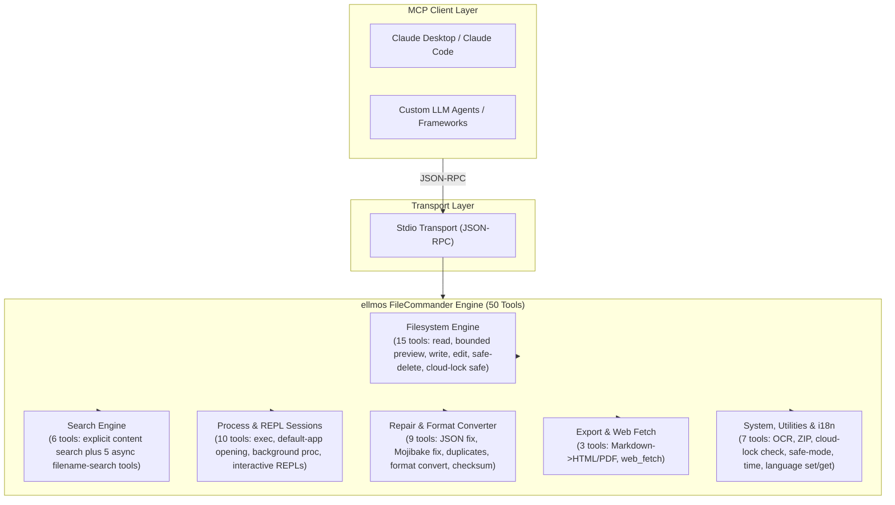
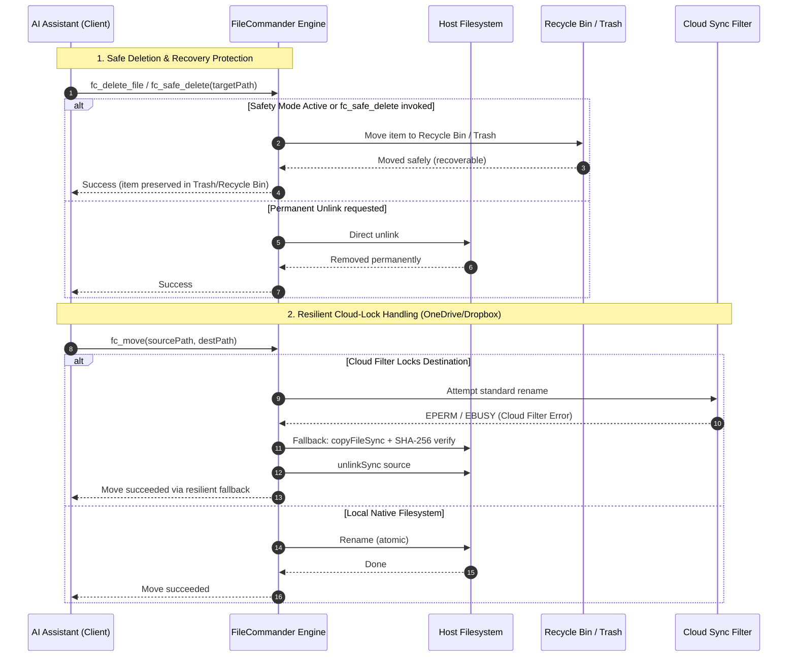

<!-- worldset: {"translated_from_sha256": "b14c4d90b205afeb948351c40f5ee76737faae530da0e8c3cec486fbe24661fa", "translator": "claude-haiku-5-5", "translated_at": "2026-10-25T07:17:11.496324+00:00", "reviewer": "gpt-6-luna/max; Root independent structure and risk samples"} -->
<p align="center">
  
</p>

# Servidor MCP ellmos FileCommander

[English](README.md) | [Deutsch](README_de.md) | [Español](README_es.md) | [简体中文](README_zh.md) | [日本語](README_ja.md) | [Русский](README_ru.md) | [Français](README_fr.md) | [हिन्दी](README_hi.md) | [العربية](README_ar.md) | [বাংলা](README_bn.md) | **Português**

A navegação do README lista os idiomas de documentação disponíveis neste repositório. As mensagens de execução do FileCommander suportam alemão (de), inglês (en), espanhol (es), chinês (zh), japonês (ja) e russo (ru). Esta lista de execução é separada da disponibilidade de traduções do README. Defina `FC_LANGUAGE` antes de iniciar o servidor, ou chame `fc_set_language` durante uma sessão MCP ativa. Use `fc_get_language` para ver o idioma ativo e os códigos suportados. Se `FC_LANGUAGE` não estiver definida ou contiver um código não suportado, a execução assume alemão (de) como padrão.

*Parte da família [ellmos-ai](https://github.com/ellmos-ai).*

[](https://opensource.org/licenses/MIT)
[](https://github.com/ellmos-ai/ellmos-filecommander-mcp/actions/workflows/tests.yml)
[](https://www.npmjs.com/package/ellmos-filecommander-mcp)
[](https://nodejs.org/)
[](#tools-overview)
[-brightgreen.svg)](#testing)
[](SECURITY.md)
[](SECURITY.md)
[](#why-filecommander)
[](NOTICE)
[](SECURITY.md)
[](THIRD_PARTY_LICENSES.md)
[](THIRD_PARTY_LICENSES.txt)
[](https://github.com/ellmos-ai)
[](https://github.com/open-bricks)
[](llms.txt)
[](llms.txt)
[](llms.txt)

> **Navegação Rápida:**
> 1. [Visão Geral](#sec-01) | 2. [Arquitetura do Sistema](#sec-02) | 3. [Ciclo de Vida de Execução de Ponta a Ponta](#sec-03) | 4. [Capacidades Principais e Invariantes de Segurança](#sec-04) | 5. [Personas Alvo e Descoberabilidade](#sec-05) | 6. [Instalação e Pré-requisitos](#sec-06) | 7. [Configuração e Configuração do Cliente](#sec-07) | 8. [Visão Geral das Ferramentas (50 Ferramentas)](#sec-08) | 9. [Matriz Comparativa e Alternativas](#sec-09) | 10. [Prefixo de Ferramenta e Convenção de Nomenclatura](#sec-10) | 11. [Governança e Invariantes de Execução](#sec-11) | 12. [Arquitetura de Segurança e Riscos das Ferramentas](#sec-12) | 13. [Testes, Portões de Qualidade e Verificação](#sec-13) | 14. [Changelog e Versionamento](#sec-14) | 15. [SBOM Nível 1 e Licenças de Terceiros](#sec-15) | 16. [Histórico e Evolução](#sec-16) | 17. [Ecossistema ellmos-ai e Matriz de Parceiros](#sec-17) | 18. [Aviso Legal (§ 521 BGB) e Isenção de Responsabilidade](#sec-18)
>
> | Referências Diretas: [🛡️ Política de Segurança](SECURITY.md) • [🤝 Contribuindo](CONTRIBUTING.md) • [⚖️ Licenças de Terceiros](THIRD_PARTY_LICENSES.md) • [📄 SBOM em Texto Simples](THIRD_PARTY_LICENSES.txt) • [📜 Registro de Marketing](MARKETING-LOG.txt) • [🤖 Contexto para LLM (llms.txt)](llms.txt) • [📋 Aviso Canônico](NOTICE) |

Um **servidor abrangente do Model Context Protocol (MCP)** que oferece a assistentes de IA acesso completo ao sistema de arquivos, busca limitada de conteúdo em múltiplos arquivos, gerenciamento de processos, sessões de shell interativas e capacidades de busca assíncrona por nome de arquivo.

**50 ferramentas** em um único servidor — tudo o que um agente de IA precisa para interagir com o sistema local.

**Palavras-chave de descoberta:** servidor MCP de sistema de arquivos local, MCP de busca de conteúdo em múltiplos arquivos, MCP de exclusão segura, servidor MCP da Lixeira, MCP de gerenciamento de processos, MCP de shell interativo, busca assíncrona de arquivos para agentes de IA, operações de arquivos seguras contra bloqueio de nuvem, MCP de Markdown para PDF, servidor MCP de OCR, MCP de arquivos ZIP.

**Status nos registros:** publicado no [npm](https://www.npmjs.com/package/ellmos-filecommander-mcp), indexado pelo [jsDelivr](https://www.jsdelivr.com/package/npm/ellmos-filecommander-mcp), visível no [LobeHub](https://lobehub.com/mcp/ellmos-ai-ellmos-filecommander-mcp), listado no [Glama](https://glama.ai/mcp/servers/ellmos-ai/ellmos-filecommander-mcp) e preparado para o Registro Oficial MCP via [`server.json`](server.json). Alguns diretórios de terceiros ainda exibem metadados antigos de 43 ferramentas, portanto os metadados canônicos do README/npm devem permanecer como fonte de verdade até que sua reindexação seja atualizada.

> [!NOTE]
> **Para Agentes de IA e Integrações com LLM:**
> O FileCommander oferece **50 ferramentas especializadas** acessíveis por transporte stdio padrão. Todos os nomes de ferramentas usam o prefixo `fc_` para evitar colisões de namespace. Para LLMs, visões gerais compactas de contexto e esquemas estão disponíveis em [`llms.txt`](llms.txt) e [`server.json`](server.json).

---

<a id="sec-01"></a><a id="overview"></a><a id="why-filecommander"></a><a id="ueberblick"></a><a id="überblick"></a>
## Visão Geral e Motivo do FileCommander?

A maioria dos servidores MCP de sistema de arquivos cobre apenas operações básicas de leitura e escrita. O FileCommander vai além:

- **Exclusão Segura** - Move arquivos para a Lixeira (Windows) ou o Lixo (macOS/Linux) em vez de excluí-los permanentemente
- **Sessões Interativas** - Inicie e interaja com REPLs (Python, Node.js, shells) através do protocolo MCP
- **Busca Assíncrona** - Pesquisa árvores de diretórios grandes em segundo plano enquanto a IA continua trabalhando
- **Busca Explícita de Conteúdo** - Pesquisa texto literal ou regex em uma lista limitada de arquivos, sem recursão nem expansão de glob
- **Gerenciamento de Processos** - Lista, inicia e encerra processos do sistema
- **Substituição de Strings** - Edita arquivos correspondendo strings únicas com validação de contexto
- **Conversão de Formatos** - Converte entre JSON, CSV, INI, YAML, TOML, XML e TOON
- **Arquivos ZIP** - Cria, extrai e lista arquivos ZIP
- **Somas de Verificação de Arquivos** - Hash MD5, SHA-1, SHA-256, SHA-384 e SHA-512 com comparação
- **OCR** - Extrai texto de imagens (dependência opcional tesseract.js)
- **Modo de Segurança** - Alterna para direcionar todas as exclusões para a Lixeira / Lixo
- **Exportação em Markdown** - Converte Markdown em HTML/PDF profissional com blocos de código, tabelas, listas aninhadas e citações em bloco
- **Seguro contra Bloqueio de Nuvem** - Fallback automático de cópia+exclusão quando filtros de sincronização em nuvem (OneDrive, Dropbox, Google Drive, iCloud) bloqueiam operações de renomeação
- **Diagnóstico de Bloqueio de Nuvem** - Verifica se um caminho está sob risco de conflitos de filtro de sincronização antes de operar
- **Multiplataforma** - Funciona no Windows, macOS e Linux com otimizações específicas de cada plataforma

---

<a id="sec-02"></a><a id="system-architecture"></a><a id="systemarchitektur"></a>
## Arquitetura do Sistema

### Topologia Arquitetural em ASCII de Quatro Visões

```text
+--------------------------------------------------------------------------------------------------+
|                            ELLMOS FILECOMMANDER MCP ARCHITECTURAL TOPOLOGY                       |
+--------------------------------------------------------------------------------------------------+
| [VIEW 1: CALLER RUNTIMES & AGENT CLIENTS]                                                        |
|   * Autonomous Agents   : Claude Code, OpenAI Codex, Antigravity / Gemini, Kimi, Cursor          |
|   * Agent Frameworks    : AutoGen, CrewAI, LangChain, LlamaIndex, Custom Python / TS Clients    |
|   * Transport Protocols : Model Context Protocol (MCP stdio), JSON-RPC 2.0 Framing               |
|   * Tool Surface        : 50 Unified Specialized Tools (fc_* namespace collision isolation)       |
|   * Schema Contract     : Stdio transport, dynamic runtime i18n parameter parsing (Zod validated)|
+--------------------------------------------------------------------------------------------------+
|                                                |                                                 |
|                                                v                                                 |
+--------------------------------------------------------------------------------------------------+
| [VIEW 2: FILECOMMANDER MCP CORE ENGINE & DISPATCH ORCHESTRATOR]                                  |
|   * Protocol Dispatch   : ESM stdio router with Zod schema validation & parameter checking      |
|   * Multilingual Core   : 6-language dynamic runtime i18n (de, en, es, zh, ja, ru) engine       |
|   * Safety Interceptor  : Global Safety Mode (fc_set_safe_mode) routing deletes to Recycle Bin   |
|   * Sync Diagnostics    : Reparse point detection & cloud filter diagnostics (fc_check_cloud_lock)|
|   * Process Supervisor  : Bounded child process lifecycle management & interactive REPL session  |
|                           state registry with circular ring buffers                              |
+--------------------------------------------------------------------------------------------------+
|                                                |                                                 |
|                                                v                                                 |
+--------------------------------------------------------------------------------------------------+
| [VIEW 3: FILESYSTEM RUNTIME, FORMAT REPAIR & PROCESS ISOLATION]                                  |
|   * Atomic File Ops     : Read, write, line edit, exact literal string replacement (fc_str_replace)|
|   * Cloud-Lock Fallback : Automatic copyFileSync + SHA-256 verify + unlinkSync on EPERM / EBUSY   |
|   * Bounded Inspection  : Metadata-first preview (fc_preview_file, 1 MiB inline content ceiling)  |
|   * Bounded Content Srch: max 50 explicit files, 10 MB ceiling, token redaction (INV-MASK-06)   |
|   * Self-Healing Repair : Mojibake repair (27+ UTF-8 patterns), JSON syntax fix, file cleanup    |
|   * Lossless Converter  : Declarative transformation across 7 formats (JSON, YAML, TOML, XML...) |
|   * Media & Documents   : Headless Markdown to PDF/HTML, ZIP archive engine, optional OCR (Tess)  |
+--------------------------------------------------------------------------------------------------+
|                                                |                                                 |
|                                                v                                                 |
+--------------------------------------------------------------------------------------------------+
| [VIEW 4: AIR-GAP DEFENSE PERIMETER, RUNASINVOKER & CONTROLLED EGRESS]                            |
|   * Execution Privilege : RunAsInvoker unprivileged user-mode (Zero administrative elevation)    |
|   * Transport Boundary  : 100% Local stdio transport, zero telemetry, zero open listening ports  |
|   * Controlled Egress   : Outbound HTTP(S) strictly gated through caller-invoked fc_web_fetch     |
|   * Network Safety      : SSRF guard blocking private/internal IP ranges (allow_private override) |
|   * Governance & Supply : Level 1 SBOM, 100% permissive runtime (MIT/BSD), 48h Security SLA      |
+--------------------------------------------------------------------------------------------------+
```

### Diagrama de Fluxo de Componentes



---

<a id="sec-03"></a><a id="end-to-end-execution-lifecycle"></a><a id="execution-lifecycle"></a><a id="end-to-end-ausfuehrungszyklus"></a>
## Ciclo de Vida de Execução de Ponta a Ponta



---

<a id="sec-04"></a><a id="core-capabilities--safety-invariants"></a><a id="core-capabilities"></a><a id="kernfaehigkeiten--sicherheitsinvarianten"></a><a id="kernfähigkeiten--sicherheitsinvarianten"></a>
## Capacidades Centrais e Invariantes de Segurança

| Capacidade / Invariante | Garantia e Detalhes de Implementação | Benefício de Segurança e Operacional |
|------------------------|-----------------------------------|--------------------------------|
| **Stdio local e egress explícito** | O transporte MCP é stdio local, sem telemetria e sem egress automático de rede. `fc_web_fetch` faz requisições HTTP(S) de saída somente quando um cliente a invoca explicitamente; alvos privados são bloqueados por padrão, a menos que `allow_private` esteja habilitado. | Torna a fronteira de rede visível para os clientes, mantendo um transporte de servidor local e sem portas. |
| **Exclusão Segura e Proteção da Lixeira** | `fc_safe_delete` move itens para a Lixeira do Windows / Lixo do macOS / Lixeira FreeDesktop do Linux. `fc_set_safe_mode` roteia todas as exclusões de forma segura. | Previne perda irreversível de dados causada por exclusões recursivas ou em massa acidentais. |
| **Movimentação Resiliente a Bloqueios de Nuvem (`fc_move`)** | Detecção automática de filtros de sincronização em nuvem (pontos de reanálise do OneDrive, Dropbox e iCloud) com fallback contínuo de cópia, verificação e exclusão. | Elimina falhas de `EPERM` / `EBUSY` durante operações automatizadas de agentes em diretórios sincronizados. |
| **Diagnóstico de Bloqueio de Nuvem (`fc_check_cloud_lock`)** | Relatório somente leitura do contexto estático de caminhos de nuvem, além da existência/tipo do alvo; hidratação de Arquivos na Nuvem e identificadores de processos são explicitamente informados como não verificados quando indisponíveis. | Permite que agentes distingam o risco estático do OneDrive de um bloqueio de renomeação realmente detectado. |
| **Busca de Conteúdo em Múltiplos Arquivos Limitada** | `fc_search_content` limita estritamente as entradas (máximo de 50 arquivos explícitos, 10 MB por arquivo, 200 correspondências, 200 mil caracteres) sem recursão por glob. | Previne erros de falta de memória e travamentos catastróficos de CPU durante buscas em grandes repositórios. |
| **Redação Automática de Segredos e Tokens** | Trechos de resultados da busca de conteúdo mascaram automaticamente chaves de API comuns, tokens bearer, credenciais da AWS e cabeçalhos de autorização. | Previne contaminação do contexto do LLM e vazamento acidental de credenciais no histórico de prompts. |
| **REPL Interativo e Isolamento de Sessões** | Sessões interativas com estado (`fc_start_session`, `fc_send_input`, `fc_read_output`) para Python, Node.js, bash e PowerShell, com buffers limitados. | Permite depuração em REPL com múltiplas interações sem acúmulo descontrolado de processos em segundo plano. |
| **Motor de Múltiplos Formatos sem Perdas** | Conversão declarativa (`fc_convert_format`) entre 7 formatos estruturados (JSON, YAML, TOML, XML, CSV, INI, TOON). | Normalização limpa de dados entre formatos heterogêneos de configuração, sem perda de dados. |
| **Motor de Correção de Mojibake e Arquivos** | `fc_fix_encoding`, `fc_fix_json` e `fc_cleanup_file` reparam codificação UTF-8 quebrada (mais de 27 padrões), sintaxe JSON malformada, BOMs e bytes NUL. | Pipelines autorrecuperáveis para arquivos corrompidos gerados em plataformas de sistemas operacionais divergentes. |
| **Execução Não Privilegiada e Sem Elevação** | Projetado e verificado para rodar em modo de usuário comum, sem privilégios. Nunca requer privilégios administrativos ou de root. | Superfície de ataque mínima; adere ao princípio do menor privilégio. |
| **Motor de i18n de Tempo de Execução em Seis Idiomas** | Troca dinâmica de idioma e introspecção (`fc_set_language`, `fc_get_language`) para alemão (`de`), inglês (`en`), espanhol (`es`), chinês (`zh`), japonês (`ja`) e russo (`ru`). | Experiência multilíngue nativa para desenvolvedores e relatórios de erro localizados. |
| **Matriz Verificada em Múltiplos SOs** | Testado em Windows, Ubuntu Linux e macOS com Node.js 20, 22 e 24, com 292 asserções automatizadas. | Paridade e confiabilidade multiplataforma contínuas. |

---

<a id="sec-05"></a><a id="target-personas--discoverability"></a><a id="target-personas"></a><a id="zielgruppen--auffindbarkeit"></a>
## Personas Alvo e Descoberta

O FileCommander foi desenvolvido e validado especificamente para quatro personas principais: desenvolvedores, agentes e equipes de operações:

### [PERSONA-01] Agentes Autônomos de Codificação com IA e Enxames de LLM
- **Perfil:** Enxames multiagente e runtimes agênticos independentes (Claude Code, Antigravity/Gemini, OpenAI Codex, AutoGen, CrewAI) que executam edição de código recursiva, refatoração de projetos e auditorias de diretórios.
- **Principais Pontos de Dor Operacionais:** Inchaço rápido da janela de contexto causado pela leitura de arquivos com vários megabytes, falhas de processo não tratadas causadas por arquivos bloqueados (`EPERM`/`EBUSY`) em pastas sincronizadas com a nuvem, e corrupção irrecuperável de repositórios por rotinas acidentais de limpeza de `rm -rf`.
- **Solução FileCommander:**
  - `fc_preview_file`: Inspeção com prioridade para metadados e limite rígido de 1 MiB para conteúdo inline, evitando a sobrecarga do contexto do LLM.
  - `fc_search_content`: Busca limitada em múltiplos arquivos (máximo de 50 arquivos, 10 MB por arquivo, 200 correspondências) com redação automática de segredos e tokens.
  - `fc_safe_delete` & `fc_set_safe_mode`: Preserva os arquivos excluídos na Lixeira do sistema operacional para operações de arquivo sem risco.
  - `fc_move` & `fc_check_cloud_lock`: Cópia automática + verificação SHA-256 + estratégia de fallback com unlink em caso de bloqueio de arquivo, evitando falhas do agente.

### [PERSONA-02] Engenheiros de DevOps, Cadeia de Ferramentas e Automação Multi-Host
- **Perfil:** Engenheiros de sistemas e automação que constroem ferramentas CLI multiplataforma, pipelines de validação de CI/CD e scripts de sincronização entre múltiplas máquinas em Windows, Linux e macOS.
- **Principais Pontos de Dor Operacionais:** Semântica heterogênea de sistemas operacionais (barras invertidas do Windows versus barras do POSIX, corrupção de quebras de linha, sintaxe específica de shell), processos filhos zumbis e bloqueio de arquivos em espaços de trabalho compartilhados no OneDrive/Dropbox.
- **Solução FileCommander:**
  - Semântica unificada de ferramentas multiplataforma para Windows, Linux e macOS.
  - Sessões REPL interativas com estado (`fc_start_session`, `fc_send_input`, `fc_read_output`) com buffers circulares em anel limitados.
  - Renomeação em lote de arquivos (`fc_batch_rename`) e busca de diretórios em segundo plano (`fc_start_search`, `fc_get_search_results`).
  - Gerenciamento do ciclo de vida de processos (`fc_execute_command`, `fc_start_process`, `fc_kill_process`) sem vazamento de processos.

### [PERSONA-03] Responsáveis por SecOps, Governança e Conformidade
- **Perfil:** Oficiais de segurança, auditores de conformidade e equipes de privacidade que supervisionam integrações de ferramentas de IA em ambientes corporativos e de produção.
- **Principais Pontos de Dor Operacionais:** Beacons de telemetria em segundo plano não divulgados, acesso não validado à rede a partir de plugins locais, vazamento de credenciais e tokens para treinamento de modelos ou históricos de prompts, e escalonamento não autorizado de privilégios de usuário.
- **Solução FileCommander:**
  - Transporte stdio local com telemetria estritamente zero e zero portas de escuta de rede abertas.
  - Saída de rede explícita estritamente restrita à `fc_web_fetch` invocada pelo chamador (IPs internos/privados bloqueados por padrão).
  - Mascaramento automatizado de segredos e tokens bearer em trechos de busca (`INV-MASK-06`).
  - Execução estrita por usuário sem privilégios (`INV-PROC-09`) e SLA vinculante de 48 horas para resposta a vulnerabilidades (`security@open-bricks.org`, `security@ellmos.ai`).

### [PERSONA-04] Arquitetos de Plataforma Corporativa e Desenvolvedores de Pipelines de Dados
- **Perfil:** Arquitetos de soluções e engenheiros de dados que integram arquivos locais, normalizam formatos de configuração heterogêneos, validam hashes criptográficos e geram relatórios.
- **Principais Pontos de Dor Operacionais:** Proliferação de servidores MCP que exige 4 a 6 servidores díspares de finalidade única, sequências de bytes UTF-8 corrompidas (Mojibake) entre ferramentas e scripts de parsing sob medida.
- **Solução FileCommander:**
  - Implantação em servidor único com 50 ferramentas, eliminando a proliferação de múltiplos servidores e a sobrecarga de processos.
  - Conversão declarativa sem perdas entre 7 formatos estruturados (`fc_convert_format`: JSON, YAML, TOML, XML, CSV, INI, TOON).
  - Mecanismos integrados de reparo de arquivos (`fc_fix_encoding`, `fc_fix_json`, `fc_cleanup_file`) para pipelines com autorrecuperação.
  - Somas de verificação criptográficas (`fc_checksum`: SHA-256, SHA-512, MD5, SHA-1) e renderização de Markdown para PDF/HTML (`fc_md_to_pdf`, `fc_md_to_html`).

### Consultas de Alta Intenção de Busca e Vetores de Descoberabilidade

- **Consultas Principais de Busca:** `ellmos-filecommander-mcp`, `FileCommander MCP`, `filesystem MCP server`, `multi-file content search MCP`, `safe delete MCP`, `async file search MCP`, `process management MCP`, `Markdown PDF MCP`.
- **Metadados Legíveis por Máquina:** O contexto estruturado para agentes de IA é mantido em [`llms.txt`](llms.txt), [`server.json`](server.json) e [`glama.json`](glama.json).
- **Conformidade e Atribuição:** Validado em relação a [`THIRD_PARTY_LICENSES.md`](THIRD_PARTY_LICENSES.md) e [`NOTICE`](NOTICE).

---

<a id="sec-06"></a><a id="installation"></a><a id="installation-prerequisites"></a>
## Instalação

### Pré-requisitos

- [Node.js](https://nodejs.org/) 20 ou superior
- npm

### Opção 1: Instalar a partir do NPM

```bash
npm install -g ellmos-filecommander-mcp
```

### Opção 2: Instalar a partir do código-fonte

```bash
git clone https://github.com/ellmos-ai/ellmos-filecommander-mcp.git
cd ellmos-filecommander-mcp
npm ci
npm run build
```

---

<a id="sec-07"></a><a id="configuration"></a><a id="client-setup"></a><a id="konfiguration"></a>
## Configuração

### Claude Desktop

Adicione ao seu `claude_desktop_config.json`:

**Windows:** `%APPDATA%\Claude\claude_desktop_config.json`
**macOS:** `~/Library/Application Support/Claude/claude_desktop_config.json`

#### Se instalado globalmente via NPM:

```json
{
  "mcpServers": {
    "filecommander": {
      "command": "ellmos-filecommander"
    }
  }
}
```

#### Se instalado a partir do código-fonte:

```json
{
  "mcpServers": {
    "filecommander": {
      "command": "node",
      "args": ["/absolute/path/to/filecommander-mcp/dist/index.js"]
    }
  }
}
```

Reinicie o Claude Desktop após salvar.

### Outros clientes MCP

O servidor se comunica via **transporte stdio**. Aponte o seu cliente MCP para a entrada `dist/index.js` ou para o binário `ellmos-filecommander`.

---

<a id="sec-08"></a><a id="tools-overview"></a><a id="available-tools"></a><a id="tools-uebersicht"></a><a id="tools-übersicht"></a>
## Visão geral das ferramentas

### Operações de sistema de arquivos (15 ferramentas)

| Ferramenta | Descrição |
|------|-------------|
| `fc_read_file` | Lê o conteúdo de um arquivo, com limite opcional de linhas |
| `fc_preview_file` | Inspeciona primeiro o tipo MIME e o tamanho e, em seguida, solicita explicitamente conteúdo MCP inline limitado |
| `fc_read_multiple_files` | Lê até 20 arquivos em uma única chamada |
| `fc_write_file` | Grava, cria ou acrescenta conteúdo a arquivos |
| `fc_edit_file` | Edição baseada em linhas (substituir, inserir, excluir linhas) |
| `fc_str_replace` | Substitui uma string única em um arquivo com validação de contexto |
| `fc_list_directory` | Lista o conteúdo de diretórios (recursivo, com profundidade configurável) |
| `fc_create_directory` | Cria diretórios (incluindo os pais) |
| `fc_delete_file` | Exclui um arquivo (permanentemente) |
| `fc_delete_directory` | Exclui um diretório (com flag recursiva opcional) |
| `fc_safe_delete` | Move para a Lixeira / Lixo (recuperável!) |
| `fc_move` | Move ou renomeia arquivos e diretórios (seguro contra bloqueio de nuvem) |
| `fc_copy` | Copia arquivos e diretórios |
| `fc_file_info` | Obtém metadados detalhados do arquivo (tamanho, datas, tipo) |
| `fc_search_files` | Busca síncrona de arquivos com padrões curinga |

`fc_preview_file` é o recurso de contingência remoto/headless para arquivos locais. Sua chamada padrão retorna apenas metadados estruturados: caminho resolvido, URI `file://`, tipo MIME, tamanho em bytes, tipo de pré-visualização, limite fixo de 1 MiB e a chamada de acompanhamento exata. O conteúdo só é lido após `include_content=true`. Textos elegíveis e imagens raster usam blocos de conteúdo padrão MCP `text`/`image`; PDFs usam um `resource` incorporado e limitado. Arquivos acima de 1 MiB e tipos não suportados permanecem apenas com metadados e nunca são lidos nem codificados em Base64 pelo caminho de pré-visualização.

### Busca de conteúdo (1 ferramenta)

| Ferramenta | Descrição |
|------|-------------|
| `fc_search_content` | Busca somente leitura, literal ou por regex, dentro de uma lista explícita e ordenada de arquivos, com limites de maiúsculas/minúsculas, contexto, globais e por arquivo |

`fc_search_content` nunca expande globs, não percorre diretórios nem descobre arquivos recursivamente. Aceita no máximo 50 arquivos de texto UTF-8 explícitos, ignora arquivos binários e arquivos acima de 10 MB, e retorna JSON determinístico. As correspondências são limitadas a 200 globalmente e 100 por arquivo, o contexto a 10 linhas, os trechos a 500 caracteres e a saída serializada a 200.000 caracteres. Falhas de arquivo ausente, somente na nuvem, de permissão, de codificação, binárias e de tamanho são informadas por arquivo, de modo que os arquivos legíveis ainda produzam resultados. Formatos comuns de segredos são ocultados nos trechos.

### Busca assíncrona (5 ferramentas)

| Ferramenta | Descrição |
|------|-------------|
| `fc_start_search` | Inicia uma busca em segundo plano (retorna imediatamente) |
| `fc_get_search_results` | Recupera resultados com paginação |
| `fc_stop_search` | Cancela uma busca em execução |
| `fc_list_searches` | Lista todas as buscas ativas/concluídas |
| `fc_clear_search` | Remove da memória as buscas concluídas |

### Gerenciamento de processos (5 ferramentas)

| Ferramenta | Descrição |
|------|-------------|
| `fc_execute_command` | Executa um comando de shell (bloqueante, com timeout) |
| `fc_start_process` | Inicia um processo em segundo plano (não bloqueante) |
| `fc_open_path` | Valida e abre um arquivo ou diretório local existente com o aplicativo padrão do SO |
| `fc_list_processes` | Lista os processos do sistema em execução |
| `fc_kill_process` | Encerra um processo por PID ou nome |

`fc_open_path` aceita apenas um arquivo ou diretório existente e o envia para um iniciador nativo fixo de aplicativo padrão. Seu resultado estruturado informa `launcher_accepted=true|false`, sempre informa `user_visible="unknown"` e identifica um fallback legível por máquina: `fc_preview_file` com argumentos somente de metadados para arquivos, ou `fc_list_directory` para diretórios. A aceitação pelo iniciador nunca afirma que uma interface gráfica ficou visível. `fc_start_process`, por sua vez, permite que quem chama escolha um executável e seus argumentos. `fc_execute_command` aceita um comando de shell arbitrário: o shell padrão do Node é usado para comandos comuns (`COMSPEC`/`cmd.exe` no Windows), enquanto o caminho do FileCommander para caracteres especiais no Windows pode direcionar para o Windows PowerShell.

### Sessões interativas (5 ferramentas)

| Ferramenta | Descrição |
|------|-------------|
| `fc_start_session` | Iniciar um processo interativo (Python, Node, shell...) |
| `fc_read_output` | Ler a saída da sessão |
| `fc_send_input` | Enviar entrada para uma sessão em execução |
| `fc_list_sessions` | Listar todas as sessões |
| `fc_close_session` | Encerrar uma sessão |

### Manutenção e Reparação de Arquivos (9 ferramentas)

| Ferramenta | Descrição |
|------|-------------|
| `fc_fix_json` | Reparar JSON defeituoso (BOM, vírgulas finais, comentários, aspas simples) |
| `fc_validate_json` | Validar JSON com posição detalhada do erro e contexto |
| `fc_cleanup_file` | Remover BOM, bytes NUL, espaços em branco finais e normalizar quebras de linha |
| `fc_fix_encoding` | Corrigir Mojibake / UTF-8 codificado duas vezes (mais de 27 padrões de caracteres) |
| `fc_folder_diff` | Rastrear alterações em diretórios com instantâneos (novos/modificados/excluídos) |
| `fc_batch_rename` | Renomeação em lote baseada em padrões (prefixo/sufixo, substituição, detecção automática) |
| `fc_convert_format` | Converter entre os formatos JSON, CSV, INI, YAML, TOML, XML e TOON |
| `fc_detect_duplicates` | Encontrar arquivos duplicados usando hash SHA-256 |
| `fc_checksum` | Hash de arquivos (MD5, SHA-1, SHA-256, SHA-384, SHA-512) com comparação opcional |

### Arquivo (1 ferramenta)

| Ferramenta | Descrição |
|------|-------------|
| `fc_archive` | Criar, extrair e listar arquivos ZIP |

### OCR (1 ferramenta)

| Ferramenta | Descrição |
|------|-------------|
| `fc_ocr` | Extrair texto de imagens via tesseract.js (dependência opcional) |

### Sincronização na Nuvem (1 ferramenta)

| Ferramenta | Descrição |
|------|-------------|
| `fc_check_cloud_lock` | Relatar o contexto estático de sincronização na nuvem e o estado do destino; nunca afirmar a existência de um bloqueio ativo sem evidências (Windows) |

### Sistema (4 ferramentas)

| Ferramenta | Descrição |
|------|-------------|
| `fc_get_time` | Obter a hora atual do sistema com informações de fuso horário |
| `fc_set_safe_mode` | Alternar o modo seguro: todas as exclusões passam pela Lixeira |
| `fc_set_language` | Definir o idioma de execução (`de`, `en`, `es`, `zh`, `ja` ou `ru`) |
| `fc_get_language` | Ler o idioma de execução ativo e todos os códigos de idioma suportados |

### Exportação (2 ferramentas)

| Ferramenta | Descrição |
|------|-------------|
| `fc_md_to_html` | Markdown para HTML autónomo com estilização CSS (cabeçalhos, blocos de código, tabelas, listas aninhadas, citações em bloco, imagens, caixas de seleção) |
| `fc_md_to_pdf` | Markdown para PDF através de navegador sem interface gráfica (Edge/Chrome). Recorre a HTML se nenhum navegador estiver disponível |

### Web (1 ferramenta)

| Ferramenta | Descrição |
|------|-------------|
| `fc_web_fetch` | Obter uma página web e devolver o conteúdo conforme `mode`: extract (texto principal limpo), raw (corpo HTTP), links, forms ou headers. Ferramenta de rede somente leitura; a proteção SSRF bloqueia alvos internos/privados por predefinição. |

**Total: 50 ferramentas**

---

<a id="sec-09"></a><a id="comparative-matrix--alternatives"></a><a id="comparative-matrix"></a><a id="comparison-with-alternatives"></a><a id="vergleichsmatrix--alternativen"></a>
## Matriz Comparativa e Alternativas

O FileCommander combina manipulação do sistema de ficheiros, pesquisa limitada, controlo de processos, reparação de dados, conversão de formatos e renderização de documentos numa única interface MCP unificada. Abaixo está uma comparação arquitetural com alternativas padrão em 10 dimensões operacionais principais:

| Dimensão Operacional | ellmos FileCommander MCP (50 Ferramentas) | MCP Oficial de Sistema de Arquivos (`@modelcontextprotocol/server-filesystem`) | Desktop Commander MCP | Shell Direto do Host (`bash` / PowerShell) | Scripts Ad-Hoc e APIs de Nuvem |
|-----------------------|:-----------------------------------:|:------------------------------------------------------------------:|:---------------------:|:---------------------------------------:|:---------------------------:|
| **Amplitude e Escopo de Ferramentas** `[INV-PROC-09]` | **50 ferramentas unificadas** em 6 domínios | ~11 ferramentas básicas de E/S de arquivos | ~15 ferramentas (arquivos + processos) | Comandos CLI sem restrições | Scripts personalizados fragmentados |
| **Exclusão Segura e Recuperação** `[INV-SAFE-02]` | **Lixeira / Lixo nativo do SO** (`fc_safe_delete`, Modo de Segurança) | Apenas exclusão permanente (`unlink`) | Apenas exclusão permanente | `rm -rf` / `Remove-Item` irreversível | Implementações personalizadas de lixeira |
| **Resiliência com Bloqueio e Sincronização na Nuvem** `[INV-LOCK-03]` | **Fallback automático** (cópia + verificação SHA-256 + desvinculação em EPERM/EBUSY) | Falha em arquivos bloqueados / pontos de reparse | Falha em arquivos bloqueados | Falha ou bloqueia indefinidamente | Colisões de sincronização / cópias de conflito |
| **Busca Limitada e Redação de Segredos** `[INV-SRCH-05 / INV-MASK-06]` | **Busca limitada** (máx. 50 arquivos, 10 MB, redação automática de tokens de API) | Apenas percurso de diretórios (sem regex de conteúdo) | Busca regex sem limites | `grep` sem limites (vaza segredos no contexto) | Regex personalizado sem redação |
| **Busca Assíncrona de Longa Duração** `[INV-SRCH-05]` | **Varreduras em segundo plano com paginação por token** (`fc_start_search`) | Apenas síncrona (bloqueia o agente) | Apenas síncrona | Controle de tarefas em segundo plano (`&`) | Loops de polling / chamadas de rede lentas |
| **REPL Interativo e Controle de Sessão** `[INV-REPL-08]` | **REPLs com estado** (Node, Python, Shell) com buffers circulares | Não suportado | Sessões básicas de terminal | Subprocessos brutos (risco de processos zumbis) | IPC complexo por pipes |
| **Autorreparação e Reparo de Dados** `[INV-DIAG-04]` | **Nativo**: correção de Mojibake (27+ padrões) e reparo de JSON | Não suportado | Não suportado | Pipeline manual `iconv` / `sed` | Código personalizado de recuperação de erros |
| **Transformação Multiformato** `[INV-PREV-07]` | **Conversão declarativa** (JSON, YAML, TOML, XML, CSV, INI, TOON) | Não suportado | Não suportado | Requer `jq` / `yq` / `xmlstarlet` externos | Bibliotecas Python de terceiros |
| **Utilitários de Documentos e Arquivos** `[INV-PREV-07]` | **Nativo**: ciclo de vida de ZIP, OCR (Tesseract), Markdown para HTML/PDF | Não suportado | Excel/PDF via aplicativo de desktop | Requer `pandoc`, `zip`, `tesseract` | Dependências de utilitários fragmentadas |
| **Governança e SLAs de Segurança** `[INV-LOCAL-01 / INV-SLA-10]` | **stdio local**, zero telemetria, saída explícita de dados, SLA vinculante de 48h | stdio padrão, SLA comunitário | stdio, telemetria/logs não verificados | Elevação irrestrita e risco de injeção de scripts | Exposição ad-hoc a SaaS na nuvem |

**Diferenciais principais:**
- Único servidor MCP com **exclusão recuperável** (Lixeira / Lixo) e **Modo de Segurança** global
- Único servidor MCP com **busca assíncrona em segundo plano** com paginação e gerenciamento de tokens
- Único servidor MCP com **redação automatizada de segredos e tokens bearer** em trechos de busca
- **Reparo de JSON**, **correção de codificação Mojibake** e **detecção de duplicatas** integrados
- Operações de arquivo **seguras contra bloqueio da nuvem** integradas, com fallback automático de cópia + verificação + exclusão
- Solução mais abrangente em um único servidor (**50 ferramentas**), eliminando a proliferação de múltiplos servidores

---

<a id="sec-10"></a><a id="tool-prefix"></a><a id="tool-praefix"></a><a id="tool-präfix"></a>
## Prefixo das Ferramentas

Todas as ferramentas usam o prefixo `fc_` (FileCommander) para evitar conflitos com outros servidores MCP.

---

<a id="sec-11"></a><a id="governance--runtime-invariants"></a><a id="governance-invariants"></a><a id="governance--laufzeit-invarianten"></a>
## Invariantes de Governança e Execução

O servidor aplica 10 invariantes rigorosas de execução que garantem segurança, previsibilidade e privilégio mínimo:

| ID do Invariante | Nome | Garantia e Detalhes de Implementação | Benefício de Segurança Operacional |
|--------------|------|-----------------------------------|----------------------------|
| **INV-LOCAL-01** | **Stdio local e saída explícita** | Transporte stdio local, zero telemetria, sem portas de escuta abertas. Requisições HTTP(S) de saída ocorrem estritamente por meio de chamadas explícitas do cliente para `fc_web_fetch`. | Zero vazamento de rede em segundo plano não autorizado; isolamento local-first. |
| **INV-SAFE-02** | **Exclusão segura e proteção da lixeira** | `fc_safe_delete` e o `fc_set_safe_mode` global direcionam exclusões de arquivos e diretórios para a Lixeira do SO (Windows) / Lixeira (macOS/Linux). | Elimina perda acidental e irreversível de dados causada por ações de agentes de IA. |
| **INV-LOCK-03** | **Movimentação resiliente a bloqueios de nuvem** | `fc_move` executa automaticamente o procedimento de cópia + verificação SHA-256 + fallback de desvinculação da origem quando filtros de sincronização (OneDrive, Dropbox, iCloud) causam EPERM/EBUSY. | Garante que operações de arquivo tenham sucesso de forma confiável dentro de espaços de trabalho sincronizados com a nuvem. |
| **INV-DIAG-04** | **Diagnóstico de bloqueio de nuvem** | `fc_check_cloud_lock` fornece inspeção estática somente leitura de caminhos e detecção de reparse points sem alterar o estado do sistema de arquivos. | Permite que agentes avaliem riscos de conflito de sincronização antes de realizar modificações. |
| **INV-SRCH-05** | **Busca de conteúdo em múltiplos arquivos com limites** | `fc_search_content` limita estritamente as entradas (máximo de 50 arquivos explícitos, 10 MB por arquivo, 200 correspondências, 200 mil caracteres) sem recursão por glob. | Previne falhas por falta de memória e consumo ilimitado de CPU. |
| **INV-MASK-06** | **Redação automática de segredos e tokens** | Trechos de busca de conteúdo detectam e mascaram automaticamente chaves de API, tokens bearer, credenciais AWS e cabeçalhos de autorização. | Protege credenciais contra vazamento em prompts e contaminação do contexto. |
| **INV-PREV-07** | **Pré-visualização inline limitada e abertura segura** | `fc_preview_file` é orientada a metadados, com um limite estrito de 1 MiB para conteúdo inline; `fc_open_path` invoca o aplicativo padrão por meio de lançadores seguros do SO. | Inspeção segura de arquivos remotos e locais sem travamento da interface ou inchaço de carga útil. |
| **INV-REPL-08** | **REPL interativo e isolamento de sessão** | Sessões interativas com estado (`fc_start_session`, `fc_send_input`, `fc_read_output`) empregam buffers circulares limitados. | Permite depuração REPL em múltiplas etapas, evitando o acúmulo de processos zumbis. |
| **INV-PROC-09** | **Execução sem privilégios e sem elevação** | Executa inteiramente em modo de usuário padrão, sem privilégios; nunca solicita nem exige elevação administrativa ou direitos de root. | Superfície de ataque mínima; adere estritamente ao princípio do menor privilégio. |
| **INV-SLA-10** | **SLA de resposta de segurança em 48h e triagem em 5 dias** | Compromisso formal de tratamento de vulnerabilidades com contatos multicanal (`security@open-bricks.org`, `security@ellmos.ai`). | Ciclo previsível e pronto para empresas de resposta a incidentes e triagem. |

---

<a id="sec-12"></a><a id="security"></a><a id="security-architecture"></a><a id="sicherheit"></a>
## Segurança

**Este servidor tem acesso total ao sistema de arquivos com as permissões do usuário em execução.**

Consulte [SECURITY.md](SECURITY.md) para informações detalhadas de segurança e recomendações.

Pontos principais:
- `fc_execute_command` executa comandos arbitrários de shell
- `fc_open_path` invoca o aplicativo associado pelo sistema operacional para um caminho existente selecionado pelo chamador; esse aplicativo é executado com as permissões do usuário
- `fc_open_path` informa a aceitação do lançador separadamente do invariante `user_visible="unknown"`; `fc_preview_file` é o fallback remoto orientado a metadados, com um limite explícito de 1 MiB para conteúdo inline
- `fc_start_session` inicia um comando interativo arbitrário, e chamadas subsequentes de `fc_send_input` podem executar ações adicionais
- As ferramentas `fc_delete_*` realizam exclusão permanente por padrão (use `fc_safe_delete` ou ative o **modo seguro** via `fc_set_safe_mode` para direcionar todas as exclusões para a Lixeira)
- O modo seguro protege apenas `fc_delete_file` e `fc_delete_directory`; ele não isola comandos nem sessões interativas em sandbox
- O transporte do servidor é stdio local e não emite telemetria, mas uma chamada explícita de `fc_web_fetch` realiza acesso HTTP(S) de saída
- Não há sandboxing integrado: a segurança é delegada à camada do cliente MCP

---

<a id="sec-13"></a><a id="development"></a><a id="testing"></a><a id="testing--verification"></a><a id="entwicklung"></a>
## Desenvolvimento

```bash
# Install dependencies
npm ci

# Watch mode (auto-rebuild on changes)
npm run dev

# One-time build
npm run build

# Start the server
npm start

# Run test suite
npm test
```

### Testes

O projeto inclui **235 testes Vitest mais 71 verificações i18n independentes (306 no total)** cobrindo operações de sistema de arquivos, pré-visualização inline orientada a metadados, busca de conteúdo limitada, abertura nativa pelo aplicativo padrão, conversão de formato, reparo de codificação, manipulação de arquivos compactados, detecção de duplicatas, pacotes de idiomas, anotações de ferramentas, comportamento real do stdio e limites de segurança.

```bash
npm test              # Run all tests
node test-i18n.mjs    # Run standalone i18n checks
npx vitest run        # Same as above
npx vitest --watch    # Watch mode
```

Os testes são verificados no **Windows**, **macOS** e **Linux**.
Pushes e pull requests executam o CI no Node.js **20**, **22** e **24** com `npm ci`, build do TypeScript, Vitest e um dry-run do pacote npm.

Consulte [CONTRIBUTING.md](CONTRIBUTING.md) para as diretrizes de contribuição.

---

<a id="sec-14"></a><a id="changelog"></a>
## Changelog

Consulte [CHANGELOG.md](CHANGELOG.md) para o histórico completo de versões.

---

<a id="sec-15"></a><a id="license--legal-attribution"></a><a id="third-party-licenses"></a><a id="drittanbieter-lizenzen"></a>
## Licença e Atribuição Legal

[MIT](LICENSE) - Lukas Geiger ([ellmos-ai](https://github.com/ellmos-ai)). Consulte [NOTICE](NOTICE) para a atribuição do guarda-chuva open-bricks, [THIRD_PARTY_LICENSES.md](THIRD_PARTY_LICENSES.md) para o SBOM de Nível 1 e [THIRD_PARTY_LICENSES.txt](THIRD_PARTY_LICENSES.txt) para o SBOM em texto simples.

---

<a id="sec-16"></a><a id="history"></a><a id="historie"></a>
## Histórico

Este projeto foi originalmente desenvolvido como **BACH FileCommander** (`bach-filecommander-mcp`). Ele foi renomeado para **ellmos FileCommander** (`ellmos-filecommander-mcp`) como parte da organização [ellmos-ai](https://github.com/ellmos-ai).

O nome de pacote legado `bach-filecommander-mcp` está obsoleto. Por favor, use [`ellmos-filecommander-mcp`](https://www.npmjs.com/package/ellmos-filecommander-mcp) em vez disso:

```bash
npm uninstall -g bach-filecommander-mcp
npm install -g ellmos-filecommander-mcp
```

---

<a id="sec-17"></a><a id="ellmos-ai-ecosystem"></a><a id="ecosystem"></a><a id="ellmos-ai-oekosystem"></a><a id="ellmos-ai-ökosystem"></a>
## Ecossistema ellmos-ai

Este servidor MCP faz parte do ecossistema **[ellmos-ai](https://github.com/ellmos-ai)** — infraestrutura de IA, servidores MCP e ferramentas inteligentes.

### Família de Servidores MCP

| Servidor | Ferramentas | Foco | npm |
|--------|-------|-------|-----|
| **[FileCommander](https://github.com/ellmos-ai/ellmos-filecommander-mcp)** | **50** | **Sistema de arquivos, pré-visualização inline limitada, busca de conteúdo, abertura com aplicativo padrão, gerenciamento de processos, sessões interativas, operações seguras com bloqueio de nuvem** | **[`ellmos-filecommander-mcp`](https://www.npmjs.com/package/ellmos-filecommander-mcp)** |
| [CodeCommander](https://github.com/ellmos-ai/ellmos-codecommander-mcp) | 22 | Análise de código, reparo de JSON, importações, diffs, regex | [`ellmos-codecommander-mcp`](https://www.npmjs.com/package/ellmos-codecommander-mcp) |
| [Clatcher](https://github.com/ellmos-ai/ellmos-clatcher-mcp) | 12 | Reparo de arquivos, conversão de formatos, operações em lote | [`ellmos-clatcher-mcp`](https://www.npmjs.com/package/ellmos-clatcher-mcp) |
| [n8n Manager](https://github.com/ellmos-ai/n8n-manager-mcp) | 19 | Gerenciamento de fluxos de trabalho n8n por meio de assistentes de IA | [`n8n-manager-mcp`](https://www.npmjs.com/package/n8n-manager-mcp) |
| [ControlCenter](https://github.com/ellmos-ai/ellmos-controlcenter-mcp) | 31 | Descoberta de pilha MCP, gerenciamento de perfis, plano de controle | [`ellmos-controlcenter-mcp`](https://www.npmjs.com/package/ellmos-controlcenter-mcp) |
| [Homebase](https://github.com/ellmos-ai/ellmos-homebase-mcp) | 45 | Memória, conhecimento, estado, roteamento e orquestração de enxame de LLMs com prioridade local | [`ellmos-homebase-mcp`](https://www.npmjs.com/package/ellmos-homebase-mcp) (alfa) |
| [ServerCommander](https://github.com/ellmos-ai/ellmos-servercommander-mcp) | 8 | Operações de servidor: verificações de saúde, análise de logs, dry-runs de deploy, diagnósticos de e-mail | [`ellmos-servercommander-mcp`](https://www.npmjs.com/package/ellmos-servercommander-mcp) (alfa) |
| [Blender Use](https://github.com/ellmos-ai/ellmos-blender-use-mcp) | 5 | QA de ativos do Blender sem interface e verificação de reimportação FBX | [`ellmos-blender-use-mcp`](https://www.npmjs.com/package/ellmos-blender-use-mcp) (alfa) |
| [Open Compute](https://github.com/ellmos-ai/open-compute-mcp) | 16 | Uso de computador agnóstico de modelo: captura, ações com controle de segurança, Windows UIA | [`open-compute-mcp`](https://www.npmjs.com/package/open-compute-mcp) (alfa) |

### Infraestrutura de IA

| Projeto | Descrição |
|---------|-------------|
| [BACH](https://github.com/ellmos-ai/bach) | Sistema operacional baseado em texto com prioridade local para agentes LLM — mais de 113 handlers, mais de 550 ferramentas, memória SQLite |
| [open-compute](https://github.com/ellmos-ai/open-compute) | Núcleo de uso de computador agnóstico de modelo que alimenta o Open Compute MCP |
| [clutch](https://github.com/ellmos-ai/clutch) | Orquestração de LLMs neutra quanto ao provedor, com roteamento automático e controle de orçamento |
| [rinnsal](https://github.com/ellmos-ai/rinnsal) | Memória leve para agentes, conectores e infraestrutura de automação |
| [ellmos-stack](https://github.com/ellmos-ai/ellmos-stack) | Pilha de pesquisa em IA autohospedada (Ollama + n8n + Rinnsal + KnowledgeDigest) |
| [MarbleRun](https://github.com/ellmos-ai/MarbleRun) | Framework de cadeias de agentes autônomos para Claude Code |
| [gardener](https://github.com/ellmos-ai/gardener) | Protótipo minimalista de sistema operacional LLM orientado a banco de dados (4 funções, 1 tabela) |
| [ellmos-tests](https://github.com/ellmos-ai/ellmos-tests) | Framework de testes para sistemas operacionais LLM (7 dimensões) |

### Software para Desktop e Aplicações Irmãs

Nossa organização parceira **[open-bricks](https://github.com/open-bricks)** e suas organizações de linha fornecem aplicações desktop nativas de IA e utilitários para desenvolvedores:

| Aplicação | Categoria | Organização | Foco |
|-----------|-----------|-------------|------|
| [ProFiler](https://github.com/file-bricks/ProFiler) | Gerenciamento de Arquivos | file-bricks | Gerenciador de arquivos de painel duplo de alta velocidade com integração de IA |
| [ExplorerPro](https://github.com/file-bricks/ExplorerPro) | Exploração de Arquivos | file-bricks | Explorador de arquivos inteligente com filtros semânticos e pré-visualização |
| [WinStorePackager](https://github.com/file-bricks/WinStorePackager) | Empacotamento | file-bricks | Empacotamento MSIX e para a Microsoft Store de aplicações desktop para Windows |
| [SoftwareCenter](https://github.com/file-bricks/SoftwareCenter) | Loja de Aplicações | file-bricks | Gerenciamento e distribuição centralizados de pacotes desktop |
| [SQLiteViewer](https://github.com/file-bricks/SQLiteViewer) | Ferramenta de Banco de Dados | file-bricks | Exploração e consulta leves de SQLite |
| [DokuZen](https://github.com/doc-bricks/DokuZen) | Suíte Markdown | doc-bricks | Editor Markdown, exportação para PDF e conversão de documentos |
| [MediaBrain](https://github.com/doc-bricks/MediaBrain) | Documento / Mídia | doc-bricks | Transcrição de áudio/vídeo, extração de metadados e catalogação |
| [UniversalInvoiceMail](https://github.com/doc-bricks/UniversalInvoiceMail) | Documento / E-mail | doc-bricks | Análise automatizada de faturas, extração de PDF e roteamento de e-mails |
| [DevCenter](https://github.com/dev-bricks/DevCenter) | Suíte para Desenvolvedores | dev-bricks | Caixa de ferramentas integrada para desenvolvedores, analisadores e geradores de código |
| [CodeBox](https://github.com/dev-bricks/CodeBox) | Editor de Código | dev-bricks | Editor de código multilíngue com aprimoramento por LLM |
| [safe-start-for-codex](https://github.com/dev-bricks/safe-start-for-codex) | Segurança e Auditoria | dev-bricks | Ambiente de execução reforçado e verificador pré-voo para Codex |
| [automation-master](https://github.com/dev-bricks/automation-master) | Automação de Tarefas | dev-bricks | Executor e agendador de automação em segundo plano de alta confiabilidade |
| [Zombie Killer Tray](https://github.com/dev-bricks/zombie-killer-tray) | Gerenciamento de Processos | dev-bricks | Ferramenta opcional para Windows para verificar processos MCP órfãos. O FileCommander é um candidato configurado quando iniciado pelo ponto de entrada suportado `node_modules/ellmos-filecommander-mcp/dist/index.js`; todas as verificações adicionais de processo e de aplicação continuam valendo. |

---

<a id="sec-18"></a><a id="liability"></a><a id="statutory-notice--liability"></a><a id="haftung--liability"></a><a id="haftung"></a>
## Haftung / Liability

Este projeto é uma **doação de código aberto não remunerada** nos termos dos §§ 516 e seguintes do BGB (direito alemão de cortesia). A responsabilidade do autor e dos colaboradores é limitada, nos termos do **§ 521 do BGB**, a **dolo e negligência grosseira**. Complementarmente, aplica-se a exclusão de responsabilidade da licença MIT.

Uso por conta e risco. Sem compromisso de manutenção, sem garantia de disponibilidade e sem garantia de ausência de erros ou de adequação a uma finalidade específica.

Incidentes de segurança e vulnerabilidades são recebidos através do **SLA vinculante de 48 horas** em `security@open-bricks.org` e `security@ellmos.ai`, e triados formalmente no prazo de 5 dias úteis.

This project is an unpaid open-source donation under German law (§§ 516 et seq. BGB). Liability is strictly limited to intent and gross negligence (§ 521 German Civil Code). The MIT license disclaimer applies complementarily. Use at your own risk. No warranty, no maintenance guarantee, no fitness-for-purpose assumed.

Security incidents and vulnerabilities are handled under a binding **48-hour response SLA** via `security@open-bricks.org` and `security@ellmos.ai` with formal triage within 5 business days.
