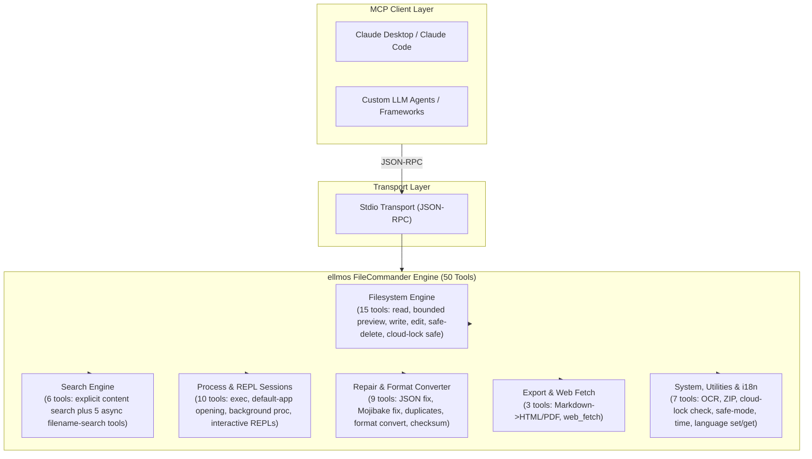
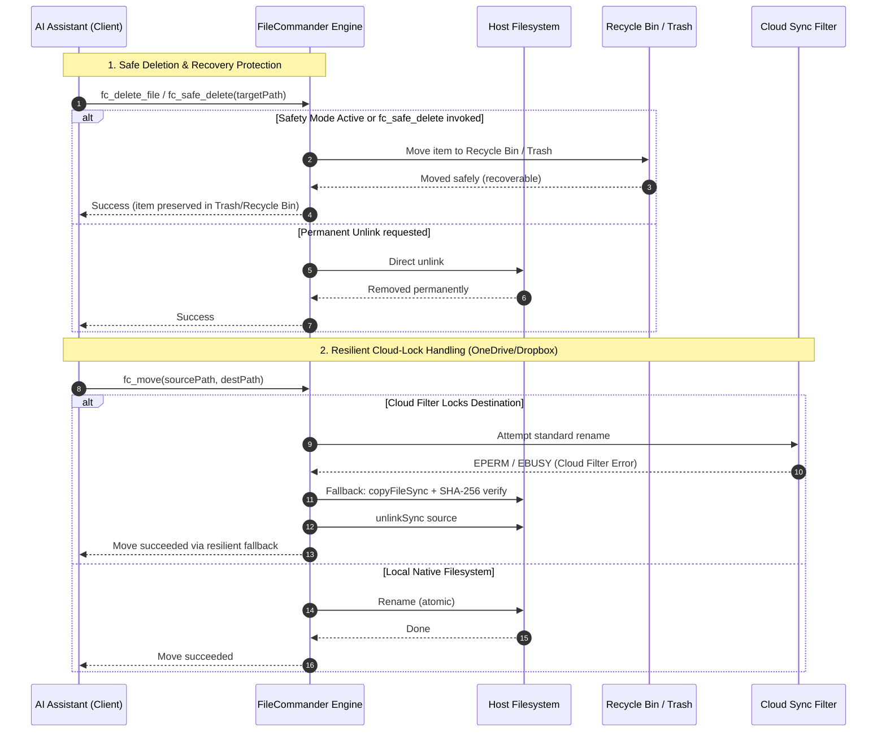

<!-- worldset: {"translated_from_sha256": "9630d9e7c40ee64dd237211fe37faef99c9791362a3f1f0712b5f78fa43a41f8", "translator": "claude-haiku-5-5", "translated_at": "2026-10-25T05:43:05.467386+00:00"} -->
<p align="center">
  
</p>

# ellmos FileCommander MCP-сервер

[English](README.md) | [Deutsch](README_de.md) | [Español](README_es.md) | [简体中文](README_zh.md) | [日本語](README_ja.md) | **Русский**

В навигации README перечислены доступные в этом репозитории языки документации. Сообщения FileCommander во время выполнения доступны на немецком (de), английском (en), испанском (es), китайском (zh), японском (ja) и русском (ru). Этот список языков среды выполнения отделён от языков перевода README. Задайте `FC_LANGUAGE` до запуска сервера или вызовите `fc_set_language` в активном сеансе MCP. С помощью `fc_get_language` можно узнать активный язык и поддерживаемые коды. Если переменная `FC_LANGUAGE` не задана или содержит неподдерживаемый код, по умолчанию используется немецкий (de).

*Часть семейства [ellmos-ai](https://github.com/ellmos-ai).*

[](https://opensource.org/licenses/MIT)
[](https://github.com/ellmos-ai/ellmos-filecommander-mcp/actions/workflows/tests.yml)
[](https://www.npmjs.com/package/ellmos-filecommander-mcp)
[](https://nodejs.org/)
[](#tools-overview)
[-brightgreen.svg)](#testing)
[](SECURITY.md)
[](SECURITY.md)
[](#why-filecommander)
[](NOTICE)
[](SECURITY.md)
[](THIRD_PARTY_LICENSES.md)
[](THIRD_PARTY_LICENSES.txt)
[](https://github.com/ellmos-ai)
[](https://github.com/open-bricks)
[](llms.txt)
[](llms.txt)
[](llms.txt)

> **Быстрая навигация:**
> 1. [Обзор](#sec-01) | 2. [Системная архитектура](#sec-02) | 3. [Сквозной жизненный цикл выполнения](#sec-03) | 4. [Основные возможности и инварианты безопасности](#sec-04) | 5. [Целевые персоны и обнаруживаемость](#sec-05) | 6. [Установка и предварительные требования](#sec-06) | 7. [Конфигурация и настройка клиента](#sec-07) | 8. [Обзор инструментов (50 инструментов)](#sec-08) | 9. [Сравнительная матрица и альтернативы](#sec-09) | 10. [Префикс инструментов и соглашение об именовании](#sec-10) | 11. [Управление и инварианты выполнения](#sec-11) | 12. [Архитектура безопасности и риски инструментов](#sec-12) | 13. [Тестирование, контрольные шлюзы качества и верификация](#sec-13) | 14. [Журнал изменений и версионирование](#sec-14) | 15. [SBOM уровня 1 и сторонние лицензии](#sec-15) | 16. [История и развитие](#sec-16) | 17. [Экосистема ellmos-ai и матрица партнёров](#sec-17) | 18. [Уведомление по закону (§ 521 BGB) и отказ от ответственности](#sec-18)
>
> | Прямые ссылки: [🛡️ Политика безопасности](SECURITY.md) • [🤝 Участие в разработке](CONTRIBUTING.md) • [⚖️ Сторонние лицензии](THIRD_PARTY_LICENSES.md) • [📄 SBOM в текстовом формате](THIRD_PARTY_LICENSES.txt) • [📜 Журнал маркетинга](MARKETING-LOG.txt) • [🤖 Контекст для LLM (llms.txt)](llms.txt) • [📋 Каноническое уведомление](NOTICE) |

Комплексный **MCP-сервер (Model Context Protocol)**, который предоставляет ИИ-ассистентам полный доступ к файловой системе, ограниченный поиск содержимого в нескольких файлах, управление процессами, интерактивные оболочечные сеансы и асинхронный поиск по именам файлов.

**50 инструментов** в одном сервере — всё, что нужно ИИ-агенту для работы с локальной системой.

**Ключевые слова для обнаружения:** локальный MCP-сервер файловой системы, MCP для поиска содержимого в нескольких файлах, MCP для безопасного удаления, MCP-сервер корзины, MCP для управления процессами, MCP для интерактивной оболочки, асинхронный поиск файлов для ИИ-агентов, файловые операции, безопасные для облачной блокировки, MCP для преобразования Markdown в PDF, MCP-сервер OCR, MCP для ZIP-архивов.

**Статус в реестрах:** опубликован в [npm](https://www.npmjs.com/package/ellmos-filecommander-mcp), проиндексирован в [jsDelivr](https://www.jsdelivr.com/package/npm/ellmos-filecommander-mcp), доступен на [LobeHub](https://lobehub.com/mcp/ellmos-ai-ellmos-filecommander-mcp), включён в [Glama](https://glama.ai/mcp/servers/ellmos-ai/ellmos-filecommander-mcp) и подготовлен для официального реестра MCP через [`server.json`](server.json). Некоторые сторонние каталоги всё ещё показывают устаревшие метаданные для 43 инструментов, поэтому каноническими источниками истины остаются README и метаданные npm до завершения их переиндексации.

> [!NOTE]
> **Для ИИ-агентов и интеграций с LLM:**
> FileCommander предоставляет **50 специализированных инструментов**, доступных через стандартный транспорт stdio. Все имена инструментов используют префикс `fc_`, чтобы избежать коллизий пространств имён. Для LLM краткие обзоры контекста и схем доступны в [`llms.txt`](llms.txt) и [`server.json`](server.json).

---

<a id="sec-01"></a><a id="overview"></a><a id="why-filecommander"></a><a id="ueberblick"></a><a id="überblick"></a>
## Обзор и почему FileCommander?

Большинство MCP-серверов файловой системы охватывают только базовые операции чтения и записи. FileCommander идёт дальше:

- **Безопасное удаление** — перемещает файлы в Корзину (Windows) или Корзину/Trash (macOS/Linux) вместо безвозвратного удаления
- **Интерактивные сеансы** — запуск и взаимодействие с REPL (Python, Node.js, оболочки) через протокол MCP
- **Асинхронный поиск** — поиск по большим деревьям каталогов в фоне, пока ИИ продолжает работу
- **Явный поиск содержимого** — поиск литерального текста или регулярных выражений в ограниченном списке файлов без рекурсии и раскрытия масок
- **Управление процессами** — просмотр, запуск и завершение системных процессов
- **Замена строк** — редактирование файлов по уникальным строкам с проверкой контекста
- **Преобразование форматов** — конвертация между JSON, CSV, INI, YAML, TOML, XML и TOON
- **ZIP-архивы** — создание, распаковка и просмотр ZIP-архивов
- **Контрольные суммы файлов** — хеширование MD5, SHA-1, SHA-256, SHA-384 и SHA-512 со сравнением
- **OCR** — извлечение текста из изображений (необязательная зависимость tesseract.js)
- **Режим безопасности** — переключатель, направляющий все удаления в Корзину / Trash
- **Экспорт Markdown** — конвертация Markdown в профессиональные HTML/PDF с блоками кода, таблицами, вложенными списками, цитатами
- **Безопасность для облачной синхронизации** — автоматический резервный сценарий копирования и удаления, когда фильтры синхронизации облачных сервисов (OneDrive, Dropbox, Google Drive, iCloud) блокируют переименование
- **Диагностика облачной блокировки** — проверка, подвержен ли путь риску конфликтов фильтров синхронизации, перед операцией
- **Кроссплатформенность** — работает в Windows, macOS и Linux с оптимизациями для конкретных платформ

---

<a id="sec-02"></a><a id="system-architecture"></a><a id="systemarchitektur"></a>
## Системная архитектура

### ASCII-топология архитектуры в четырёх представлениях

```text
+--------------------------------------------------------------------------------------------------+
|                            ELLMOS FILECOMMANDER MCP ARCHITECTURAL TOPOLOGY                       |
+--------------------------------------------------------------------------------------------------+
| [VIEW 1: CALLER RUNTIMES & AGENT CLIENTS]                                                        |
|   * Autonomous Agents   : Claude Code, OpenAI Codex, Antigravity / Gemini, Kimi, Cursor          |
|   * Agent Frameworks    : AutoGen, CrewAI, LangChain, LlamaIndex, Custom Python / TS Clients    |
|   * Transport Protocols : Model Context Protocol (MCP stdio), JSON-RPC 2.0 Framing               |
|   * Tool Surface        : 50 Unified Specialized Tools (fc_* namespace collision isolation)       |
|   * Schema Contract     : Stdio transport, dynamic runtime i18n parameter parsing (Zod validated)|
+--------------------------------------------------------------------------------------------------+
|                                                |                                                 |
|                                                v                                                 |
+--------------------------------------------------------------------------------------------------+
| [VIEW 2: FILECOMMANDER MCP CORE ENGINE & DISPATCH ORCHESTRATOR]                                  |
|   * Protocol Dispatch   : ESM stdio router with Zod schema validation & parameter checking      |
|   * Multilingual Core   : 6-language dynamic runtime i18n (de, en, es, zh, ja, ru) engine       |
|   * Safety Interceptor  : Global Safety Mode (fc_set_safe_mode) routing deletes to Recycle Bin   |
|   * Sync Diagnostics    : Reparse point detection & cloud filter diagnostics (fc_check_cloud_lock)|
|   * Process Supervisor  : Bounded child process lifecycle management & interactive REPL session  |
|                           state registry with circular ring buffers                              |
+--------------------------------------------------------------------------------------------------+
|                                                |                                                 |
|                                                v                                                 |
+--------------------------------------------------------------------------------------------------+
| [VIEW 3: FILESYSTEM RUNTIME, FORMAT REPAIR & PROCESS ISOLATION]                                  |
|   * Atomic File Ops     : Read, write, line edit, exact literal string replacement (fc_str_replace)|
|   * Cloud-Lock Fallback : Automatic copyFileSync + SHA-256 verify + unlinkSync on EPERM / EBUSY   |
|   * Bounded Inspection  : Metadata-first preview (fc_preview_file, 1 MiB inline content ceiling)  |
|   * Bounded Content Srch: max 50 explicit files, 10 MB ceiling, token redaction (INV-MASK-06)   |
|   * Self-Healing Repair : Mojibake repair (27+ UTF-8 patterns), JSON syntax fix, file cleanup    |
|   * Lossless Converter  : Declarative transformation across 7 formats (JSON, YAML, TOML, XML...) |
|   * Media & Documents   : Headless Markdown to PDF/HTML, ZIP archive engine, optional OCR (Tess)  |
+--------------------------------------------------------------------------------------------------+
|                                                |                                                 |
|                                                v                                                 |
+--------------------------------------------------------------------------------------------------+
| [VIEW 4: AIR-GAP DEFENSE PERIMETER, RUNASINVOKER & CONTROLLED EGRESS]                            |
|   * Execution Privilege : RunAsInvoker unprivileged user-mode (Zero administrative elevation)    |
|   * Transport Boundary  : 100% Local stdio transport, zero telemetry, zero open listening ports  |
|   * Controlled Egress   : Outbound HTTP(S) strictly gated through caller-invoked fc_web_fetch     |
|   * Network Safety      : SSRF guard blocking private/internal IP ranges (allow_private override) |
|   * Governance & Supply : Level 1 SBOM, 100% permissive runtime (MIT/BSD), 48h Security SLA      |
+--------------------------------------------------------------------------------------------------+
```

### Диаграмма потоков компонентов



---

<a id="sec-03"></a><a id="end-to-end-execution-lifecycle"></a><a id="execution-lifecycle"></a><a id="end-to-end-ausfuehrungszyklus"></a>
## Сквозной жизненный цикл выполнения



---

<a id="sec-04"></a><a id="core-capabilities--safety-invariants"></a><a id="core-capabilities"></a><a id="kernfaehigkeiten--sicherheitsinvarianten"></a><a id="kernfähigkeiten--sicherheitsinvarianten"></a>
## Основные возможности и инварианты безопасности

| Возможность / инвариант | Гарантия и детали реализации | Преимущество для безопасности и эксплуатации |
|------------------------|-----------------------------------|--------------------------------|
| **Локальный stdio и явная исходящая связь** | Транспорт MCP — локальный stdio, без телеметрии и без автоматической исходящей сетевой связи. `fc_web_fetch` выполняет исходящие HTTP(S)-запросы только тогда, когда клиент явно его вызывает; приватные цели по умолчанию блокируются, если не включён `allow_private`. | Делает сетевую границу видимой для клиентов, сохраняя локальный транспорт сервера без портов. |
| **Безопасное удаление и защита корзины** | `fc_safe_delete` перемещает элементы в Корзину Windows / Корзину macOS / FreeDesktop Trash в Linux. `fc_set_safe_mode` безопасно направляет все удаления. | Предотвращает необратимую потерю данных из-за случайных рекурсивных или массовых удалений. |
| **Устойчивое перемещение при облачной блокировке (`fc_move`)** | Автоматическое обнаружение фильтров облачной синхронизации (точки повторного разбора OneDrive, Dropbox, iCloud) с плавным резервным сценарием копирования, проверки и удаления. | Устраняет сбои `EPERM` / `EBUSY` при автоматизированных операциях агентов в синхронизируемых каталогах. |
| **Диагностика облачной блокировки (`fc_check_cloud_lock`)** | Отчёт только для чтения о статическом контексте облачного пути и существовании/типе цели; гидратация облачных файлов и дескрипторы процессов явно отмечаются как не проверенные, если недоступны. | Агенты могут отличить статический риск OneDrive от фактически обнаруженной блокировки переименования. |
| **Ограниченный поиск содержимого в нескольких файлах** | `fc_search_content` строго ограничивает входные данные (максимум 50 явных файлов, 10 МБ на файл, 200 совпадений, 200 тыс. символов) без рекурсии по маскам. | Предотвращает ошибки нехватки памяти и катастрофические зависания ЦП при поиске по большим репозиториям. |
| **Автоматическое скрытие секретов и токенов** | Фрагменты результатов поиска автоматически маскируют распространённые API-ключи, bearer-токены, учётные данные AWS и заголовки авторизации. | Предотвращает загрязнение контекста LLM и случайную утечку учётных данных в истории запросов. |
| **Интерактивный REPL и изоляция сеансов** | Сохраняющие состояние интерактивные сеансы (`fc_start_session`, `fc_send_input`, `fc_read_output`) для Python, Node.js, bash и PowerShell с ограниченными буферами. | Позволяет многоходовую отладку в REPL без неограниченного накопления фоновых процессов. |
| **Движок многоформатного преобразования без потерь** | Декларативное преобразование (`fc_convert_format`) для 7 структурированных форматов (JSON, YAML, TOML, XML, CSV, INI, TOON). | Чистая нормализация данных между разнородными форматами конфигураций без потери данных. |
| **Движок исправления кодировки и файлов** | `fc_fix_encoding`, `fc_fix_json` и `fc_cleanup_file` исправляют повреждённое кодирование UTF-8 (более 27 шаблонов), некорректный синтаксис JSON, BOM и байты NUL. | Самовосстанавливающиеся конвейеры для повреждённых файлов, созданных на разных ОС. |
| **Выполнение без повышения привилегий** | Спроектирован и проверен для работы в стандартном пользовательском режиме без привилегий. Никогда не требует административных прав или прав root. | Минимальная поверхность атаки; соблюдение принципа наименьших привилегий. |
| **Шестиязычный движок i18n времени выполнения** | Динамическое переключение языков и интроспекция (`fc_set_language`, `fc_get_language`) для немецкого (`de`), английского (`en`), испанского (`es`), китайского (`zh`), японского (`ja`) и русского (`ru`). | Нативный многоязычный опыт разработчика и локализованные отчёты об ошибках. |
| **Многоплатформенная проверенная матрица** | Протестировано в Windows, Ubuntu Linux и macOS на Node.js 20, 22 и 24 с 292 автоматическими проверками. | Непрерывное кроссплатформенное соответствие и надёжность. |

---

<a id="sec-05"></a><a id="target-personas--discoverability"></a><a id="target-personas"></a><a id="zielgruppen--auffindbarkeit"></a>
## Целевые персоны и обнаруживаемость

FileCommander специально создан и проверен для четырёх основных персон: разработчиков, агентных систем и специалистов по эксплуатации:

### [PERSONA-01] Автономные ИИ-агенты для программирования и рои LLM
- **Профиль:** Мультиагентные рои и самостоятельные агентные среды выполнения (Claude Code, Antigravity/Gemini, OpenAI Codex, AutoGen, CrewAI), выполняющие рекурсивное редактирование кода, рефакторинг проектов и аудит каталогов.
- **Ключевые операционные проблемы:** быстрое раздувание окна контекста из-за чтения файлов размером в несколько мегабайт, необработанные сбои процессов из-за заблокированных файлов (`EPERM`/`EBUSY`) в папках с облачной синхронизацией и невосстановимое повреждение репозитория из-за случайных процедур очистки `rm -rf`.
- **Решение FileCommander:**
  - `fc_preview_file`: проверка, начинающаяся с метаданных, со строгим потолком встроенного содержимого 1 МиБ, предотвращающим переполнение контекста LLM.
  - `fc_search_content`: ограниченный поиск в нескольких файлах (максимум 50 файлов, 10 МБ на файл, 200 совпадений) с автоматическим скрытием секретов и токенов.
  - `fc_safe_delete` и `fc_set_safe_mode`: сохранение удалённых файлов в Корзине / Trash ОС для файловых операций без риска.
  - `fc_move` и `fc_check_cloud_lock`: автоматический резервный сценарий «копирование + проверка SHA-256 + удаление» при блокировках файлов, предотвращающий сбои агента.

### [PERSONA-02] Инженеры DevOps, инструментальных цепочек и многохостовой автоматизации
- **Профиль:** инженеры систем и автоматизации, создающие кроссплатформенные CLI-инструменты, конвейеры проверки CI/CD и скрипты синхронизации нескольких машин в Windows, Linux и macOS.
- **Ключевые операционные проблемы:** разнородная семантика операционных систем (обратные слэши Windows против слэшей POSIX, повреждение окончаний строк, синтаксис, специфичный для оболочки), зомби-процессы дочерних процессов и блокировки файлов в общих рабочих областях OneDrive/Dropbox.
- **Решение FileCommander:**
  - Единая кроссплатформенная семантика инструментов в Windows, Linux и macOS.
  - Сохраняющие состояние интерактивные REPL-сеансы (`fc_start_session`, `fc_send_input`, `fc_read_output`) с ограниченными кольцевыми буферами.
  - Пакетное переименование файлов (`fc_batch_rename`) и фоновый поиск по каталогам (`fc_start_search`, `fc_get_search_results`).
  - Управление жизненным циклом процессов (`fc_execute_command`, `fc_start_process`, `fc_kill_process`) без утечек процессов.

### [PERSONA-03] Специалисты по SecOps, управлению и комплаенсу
- **Профиль:** сотрудники службы безопасности, аудиторы соответствия и команды по конфиденциальности, контролирующие интеграции ИИ-инструментов в корпоративных и производственных средах.
- **Ключевые операционные проблемы:** скрытые фоновые телеметрические сигналы, непроверенный сетевой доступ из локальных плагинов, утечка учётных данных и токенов в обучающие данные моделей или истории запросов, а также эскалация привилегий непривилегированных пользователей.
- **Решение FileCommander:**
  - Локальный транспорт stdio с строго нулевой телеметрией и нулевым количеством открытых сетевых портов для прослушивания.
  - Явная исходящая сетевая связь, строго ограниченная вызовом `fc_web_fetch`, инициированным клиентом (внутренние/приватные IP-адреса по умолчанию блокируются).
  - Автоматическое маскирование секретов и bearer-токенов в фрагментах поиска (`INV-MASK-06`).
  - Строгое выполнение без повышения привилегий (`INV-PROC-09`) и обязательный 48-часовой SLA реагирования на уязвимости (`security@open-bricks.org`, `security@ellmos.ai`).

### [PERSONA-04] Архитекторы корпоративных платформ и разработчики конвейеров данных
- **Профиль:** архитекторы решений и инженеры данных, интегрирующие локальные файлы, нормализующие разнородные форматы конфигурации, проверяющие криптографические хеши и формирующие отчёты.
- **Ключевые операционные проблемы:** разрастание MCP-серверов, требующее 4–6 разрозненных серверов с единственной функцией, повреждённые последовательности байтов UTF-8 (mojibake) в разных инструментах и самодельные скрипты разбора.
- **Решение FileCommander:**
  - Комплексное развёртывание из 50 инструментов на одном сервере, устраняющее разрастание числа серверов и накладные расходы процессов.
  - Декларативное преобразование без потерь для 7 структурированных форматов (`fc_convert_format`: JSON, YAML, TOML, XML, CSV, INI, TOON).
  - Встроенные движки восстановления файлов (`fc_fix_encoding`, `fc_fix_json`, `fc_cleanup_file`) для самовосстанавливающихся конвейеров.
  - Криптографические контрольные суммы (`fc_checksum`: SHA-256, SHA-512, MD5, SHA-1) и рендеринг Markdown в PDF/HTML (`fc_md_to_pdf`, `fc_md_to_html`).

### Поисковые запросы с высоким намерением и векторы обнаруживаемости

- **Основные поисковые запросы:** `ellmos-filecommander-mcp`, `FileCommander MCP`, `filesystem MCP server`, `multi-file content search MCP`, `safe delete MCP`, `async file search MCP`, `process management MCP`, `Markdown PDF MCP`.
- **Машиночитаемые метаданные:** структурированный контекст для ИИ-агентов поддерживается в [`llms.txt`](llms.txt), [`server.json`](server.json) и [`glama.json`](glama.json).
- **Соответствие и атрибуция:** проверено по [`THIRD_PARTY_LICENSES.md`](THIRD_PARTY_LICENSES.md) и [`NOTICE`](NOTICE).

---

<a id="sec-06"></a><a id="installation"></a><a id="installation-prerequisites"></a>
## Установка

### Предварительные требования

- [Node.js](https://nodejs.org/) 20 или выше
- npm

### Вариант 1: установка из NPM

```bash
npm install -g ellmos-filecommander-mcp
```

### Вариант 2: установка из исходного кода

```bash
git clone https://github.com/ellmos-ai/ellmos-filecommander-mcp.git
cd ellmos-filecommander-mcp
npm ci
npm run build
```

---

<a id="sec-07"></a><a id="configuration"></a><a id="client-setup"></a><a id="konfiguration"></a>
## Конфигурация

### Claude Desktop

Добавьте в ваш `claude_desktop_config.json`:

**Windows:** `%APPDATA%\Claude\claude_desktop_config.json`
**macOS:** `~/Library/Application Support/Claude/claude_desktop_config.json`

#### Если установлено глобально через NPM:

```json
{
  "mcpServers": {
    "filecommander": {
      "command": "ellmos-filecommander"
    }
  }
}
```

#### Если установлено из исходного кода:

```json
{
  "mcpServers": {
    "filecommander": {
      "command": "node",
      "args": ["/absolute/path/to/filecommander-mcp/dist/index.js"]
    }
  }
}
```

Перезапустите Claude Desktop после сохранения.

### Другие MCP-клиенты

Сервер взаимодействует через **транспорт stdio**. Укажите вашему MCP-клиенту точку входа `dist/index.js` или исполняемый файл `ellmos-filecommander`.

---

<a id="sec-08"></a><a id="tools-overview"></a><a id="available-tools"></a><a id="tools-uebersicht"></a><a id="tools-übersicht"></a>
## Обзор инструментов

### Операции с файловой системой (15 инструментов)

| Инструмент | Описание |
|------|-------------|
| `fc_read_file` | Чтение содержимого файла с необязательным ограничением количества строк |
| `fc_preview_file` | Проверка MIME-типа и размера, затем явный запрос ограниченного встроенного содержимого MCP |
| `fc_read_multiple_files` | Чтение до 20 файлов за один вызов |
| `fc_write_file` | Запись/создание/дополнение файлов |
| `fc_edit_file` | Построчное редактирование (замена, вставка, удаление строк) |
| `fc_str_replace` | Замена уникальной строки в файле с проверкой контекста |
| `fc_list_directory` | Список содержимого каталога (рекурсивно, с настраиваемой глубиной) |
| `fc_create_directory` | Создание каталогов (включая родительские) |
| `fc_delete_file` | Удаление файла (безвозвратное) |
| `fc_delete_directory` | Удаление каталога (с необязательным флагом рекурсии) |
| `fc_safe_delete` | Перемещение в Корзину / Trash (с возможностью восстановления!) |
| `fc_move` | Перемещение или переименование файлов и каталогов (безопасно для облачной блокировки) |
| `fc_copy` | Копирование файлов и каталогов |
| `fc_file_info` | Получение подробных метаданных файла (размер, даты, тип) |
| `fc_search_files` | Синхронный поиск файлов по шаблонам с подстановочными знаками |

`fc_preview_file` — резервный инструмент для удалённых/безголовых сценариев для локальных файлов. Его вызов по умолчанию возвращает только структурированные метаданные: разрешённый путь, URI `file://`, MIME-тип, размер в байтах, вид предпросмотра, фиксированный предел 1 МиБ и точный последующий вызов. Содержимое читается только после `include_content=true`. Подходящие текстовые файлы и растровые изображения используют стандартные блоки содержимого MCP `text`/`image`; PDF используют ограниченный встроенный `resource`. Файлы больше 1 МиБ и неподдерживаемые типы остаются только с метаданными и никогда не читаются и не кодируются в Base64 путём предпросмотра.

### Поиск содержимого (1 инструмент)

| Инструмент | Описание |
|------|-------------|
| `fc_search_content` | Поиск только для чтения по литералу или регулярному выражению в явном упорядоченном списке файлов с ограничениями по регистру, контексту, глобальным и пофайловым пределам |

`fc_search_content` никогда не раскрывает маски, не обходит каталоги и не выполняет рекурсивное обнаружение файлов. Он принимает не более 50 явных текстовых файлов в UTF-8, пропускает бинарные файлы и файлы больше 10 МБ и возвращает детерминированный JSON. Совпадения ограничены 200 глобально и 100 на файл, контекст — 10 строками, фрагменты — 500 символами, сериализованный вывод — 200 000 символами. Ошибки отсутствия файла, облачного файла, прав доступа, кодировки, бинарности и размера сообщаются для каждого файла отдельно, поэтому читаемые файлы всё равно дают результаты. Распространённые форматы секретов скрываются во фрагментах.

### Асинхронный поиск (5 инструментов)

| Инструмент | Описание |
|------|-------------|
| `fc_start_search` | Запуск фонового поиска (возвращает результат сразу) |
| `fc_get_search_results` | Получение результатов с постраничной навигацией |
| `fc_stop_search` | Отмена выполняющегося поиска |
| `fc_list_searches` | Список всех активных/завершённых поисков |
| `fc_clear_search` | Удаление завершённых поисков из памяти |

### Управление процессами (5 инструментов)

| Инструмент | Описание |
|------|-------------|
| `fc_execute_command` | Выполнение команды оболочки (блокирующее, с таймаутом) |
| `fc_start_process` | Запуск фонового процесса (неблокирующий) |
| `fc_open_path` | Проверка и открытие существующего локального файла или каталога приложением ОС по умолчанию |
| `fc_list_processes` | Список запущенных системных процессов |
| `fc_kill_process` | Завершение процесса по PID или имени |

`fc_open_path` принимает только существующий файл или каталог и передаёт его фиксированному нативному запускателю обработчика по умолчанию. Его структурированный результат сообщает `launcher_accepted=true|false`, всегда сообщает `user_visible="unknown"` и указывает машиночитаемый резервный вариант: `fc_preview_file` с аргументами только с метаданными для файлов или `fc_list_directory` для каталогов. Принятие запускателем никогда не утверждает, что графический интерфейс стал видимым. `fc_start_process` позволяет вызывающей стороне выбрать исполняемый файл и аргументы. `fc_execute_command` принимает произвольную команду оболочки: для обычных команд используется оболочка Node по умолчанию (`COMSPEC`/`cmd.exe` в Windows), а путь FileCommander для специальных символов Windows может направляться через Windows PowerShell.

### Интерактивные сеансы (5 инструментов)

| Инструмент | Описание |
|------|-------------|
| `fc_start_session` | Запуск интерактивного процесса (Python, Node, оболочка...) |
| `fc_read_output` | Чтение вывода сеанса |
| `fc_send_input` | Отправка ввода в выполняющийся сеанс |
| `fc_list_sessions` | Список всех сеансов |
| `fc_close_session` | Завершение сеанса |

### Обслуживание и восстановление файлов (9 инструментов)

| Инструмент | Описание |
|------|-------------|
| `fc_fix_json` | Восстановление повреждённого JSON (BOM, завершающие запятые, комментарии, одинарные кавычки) |
| `fc_validate_json` | Проверка JSON с подробным указанием позиции ошибки и контекста |
| `fc_cleanup_file` | Удаление BOM, байтов NUL, завершающих пробелов, нормализация окончаний строк |
| `fc_fix_encoding` | Исправление Mojibake / двойного кодирования UTF-8 (более 27 шаблонов символов) |
| `fc_folder_diff` | Отслеживание изменений каталога с помощью снимков (новые/изменённые/удалённые) |
| `fc_batch_rename` | Пакетное переименование по шаблонам (префикс/суффикс, замена, автоопределение) |
| `fc_convert_format` | Преобразование между форматами JSON, CSV, INI, YAML, TOML, XML и TOON |
| `fc_detect_duplicates` | Поиск дубликатов файлов с помощью хеширования SHA-256 |
| `fc_checksum` | Хеширование файлов (MD5, SHA-1, SHA-256, SHA-384, SHA-512) с необязательным сравнением |

### Архивы (1 инструмент)

| Инструмент | Описание |
|------|-------------|
| `fc_archive` | Создание, распаковка и просмотр ZIP-архивов |

### OCR (1 инструмент)

| Инструмент | Описание |
|------|-------------|
| `fc_ocr` | Извлечение текста из изображений через tesseract.js (необязательная зависимость) |

### Облачная синхронизация (1 инструмент)

| Инструмент | Описание |
|------|-------------|
| `fc_check_cloud_lock` | Отчёт о статическом контексте облачной синхронизации и состоянии цели; никогда не утверждать об активной блокировке без доказательств (Windows) |

### Система (4 инструмента)

| Инструмент | Описание |
|------|-------------|
| `fc_get_time` | Получение текущего системного времени с информацией о часовом поясе |
| `fc_set_safe_mode` | Переключение режима безопасности: все удаления идут через Корзину / Trash |
| `fc_set_language` | Установка языка выполнения (`de`, `en`, `es`, `zh`, `ja` или `ru`) |
| `fc_get_language` | Чтение активного языка выполнения и всех поддерживаемых кодов языков |

### Экспорт (2 инструмента)

| Инструмент | Описание |
|------|-------------|
| `fc_md_to_html` | Markdown в автономный HTML со стилями CSS (заголовки, блоки кода, таблицы, вложенные списки, цитаты, изображения, флажки) |
| `fc_md_to_pdf` | Markdown в PDF через безголовый браузер (Edge/Chrome). При отсутствии браузера — резервный вариант HTML |

### Веб (1 инструмент)

| Инструмент | Описание |
|------|-------------|
| `fc_web_fetch` | Получение веб-страницы и возврат содержимого по `mode`: extract (очищенный основной текст), raw (тело HTTP), links, forms или headers. Инструмент сетевого доступа только для чтения; защита от SSRF по умолчанию блокирует внутренние/приватные цели. |

**Итого: 50 инструментов**

---

<a id="sec-09"></a><a id="comparative-matrix--alternatives"></a><a id="comparative-matrix"></a><a id="comparison-with-alternatives"></a><a id="vergleichsmatrix--alternativen"></a>
## Сравнительная матрица и альтернативы

FileCommander объединяет манипулирование файловой системой, ограниченный поиск, управление процессами, восстановление данных, преобразование форматов и рендеринг документов в едином унифицированном интерфейсе MCP. Ниже приведено архитектурное сравнение со стандартными альтернативами по 10 ключевым эксплуатационным параметрам:

| Эксплуатационный параметр | ellmos FileCommander MCP (50 инструментов) | Официальный MCP файловой системы (`@modelcontextprotocol/server-filesystem`) | Desktop Commander MCP | Прямая оболочка хоста (`bash` / PowerShell) | Самодельные скрипты и облачные API |
|-----------------------|:-----------------------------------:|:------------------------------------------------------------------:|:---------------------:|:---------------------------------------:|:---------------------------:|
| **Широта и охват инструментов** `[INV-PROC-09]` | **50 унифицированных инструментов** в 6 областях | ~11 базовых инструментов ввода-вывода файлов | ~15 инструментов (файлы + процессы) | Неограниченные команды CLI | Разрозненные самодельные скрипты |
| **Безопасное удаление и восстановление** `[INV-SAFE-02]` | **Нативная Корзина / Trash ОС** (`fc_safe_delete`, режим безопасности) | Только безвозвратное удаление (`unlink`) | Только безвозвратное удаление | Необратимо `rm -rf` / `Remove-Item` | Самодельные реализации корзины |
| **Устойчивость к облачной блокировке и синхронизации** `[INV-LOCK-03]` | **Автоматический резерв** (копирование + проверка SHA-256 + удаление при EPERM/EBUSY) | Сбой при заблокированных файлах / точках повторного разбора | Сбой при заблокированных файлах | Сбой или бесконечная блокировка | Конфликты синхронизации / копии конфликтов |
| **Ограниченный поиск и скрытие секретов** `[INV-SRCH-05 / INV-MASK-06]` | **Ограниченный поиск** (максимум 50 файлов, 10 МБ, автоматическое скрытие API-токенов) | Только обход каталогов (без регулярных выражений по содержимому) | Неограниченный поиск по регулярным выражениям | Неограниченный `grep` (утечка секретов в контекст) | Самодельный поиск по регулярным выражениям без скрытия |
| **Асинхронный длительный поиск** `[INV-SRCH-05]` | **Фоновые сканирования с токенной пагинацией** (`fc_start_search`) | Только синхронный (блокирует агента) | Только синхронный | Управление фоновыми заданиями (`&`) | Циклы опроса / медленные сетевые вызовы |
| **Интерактивный REPL и управление сеансами** `[INV-REPL-08]` | **Сохраняющие состояние REPL** (Node, Python, оболочка) с кольцевыми буферами | Не поддерживается | Базовые терминальные сеансы | Сырые подпроцессы (риск зомби-процессов) | Сложная передача данных через IPC |
| **Самовосстановление и восстановление данных** `[INV-DIAG-04]` | **Встроенное** исправление Mojibake (более 27 шаблонов) и восстановление JSON | Не поддерживается | Не поддерживается | Ручной конвейер `iconv` / `sed` | Самодельный код восстановления после ошибок |
| **Многоформатное преобразование** `[INV-PREV-07]` | **Декларативное преобразование** (JSON, YAML, TOML, XML, CSV, INI, TOON) | Не поддерживается | Не поддерживается | Требует внешних `jq` / `yq` / `xmlstarlet` | Сторонние библиотеки Python |
| **Утилиты для документов и архивов** `[INV-PREV-07]` | **Встроенные** ZIP-операции, OCR (Tesseract), Markdown в HTML/PDF | Не поддерживается | Excel/PDF через настольное приложение | Требует `pandoc`, `zip`, `tesseract` | Разрозненные зависимости утилит |
| **Управление и SLA безопасности** `[INV-LOCAL-01 / INV-SLA-10]` | **Локальный stdio**, нулевая телеметрия, явная исходящая связь, обязательный SLA 48 ч | Стандартный stdio, SLA сообщества | Stdio, телеметрия/журналы без проверки | Неограниченное повышение прав и риск внедрения скриптов | Нерегламентированное облачное SaaS-раскрытие данных |

**Ключевые отличия:**
- Единственный MCP-сервер с **восстанавливаемым удалением** (Корзина / Trash) и глобальным **режимом безопасности**
- Единственный MCP-сервер с **асинхронным фоновым поиском** с пагинацией и управлением токенами
- Единственный MCP-сервер с **автоматическим скрытием секретов и bearer-токенов** во фрагментах поиска
- Встроенные **восстановление JSON**, **исправление кодировки Mojibake** и **поиск дубликатов**
- Встроенные **файловые операции, безопасные для облачной блокировки**, с автоматическим резервом «копирование + проверка + удаление»
- Самое комплексное решение на одном сервере (**50 инструментов**), устраняющее разрастание числа серверов

---

<a id="sec-10"></a><a id="tool-prefix"></a><a id="tool-praefix"></a><a id="tool-präfix"></a>
## Префикс инструментов

Все инструменты используют префикс `fc_` (FileCommander), чтобы избежать конфликтов с другими MCP-серверами.

---

<a id="sec-11"></a><a id="governance--runtime-invariants"></a><a id="governance-invariants"></a><a id="governance--laufzeit-invarianten"></a>
## Управление и инварианты выполнения

Сервер соблюдает 10 строгих инвариантов выполнения, гарантирующих безопасность, предсказуемость и наименьшие привилегии:

| ID инварианта | Название | Гарантия и детали реализации | Эксплуатационная выгода для безопасности |
|--------------|------|-----------------------------------|----------------------------|
| **INV-LOCAL-01** | **Локальный stdio и явная исходящая связь** | Локальный транспорт stdio, нулевая телеметрия, отсутствие открытых портов для прослушивания. Исходящие HTTP(S)-запросы возникают строго через явные вызовы клиента к `fc_web_fetch`. | Ноль несанкционированной фоновой сетевой утечки; локальная изоляция по умолчанию. |
| **INV-SAFE-02** | **Безопасное удаление и защита корзины** | `fc_safe_delete` и глобальный `fc_set_safe_mode` направляют удаления файлов и каталогов через Корзину ОС (Windows) / Trash (macOS/Linux). | Устраняет необратимую случайную потерю данных из-за действий ИИ-агентов. |
| **INV-LOCK-03** | **Устойчивое перемещение при облачной блокировке** | `fc_move` автоматически выполняет резервный сценарий «копирование + проверка SHA-256 + удаление источника», когда фильтры синхронизации (OneDrive, Dropbox, iCloud) вызывают EPERM/EBUSY. | Гарантирует надёжное выполнение файловых операций в облачных синхронизируемых рабочих областях. |
| **INV-DIAG-04** | **Диагностика облачной блокировки** | `fc_check_cloud_lock` обеспечивает статическую проверку пути только для чтения и обнаружение точек повторного разбора без изменения состояния файловой системы. | Позволяет агентам оценивать риски конфликтов синхронизации перед выполнением изменений. |
| **INV-SRCH-05** | **Ограниченный поиск содержимого в нескольких файлах** | `fc_search_content` строго ограничивает входные данные (максимум 50 явных файлов, 10 МБ на файл, 200 совпадений, 200 тыс. символов) без рекурсии по маскам. | Предотвращает сбои из-за нехватки памяти и неограниченное потребление ЦП. |
| **INV-MASK-06** | **Автоматическое скрытие секретов и токенов** | Фрагменты результатов поиска автоматически обнаруживают и маскируют API-ключи, bearer-токены, учётные данные AWS и заголовки авторизации. | Защищает учётные данные от утечки в запросы и загрязнения контекста. |
| **INV-PREV-07** | **Ограниченный встроенный предпросмотр и безопасное открытие** | `fc_preview_file` начинается с метаданных со строгим потолком встроенного содержимого 1 МиБ; `fc_open_path` вызывает приложение по умолчанию через безопасные для оболочки запускатели ОС. | Безопасный просмотр удалённых и локальных файлов без зависания интерфейса и раздувания полезной нагрузки. |
| **INV-REPL-08** | **Интерактивный REPL и изоляция сеансов** | Сохраняющие состояние интерактивные сеансы (`fc_start_session`, `fc_send_input`, `fc_read_output`) используют ограниченные кольцевые буферы. | Позволяет многоходовую отладку REPL, предотвращая накопление зомби-процессов. |
| **INV-PROC-09** | **Выполнение без повышения привилегий** | Выполняется полностью в стандартном пользовательском режиме без привилегий; никогда не запрашивает и не требует административного повышения или прав root. | Минимальная поверхность атаки; строгое соблюдение принципа наименьших привилегий. |
| **INV-SLA-10** | **SLA: ответ по вопросам безопасности в течение 48 часов и триаж в течение 5 дней** | Формальное обязательство по уязвимостям с многоканальными контактами (`security@open-bricks.org`, `security@ellmos.ai`). | Предсказуемый, готовый для предприятий жизненный цикл реагирования на инциденты и их триажа. |

---

<a id="sec-12"></a><a id="security"></a><a id="security-architecture"></a><a id="sicherheit"></a>
## Безопасность

**Этот сервер имеет полный доступ к файловой системе с правами запущенного пользователя.**

Подробные сведения по безопасности и рекомендации см. в [SECURITY.md](SECURITY.md).

Ключевые моменты:
- `fc_execute_command` выполняет произвольные команды оболочки
- `fc_open_path` вызывает приложение, связанное с операционной системой, для существующего пути, выбранного вызывающей стороной; это приложение работает с правами пользователя
- `fc_open_path` сообщает о принятии запускателем отдельно от инварианта `user_visible="unknown"`; `fc_preview_file` — резервный вариант для удалённых сценариев, начинающийся с метаданных, с явной границей 1 МиБ для встроенного содержимого
- `fc_start_session` запускает произвольную интерактивную команду, а последующие вызовы `fc_send_input` могут выполнять дополнительные действия
- Инструменты `fc_delete_*` по умолчанию выполняют безвозвратное удаление (используйте `fc_safe_delete` или включите **безопасный режим** через `fc_set_safe_mode`, чтобы направлять все удаления в Корзину / Trash)
- Безопасный режим защищает только `fc_delete_file` и `fc_delete_directory`; он не создаёт песочницу для команд или интерактивных сеансов
- Транспорт сервера — локальный stdio и не испускает телеметрию, однако явный вызов `fc_web_fetch` выполняет исходящий доступ по HTTP(S)
- Встроенной изоляции (песочницы) нет — безопасность делегируется уровню MCP-клиента

---

<a id="sec-13"></a><a id="development"></a><a id="testing"></a><a id="testing--verification"></a><a id="entwicklung"></a>
## Разработка

```bash
# Install dependencies
npm ci

# Watch mode (auto-rebuild on changes)
npm run dev

# One-time build
npm run build

# Start the server
npm start

# Run test suite
npm test
```

### Тестирование

Проект включает **235 тестов Vitest и 71 автономную проверку i18n (всего 306)**, охватывающих операции с файловой системой, предпросмотр встроенного содержимого, начинающийся с метаданных, ограниченный поиск содержимого, запуск нативного обработчика по умолчанию, преобразование форматов, восстановление кодировки, работу с архивами, поиск дубликатов, языковые пакеты, аннотации инструментов, реальное поведение stdio и границы безопасности.

```bash
npm test              # Run all tests
node test-i18n.mjs    # Run standalone i18n checks
npx vitest run        # Same as above
npx vitest --watch    # Watch mode
```

Тесты проверены в **Windows**, **macOS** и **Linux**.
При отправке изменений и pull request выполняется CI на Node.js **20**, **22** и **24** с `npm ci`, сборкой TypeScript, Vitest и пробным запуском упаковки npm.

Рекомендации по участию см. в [CONTRIBUTING.md](CONTRIBUTING.md).

---

<a id="sec-14"></a><a id="changelog"></a>
## Журнал изменений

Полную историю версий см. в [CHANGELOG.md](CHANGELOG.md).

---

<a id="sec-15"></a><a id="license--legal-attribution"></a><a id="third-party-licenses"></a><a id="drittanbieter-lizenzen"></a>
## Лицензия и правовая атрибуция

[MIT](LICENSE) — Lukas Geiger ([ellmos-ai](https://github.com/ellmos-ai)). Атрибуцию зонтичного проекта open-bricks см. в [NOTICE](NOTICE), SBOM уровня 1 — в [THIRD_PARTY_LICENSES.md](THIRD_PARTY_LICENSES.md), текстовый SBOM — в [THIRD_PARTY_LICENSES.txt](THIRD_PARTY_LICENSES.txt).

---

<a id="sec-16"></a><a id="history"></a><a id="historie"></a>
## История

Проект изначально разрабатывался как **BACH FileCommander** (`bach-filecommander-mcp`). Он был переименован в **ellmos FileCommander** (`ellmos-filecommander-mcp`) в рамках организации [ellmos-ai](https://github.com/ellmos-ai).

Устаревшее имя пакета `bach-filecommander-mcp` считается устаревшим. Используйте вместо него [`ellmos-filecommander-mcp`](https://www.npmjs.com/package/ellmos-filecommander-mcp):

```bash
npm uninstall -g bach-filecommander-mcp
npm install -g ellmos-filecommander-mcp
```

---

<a id="sec-17"></a><a id="ellmos-ai-ecosystem"></a><a id="ecosystem"></a><a id="ellmos-ai-oekosystem"></a><a id="ellmos-ai-ökosystem"></a>
## Экосистема ellmos-ai

Этот MCP-сервер входит в экосистему **[ellmos-ai](https://github.com/ellmos-ai)** — ИИ-инфраструктура, MCP-серверы и интеллектуальные инструменты.

### Семейство MCP-серверов

| Сервер | Инструменты | Направленность | npm |
|--------|-------|-------|-----|
| **[FileCommander](https://github.com/ellmos-ai/ellmos-filecommander-mcp)** | **50** | **Файловая система, ограниченный встроенный предпросмотр, поиск содержимого, открытие приложением по умолчанию, управление процессами, интерактивные сеансы, операции, безопасные для облачной блокировки** | **[`ellmos-filecommander-mcp`](https://www.npmjs.com/package/ellmos-filecommander-mcp)** |
| [CodeCommander](https://github.com/ellmos-ai/ellmos-codecommander-mcp) | 22 | Анализ кода, восстановление JSON, импорты, диффы, регулярные выражения | [`ellmos-codecommander-mcp`](https://www.npmjs.com/package/ellmos-codecommander-mcp) |
| [Clatcher](https://github.com/ellmos-ai/ellmos-clatcher-mcp) | 12 | Восстановление файлов, преобразование форматов, пакетные операции | [`ellmos-clatcher-mcp`](https://www.npmjs.com/package/ellmos-clatcher-mcp) |
| [n8n Manager](https://github.com/ellmos-ai/n8n-manager-mcp) | 19 | Управление рабочими процессами n8n через ИИ-ассистентов | [`n8n-manager-mcp`](https://www.npmjs.com/package/n8n-manager-mcp) |
| [ControlCenter](https://github.com/ellmos-ai/ellmos-controlcenter-mcp) | 31 | Обнаружение стека MCP, управление профилями, плоскость управления | [`ellmos-controlcenter-mcp`](https://www.npmjs.com/package/ellmos-controlcenter-mcp) |
| [Homebase](https://github.com/ellmos-ai/ellmos-homebase-mcp) | 45 | Локальная память LLM, знания, состояние, маршрутизация, оркестрация роя | [`ellmos-homebase-mcp`](https://www.npmjs.com/package/ellmos-homebase-mcp) (alpha) |
| [ServerCommander](https://github.com/ellmos-ai/ellmos-servercommander-mcp) | 8 | Операции с серверами: проверки состояния, анализ журналов, пробные запуски развёртывания, диагностика почты | [`ellmos-servercommander-mcp`](https://www.npmjs.com/package/ellmos-servercommander-mcp) (alpha) |
| [Blender Use](https://github.com/ellmos-ai/ellmos-blender-use-mcp) | 5 | Headless-контроль качества ресурсов Blender и проверка повторного импорта FBX | [`ellmos-blender-use-mcp`](https://www.npmjs.com/package/ellmos-blender-use-mcp) (alpha) |
| [Open Compute](https://github.com/ellmos-ai/open-compute-mcp) | 16 | Независимое от модели использование компьютера: захват, действия с контролем безопасности, Windows UIA | [`open-compute-mcp`](https://www.npmjs.com/package/open-compute-mcp) (alpha) |

### ИИ-инфраструктура

| Проект | Описание |
|---------|-------------|
| [BACH](https://github.com/ellmos-ai/bach) | Локальная текстовая ОС для агентов LLM — 113+ обработчиков, 550+ инструментов, память SQLite |
| [open-compute](https://github.com/ellmos-ai/open-compute) | Независимое от модели ядро использования компьютера, на котором работает Open Compute MCP |
| [clutch](https://github.com/ellmos-ai/clutch) | Оркестрация LLM, не зависящая от провайдера, с автоматической маршрутизацией и учётом бюджета |
| [rinnsal](https://github.com/ellmos-ai/rinnsal) | Лёгкая память агентов, коннекторы и инфраструктура автоматизации |
| [ellmos-stack](https://github.com/ellmos-ai/ellmos-stack) | Самохостируемый стек ИИ-исследований (Ollama + n8n + Rinnsal + KnowledgeDigest) |
| [MarbleRun](https://github.com/ellmos-ai/MarbleRun) | Фреймворк цепочек автономных агентов для Claude Code |
| [gardener](https://github.com/ellmos-ai/gardener) | Минималистичный прототип LLM-ОС на основе базы данных (4 функции, 1 таблица) |
| [ellmos-tests](https://github.com/ellmos-ai/ellmos-tests) | Фреймворк тестирования операционных систем LLM (7 измерений) |

### Настольное ПО и сопутствующие приложения

Наша партнёрская организация **[open-bricks](https://github.com/open-bricks)** и её профильные организации предоставляют нативные для ИИ настольные приложения и утилиты для разработчиков:

| Приложение | Категория | Организация | Направленность |
|-------------|----------|--------------|-------|
| [ProFiler](https://github.com/file-bricks/ProFiler) | Управление файлами | file-bricks | Высокоскоростной двухпанельный файловый менеджер с интеграцией ИИ |
| [ExplorerPro](https://github.com/file-bricks/ExplorerPro) | Проводник файлов | file-bricks | Интеллектуальный проводник с семантическими фильтрами и предпросмотром |
| [WinStorePackager](https://github.com/file-bricks/WinStorePackager) | Упаковка | file-bricks | Упаковка MSIX и Store для настольных приложений Windows |
| [SoftwareCenter](https://github.com/file-bricks/SoftwareCenter) | Магазин приложений | file-bricks | Централизованное управление и распространение настольных пакетов |
| [SQLiteViewer](https://github.com/file-bricks/SQLiteViewer) | Инструмент для баз данных | file-bricks | Лёгкий просмотр и запросы SQLite |
| [DokuZen](https://github.com/doc-bricks/DokuZen) | Набор Markdown | doc-bricks | Редактор Markdown, экспорт в PDF и преобразование документов |
| [MediaBrain](https://github.com/doc-bricks/MediaBrain) | Документы / медиа | doc-bricks | Транскрибирование аудио/видео, извлечение метаданных и каталогизация |
| [UniversalInvoiceMail](https://github.com/doc-bricks/UniversalInvoiceMail) | Документы / почта | doc-bricks | Автоматический разбор счетов, извлечение из PDF и маршрутизация почты |
| [DevCenter](https://github.com/dev-bricks/DevCenter) | Набор разработчика | dev-bricks | Интегрированный набор инструментов разработчика, анализаторы и генераторы кода |
| [CodeBox](https://github.com/dev-bricks/CodeBox) | Редактор кода | dev-bricks | Многоязычный редактор кода с расширением через LLM |
| [safe-start-for-codex](https://github.com/dev-bricks/safe-start-for-codex) | Безопасность и аудит | dev-bricks | Усиленная среда выполнения и предполётная проверка для Codex |
| [automation-master](https://github.com/dev-bricks/automation-master) | Автоматизация задач | dev-bricks | Высоконадёжный фоновый запускатель автоматизации и планировщик |
| [Zombie Killer Tray](https://github.com/dev-bricks/zombie-killer-tray) | Управление процессами | dev-bricks | Необязательный инструмент Windows для проверки «осиротевших» процессов MCP. FileCommander является настроенным кандидатом при запуске через поддерживаемую точку входа `node_modules/ellmos-filecommander-mcp/dist/index.js`; все дополнительные проверки процессов и применения по-прежнему действуют. |

---

<a id="sec-18"></a><a id="liability"></a><a id="statutory-notice--liability"></a><a id="haftung--liability"></a><a id="haftung"></a>
## Haftung / Ответственность

Dieses Projekt ist eine **unentgeltliche Open-Source-Schenkung** im Sinne der §§ 516 ff. BGB (Gefälligkeitsrecht). Die Haftung des Urhebers und der Mitwirkenden ist gemäß **§ 521 BGB** auf **Vorsatz und grobe Fahrlässigkeit** beschränkt. Ergänzend gilt der Haftungsausschluss der MIT-Lizenz.

Nutzung auf eigenes Risiko. Keine Wartungszusage, keine Verfügbarkeitsgarantie, keine Gewähr für Fehlerfreiheit oder Eignung für einen bestimmten Zweck.

Sicherheitsrelevante Vorfälle und Schwachstellen werden über das verbindliche **48-Stunden-SLA** unter `security@open-bricks.org` und `security@ellmos.ai` entgegengenommen und innerhalb von 5 Werktagen triagiert.

Этот проект — **безвозмездное пожертвование открытого кода** в соответствии с §§ 516 и далее BGB (немецкое гражданское право). Ответственность строго ограничена умыслом и грубой неосторожностью (§ 521 BGB). Дополнительно применяется отказ от ответственности MIT-лицензии. Использование на ваш страх и риск. Гарантии, обязательств по обслуживанию, доступности, отсутствия ошибок или пригодности для конкретной цели не предоставляются.

Инциденты и уязвимости, связанные с безопасностью, обрабатываются в рамках обязательного **48-часового SLA на реагирование** через `security@open-bricks.org` и `security@ellmos.ai` с формальным триажем в течение 5 рабочих дней.
