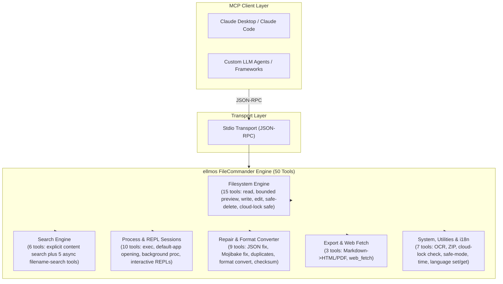
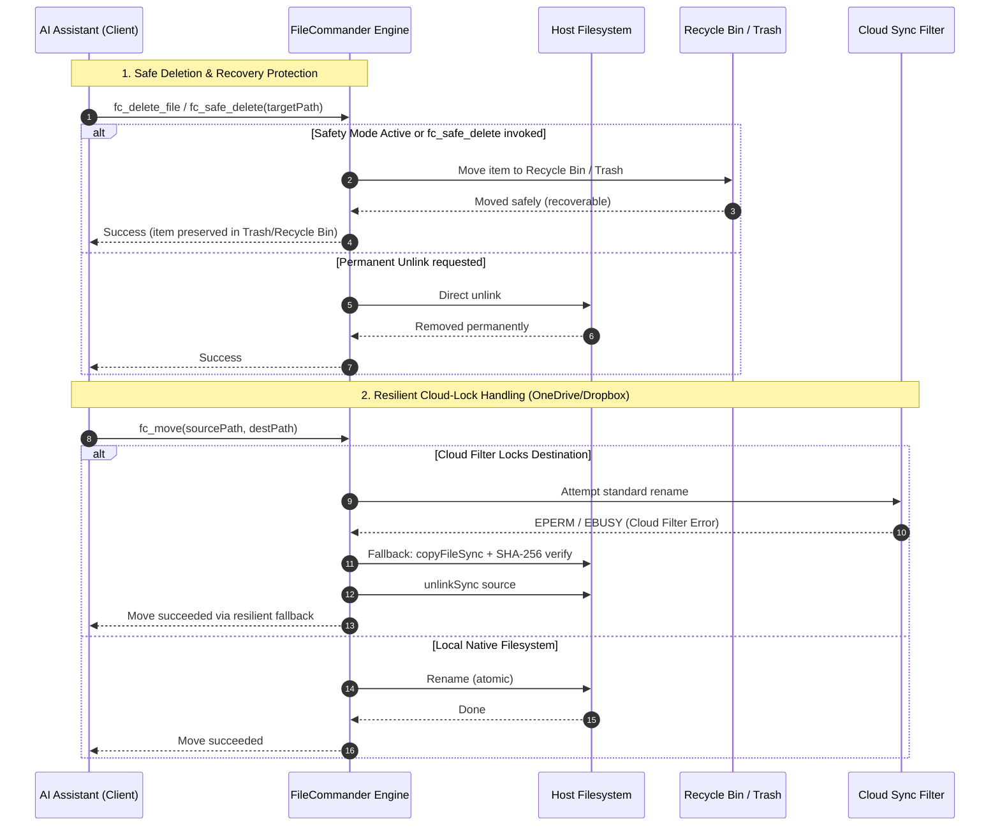

<!-- worldset: {"translated_from_sha256": "b14c4d90b205afeb948351c40f5ee76737faae530da0e8c3cec486fbe24661fa", "translator": "claude-haiku-5-5", "translated_at": "2026-10-25T05:56:51.271355+00:00", "reviewed_by": "gpt-6-luna", "review_manifest_sha256": "8f8d60530b2c2262d1f65f226d7c19b614f154bf7bf509af34edb77abc564dff", "operator_assembled_at": "2026-10-25T06:40:18.788189+00:00", "reviewer": "gpt-6-luna/max; Root independent structure and risk samples"} -->
<p align="center">
  
</p>

# ellmos FileCommander MCP 服务器

[English](README.md) | [Deutsch](README_de.md) | [Español](README_es.md) | **简体中文** | [日本語](README_ja.md) | [Русский](README_ru.md) | [Français](README_fr.md) | [हिन्दी](README_hi.md) | [العربية](README_ar.md) | [বাংলা](README_bn.md) | [Português](README_pt.md)

README 导航会列出本仓库提供的文档语言。 FileCommander 运行时消息支持德语 (de)、英语 (en)、西班牙语 (es)、中文 (zh)、日语 (ja) 和俄语 (ru)。此运行时语言列表与 README 文档翻译语言分开说明。 在启动服务器前设置 `FC_LANGUAGE`，或在活动的 MCP 会话中调用 `fc_set_language`。使用 `fc_get_language` 查看当前语言和支持的语言代码。 如果未设置 `FC_LANGUAGE` 或其值不受支持，运行时默认使用德语 (de)。

*属于 [ellmos-ai](https://github.com/ellmos-ai) 系列。*

[](https://opensource.org/licenses/MIT)
[](https://github.com/ellmos-ai/ellmos-filecommander-mcp/actions/workflows/tests.yml)
[](https://www.npmjs.com/package/ellmos-filecommander-mcp)
[](https://nodejs.org/)
[](#tools-overview)
[-brightgreen.svg)](#testing)
[](SECURITY.md)
[](SECURITY.md)
[](#why-filecommander)
[](NOTICE)
[](SECURITY.md)
[](THIRD_PARTY_LICENSES.md)
[](THIRD_PARTY_LICENSES.txt)
[](https://github.com/ellmos-ai)
[](https://github.com/open-bricks)
[](llms.txt)
[](llms.txt)
[](llms.txt)

> **快速导航：**
> 1. [概述](#sec-01) | 2. [系统架构](#sec-02) | 3. [端到端执行生命周期](#sec-03) | 4. [核心能力与安全不变量](#sec-04) | 5. [目标用户画像与可发现性](#sec-05) | 6. [安装与前置条件](#sec-06) | 7. [配置与客户端设置](#sec-07) | 8. [工具概览（50 个工具）](#sec-08) | 9. [对比矩阵与替代方案](#sec-09) | 10. [工具前缀与命名约定](#sec-10) | 11. [治理与运行时不变量](#sec-11) | 12. [安全架构与工具风险](#sec-12) | 13. [测试、质量门禁与验证](#sec-13) | 14. [变更日志与版本控制](#sec-14) | 15. [一级 SBOM 与第三方许可证](#sec-15) | 16. [历史与演进](#sec-16) | 17. [ellmos-ai 生态系统与合作伙伴矩阵](#sec-17) | 18. [法定声明（德国民法典第 521 条）与责任免责声明](#sec-18)
>
> | 直接链接：[🛡️ 安全政策](SECURITY.md) • [🤝 贡献指南](CONTRIBUTING.md) • [⚖️ 第三方许可证](THIRD_PARTY_LICENSES.md) • [📄 纯文本 SBOM](THIRD_PARTY_LICENSES.txt) • [📜 营销日志](MARKETING-LOG.txt) • [🤖 LLM 上下文（llms.txt）](llms.txt) • [📋 标准声明](NOTICE) |

一个功能全面的 **模型上下文协议（MCP）服务器**，为 AI 助手提供完整的文件系统访问、有界的多文件内容搜索、进程管理、交互式 Shell 会话以及异步文件名搜索能力。

单个服务器提供 **50 个工具**，涵盖 AI 智能体与本地系统交互所需的一切功能。

**发现关键词：** 本地文件系统 MCP 服务器、多文件内容搜索 MCP、安全删除 MCP、回收站 MCP 服务器、进程管理 MCP、交互式 Shell MCP、面向 AI 智能体的异步文件搜索、云锁安全文件操作、Markdown 转 PDF MCP、OCR MCP 服务器、ZIP 压缩包 MCP。

**注册状态：** 已发布于 [npm](https://www.npmjs.com/package/ellmos-filecommander-mcp)，已被 [jsDelivr](https://www.jsdelivr.com/package/npm/ellmos-filecommander-mcp) 索引，可在 [LobeHub](https://lobehub.com/mcp/ellmos-ai-ellmos-filecommander-mcp) 查看，已在 [Glama](https://glama.ai/mcp/servers/ellmos-ai/ellmos-filecommander-mcp) 上架，并已通过 [`server.json`](server.json) 为官方 MCP 注册表做好准备。部分第三方目录仍显示较早的 43 个工具元数据，因此在其重新索引完成之前，应以规范的 README/npm 元数据为准。

> [!NOTE]
> **面向 AI 智能体与 LLM 集成：**
> FileCommander 通过标准 stdio 传输提供 **50 个专用工具**。所有工具名称均使用 `fc_` 前缀，以防止命名空间冲突。对于 LLM，紧凑的上下文与模式概览可见于 [`llms.txt`](llms.txt) 和 [`server.json`](server.json)。

---

<a id="sec-01"></a><a id="overview"></a><a id="why-filecommander"></a><a id="ueberblick"></a><a id="überblick"></a>
## 概述与 FileCommander 的价值

大多数文件系统 MCP 服务器仅涵盖基本的读写操作。FileCommander 则更进一步：

- **安全删除** - 将文件移入回收站（Windows）或废纸篓（macOS/Linux），而非永久删除
- **交互式会话** - 通过 MCP 协议启动并与 REPL（Python、Node.js、Shell）交互
- **异步搜索** - 在后台搜索大型目录树，AI 可继续工作
- **显式内容搜索** - 在有界文件列表中搜索字面文本或正则表达式，不进行递归或通配符展开
- **进程管理** - 列出、启动和终止系统进程
- **字符串替换** - 通过匹配唯一字符串并进行上下文验证来编辑文件
- **格式转换** - 在 JSON、CSV、INI、YAML、TOML、XML 和 TOON 之间相互转换
- **ZIP 压缩包** - 创建、解压和列出 ZIP 压缩包
- **文件校验和** - 支持 MD5、SHA-1、SHA-256、SHA-384 和 SHA-512 哈希，并支持比对
- **OCR** - 从图像中提取文本（可选依赖 tesseract.js）
- **安全模式** - 切换开关，将所有删除操作路由至回收站 / 废纸篓
- **Markdown 导出** - 将 Markdown 转换为专业的 HTML/PDF，支持代码块、表格、嵌套列表和引用块
- **云锁安全** - 当云同步过滤器（OneDrive、Dropbox、Google Drive、iCloud）阻止重命名操作时，自动回退为复制后删除
- **云锁诊断** - 在操作前检查路径是否存在同步过滤冲突风险
- **跨平台** - 支持 Windows、macOS 和 Linux，并进行平台特定优化

---

<a id="sec-02"></a><a id="system-architecture"></a><a id="systemarchitektur"></a>
## 系统架构

### ASCII 四视图架构拓扑

```text
+--------------------------------------------------------------------------------------------------+
|                            ELLMOS FILECOMMANDER MCP ARCHITECTURAL TOPOLOGY                       |
+--------------------------------------------------------------------------------------------------+
| [VIEW 1: CALLER RUNTIMES & AGENT CLIENTS]                                                        |
|   * Autonomous Agents   : Claude Code, OpenAI Codex, Antigravity / Gemini, Kimi, Cursor          |
|   * Agent Frameworks    : AutoGen, CrewAI, LangChain, LlamaIndex, Custom Python / TS Clients    |
|   * Transport Protocols : Model Context Protocol (MCP stdio), JSON-RPC 2.0 Framing               |
|   * Tool Surface        : 50 Unified Specialized Tools (fc_* namespace collision isolation)       |
|   * Schema Contract     : Stdio transport, dynamic runtime i18n parameter parsing (Zod validated)|
+--------------------------------------------------------------------------------------------------+
|                                                |                                                 |
|                                                v                                                 |
+--------------------------------------------------------------------------------------------------+
| [VIEW 2: FILECOMMANDER MCP CORE ENGINE & DISPATCH ORCHESTRATOR]                                  |
|   * Protocol Dispatch   : ESM stdio router with Zod schema validation & parameter checking      |
|   * Multilingual Core   : 6-language dynamic runtime i18n (de, en, es, zh, ja, ru) engine       |
|   * Safety Interceptor  : Global Safety Mode (fc_set_safe_mode) routing deletes to Recycle Bin   |
|   * Sync Diagnostics    : Reparse point detection & cloud filter diagnostics (fc_check_cloud_lock)|
|   * Process Supervisor  : Bounded child process lifecycle management & interactive REPL session  |
|                           state registry with circular ring buffers                              |
+--------------------------------------------------------------------------------------------------+
|                                                |                                                 |
|                                                v                                                 |
+--------------------------------------------------------------------------------------------------+
| [VIEW 3: FILESYSTEM RUNTIME, FORMAT REPAIR & PROCESS ISOLATION]                                  |
|   * Atomic File Ops     : Read, write, line edit, exact literal string replacement (fc_str_replace)|
|   * Cloud-Lock Fallback : Automatic copyFileSync + SHA-256 verify + unlinkSync on EPERM / EBUSY   |
|   * Bounded Inspection  : Metadata-first preview (fc_preview_file, 1 MiB inline content ceiling)  |
|   * Bounded Content Srch: max 50 explicit files, 10 MB ceiling, token redaction (INV-MASK-06)   |
|   * Self-Healing Repair : Mojibake repair (27+ UTF-8 patterns), JSON syntax fix, file cleanup    |
|   * Lossless Converter  : Declarative transformation across 7 formats (JSON, YAML, TOML, XML...) |
|   * Media & Documents   : Headless Markdown to PDF/HTML, ZIP archive engine, optional OCR (Tess)  |
+--------------------------------------------------------------------------------------------------+
|                                                |                                                 |
|                                                v                                                 |
+--------------------------------------------------------------------------------------------------+
| [VIEW 4: AIR-GAP DEFENSE PERIMETER, RUNASINVOKER & CONTROLLED EGRESS]                            |
|   * Execution Privilege : RunAsInvoker unprivileged user-mode (Zero administrative elevation)    |
|   * Transport Boundary  : 100% Local stdio transport, zero telemetry, zero open listening ports  |
|   * Controlled Egress   : Outbound HTTP(S) strictly gated through caller-invoked fc_web_fetch     |
|   * Network Safety      : SSRF guard blocking private/internal IP ranges (allow_private override) |
|   * Governance & Supply : Level 1 SBOM, 100% permissive runtime (MIT/BSD), 48h Security SLA      |
+--------------------------------------------------------------------------------------------------+
```

### 组件流程图



---

<a id="sec-03"></a><a id="end-to-end-execution-lifecycle"></a><a id="execution-lifecycle"></a><a id="end-to-end-ausfuehrungszyklus"></a>
## 端到端执行生命周期



---

<a id="sec-04"></a><a id="core-capabilities--safety-invariants"></a><a id="core-capabilities"></a><a id="kernfaehigkeiten--sicherheitsinvarianten"></a><a id="kernfähigkeiten--sicherheitsinvarianten"></a>
## 核心能力与安全不变式

| 能力 / 不变量 | 保证与实现细节 | 安全与运维收益 |
|------------------------|-----------------------------------|--------------------------------|
| **本地 stdio 与显式出站** | MCP 传输为本地 stdio,不包含遥测,也不会自动进行网络出站。`fc_web_fetch` 仅在客户端显式调用时才发出 HTTP(S) 请求;除非启用 `allow_private`,否则默认阻止私有目标。 | 让网络边界对客户端可见,同时保留本地、无端口的服务器传输方式。 |
| **安全删除与回收站保护** | `fc_safe_delete` 将项目移动到 Windows 回收站 / macOS 废纸篓 / Linux FreeDesktop 回收站。`fc_set_safe_mode` 将所有删除操作安全地路由处理。 | 防止因意外递归或批量删除造成的不可逆数据丢失。 |
| **云锁弹性移动(`fc_move`)** | 自动检测云同步过滤器(OneDrive、Dropbox、iCloud 重解析点),并无缝回退为复制+校验+删除。 | 消除代理在同步目录中自动化操作时的 `EPERM` / `EBUSY` 失败。 |
| **云锁诊断(`fc_check_cloud_lock`)** | 只读报告静态云路径上下文以及目标的存在性/类型;当云文件水合和进程句柄不可用时,明确报告为未检查。 | 代理可以区分静态 OneDrive 风险与实际检测到的重命名锁定。 |
| **有界多文件内容搜索** | `fc_search_content` 严格限制输入(最多 50 个显式文件、每个文件 10 MB、200 个匹配项、200k 字符),且不进行 glob 递归。 | 防止大型代码仓库搜索时出现内存溢出错误和灾难性的 CPU 卡死。 |
| **自动化密钥与令牌脱敏** | 内容搜索摘录会自动遮蔽常见的 API 密钥、Bearer 令牌、AWS 凭据和授权头。 | 防止 LLM 上下文污染,以及提示历史中的意外凭据泄露。 |
| **交互式 REPL 与会话隔离** | 为 Python、Node.js、bash 和 PowerShell 提供有界缓冲区的有状态交互式会话(`fc_start_session`、`fc_send_input`、`fc_read_output`)。 | 支持多轮 REPL 调试,且不会产生无约束的后台进程堆积。 |
| **无损多格式引擎** | 通过声明式转换(`fc_convert_format`)支持 7 种结构化格式(JSON、YAML、TOML、XML、CSV、INI、TOON)。 | 在异构配置格式之间实现清晰的数据规范化,且不丢失数据。 |
| **乱码与文件修复引擎** | `fc_fix_encoding`、`fc_fix_json` 和 `fc_cleanup_file` 可修复损坏的 UTF-8 编码(27 种以上模式)、格式错误的 JSON 语法、BOM 以及 NUL 字节。 | 为不同操作系统平台生成的损坏文件提供自修复流水线。 |
| **无权限、非提权执行** | 经设计并验证可在标准的非特权用户模式下运行。从不需要管理员或 root 权限。 | 攻击面最小;遵循最小权限原则。 |
| **六语言运行时 i18n 引擎** | 动态语言切换与自省(`fc_set_language`、`fc_get_language`),支持德语(`de`)、英语(`en`)、西班牙语(`es`)、中文(`zh`)、日语(`ja`)和俄语(`ru`)。 | 原生多语言开发者体验与本地化错误报告。 |
| **多操作系统验证矩阵** | 在 Windows、Ubuntu Linux 和 macOS 上,基于 Node.js 20、22 和 24 测试,包含 292 项自动化断言。 | 持续的跨平台一致性与可靠性。 |

---

<a id="sec-05"></a><a id="target-personas--discoverability"></a><a id="target-personas"></a><a id="zielgruppen--auffindbarkeit"></a>
## 目标用户画像与可发现性

FileCommander 专为四类核心用户画像而构建并经过验证:开发者、代理式使用者和运维人员。

### [PERSONA-01] 自主 AI 编码代理与 LLM 集群
- **概述:** 多代理集群与独立代理运行时(Claude Code、Antigravity/Gemini、OpenAI Codex、AutoGen、CrewAI)执行递归代码编辑、项目重构与目录审计。
- **主要运营痛点:** 读取多兆字节文件导致的上下文窗口快速膨胀;云同步文件夹中因文件锁定(`EPERM`/`EBUSY`)引发的未处理进程崩溃;以及因误执行 `rm -rf` 清理例程造成的仓库损坏且无法恢复。
- **FileCommander 解决方案:**
  - `fc_preview_file`:元数据优先检查,严格的 1 MiB 内联内容上限,防止 LLM 上下文溢出。
  - `fc_search_content`:有界多文件搜索(最多 50 个文件、每个文件 10 MB、200 条匹配),并自动脱敏机密信息与令牌。
  - `fc_safe_delete` 与 `fc_set_safe_mode`:将已删除文件保留在操作系统回收站/废纸篓中,实现零风险文件操作。
  - `fc_move` 与 `fc_check_cloud_lock`:在文件锁定时自动执行复制 + SHA-256 校验 + 删除源文件的回退流程,防止代理失败。

### [PERSONA-02] DevOps、工具链与多主机自动化工程师
- **概述:** 系统与自动化工程师,负责构建跨平台 CLI 工具、CI/CD 验证流水线,以及跨 Windows、Linux 和 macOS 的多机同步脚本。
- **主要运营痛点:** 异构操作系统语义(Windows 反斜杠与 POSIX 斜杠、换行符损坏、特定 shell 语法)、僵尸子进程,以及共享 OneDrive/Dropbox 工作区中的文件锁定。
- **FileCommander 解决方案:**
  - 跨 Windows、Linux 与 macOS 的统一工具语义。
  - 带有有界循环环形缓冲区的有状态交互式 REPL 会话(`fc_start_session`、`fc_send_input`、`fc_read_output`)。
  - 批量文件重命名(`fc_batch_rename`)与后台目录搜索(`fc_start_search`、`fc_get_search_results`)。
  - 进程生命周期管理(`fc_execute_command`、`fc_start_process`、`fc_kill_process`),且无进程泄漏。

### [PERSONA-03] 安全运维、治理与合规官员
- **概述:** 负责监督企业和生产环境中 AI 工具集成的安全官员、合规审计人员与隐私团队。
- **主要运营痛点:** 未公开的后台遥测信标、本地插件未经审核的网络访问、凭据/令牌泄露进模型训练或提示历史,以及未授权用户的权限提升。
- **FileCommander 解决方案:**
  - 本地 stdio 传输,严格零遥测且零开放网络监听端口。
  - 显式出站网络出口,严格限制为调用方主动调用的 `fc_web_fetch`(默认阻止内部/私有 IP)。
  - 在搜索摘录中自动屏蔽机密信息与 Bearer 令牌(`INV-MASK-06`)。
  - 严格的非特权用户执行(`INV-PROC-09`),以及具有约束力的 48 小时漏洞响应 SLA(`security@open-bricks.org`、`security@ellmos.ai`)。

### [PERSONA-04] 企业平台架构师与数据管道开发人员
- **概述:** 解决方案架构师与数据工程师,负责集成本地文件、规范化异构配置格式、校验加密哈希并生成报告。
- **主要运营痛点:** 需要 4-6 个不同单一用途服务器的 MCP 服务器泛滥、跨工具的 UTF-8 字节序列损坏(乱码),以及定制解析脚本。
- **FileCommander 解决方案:**
  - 全面的 50 工具单服务器部署,消除多服务器泛滥与进程开销。
  - 跨 7 种结构化格式(`fc_convert_format`:JSON、YAML、TOML、XML、CSV、INI、TOON)的无损声明式转换。
  - 用于自愈流水线的内置文件修复引擎(`fc_fix_encoding`、`fc_fix_json`、`fc_cleanup_file`)。
  - 加密校验和(`fc_checksum`:SHA-256、SHA-512、MD5、SHA-1)以及 Markdown 到 PDF/HTML 的渲染(`fc_md_to_pdf`、`fc_md_to_html`)。

### 高意图搜索查询与可发现性入口

- **主要搜索查询:** `ellmos-filecommander-mcp`、`FileCommander MCP`、`filesystem MCP server`、`multi-file content search MCP`、`safe delete MCP`、`async file search MCP`、`process management MCP`、`Markdown PDF MCP`。
- **机器可读元数据:** 面向 AI 代理的结构化上下文维护于 [`llms.txt`](llms.txt)、[`server.json`](server.json) 与 [`glama.json`](glama.json)。
- **合规与署名:** 已对照 [`THIRD_PARTY_LICENSES.md`](THIRD_PARTY_LICENSES.md) 与 [`NOTICE`](NOTICE) 进行校验。

---

<a id="sec-06"></a><a id="installation"></a><a id="installation-prerequisites"></a>
## 安装

### 先决条件

- [Node.js](https://nodejs.org/) 20 或更高版本
- npm

### 方式 1:从 NPM 安装

```bash
npm install -g ellmos-filecommander-mcp
```

### 方式 2:从源代码安装

```bash
git clone https://github.com/ellmos-ai/ellmos-filecommander-mcp.git
cd ellmos-filecommander-mcp
npm ci
npm run build
```

---

<a id="sec-07"></a><a id="configuration"></a><a id="client-setup"></a><a id="konfiguration"></a>
## 配置

### Claude Desktop

添加到你的 `claude_desktop_config.json` 中:

**Windows:** `%APPDATA%\Claude\claude_desktop_config.json`
**macOS:** `~/Library/Application Support/Claude/claude_desktop_config.json`

#### 如果通过 NPM 全局安装:

```json
{
  "mcpServers": {
    "filecommander": {
      "command": "ellmos-filecommander"
    }
  }
}
```

#### 如果从源码安装:

```json
{
  "mcpServers": {
    "filecommander": {
      "command": "node",
      "args": ["/absolute/path/to/filecommander-mcp/dist/index.js"]
    }
  }
}
```

保存后请重启 Claude Desktop。

### 其他 MCP 客户端

该服务器通过 **stdio 传输** 进行通信。请将你的 MCP 客户端指向 `dist/index.js` 入口点或 `ellmos-filecommander` 二进制文件。

---

<a id="sec-08"></a><a id="tools-overview"></a><a id="available-tools"></a><a id="tools-uebersicht"></a><a id="tools-übersicht"></a>
## 工具概览

### 文件系统操作(15 个工具)

| 工具 | 描述 |
|------|-------------|
| `fc_read_file` | 读取文件内容,可选行数限制 |
| `fc_preview_file` | 先检查 MIME 类型和大小,然后显式请求有界的内联 MCP 内容 |
| `fc_read_multiple_files` | 单次调用最多读取 20 个文件 |
| `fc_write_file` | 写入/创建/追加文件 |
| `fc_edit_file` | 基于行的编辑(替换、插入、删除行) |
| `fc_str_replace` | 在文件中替换唯一字符串,并进行上下文验证 |
| `fc_list_directory` | 列出目录内容(递归,可配置深度) |
| `fc_create_directory` | 创建目录(包括父目录) |
| `fc_delete_file` | 删除文件(永久删除) |
| `fc_delete_directory` | 删除目录(可选递归标志) |
| `fc_safe_delete` | 移至回收站 / 废纸篓(可恢复!) |
| `fc_move` | 移动或重命名文件和目录(云锁安全) |
| `fc_copy` | 复制文件和目录 |
| `fc_file_info` | 获取详细的文件元数据(大小、日期、类型) |
| `fc_search_files` | 使用通配符模式进行同步文件搜索 |

`fc_preview_file` 是本地文件的远程/无头回退方案。其默认调用仅返回结构化元数据:解析后的路径、`file://` URI、MIME 类型、字节大小、预览类型、固定的 1 MiB 限制以及确切的后续调用。仅在 `include_content=true` 之后才读取内容。符合条件的文本和栅格图像使用标准 MCP `text`/`image` 内容块;PDF 使用有界的嵌入式 `resource`。超过 1 MiB 的文件和不支持的类型仍仅返回元数据,预览路径从不读取或进行 Base64 编码。

### 内容搜索(1 个工具)

| 工具 | 描述 |
|------|-------------|
| `fc_search_content` | 在显式有序的文件列表中进行只读的字面量或正则搜索,支持大小写、上下文、全局和每文件限制 |

`fc_search_content` 从不展开通配符、遍历目录或递归发现文件。它最多接受 50 个显式的 UTF-8 文本文件,跳过二进制文件和超过 10 MB 的文件,并返回确定性的 JSON。匹配结果全局限制为 200 条,每个文件限制为 100 条;上下文限制为 10 行,摘录限制为 500 个字符,序列化输出限制为 200,000 个字符。缺失、仅云端、权限、编码、二进制和大小错误均按文件报告,因此可读文件仍能产生结果。常见的密钥格式会在摘录中被脱敏。

### 异步搜索(5 个工具)

| 工具 | 描述 |
|------|-------------|
| `fc_start_search` | 启动后台搜索(立即返回) |
| `fc_get_search_results` | 分页检索结果 |
| `fc_stop_search` | 取消正在运行的搜索 |
| `fc_list_searches` | 列出所有活动/已完成的搜索 |
| `fc_clear_search` | 从内存中移除已完成的搜索 |

### 进程管理(5 个工具)

| 工具 | 描述 |
|------|-------------|
| `fc_execute_command` | 执行 shell 命令(阻塞,带超时) |
| `fc_start_process` | 启动后台进程(非阻塞) |
| `fc_open_path` | 验证并使用操作系统默认应用程序打开现有的本地文件或目录 |
| `fc_list_processes` | 列出正在运行的系统进程 |
| `fc_kill_process` | 按 PID 或名称终止进程 |

`fc_open_path` 仅接受现有的文件或目录,并将其发送到固定的原生默认处理程序启动器。其结构化结果报告 `launcher_accepted=true|false`,始终报告 `user_visible="unknown"`,并标明机器可读的回退方案:对于文件为带仅元数据参数的 `fc_preview_file`,对于目录为 `fc_list_directory`。启动器接受并不意味着 GUI 已可见。`fc_start_process` 则允许调用者选择可执行文件及其参数。`fc_execute_command` 接受任意 shell 命令:普通命令使用 Node 的默认 shell(Windows 上为 `COMSPEC`/`cmd.exe`),而 FileCommander 的 Windows 特殊字符路径可以路由到 Windows PowerShell。

### 交互式会话(5 个工具)

| 工具 | 描述 |
|------|-------------|
| `fc_start_session` | 启动交互式进程(Python、Node、shell 等) |
| `fc_read_output` | 读取会话输出 |
| `fc_send_input` | 向正在运行的会话发送输入 |
| `fc_list_sessions` | 列出所有会话 |
| `fc_close_session` | 终止会话 |

### 文件维护与修复(9 个工具)

| 工具 | 描述 |
|------|-------------|
| `fc_fix_json` | 修复损坏的 JSON(BOM、尾随逗号、注释、单引号) |
| `fc_validate_json` | 验证 JSON,并给出详细的错误位置和上下文 |
| `fc_cleanup_file` | 移除 BOM、NUL 字节、尾随空白,规范化换行符 |
| `fc_fix_encoding` | 修复 Mojibake / 双重编码的 UTF-8(27 种以上字符模式) |
| `fc_folder_diff` | 通过快照跟踪目录变化(新增/修改/删除) |
| `fc_batch_rename` | 基于模式的批量重命名(前缀/后缀、替换、自动检测) |
| `fc_convert_format` | 在 JSON、CSV、INI、YAML、TOML、XML 和 TOON 格式之间转换 |
| `fc_detect_duplicates` | 使用 SHA-256 哈希查找重复文件 |
| `fc_checksum` | 文件哈希(MD5、SHA-1、SHA-256、SHA-384、SHA-512),可选比较 |

### 归档(1 个工具)

| 工具 | 描述 |
|------|-------------|
| `fc_archive` | 创建、解压和列出 ZIP 归档 |

### OCR(1 个工具)

| 工具 | 描述 |
|------|-------------|
| `fc_ocr` | 通过 tesseract.js 从图像中提取文本(可选依赖) |

### 云同步(1 个工具)

| 工具 | 描述 |
|------|-------------|
| `fc_check_cloud_lock` | 报告静态的云同步上下文和目标状态;在没有证据的情况下,切勿声称存在活动锁(Windows) |

### 系统(4 个工具)

| 工具 | 描述 |
|------|-------------|
| `fc_get_time` | 获取当前系统时间及时区信息 |
| `fc_set_safe_mode` | 切换安全模式:所有删除操作均经由回收站/废纸篓 |
| `fc_set_language` | 设置运行时语言(`de`、`en`、`es`、`zh`、`ja` 或 `ru`) |
| `fc_get_language` | 读取当前运行时语言及所有受支持的语言代码 |

### 导出(2 个工具)

| 工具 | 描述 |
|------|-------------|
| `fc_md_to_html` | Markdown 转独立 HTML,带 CSS 样式(标题、代码块、表格、嵌套列表、引用块、图像、复选框) |
| `fc_md_to_pdf` | 通过无头浏览器(Edge/Chrome)将 Markdown 转为 PDF。若无可用浏览器,则回退为 HTML |

### Web(1 个工具)

| 工具 | 描述 |
|------|-------------|
| `fc_web_fetch` | 抓取网页,并按 `mode` 返回内容:extract(清理后的正文)、raw(HTTP 响应体)、links(链接)、forms(表单)或 headers(响应头)。只读网络工具;SSRF 防护默认阻止内部/私有目标。 |

**总计:50 个工具**

---

<a id="sec-09"></a><a id="comparative-matrix--alternatives"></a><a id="comparative-matrix"></a><a id="comparison-with-alternatives"></a><a id="vergleichsmatrix--alternativen"></a>
## 对比矩阵与替代方案

FileCommander 将文件系统操作、有界搜索、进程控制、数据修复、格式转换和文档渲染整合到单一的统一 MCP 接口中。下面是在 10 个关键操作维度上与标准替代方案的架构对比:

| 操作维度 | ellmos FileCommander MCP（50 个工具） | 官方 Filesystem MCP（`@modelcontextprotocol/server-filesystem`） | Desktop Commander MCP | 直接宿主 Shell（`bash` / PowerShell） | 临时脚本与云 API |
|-----------------------|:-----------------------------------:|:------------------------------------------------------------------:|:---------------------:|:---------------------------------------:|:---------------------------:|
| **工具广度与范围** `[INV-PROC-09]` | **跨 6 个领域的 50 个统一工具** | 约 11 个基础文件 I/O 工具 | 约 15 个工具（文件 + 进程） | 不受限制的 CLI 命令 | 零散的定制脚本 |
| **安全删除与恢复** `[INV-SAFE-02]` | **原生操作系统回收站 / 废纸篓**（`fc_safe_delete`，安全模式） | 仅支持永久删除（`unlink`） | 仅支持永久删除 | 不可逆 `rm -rf` / `Remove-Item` | 自定义回收站实现 |
| **云锁定与同步韧性** `[INV-LOCK-03]` | **自动回退**（复制 + SHA-256 校验 + 在 EPERM/EBUSY 时解除链接） | 遇到锁定文件或重解析点时失败 | 遇到锁定文件时失败 | 失败或无限期阻塞 | 同步冲突 / 冲突副本 |
| **有界搜索与密钥脱敏** `[INV-SRCH-05 / INV-MASK-06]` | **有界搜索**（最多 50 个文件、10 MB，自动脱敏 API 令牌） | 仅目录遍历（不支持内容正则） | 无界正则搜索 | 无界 `grep`（会将密钥泄露到上下文中） | 不带脱敏的自定义正则 |
| **异步长时间运行搜索** `[INV-SRCH-05]` | **基于令牌分页的后台扫描**（`fc_start_search`） | 仅同步（会阻塞代理） | 仅同步 | 后台作业控制（`&`） | 轮询循环 / 缓慢的网络调用 |
| **交互式 REPL 与会话控制** `[INV-REPL-08]` | **带循环缓冲区的有状态 REPL**（Node、Python、Shell） | 不支持 | 基础终端会话 | 原始子进程（存在僵尸进程风险） | 复杂的 IPC 管道 |
| **自愈与数据修复** `[INV-DIAG-04]` | **内置** 乱码修复（27+ 种模式）与 JSON 修复 | 不支持 | 不支持 | 手动 `iconv` / `sed` 流水线 | 自定义错误恢复代码 |
| **多格式转换** `[INV-PREV-07]` | **声明式转换**（JSON、YAML、TOML、XML、CSV、INI、TOON） | 不支持 | 不支持 | 需要外部 `jq` / `yq` / `xmlstarlet` | 第三方 Python 库 |
| **文档与归档工具** `[INV-PREV-07]` | **内置** ZIP 生命周期、OCR（Tesseract）、Markdown 转 HTML/PDF | 不支持 | 通过桌面应用处理 Excel/PDF | 需要 `pandoc`、`zip`、`tesseract` | 零散的工具依赖 |
| **治理与安全 SLA** `[INV-LOCAL-01 / INV-SLA-10]` | **本地 stdio**、零遥测、显式出站、具有约束力的 48 小时 SLA | 标准 stdio、社区 SLA | Stdio，遥测/日志未经审核 | 不受限制的提权与脚本注入风险 | 临时 SaaS 云暴露 |

**主要差异点：**
- 唯一具备**可恢复删除**（回收站 / 废纸篓）和全局**安全模式**的 MCP 服务器
- 唯一具备**带分页与令牌管理的异步后台搜索**的 MCP 服务器
- 唯一在搜索片段中**自动脱敏密钥与 Bearer 令牌**的 MCP 服务器
- 内置 **JSON 修复**、**乱码编码修复**和**重复检测**
- 内置**云锁安全的文件操作**，具备自动复制、校验、删除回退机制
- 最全面的单服务器方案（**50 个工具**），避免多服务器泛滥

---

<a id="sec-10"></a><a id="tool-prefix"></a><a id="tool-praefix"></a><a id="tool-präfix"></a>
## 工具前缀

所有工具均使用 `fc_` 前缀（FileCommander），以避免与其他 MCP 服务器发生冲突。

---

<a id="sec-11"></a><a id="governance--runtime-invariants"></a><a id="governance-invariants"></a><a id="governance--laufzeit-invarianten"></a>
## 治理与运行时不变量

该服务器强制执行 10 项严格的运行时不变量，以保证安全性、可预测性和最小权限：

| 不变量 ID | 名称 | 保证与实现细节 | 运行安全收益 |
|--------------|------|-----------------------------------|----------------------------|
| **INV-LOCAL-01** | **本地 stdio 与显式出站** | 本地 stdio 传输,零遥测,不开放监听端口。出站 HTTP(S) 请求严格仅通过对 `fc_web_fetch` 的显式客户端调用发生。 | 零未授权的后台网络泄露;本地优先隔离。 |
| **INV-SAFE-02** | **安全删除与回收站保护** | `fc_safe_delete` 及全局 `fc_set_safe_mode` 将文件与目录删除路由至操作系统回收站(Windows)/废纸篓(macOS/Linux)。 | 消除 AI 智能体操作导致的不可逆意外数据丢失。 |
| **INV-LOCK-03** | **云锁弹性移动** | 当同步过滤器(OneDrive、Dropbox、iCloud)引发 EPERM/EBUSY 时,`fc_move` 自动执行复制 + SHA-256 校验 + 源文件解链接的回退流程。 | 保证文件操作在云同步工作区内可靠成功。 |
| **INV-DIAG-04** | **云锁诊断** | `fc_check_cloud_lock` 提供只读的静态路径检查与重解析点检测,且不改变文件系统状态。 | 使智能体能够在执行修改前评估同步冲突风险。 |
| **INV-SRCH-05** | **有界多文件内容搜索** | `fc_search_content` 严格限制输入(最多 50 个显式文件,每个文件 10 MB,200 个匹配项,200k 字符),且不进行 glob 递归。 | 防止内存溢出崩溃与无约束的 CPU 消耗。 |
| **INV-MASK-06** | **自动密钥与令牌脱敏** | 内容搜索摘录自动检测并遮蔽 API 密钥、Bearer 令牌、AWS 凭证及授权请求头。 | 保护凭证免受提示泄露与上下文污染。 |
| **INV-PREV-07** | **有界内联预览与安全打开** | `fc_preview_file` 以元数据优先,并设有严格的 1 MiB 内联内容上限;`fc_open_path` 通过shell 安全的操作系统启动器调用默认应用程序。 | 安全检查远程与本地文件,避免界面冻结与负载膨胀。 |
| **INV-REPL-08** | **交互式 REPL 与会话隔离** | 有状态交互会话(`fc_start_session`、`fc_send_input`、`fc_read_output`)采用有界循环环形缓冲区。 | 支持多轮 REPL 调试,同时防止僵尸进程堆积。 |
| **INV-PROC-09** | **非特权、非提权执行** | 完全以标准非特权用户模式执行;从不请求或要求管理员提权或 root 权限。 | 攻击面最小;严格遵循最小权限原则。 |
| **INV-SLA-10** | **48 小时安全响应与 5 日分诊 SLA** | 正式的漏洞承诺,提供多渠道联系方式(`security@open-bricks.org`、`security@ellmos.ai`)。 | 可预测的、适用于企业的事件响应与分诊生命周期。 |

---

<a id="sec-12"></a><a id="security"></a><a id="security-architecture"></a><a id="sicherheit"></a>
## 安全

**本服务器以运行用户的权限拥有完整的文件系统访问权限。**

详细的安全信息与建议请参阅 [SECURITY.md](SECURITY.md)。

要点:
- `fc_execute_command` 运行任意 shell 命令
- `fc_open_path` 针对调用方选定的现有路径调用操作系统关联的应用程序;该应用程序以用户权限运行
- `fc_open_path` 将启动器接受情况与不变量 `user_visible="unknown"` 分开报告;`fc_preview_file` 是以元数据优先的远程回退方案,并带有明确的 1 MiB 内联内容边界
- `fc_start_session` 启动任意交互式命令,随后的 `fc_send_input` 调用可以执行额外操作
- `fc_delete_*` 工具默认执行永久删除(可使用 `fc_safe_delete`,或通过 `fc_set_safe_mode` 启用**安全模式**,将所有删除操作路由至回收站 / 废纸篓)
- 安全模式仅保护 `fc_delete_file` 与 `fc_delete_directory`;它不对命令或交互式会话进行沙箱隔离
- 服务器传输为本地 stdio,且不发出遥测,但显式的 `fc_web_fetch` 调用会执行出站 HTTP(S) 访问
- 未内置沙箱机制——安全性委托给 MCP 客户端层

---

<a id="sec-13"></a><a id="development"></a><a id="testing"></a><a id="testing--verification"></a><a id="entwicklung"></a>
## 开发

```bash
# Install dependencies
npm ci

# Watch mode (auto-rebuild on changes)
npm run dev

# One-time build
npm run build

# Start the server
npm start

# Run test suite
npm test
```

### 测试

本项目包含 **235 个 Vitest 测试以及 71 个独立的 i18n 检查(共 306 项)**,涵盖文件系统操作、以元数据优先的内联预览、有界内容搜索、原生默认处理程序启动、格式转换、编码修复、归档处理、重复检测、语言包、工具注解、真实 stdio 行为以及安全边界。

```bash
npm test              # Run all tests
node test-i18n.mjs    # Run standalone i18n checks
npx vitest run        # Same as above
npx vitest --watch    # Watch mode
```

在 **Windows**、**macOS** 和 **Linux** 上验证了测试。
推送和拉取请求会在 Node.js **20**、**22** 和 **24** 上运行 CI，包括 `npm ci`、TypeScript 构建、Vitest 以及 npm 包试运行。

贡献指南请参阅 [CONTRIBUTING.md](CONTRIBUTING.md)。

---

<a id="sec-14"></a><a id="changelog"></a>
## 更新日志

完整版本历史请参阅 [CHANGELOG.md](CHANGELOG.md)。

---

<a id="sec-15"></a><a id="license--legal-attribution"></a><a id="third-party-licenses"></a><a id="drittanbieter-lizenzen"></a>
## 许可证与法律声明

[MIT](LICENSE) - Lukas Geiger（[ellmos-ai](https://github.com/ellmos-ai)）。open-bricks 总体署名请参阅 [NOTICE](NOTICE)，一级 SBOM 请参阅 [THIRD_PARTY_LICENSES.md](THIRD_PARTY_LICENSES.md)，纯文本 SBOM 请参阅 [THIRD_PARTY_LICENSES.txt](THIRD_PARTY_LICENSES.txt)。

---

<a id="sec-16"></a><a id="history"></a><a id="historie"></a>
## 历史

本项目最初以 **BACH FileCommander**（`bach-filecommander-mcp`）的名称开发。作为 [ellmos-ai](https://github.com/ellmos-ai) 组织的一部分，它已更名为 **ellmos FileCommander**（`ellmos-filecommander-mcp`）。

旧包名 `bach-filecommander-mcp` 已弃用。请改用 [`ellmos-filecommander-mcp`](https://www.npmjs.com/package/ellmos-filecommander-mcp)：

```bash
npm uninstall -g bach-filecommander-mcp
npm install -g ellmos-filecommander-mcp
```

---

<a id="sec-17"></a><a id="ellmos-ai-ecosystem"></a><a id="ecosystem"></a><a id="ellmos-ai-oekosystem"></a><a id="ellmos-ai-ökosystem"></a>
## ellmos-ai 生态系统

本 MCP 服务器是 **[ellmos-ai](https://github.com/ellmos-ai)** 生态系统的一部分，该生态系统涵盖 AI 基础设施、MCP 服务器和智能工具。

### MCP 服务器家族

| 服务器 | 工具数 | 重点 | npm |
|--------|-------|-------|-----|
| **[FileCommander](https://github.com/ellmos-ai/ellmos-filecommander-mcp)** | **50** | **文件系统、有界内联预览、内容搜索、默认应用打开、进程管理、交互式会话、云锁安全操作** | **[`ellmos-filecommander-mcp`](https://www.npmjs.com/package/ellmos-filecommander-mcp)** |
| [CodeCommander](https://github.com/ellmos-ai/ellmos-codecommander-mcp) | 22 | 代码分析、JSON 修复、导入、差异比较、正则表达式 | [`ellmos-codecommander-mcp`](https://www.npmjs.com/package/ellmos-codecommander-mcp) |
| [Clatcher](https://github.com/ellmos-ai/ellmos-clatcher-mcp) | 12 | 文件修复、格式转换、批量操作 | [`ellmos-clatcher-mcp`](https://www.npmjs.com/package/ellmos-clatcher-mcp) |
| [n8n Manager](https://github.com/ellmos-ai/n8n-manager-mcp) | 19 | 通过 AI 助手管理 n8n 工作流 | [`n8n-manager-mcp`](https://www.npmjs.com/package/n8n-manager-mcp) |
| [ControlCenter](https://github.com/ellmos-ai/ellmos-controlcenter-mcp) | 31 | MCP 栈发现、配置文件管理、控制平面 | [`ellmos-controlcenter-mcp`](https://www.npmjs.com/package/ellmos-controlcenter-mcp) |
| [Homebase](https://github.com/ellmos-ai/ellmos-homebase-mcp) | 45 | 本地优先的 LLM 记忆、知识、状态、路由、群体编排 | [`ellmos-homebase-mcp`](https://www.npmjs.com/package/ellmos-homebase-mcp)（alpha） |
| [ServerCommander](https://github.com/ellmos-ai/ellmos-servercommander-mcp) | 8 | 服务器运维：健康检查、日志分析、部署试运行、邮件诊断 | [`ellmos-servercommander-mcp`](https://www.npmjs.com/package/ellmos-servercommander-mcp)（alpha） |
| [Blender Use](https://github.com/ellmos-ai/ellmos-blender-use-mcp) | 5 | 无头 Blender 资产质量检查与 FBX 重新导入验证 | [`ellmos-blender-use-mcp`](https://www.npmjs.com/package/ellmos-blender-use-mcp)（alpha） |
| [Open Compute](https://github.com/ellmos-ai/open-compute-mcp) | 16 | 模型无关的计算机使用：捕获、安全门控操作、Windows UIA | [`open-compute-mcp`](https://www.npmjs.com/package/open-compute-mcp)（alpha） |

### AI 基础设施

| 项目 | 描述 |
|---------|-------------|
| [BACH](https://github.com/ellmos-ai/bach) | 面向 LLM 智能体的本地优先文本操作系统 — 113+ 处理器、550+ 工具、SQLite 记忆 |
| [open-compute](https://github.com/ellmos-ai/open-compute) | 为 Open Compute MCP 提供支持的模型无关计算机使用核心 |
| [clutch](https://github.com/ellmos-ai/clutch) | 提供商中立的 LLM 编排，支持自动路由和预算跟踪 |
| [rinnsal](https://github.com/ellmos-ai/rinnsal) | 轻量级智能体记忆、连接器和自动化基础设施 |
| [ellmos-stack](https://github.com/ellmos-ai/ellmos-stack) | 自托管 AI 研究栈（Ollama + n8n + Rinnsal + KnowledgeDigest） |
| [MarbleRun](https://github.com/ellmos-ai/MarbleRun) | 适用于 Claude Code 的自主智能体链框架 |
| [gardener](https://github.com/ellmos-ai/gardener) | 极简数据库驱动的 LLM OS 原型（4 个函数，1 张表） |
| [ellmos-tests](https://github.com/ellmos-ai/ellmos-tests) | 面向 LLM 操作系统的测试框架（7 个维度） |

### 桌面软件与同级应用

我们的合作组织 **[open-bricks](https://github.com/open-bricks)** 及其下属组织提供 AI 原生桌面应用和开发者实用工具：

| 应用 | 类别 | 组织 | 重点 |
|------|------|------|------|
| [ProFiler](https://github.com/file-bricks/ProFiler) | 文件管理 | file-bricks | 集成 AI 的高速双窗格文件管理器 |
| [ExplorerPro](https://github.com/file-bricks/ExplorerPro) | 文件浏览 | file-bricks | 支持语义过滤与预览的智能文件资源管理器 |
| [WinStorePackager](https://github.com/file-bricks/WinStorePackager) | 打包 | file-bricks | 面向 Windows 桌面应用的 MSIX 与 Store 打包 |
| [SoftwareCenter](https://github.com/file-bricks/SoftwareCenter) | 应用商店 | file-bricks | 集中式桌面软件包管理与分发 |
| [SQLiteViewer](https://github.com/file-bricks/SQLiteViewer) | 数据库工具 | file-bricks | 轻量级 SQLite 浏览与查询 |
| [DokuZen](https://github.com/doc-bricks/DokuZen) | Markdown 套件 | doc-bricks | Markdown 编辑器、PDF 导出与文档转换 |
| [MediaBrain](https://github.com/doc-bricks/MediaBrain) | 文档 / 媒体 | doc-bricks | 音频/视频转录、元数据提取与编目 |
| [UniversalInvoiceMail](https://github.com/doc-bricks/UniversalInvoiceMail) | 文档 / 邮件 | doc-bricks | 自动化发票解析、PDF 提取与邮件路由 |
| [DevCenter](https://github.com/dev-bricks/DevCenter) | 开发者套件 | dev-bricks | 集成式开发者工具箱、代码分析器与生成器 |
| [CodeBox](https://github.com/dev-bricks/CodeBox) | 代码编辑器 | dev-bricks | 支持 LLM 增强的多语言代码编辑器 |
| [safe-start-for-codex](https://github.com/dev-bricks/safe-start-for-codex) | 安全与审计 | dev-bricks | 面向 Codex 的强化运行时环境与飞行前检查器 |
| [automation-master](https://github.com/dev-bricks/automation-master) | 任务自动化 | dev-bricks | 高可靠性的后台自动化运行器与调度器 |
| [Zombie Killer Tray](https://github.com/dev-bricks/zombie-killer-tray) | 进程管理 | dev-bricks | 用于检查孤立 MCP 进程的可选 Windows 工具。通过受支持的 `node_modules/ellmos-filecommander-mcp/dist/index.js` 入口启动时，FileCommander 是已配置的候选项；所有其他进程与应用检查仍然适用。 |

---

<a id="sec-18"></a><a id="liability"></a><a id="statutory-notice--liability"></a><a id="haftung--liability"></a><a id="haftung"></a>
## 责任 / Liability

本项目是依据《德国民法典》第 516 条及以下条款（BGB，无偿赠与/人情法）提供的**无偿开源赠与**。根据**《德国民法典》第 521 条**，原作者及贡献者的责任仅限于**故意和重大过失**。此外，MIT 许可证的免责条款同样适用。

使用风险自负。不提供维护承诺、可用性保证，也不保证无缺陷或适用于特定用途。

安全相关事件与漏洞将根据具有约束力的 **48 小时响应 SLA**，通过 `security@open-bricks.org` 和 `security@ellmos.ai` 接收，并在 5 个工作日内完成正式分级处理。

This project is an unpaid open-source donation under German law (§§ 516 et seq. BGB). Liability is strictly limited to intent and gross negligence (§ 521 German Civil Code). The MIT license disclaimer applies complementarily. Use at your own risk. No warranty, no maintenance guarantee, no fitness-for-purpose assumed.

Security incidents and vulnerabilities are handled under a binding **48-hour response SLA** via `security@open-bricks.org` and `security@ellmos.ai` with formal triage within 5 business days.
